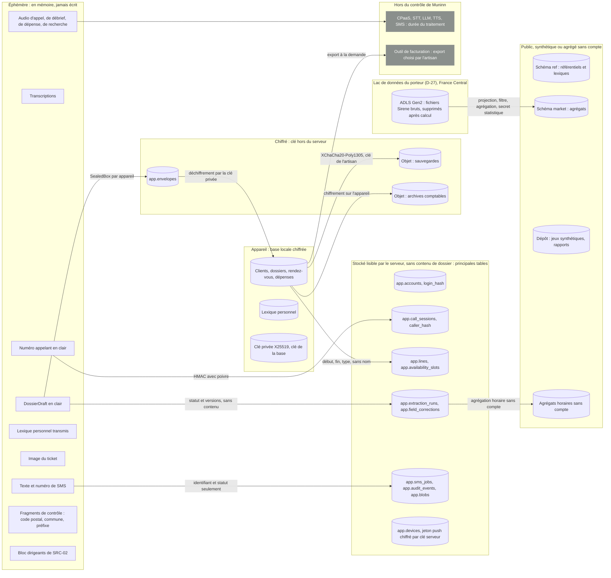

# Cartographie des données de Muninn

**Version :** 1.2
**Date :** 12 octobre 2026
**Historique :** la v1.1 applique la relecture croisée avec les documents 03 et 05 et les arbitrages A1 à A8 de l'orchestrateur.
La v1.2 ajoute DAT-76 (clé publique de récupération, D-28) et DAT-77 (clés d'idempotence),
précise DAT-08 (approbation des appareils), DAT-23 (destruction de l'image) et DAT-24
(`was_flagged`), et suit D-27 pour le traitement Sirene.
**Phase :** 1 (architecture de données)
**Statut :** proposition, à valider par le porteur
**Compétences servies :** C4 (base conforme au RGPD) ; préparation de C1, C2, C3 et C5
**Documents liés :** `02-modele-de-donnees.md` (tables citées ici), `03-acces-et-exposition.md`,
`05-registre-rgpd.md`, et en phase 0 : `01-user-stories.md`, `02-flux-de-donnees.md`,
`03-sources-de-donnees.md`

## 1. Objet et méthode

Ce document recense toutes les données que le projet manipule : les sources externes (SRC-01 à
SRC-14), les données produites par le service, les données de l'appareil, les journaux, les
métriques et les jeux d'évaluation. Chaque donnée porte un identifiant `DAT-xx`, stable, que les
autres documents de la phase 1 peuvent citer.

Pour chaque donnée, l'inventaire donne :

- son origine et son lieu de stockage ;
- son format ;
- sa sensibilité, selon quatre valeurs (section 2) ;
- la base légale pressentie et la durée de conservation, toutes deux marquées **[H]** : le
  registre des traitements (`05-registre-rgpd.md`) et l'AIPD les arrêtent ;
- les règles R1 à R10 de la passation back-end qu'elle engage ;
- la table du modèle de données qui la porte, ou « aucune » quand la donnée n'est jamais stockée.

Les volumes sont estimés en section 5, avec leur méthode de calcul, pour 100, 1 000 et 3 000
artisans.

**Ce que ce document ne fait pas.** Il ne fixe ni les droits d'accès (document 03) ni le registre
(document 05). Il ne contient aucune ligne de code.

## 2. Conventions

### 2.1 Lieux de stockage

| Code        | Lieu                                                                                                                                                                                                                                              |
| ----------- | ------------------------------------------------------------------------------------------------------------------------------------------------------------------------------------------------------------------------------------------------- |
| PG app      | PostgreSQL 16 du serveur, schéma `app` (métadonnées techniques)                                                                                                                                                                                   |
| PG ref      | PostgreSQL 16 du serveur, schéma `ref` (référentiels)                                                                                                                                                                                             |
| PG market   | PostgreSQL 16 du serveur, schéma `market` (agrégats du dimensionnement)                                                                                                                                                                           |
| Redis       | File de tâches ; identifiants opaques seulement (D-11)                                                                                                                                                                                            |
| Objet       | Stockage objet S3 compatible, région UE : deux compartiments, `backups` (versionnage désactivé, D-13) et `archives` ; clés d'objet aléatoires, sans identifiant de compte                                                                         |
| Big data    | Lac de données Azure (ADLS Gen2) et tâche planifiée Azure Container Apps qui interroge les fichiers Parquet en SQL avec un moteur en colonnes, en France Central, dans le groupe de ressources du porteur (décidé : D-27)                         |
| Mémoire     | Mémoire d'un composant du back-end (extraction, voice-gateway, relay, api, API des référentiels), le temps d'une requête ou d'un appel ; jamais écrit en clair sur disque, sauf fichier temporaire chiffré supprimé aussitôt (document 05, ST-02) |
| Appareil    | Base locale SQLite chiffrée du téléphone, ou coffre du système (Keystore, Keychain)                                                                                                                                                               |
| Journaux    | Outil de journalisation, après filtre de masquage (outil choisi en phase 2)                                                                                                                                                                       |
| Métriques   | Outil de métriques et de tableau de bord (outil choisi en phase 2)                                                                                                                                                                                |
| Secrets     | Gestionnaire de secrets ou variables d'environnement de l'hébergeur (R8)                                                                                                                                                                          |
| Dépôt       | Dépôt Git du projet (données synthétiques seulement, R9)                                                                                                                                                                                          |
| Hors dépôt  | Stockage chiffré hors du dépôt, accès restreint au porteur                                                                                                                                                                                        |
| Travail     | Zone de travail temporaire des workers ou du harnais, vidée après usage                                                                                                                                                                           |
| Fournisseur | Système d'un fournisseur (CPaaS, SMS, push, paiement), hors du contrôle de Muninn                                                                                                                                                                 |

### 2.2 Sensibilité

| Valeur                 | Signification                                                                                                    |
| ---------------------- | ---------------------------------------------------------------------------------------------------------------- |
| aucune                 | Aucune donnée relative à une personne physique : donnée publique, synthétique, ou agrégée sans colonne de compte |
| DP                     | Donnée personnelle lisible par celui qui la détient. Une donnée pseudonymisée (HMAC) reste une DP                |
| DP chiffrée            | Donnée personnelle chiffrée par une clé que le serveur ne détient pas                                            |
| donnée sensible exclue | Catégorie de l'article 9 du RGPD que le produit refuse de collecter (R7)                                         |

**Changement de classement par rapport à la phase 0.** Le document 02 de la phase 0 marquait
« aucune » les métadonnées techniques liées à un compte (clé publique, statut, compteur), avec une
réserve [H]. La phase 1 tranche autrement : toute ligne rattachée à un compte d'artisan est une DP
de l'artisan, même pseudonymisée. Une clé publique, un statut d'extraction ou un nom de champ
corrigé décrivent l'activité d'une personne identifiable par le serveur. Ce classement est plus
strict ; il ne change aucune mesure technique, mais il fait entrer ces tables dans le registre.

**Vocabulaire.** `account_id`, et tout identifiant qui y mène (`line_id`, `device_id`,
`call_session_id`), est un identifiant interne, rattaché à l'artisan : une ligne qui le porte est
une DP de l'artisan, de même qu'une métrique rattachée à un compte. Le mot « anonyme » n'est
employé qu'avec sa démonstration ; une table sans colonne de compte est dite « sans colonne de
compte », son anonymat restant à démontrer (cellules de moins de 5 non affichées [H]).

### 2.3 Bases légales pressenties

Toutes sont des hypothèses **[H]**, à arrêter dans le registre (document 05) et l'AIPD.

| Code       | Base (RGPD, article 6.1)                              | Rôle pressenti de Muninn                                                                                              |
| ---------- | ----------------------------------------------------- | --------------------------------------------------------------------------------------------------------------------- |
| Contrat    | b) exécution du contrat avec l'artisan                | Responsable de traitement                                                                                             |
| ST         | Sous-traitance (article 28) pour l'artisan            | Sous-traitant ; base de l'artisan : b) mesures précontractuelles à la demande du client final, ou f) intérêt légitime |
| Obligation | c) obligation légale (comptable, L123-22)             | Sous-traitant pour l'archive de l'artisan ; responsable pour sa propre facturation                                    |
| IL         | f) intérêt légitime (sécurité, qualité)               | Responsable de traitement                                                                                             |
| Public     | Données publiques sous licence ouverte                | Réutilisateur ; aucune DP traitée, sauf Sirene (SRC-01)                                                               |
| sans objet | Donnée synthétique, ou agrégée sans colonne de compte | Aucun traitement de DP                                                                                                |

### 2.4 Règles du projet

Les règles R1 à R10 viennent de la passation back-end. Elles priment sur toute autre
considération ; la colonne « Règles » de l'inventaire y renvoie.

| Règle | Énoncé                                                                                                                |
| ----- | --------------------------------------------------------------------------------------------------------------------- |
| R1    | Aucun dossier client stocké en clair côté serveur : le contenu est chiffré pour l'appareil avant tout stockage        |
| R2    | Audio détruit après extraction : jamais en base, en stockage objet ni dans les journaux ; test automatisé obligatoire |
| R3    | Transcriptions éphémères : elles n'existent que le temps de l'extraction, ni persistées ni journalisées               |
| R4    | Journaux sans données personnelles : ni nom, ni numéro, ni adresse, ni contenu ; identifiants hachés ou opaques       |
| R5    | Hébergement et traitement dans l'UE ; fournisseurs d'IA sur leur point UE, avec zéro rétention activée et vérifiée    |
| R6    | L'agent vocal s'annonce toujours, dès la première phrase, comme assistant automatique de l'artisan (D-04)             |
| R7    | Aucune donnée de santé : le prompt d'extraction n'en collecte aucune                                                  |
| R8    | Pas de secret dans le dépôt : variables d'environnement, `.env` exclu, `.env.example` maintenu                        |
| R9    | Aucune donnée réelle dans le dépôt : jeux de test synthétiques uniquement                                             |
| R10   | Aucune action payante ou irréversible sans accord : achat de numéro, compte fournisseur, SMS réel, déploiement        |

## 3. Vue par zone

La vue range chaque famille de données selon ce que le serveur peut en lire. Une flèche est une
transformation qui fait passer la donnée d'une zone à l'autre.

Lecture : la zone « Stocké lisible par le serveur » ne contient aucun contenu de dossier (R1). Le
seul chemin d'un dossier vers un stockage serveur passe par un chiffrement dont la clé reste sur
l'appareil ou chez l'artisan.

## 4. Inventaire

### 4.1 Sources externes

Les sources sont décrites en détail dans le document 03 de la phase 0. Cette table dit seulement
où leur contenu est gardé et sous quelle forme.

| ID     | Donnée                               | Origine                  | Stockage                                   | Format         | Sensibilité | Base légale [H]       | Conservation [H]                                                                          | Règles     | Table du modèle                                               |
| ------ | ------------------------------------ | ------------------------ | ------------------------------------------ | -------------- | ----------- | --------------------- | ----------------------------------------------------------------------------------------- | ---------- | ------------------------------------------------------------- |
| SRC-01 | Fichiers stock Sirene                | INSEE, data.gouv.fr      | Big data (fichiers bruts), puis PG market  | Parquet        | DP          | Public, IL            | Brut : supprimé à la fin du traitement, au plus tard sous 24 h ; stock précédent supprimé | R4, R9     | `market.sirene_runs`, `market.sirene_counts` (agrégats seuls) |
| SRC-02 | API Recherche d'entreprises          | Annuaire des Entreprises | Mémoire ; valeurs validées par l'artisan   | JSON           | DP          | Contrat               | Durée de la requête ; bloc `dirigeants` jamais stocké                                     | R4         | `app.lines` (nom d'entreprise, métier validés)                |
| SRC-03 | API Géo, liste des communes          | DINUM                    | Travail, puis écarts dans PG ref           | JSON           | aucune      | Public                | Écarts : durée de la version                                                              | R4         | `ref.commune_source_gaps`                                     |
| SRC-04 | Géocodage de la Géoplateforme        | IGN                      | Travail du harnais (adresses synthétiques) | JSON           | aucune      | sans objet            | Durée de la génération                                                                    | R9         | aucune (D-10 : jamais appelé avec une adresse réelle)         |
| SRC-05 | Base Adresse Nationale               | IGN et DINUM             | Travail, puis PG ref                       | CSV gzip       | aucune      | Public                | Version en service et précédente                                                          | sans objet | `ref.ban_streets`                                             |
| SRC-06 | Codes postaux                        | La Poste                 | Travail, puis PG ref                       | CSV ISO-8859-1 | aucune      | Public                | Version en service et précédente                                                          | sans objet | `ref.postal_codes`                                            |
| SRC-07 | Code officiel géographique           | INSEE                    | Travail, puis PG ref                       | CSV UTF-8      | aucune      | Public                | Version en service et précédente                                                          | sans objet | `ref.communes`                                                |
| SRC-08 | Jours fériés                         | DINUM                    | Travail, puis PG ref                       | JSON           | aucune      | Public                | Année en cours et suivante, version précédente                                            | sans objet | `ref.public_holidays`                                         |
| SRC-09 | Nomenclatures NAF                    | INSEE                    | Travail, puis PG ref                       | XLS, XLSX      | aucune      | Public                | Toutes les révisions utiles (rév. 2 et 2025)                                              | sans objet | `ref.naf_trades`                                              |
| SRC-10 | Séries Urssaf des auto-entrepreneurs | Urssaf                   | PG market                                  | JSON           | aucune      | Public (ODbL)         | 5 ans [H]                                                                                 | sans objet | `market.urssaf_series`                                        |
| SRC-11 | Wikidata                             | Wikimedia                | Travail, puis PG ref après relecture       | JSON           | aucune      | Public (CC0)          | Toutes les versions de lexique                                                            | sans objet | `ref.lexicon_terms`                                           |
| SRC-12 | Wiktionnaire                         | Wikimedia                | Travail, puis PG ref après relecture       | HTML           | aucune      | Public (CC BY-SA 4.0) | Toutes les versions de lexique                                                            | sans objet | `ref.lexicon_terms`                                           |
| SRC-13 | Numérotation ARCEP (MAJNUM)          | ARCEP                    | Travail, puis PG ref                       | CSV ANSI       | aucune      | Public                | Version en service et précédente                                                          | sans objet | `ref.numbering_ranges`                                        |
| SRC-14 | Fichier des prénoms                  | INSEE                    | Travail du harnais                         | CSV            | aucune      | Public                | Durée de la génération ; seuls les scénarios sont versionnés                              | R9         | aucune (scénarios dans le dépôt)                              |

### 4.2 Saisies manuelles de l'exploitant

| ID     | Donnée                                      | Origine                                     | Stockage | Format | Sensibilité | Base légale [H] | Conservation [H]     | Règles     | Table du modèle                |
| ------ | ------------------------------------------- | ------------------------------------------- | -------- | ------ | ----------- | --------------- | -------------------- | ---------- | ------------------------------ |
| DAT-01 | Codes de renvoi par opérateur               | Codes normalisés 3GPP, testés par opérateur | PG ref   | Table  | aucune      | sans objet      | Jusqu'à remplacement | sans objet | `ref.forwarding_codes`         |
| DAT-02 | Correspondance département vers zone fériée | Règle Alsace-Moselle [H : Code du travail]  | PG ref   | Table  | aucune      | sans objet      | Jusqu'à remplacement | sans objet | `ref.holiday_zone_departments` |
| DAT-03 | Termes de lexique saisis à la main          | Exploitant (dont tout le chauffage)         | PG ref   | Table  | aucune      | sans objet      | Toutes les versions  | sans objet | `ref.lexicon_terms`            |

### 4.3 Compte, appareils et ligne de l'artisan (serveur, persistant)

| ID     | Donnée                                                                                                                                                              | Origine                          | Stockage                             | Format                                 | Sensibilité | Base légale [H]     | Conservation [H]                                                                      | Règles     | Table du modèle                 |
| ------ | ------------------------------------------------------------------------------------------------------------------------------------------------------------------- | -------------------------------- | ------------------------------------ | -------------------------------------- | ----------- | ------------------- | ------------------------------------------------------------------------------------- | ---------- | ------------------------------- |
| DAT-04 | Identifiant de connexion (mobile ou e-mail)                                                                                                                         | Saisie de l'artisan              | PG app (empreinte) ; Mémoire         | HMAC-SHA256 avec poivre                | DP          | Contrat             | Durée du compte, puis 30 jours                                                        | R4         | `app.accounts`                  |
| DAT-05 | Code de connexion à usage unique                                                                                                                                    | Généré par l'api                 | PG app (empreinte)                   | Empreinte, compteur d'essais           | DP          | Contrat             | Validité 10 minutes ; empreinte purgée 24 heures après expiration                     | R4         | `app.otp_challenges`            |
| DAT-06 | Compte : statut, offre, fin d'essai, SIREN facultatif, référence client du prestataire de paiement                                                                  | Artisan, prestataire de paiement | PG app                               | Colonnes typées                        | DP          | Contrat             | Durée du contrat, puis 30 jours                                                       | R1         | `app.accounts`                  |
| DAT-07 | Données de carte bancaire                                                                                                                                           | Artisan                          | Fournisseur (paiement)               | Hors Muninn                            | DP          | Contrat, Obligation | Selon le prestataire                                                                  | R1         | aucune (référence opaque seule) |
| DAT-08 | Appareil : plateforme, clé publique X25519, dernière activité, approbation (date, appareil approbateur, méthode, empreinte du code, essais, expiration), révocation | App mobile, api                  | PG app                               | Octets (32), horodatages, liste fermée | DP          | Contrat             | Jusqu'à révocation, puis 30 jours ; empreinte du code effacée dès la fin de l'attente | R1         | `app.devices`                   |
| DAT-09 | Jeton push de l'appareil                                                                                                                                            | FCM ou APNs, via l'app           | PG app (chiffré par une clé serveur) | Octets chiffrés                        | DP          | Contrat             | Jusqu'à révocation ou renouvellement                                                  | R4         | `app.devices`                   |
| DAT-10 | Jeton d'authentification de l'appareil                                                                                                                              | Généré par l'api                 | PG app (empreinte)                   | SHA-256                                | DP          | Contrat             | Jusqu'à révocation, ou 90 jours sans usage                                            | R4         | `app.devices`                   |
| DAT-11 | Ligne : numéro Muninn, nom d'entreprise, prénom, métier, horaires, accueil personnalisé, prise de rendez-vous, durée de créneau, zone de jours fériés               | Artisan                          | PG app                               | Colonnes typées, JSON (horaires)       | DP          | Contrat             | Durée du contrat, puis 30 jours (cascade du compte)                                   | R6         | `app.lines`                     |
| DAT-12 | Jours fériés déclarés travaillés                                                                                                                                    | Artisan                          | PG app                               | Dates                                  | DP          | Contrat             | Jusqu'à la date passée                                                                | sans objet | `app.line_worked_holidays`      |
| DAT-13 | Fenêtre de test du renvoi et son résultat                                                                                                                           | Artisan, api                     | PG app                               | Horodatages, statut                    | DP          | Contrat             | 30 jours                                                                              | R2         | `app.forwarding_tests`          |
| DAT-14 | Créneaux libres ou occupés, sans nom                                                                                                                                | App mobile, voice-gateway        | PG app                               | Intervalles horodatés, type            | DP          | Contrat             | 14 jours glissants ; créneaux passés purgés                                           | R1, R4     | `app.availability_slots`        |
| DAT-76 | Clé publique de récupération, dérivée sur l'appareil de la phrase de récupération (D-28)                                                                            | App mobile                       | PG app                               | Octets (32)                            | DP          | Contrat             | Durée du compte, puis 30 jours (cascade du compte)                                    | R1         | `app.accounts`                  |
| DAT-77 | Clé d'idempotence d'une requête : clé, route, empreinte HMAC du corps, statut et corps de réponse sans DP                                                           | App mobile, api                  | PG app                               | UUID, empreinte, JSON                  | DP          | Contrat             | 24 heures                                                                             | R1, R4     | `app.idempotency_keys`          |

### 4.4 Appel, extraction et relais (serveur)

| ID     | Donnée                                                                                                                                                                            | Origine              | Stockage                                           | Format                                  | Sensibilité            | Base légale [H] | Conservation [H]                                       | Règles         | Table du modèle         |
| ------ | --------------------------------------------------------------------------------------------------------------------------------------------------------------------------------- | -------------------- | -------------------------------------------------- | --------------------------------------- | ---------------------- | --------------- | ------------------------------------------------------ | -------------- | ----------------------- |
| DAT-15 | Audio de l'appel                                                                                                                                                                  | Client final, CPaaS  | Mémoire (voice-gateway) ; Fournisseur              | Flux audio                              | DP                     | ST              | Fin de l'appel, bloc `finally`                         | R2, R5         | aucune                  |
| DAT-16 | Transcription de l'appel                                                                                                                                                          | STT                  | Mémoire (voice-gateway, extraction)                | Texte                                   | DP                     | ST              | Fin de l'extraction, même en cas d'erreur              | R3, R5         | aucune                  |
| DAT-17 | Numéro appelant en clair                                                                                                                                                          | CPaaS                | Mémoire ; puis dans l'enveloppe                    | E.164                                   | DP                     | ST              | Fin de la session d'appel                              | R1, R4         | aucune                  |
| DAT-18 | Empreinte du numéro appelant                                                                                                                                                      | api                  | PG app                                             | HMAC-SHA256 avec poivre                 | DP                     | IL              | 90 jours                                               | R4             | `app.call_sessions`     |
| DAT-19 | Métadonnées d'appel : horodatages, durée, statut, mode test, référence d'appel du CPaaS                                                                                           | CPaaS, api           | PG app                                             | Colonnes typées                         | DP                     | IL              | 90 jours                                               | R4             | `app.call_sessions`     |
| DAT-20 | `DossierDraft` en clair                                                                                                                                                           | extraction           | Mémoire (extraction, voice-gateway, relay, api)    | JSON                                    | DP                     | ST              | Jusqu'au chiffrement, ou à l'envoi de la réponse HTTPS | R1, R3         | aucune                  |
| DAT-21 | Enveloppe chiffrée pour un appareil                                                                                                                                               | relay                | PG app                                             | Octets (SealedBox)                      | DP chiffrée            | ST              | Accusé de réception, sinon 7 jours                     | R1             | `app.envelopes`         |
| DAT-22 | Notification push                                                                                                                                                                 | relay                | Fournisseur (push), transit                        | Texte fixe « Nouvelle demande »         | aucune                 | Contrat         | Durée de l'envoi                                       | R1, R4         | aucune                  |
| DAT-23 | Exécution d'extraction : source, statuts, versions, latences, jetons, coût, résultat du contrôle, horodatages de destruction (audio, transcription, image), décision de l'artisan | extraction, api      | PG app                                             | Colonnes typées                         | DP                     | IL              | 90 jours, puis agrégat sans colonne de compte          | R1, R4         | `app.extraction_runs`   |
| DAT-24 | Noms des champs corrigés, sans valeur, et indicateur « le champ était signalé à vérifier » (`was_flagged`)                                                                        | App mobile           | PG app                                             | Liste fermée de noms de champs, booléen | DP                     | IL              | 90 jours, puis agrégat sans colonne de compte          | R4             | `app.field_corrections` |
| DAT-25 | Fragments de contrôle : code postal, commune, préfixe de 7 chiffres                                                                                                               | extraction           | Mémoire (API des référentiels)                     | JSON dans le corps d'un POST            | DP                     | ST              | Durée de la requête ; jamais journalisés               | R4             | aucune                  |
| DAT-26 | Débrief dicté ou écrit                                                                                                                                                            | Artisan              | Mémoire (api, extraction) ; Fournisseur (STT, LLM) | Audio ou texte                          | DP                     | ST              | Fin de la requête                                      | R2, R3, R5, R7 | aucune                  |
| DAT-27 | Lexique personnel transmis avec un débrief                                                                                                                                        | App mobile           | Mémoire (api, extraction)                          | Liste de termes                         | DP                     | ST              | Fin de la requête (D-12)                               | R1, R4         | aucune                  |
| DAT-28 | Image du ticket envoyée au traitement                                                                                                                                             | Artisan              | Mémoire ; Fournisseur (LLM)                        | Image                                   | DP                     | ST              | Fin du traitement                                      | R1, R5         | aucune                  |
| DAT-29 | Dépense dite ou écrite                                                                                                                                                            | Artisan              | Mémoire ; Fournisseur (STT, LLM)                   | Audio ou texte                          | DP                     | ST              | Fin de la requête                                      | R2, R3, R5     | aucune                  |
| DAT-30 | Phrase de recherche ou d'imprévu dite                                                                                                                                             | Artisan              | Mémoire ; Fournisseur (STT)                        | Audio, texte                            | DP                     | ST              | Fin de la requête                                      | R2, R3         | aucune                  |
| DAT-31 | Texte et numéro d'un SMS                                                                                                                                                          | App mobile           | Mémoire ; Fournisseur (SMS)                        | Texte, E.164                            | DP                     | ST              | Réponse du fournisseur                                 | R1, R4, R10    | aucune                  |
| DAT-32 | Suivi d'envoi d'un SMS : référence du fournisseur, statut, type, segments                                                                                                         | Fournisseur SMS      | PG app                                             | Colonnes typées                         | DP                     | ST              | 90 jours                                               | R4             | `app.sms_jobs`          |
| DAT-33 | Bloc `dirigeants` de SRC-02                                                                                                                                                       | SRC-02               | Mémoire                                            | JSON                                    | DP                     | Contrat         | Écarté à la réception                                  | R4             | aucune                  |
| DAT-34 | Données de santé                                                                                                                                                                  | Propos d'un appelant | Jamais collectées                                  | sans objet                              | donnée sensible exclue | sans objet      | sans objet : refus par le prompt, test de conformité   | R7             | aucune                  |
| DAT-35 | Identifiants de tâches                                                                                                                                                            | api, workers         | Redis                                              | UUID opaques                            | aucune                 | sans objet      | Durée de la tâche                                      | R1, R3         | aucune                  |

### 4.5 Sauvegarde, archive et audit (serveur, persistant)

| ID     | Donnée                                                           | Origine    | Stockage | Format                         | Sensibilité | Base légale [H]                | Conservation [H]                                                                                                                           | Règles | Table du modèle    |
| ------ | ---------------------------------------------------------------- | ---------- | -------- | ------------------------------ | ----------- | ------------------------------ | ------------------------------------------------------------------------------------------------------------------------------------------ | ------ | ------------------ |
| DAT-36 | Blob de sauvegarde de la base locale                             | App mobile | Objet    | XChaCha20-Poly1305, opaque     | DP chiffrée | Contrat                        | Jusqu'au remplacement ; 30 jours après la clôture du compte                                                                                | R1     | `app.blobs`        |
| DAT-37 | Blob d'archive d'une pièce comptable                             | App mobile | Objet    | Chiffré sur l'appareil, opaque | DP chiffrée | Obligation                     | 10 ans à compter de la clôture de l'exercice comptable [H : article L123-22 du Code de commerce à relire], même après la clôture du compte | R1     | `app.blobs`        |
| DAT-38 | Métadonnées des blobs : clé d'objet, taille, empreinte, échéance | api        | PG app   | Colonnes typées                | DP          | Contrat, Obligation            | Durée de vie de l'objet                                                                                                                    | R1     | `app.blobs`        |
| DAT-39 | Événements d'audit sans donnée personnelle de client             | api        | PG app   | Type fermé, JSON sans DP       | DP          | IL (redevabilité, article 5.2) | 1 an                                                                                                                                       | R4     | `app.audit_events` |

### 4.6 Exploitation

| ID     | Donnée                                                                                                                 | Origine              | Stockage                          | Format                                                     | Sensibilité | Base légale [H] | Conservation [H]                                         | Règles     | Table du modèle                                             |
| ------ | ---------------------------------------------------------------------------------------------------------------------- | -------------------- | --------------------------------- | ---------------------------------------------------------- | ----------- | --------------- | -------------------------------------------------------- | ---------- | ----------------------------------------------------------- |
| DAT-40 | Journal applicatif de diagnostic, après masquage                                                                       | Tous composants      | Journaux                          | Lignes JSON, `request_id`                                  | DP          | IL              | 30 jours                                                 | R3, R4     | aucune (hors base)                                          |
| DAT-74 | Journal d'accès et de sécurité, adresse IP comprise                                                                    | Proxy, api           | Journaux                          | Lignes JSON                                                | DP          | IL              | 6 mois                                                   | R4         | aucune (hors base)                                          |
| DAT-41 | Métriques techniques : latences, santé, files                                                                          | Tous composants      | Métriques                         | Séries temporelles                                         | aucune      | IL              | 13 mois                                                  | R4         | aucune (hors base)                                          |
| DAT-42 | Agrégats horaires de qualité, sans colonne de compte ; anonymat à démontrer : cellules de moins de 5 non affichées [H] | workers              | PG app                            | Compteurs, quantiles                                       | aucune      | IL              | 13 mois                                                  | R4         | `app.extraction_metrics_hourly`, `app.field_metrics_hourly` |
| DAT-43 | Identifiants des webhooks traités                                                                                      | CPaaS, SMS, paiement | PG app                            | Identifiants du fournisseur                                | aucune      | Contrat         | 7 jours                                                  | sans objet | `app.processed_webhooks`                                    |
| DAT-44 | Journal des purges                                                                                                     | workers              | PG app                            | Nom de tâche, nombres                                      | aucune      | IL              | 13 mois                                                  | R4         | `app.purge_runs`                                            |
| DAT-45 | Secrets : poivre HMAC, clé de chiffrement des jetons push, clés d'API, jetons de service                               | Exploitant           | Secrets                           | Valeurs secrètes                                           | aucune      | sans objet      | Jusqu'à rotation                                         | R8         | aucune (jamais en base ni dans le dépôt)                    |
| DAT-75 | Sauvegardes de la base PostgreSQL                                                                                      | Hébergeur            | Sauvegardes gérées de l'hébergeur | Copie chiffrée au repos des schémas `app`, `ref`, `market` | DP          | IL              | 30 jours ; toute purge des tables est prolongée d'autant | R1, R4, R5 | aucune (copie de toutes les tables)                         |
| DAT-46 | Journaux d'appel et d'envoi des fournisseurs                                                                           | CPaaS, SMS           | Fournisseur                       | Propre au fournisseur                                      | DP          | ST              | Selon le contrat (P-13)                                  | R2, R4, R5 | aucune                                                      |

### 4.7 Référentiels et agrégats (serveur)

| ID     | Donnée                                                         | Origine           | Stockage  | Format          | Sensibilité | Base légale [H] | Conservation [H]                                           | Règles     | Table du modèle                                |
| ------ | -------------------------------------------------------------- | ----------------- | --------- | --------------- | ----------- | --------------- | ---------------------------------------------------------- | ---------- | ---------------------------------------------- |
| DAT-47 | Versions des jeux chargés et rapports de chargement            | workers           | PG ref    | Colonnes typées | aucune      | sans objet      | 2 ans                                                      | sans objet | `ref.dataset_versions`                         |
| DAT-48 | Lignes rejetées au chargement                                  | workers           | PG ref    | Motif, extrait  | aucune      | sans objet      | Durée de la version                                        | sans objet | `ref.load_rejections`                          |
| DAT-49 | Version de test du référentiel de numérotation (plage fictive) | Exploitant        | PG ref    | Table           | aucune      | sans objet      | Durée de la démo et de l'évaluation ; jamais en production | R9         | `ref.numbering_ranges`, `ref.dataset_versions` |
| DAT-50 | Fichiers bruts téléchargés                                     | Sources publiques | Travail   | CSV, JSON, HTML | aucune      | Public          | Supprimés après publication de la version                  | sans objet | aucune                                         |
| DAT-51 | Comptages Sirene après secret statistique                      | Big data          | PG market | Table           | aucune      | IL              | 5 ans                                                      | R4, R9     | `market.sirene_counts`                         |
| DAT-52 | Mesures d'exécution du traitement Sirene                       | Big data          | PG market | Table           | aucune      | sans objet      | 5 ans                                                      | sans objet | `market.sirene_runs`                           |
| DAT-53 | Encadrement du marché                                          | Calcul du porteur | PG market | Table           | aucune      | sans objet      | 5 ans                                                      | sans objet | `market.market_estimates`                      |

### 4.8 Évaluation et démonstration

| ID     | Donnée                                               | Origine                 | Stockage                                  | Format       | Sensibilité | Base légale [H]                                                            | Conservation [H]        | Règles    | Table du modèle   |
| ------ | ---------------------------------------------------- | ----------------------- | ----------------------------------------- | ------------ | ----------- | -------------------------------------------------------------------------- | ----------------------- | --------- | ----------------- |
| DAT-54 | Scénarios synthétiques et vérité terrain             | Harnais, SRC-04, SRC-14 | Dépôt                                     | Texte, JSON  | aucune      | sans objet                                                                 | Versionnés              | R9        | aucune (fichiers) |
| DAT-55 | Audio synthétique des scénarios (TTS et bruit)       | Harnais                 | Hors dépôt Git [H : stockage d'artefacts] | Audio        | aucune      | sans objet                                                                 | Versionné par empreinte | R9        | aucune (fichiers) |
| DAT-56 | Tickets synthétiques                                 | Harnais                 | Dépôt                                     | Images, JSON | aucune      | sans objet                                                                 | Versionnés              | R9        | aucune (fichiers) |
| DAT-57 | Rapports d'évaluation                                | Harnais                 | Dépôt (`eval/reports/`)                   | Markdown     | aucune      | sans objet                                                                 | Versionnés              | R9        | aucune (fichiers) |
| DAT-58 | Jeu réel du POC (50 appels)                          | Non constitué           | Hors dépôt, chiffré, s'il existe un jour  | Audio, JSON  | DP          | À déterminer : consentement ou intérêt légitime (document 05, RT-06, Q-11) | Fin du POC plus 3 mois  | R9        | aucune            |
| DAT-59 | Brouillon synthétique affiché par la console de démo | api                     | Navigateur, session                       | JSON         | DP          | sans objet (synthétique)                                                   | Fermeture de la console | R1 (P-03) | aucune            |

DAT-59 est marqué DP comme dans le document 02 de la phase 0 : la démo montre le chemin de
production, et le code qui traite ces données synthétiques est celui qui traitera des données
réelles (écart P-03, décision D-07).

### 4.9 Appareil de l'artisan

L'artisan est responsable des données de ses clients. Muninn fournit l'outil ; il ne lit pas ces
données (R1). Les durées de conservation sont donc des réglages proposés à l'artisan.

| ID     | Donnée                                                                                           | Origine                         | Stockage                                | Format                              | Sensibilité | Base légale [H]        | Conservation [H]                                                                                                                                                                            | Règles     | Table du modèle                    |
| ------ | ------------------------------------------------------------------------------------------------ | ------------------------------- | --------------------------------------- | ----------------------------------- | ----------- | ---------------------- | ------------------------------------------------------------------------------------------------------------------------------------------------------------------------------------------- | ---------- | ---------------------------------- |
| DAT-60 | Clients : nom, prénom, téléphone, adresse                                                        | Enveloppes, débriefs, saisie    | Appareil                                | SQLite chiffrée                     | DP chiffrée | Base de l'artisan : b) | Relation commerciale, puis effacement proposé à 3 ans                                                                                                                                       | R1         | `clients`                          |
| DAT-61 | Dossiers et demandes successives                                                                 | Enveloppes, débriefs            | Appareil                                | SQLite chiffrée                     | DP chiffrée | Base de l'artisan : b) | Comme le client                                                                                                                                                                             | R1         | `cases`, `case_requests`           |
| DAT-62 | Brouillons reçus en attente                                                                      | Enveloppes, réponses HTTPS      | Appareil                                | SQLite chiffrée, JSON               | DP chiffrée | Base de l'artisan : b) | Jusqu'à validation ou rejet                                                                                                                                                                 | R1         | `inbox_drafts`                     |
| DAT-63 | Rendez-vous                                                                                      | Agent, artisan                  | Appareil                                | SQLite chiffrée                     | DP chiffrée | Base de l'artisan : b) | Comme le dossier                                                                                                                                                                            | R1         | `appointments`                     |
| DAT-64 | Actions à faire                                                                                  | Brouillons, artisan             | Appareil                                | SQLite chiffrée                     | DP chiffrée | Base de l'artisan : b) | Comme le dossier                                                                                                                                                                            | R1         | `actions`                          |
| DAT-65 | Dépenses et encaissements                                                                        | Tickets, dictées, saisie        | Appareil                                | SQLite chiffrée                     | DP chiffrée | Base de l'artisan : c) | Dépenses : 10 ans à compter de la clôture de l'exercice comptable, détachées du dossier effacé ; encaissements : comme le dossier, les écritures légales vivant dans l'outil de facturation | R1         | `expenses`, `payments`             |
| DAT-66 | Pièces jointes : images de tickets, factures                                                     | Appareil photo, plateforme (V2) | Appareil (fichiers chiffrés)            | Image, PDF                          | DP chiffrée | Base de l'artisan : c) | 12 mois sur l'appareil, puis archive seule                                                                                                                                                  | R1         | `attachments`                      |
| DAT-67 | Historique des SMS envoyés                                                                       | App mobile                      | Appareil                                | SQLite chiffrée                     | DP chiffrée | Base de l'artisan : b) | Comme le dossier                                                                                                                                                                            | R1         | `sms_messages`                     |
| DAT-68 | Historique des exports ; fichier exporté                                                         | App mobile                      | Appareil ; fichier choisi par l'artisan | SQLite chiffrée ; format de l'outil | DP chiffrée | Base de l'artisan : b) | Comme le dossier ; fichier hors Muninn                                                                                                                                                      | R1         | `exports`                          |
| DAT-69 | Lexique personnel                                                                                | Corrections de l'artisan        | Appareil                                | SQLite chiffrée                     | DP chiffrée | Base de l'artisan : f) | Jusqu'à suppression du terme ou du client lié                                                                                                                                               | R1, R4     | `personal_lexicon_terms`           |
| DAT-70 | Débriefs et dépenses en attente de réseau                                                        | Artisan                         | Appareil (fichiers chiffrés)            | Audio ou texte chiffré              | DP chiffrée | Base de l'artisan : b) | Jusqu'à l'envoi réussi                                                                                                                                                                      | R2         | `pending_submissions`              |
| DAT-71 | Réglages locaux                                                                                  | Artisan                         | Appareil                                | Clé et valeur                       | DP chiffrée | Contrat                | Durée d'installation                                                                                                                                                                        | sans objet | `settings`                         |
| DAT-72 | Clé privée X25519 et clé de la base locale                                                       | Générées sur l'appareil         | Appareil (Keystore, Keychain)           | Octets                              | aucune      | sans objet             | Durée d'installation ; jamais transmises                                                                                                                                                    | R1         | aucune (coffre du système)         |
| DAT-73 | Phrase de récupération (clé de sauvegarde et d'archive ; approbation d'un nouvel appareil, D-28) | Générée sur l'appareil          | Détenue par l'artisan seul              | Mots                                | aucune      | sans objet             | Sous la garde de l'artisan (D-14) ; seule la clé publique dérivée (DAT-76) est transmise                                                                                                    | R1         | aucune (jamais stockée par Muninn) |

Les clés (DAT-72, DAT-73) sont classées « aucune » parce qu'elles ne décrivent personne. Leur
criticité est maximale : leur fuite rend lisibles toutes les DP chiffrées de l'artisan.

## 5. Volumes estimés

### 5.1 Hypothèses d'usage

Aucune donnée d'usage réelle n'existe : pas de POC terrain. Toutes les valeurs ci-dessous sont des
hypothèses **[H]**, choisies pour majorer plutôt que minorer. Elles seront remplacées par des
mesures dès les premiers artisans.

| Code  | Hypothèse [H]                                                                         | Valeur                                                                                                                                                             |
| ----- | ------------------------------------------------------------------------------------- | ------------------------------------------------------------------------------------------------------------------------------------------------------------------ |
| HV-01 | Jours ouvrés par mois                                                                 | 21                                                                                                                                                                 |
| HV-02 | Appels pris par l'agent, par artisan                                                  | 3 par jour ouvré, 63 par mois                                                                                                                                      |
| HV-03 | Débriefs par artisan                                                                  | 2 par jour ouvré, 42 par mois                                                                                                                                      |
| HV-04 | Tickets photographiés par artisan                                                     | 1 par jour ouvré, 21 par mois                                                                                                                                      |
| HV-05 | Dépenses dictées par artisan                                                          | 10 par mois                                                                                                                                                        |
| HV-06 | SMS par artisan                                                                       | 47 par mois : 42 rappels (2 rendez-vous par jour ouvré × 21, un rappel chacun) et 5 SMS d'imprévu                                                                  |
| HV-07 | Appareils actifs par compte                                                           | 1,2                                                                                                                                                                |
| HV-08 | Nouveaux dossiers par artisan                                                         | 50 par mois                                                                                                                                                        |
| HV-09 | Champs corrigés par brouillon validé                                                  | 0,5 en moyenne                                                                                                                                                     |
| HV-10 | Taille d'un `DossierDraft` 1.1 en JSON                                                | 2 Ko                                                                                                                                                               |
| HV-11 | Taille d'une image de ticket compressée                                               | 150 Ko                                                                                                                                                             |
| HV-12 | Facteur appliqué au volume brut des lignes (index, en-têtes, marge)                   | 2                                                                                                                                                                  |
| HV-13 | Requêtes HTTP par artisan et par jour ; lignes de journal par requête                 | 40 ; 5 lignes de diagnostic de 400 octets et 1 ligne d'accès de 300 octets                                                                                         |
| HV-14 | Créneaux publiés par artisan sur la fenêtre de 14 jours                               | 60 (environ 4 créneaux libres ou occupés par jour, plus les réservations de l'agent)                                                                               |
| HV-15 | Événements d'audit par artisan                                                        | 20 par mois                                                                                                                                                        |
| HV-16 | Combinaisons actives des agrégats horaires                                            | Extraction : 4 sources × 2 versions de prompt × 1 schéma × 1 modèle × 2 valeurs de `is_synthetic` = 16 ; champs : 21 champs × 2 versions de prompt × 1 schéma = 42 |
| HV-17 | Taille d'un dossier dans la base locale (demandes, rendez-vous, actions, SMS compris) | 4 Ko                                                                                                                                                               |
| HV-18 | Clients par artisan et par an                                                         | 500                                                                                                                                                                |
| HV-19 | Rendez-vous par artisan et par an                                                     | 500                                                                                                                                                                |
| HV-20 | Actions par artisan et par an                                                         | 1 000                                                                                                                                                              |

Méthode générale pour une table : lignes conservées = flux par artisan × durée de conservation ×
nombre d'artisans ; volume = lignes × taille moyenne d'une ligne × HV-12. La taille moyenne d'une
ligne est estimée à partir des types du modèle physique (document 02).

### 5.2 Serveur, schéma `app`

| ID     | Table ou donnée                          | Méthode de calcul                                                                                 | 100 artisans           | 1 000 artisans                      | 3 000 artisans                      |
| ------ | ---------------------------------------- | ------------------------------------------------------------------------------------------------- | ---------------------- | ----------------------------------- | ----------------------------------- |
| DAT-04 | `app.accounts`                           | 1 ligne par artisan × 500 octets × 2                                                              | 100 lignes ; 0,1 Mo    | 1 000 lignes ; 1 Mo                 | 3 000 lignes ; 3 Mo                 |
| DAT-08 | `app.devices`                            | 1,2 ligne par artisan (HV-07) × 400 octets × 2                                                    | 120 lignes ; 0,1 Mo    | 1 200 lignes ; 1 Mo                 | 3 600 lignes ; 3 Mo                 |
| DAT-11 | `app.lines`                              | 1 ligne par artisan × 2 Ko × 2                                                                    | 100 lignes ; 0,4 Mo    | 1 000 lignes ; 4 Mo                 | 3 000 lignes ; 12 Mo                |
| DAT-14 | `app.availability_slots`                 | 60 créneaux (HV-14) × 150 octets × 2                                                              | 6 000 lignes ; 1,8 Mo  | 60 000 lignes ; 18 Mo               | 180 000 lignes ; 54 Mo              |
| DAT-19 | `app.call_sessions`                      | 63 par mois × 3 mois × 200 octets × 2                                                             | 18 900 lignes ; 7,6 Mo | 189 000 lignes ; 76 Mo              | 567 000 lignes ; 227 Mo             |
| DAT-23 | `app.extraction_runs`                    | (63 + 42 + 21 + 10) par mois × 3 mois × 300 octets × 2                                            | 40 800 lignes ; 24 Mo  | 408 000 lignes ; 245 Mo             | 1 224 000 lignes ; 734 Mo           |
| DAT-24 | `app.field_corrections`                  | 408 brouillons × 0,5 champ (HV-09) × 80 octets × 2                                                | 20 400 lignes ; 3,3 Mo | 204 000 lignes ; 33 Mo              | 612 000 lignes ; 98 Mo              |
| DAT-21 | `app.envelopes`, pire cas                | Tous les appareils hors ligne 7 jours : 63 / 30 × 7 × 1,2 = 17,6 lignes × 2,1 Ko × 2              | 1 760 lignes ; 7,4 Mo  | 17 600 lignes ; 74 Mo               | 52 800 lignes ; 222 Mo              |
| DAT-21 | `app.envelopes`, flux mensuel            | 63 × 1,2 lignes écrites puis supprimées par artisan                                               | 7 560 lignes par mois  | 75 600 lignes par mois              | 226 800 lignes par mois             |
| DAT-32 | `app.sms_jobs`                           | 47 par mois (HV-06) × 3 mois × 200 octets × 2                                                     | 14 100 lignes ; 5,6 Mo | 141 000 lignes ; 56 Mo              | 423 000 lignes ; 169 Mo             |
| DAT-38 | `app.blobs`, archives, par an            | 21 pièces par mois × 12 × 250 octets × 2                                                          | 25 200 lignes ; 13 Mo  | 252 000 lignes ; 126 Mo             | 756 000 lignes ; 378 Mo             |
| DAT-39 | `app.audit_events`, par an               | 20 événements par mois (HV-15) × 12 × 300 octets × 2                                              | 24 000 lignes ; 14 Mo  | 240 000 lignes ; 144 Mo             | 720 000 lignes ; 432 Mo             |
| DAT-77 | `app.idempotency_keys`, 24 heures        | 7 requêtes avec clé par artisan et par jour [H : SMS, archives, revues, accusés] × 400 octets × 2 | 700 lignes ; 0,6 Mo    | 7 000 lignes ; 5,6 Mo               | 21 000 lignes ; 17 Mo               |
| DAT-42 | `app.extraction_metrics_hourly`, 13 mois | 13 × 730 = 9 490 heures × 16 combinaisons (HV-16) × 200 octets × 2, borne haute                   | 151 840 lignes ; 61 Mo | Même borne : 151 840 lignes ; 61 Mo | Même borne : 151 840 lignes ; 61 Mo |
| DAT-42 | `app.field_metrics_hourly`, 13 mois      | 9 490 heures × 42 combinaisons (HV-16) × 100 octets × 2, borne haute                              | 398 580 lignes ; 80 Mo | Même borne : 398 580 lignes ; 80 Mo | Même borne : 398 580 lignes ; 80 Mo |

Les agrégats ne dépendent pas du nombre d'artisans : une ligne n'existe que pour une heure et une
combinaison actives. La borne haute suppose toutes les combinaisons actives à toute heure.

Ordre de grandeur pour 3 000 artisans : environ 2,5 Go la première année, dont près de 30 % pour
`app.extraction_runs`. Le volume n'impose ni partitionnement ni répartition sur plusieurs
serveurs. Deux tables ont un renouvellement fort : `app.envelopes` (écritures puis suppressions
rapides) et `app.availability_slots` (fenêtre remplacée à chaque synchronisation). Elles demandent
un réglage de l'autovacuum, à mesurer en phase 3.

**Point d'attention sur l'archive.** Les métadonnées d'archive s'accumulent pendant 10 ans : pour
3 000 artisans, 7,6 millions de lignes et environ 3,8 Go en régime établi. Si le nombre d'objets
pèse sur le coût du stockage objet, l'appareil peut regrouper les pièces d'un mois dans un seul
blob [H : coût par objet du fournisseur à lire, ADR-06].

### 5.3 Stockage objet

| ID     | Donnée                 | Méthode de calcul                                                                          | 100 artisans | 1 000 artisans | 3 000 artisans |
| ------ | ---------------------- | ------------------------------------------------------------------------------------------ | ------------ | -------------- | -------------- |
| DAT-36 | Sauvegardes, année 1   | 1 blob par artisan : base locale sans images, 600 dossiers (HV-08) × 4 Ko (HV-17) = 2,4 Mo | 0,24 Go      | 2,4 Go         | 7,2 Go         |
| DAT-37 | Archives, par an       | 21 × 12 × 150 Ko (HV-11) = 37,8 Mo par artisan                                             | 3,8 Go       | 38 Go          | 113 Go         |
| DAT-37 | Archives, après 10 ans | Volume annuel × 10                                                                         | 38 Go        | 378 Go         | 1,13 To        |

La sauvegarde exclut les images : elles sont dans l'archive, que l'appareil peut retélécharger et
déchiffrer avec la même phrase de récupération [H]. Le coût du stockage n'est pas chiffré ici :
il dépend du fournisseur (ADR-06), dont les prix n'ont pas été lus.

### 5.4 Référentiels

Ces volumes ne dépendent pas du nombre d'artisans. Deux versions sont gardées (en service et
précédente).

| ID     | Table                     | Méthode de calcul                                                                       | Lignes par version         | Volume pour 2 versions |
| ------ | ------------------------- | --------------------------------------------------------------------------------------- | -------------------------- | ---------------------- |
| SRC-07 | `ref.communes`            | Lignes du COG 2026, mesurées (document 03 de la phase 0)                                | 37 496 lignes              | 23 Mo                  |
| SRC-06 | `ref.postal_codes`        | Lignes de La Poste, mesurées                                                            | 39 192 lignes              | 24 Mo                  |
| SRC-13 | `ref.numbering_ranges`    | Tranches MAJNUM, mesurées                                                               | 20 886 lignes              | 10 Mo                  |
| SRC-08 | `ref.public_holidays`     | 13 zones × 2 années × 13 jours au plus                                                  | 338 lignes au plus         | 0,1 Mo                 |
| SRC-05 | `ref.ban_streets`, MVP    | Sous-ensemble de 3 départements [H] ; nombre de voies à mesurer au chargement           | 100 000 lignes [H]         | 60 Mo [H]              |
| SRC-05 | `ref.ban_streets`, France | 26 118 629 adresses ; 10 adresses par voie en moyenne [H]                               | 2,6 millions de lignes [H] | 1,6 Go [H]             |
| DAT-03 | `ref.lexicon_terms`       | 1 749 pages candidates (document 03 de la phase 0) et saisies ; toutes versions gardées | 3 000 lignes au plus [H]   | 2 Mo                   |

### 5.5 Dimensionnement Sirene et agrégats `market`

| ID     | Donnée                 | Méthode de calcul                                                                                         | Lignes                                                                              | Volume                                                                |
| ------ | ---------------------- | --------------------------------------------------------------------------------------------------------- | ----------------------------------------------------------------------------------- | --------------------------------------------------------------------- |
| SRC-01 | Fichiers Sirene bruts  | Parquet mesuré : 2 220 887 978 + 713 585 991 octets (document 03 de la phase 0)                           | 74 430 765 lignes lues                                                              | 2,93 Go, supprimés à la fin du traitement, au plus tard sous 24 h [H] |
| DAT-51 | `market.sirene_counts` | 4 codes NAF × 4 tranches × 4 groupes juridiques × 102 départements (101, plus `ZZ`), plus les totaux `FR` | 6 528 lignes au plus, plus 64 totaux                                                | Moins de 2 Mo par exécution                                           |
| SRC-10 | `market.urssaf_series` | Séries trimestrielles nationales et départementales (document 03 de la phase 0)                           | 154 241 lignes au plus (2 448 nationales et 151 793 départementales, tous secteurs) | 31 Mo                                                                 |

### 5.6 Journaux, sauvegardes de la base et appareil

| ID     | Donnée                                 | Méthode de calcul                                                                                           | 100 artisans            | 1 000 artisans          | 3 000 artisans          |
| ------ | -------------------------------------- | ----------------------------------------------------------------------------------------------------------- | ----------------------- | ----------------------- | ----------------------- |
| DAT-40 | Journal de diagnostic, 30 jours        | 40 requêtes × 5 lignes × 400 octets × 30 jours = 2,4 Mo par artisan                                         | 0,24 Go                 | 2,4 Go                  | 7,2 Go                  |
| DAT-74 | Journal d'accès et de sécurité, 6 mois | 40 requêtes × 1 ligne × 300 octets × 182 jours = 2,2 Mo par artisan                                         | 0,22 Go                 | 2,2 Go                  | 6,6 Go                  |
| DAT-41 | Métriques techniques                   | Quelques centaines de séries, indépendantes du nombre d'artisans [H]                                        | Moins de 1 Go           | Moins de 1 Go           | Moins de 1 Go           |
| DAT-75 | Sauvegardes de la base, 30 jours       | 30 sauvegardes complètes de la base, borne haute [H : l'hébergeur peut faire des sauvegardes incrémentales] | 30 × 0,5 Go = 15 Go [H] | 30 × 1,1 Go = 33 Go [H] | 30 × 2,7 Go = 81 Go [H] |

Taille de la base retenue pour DAT-75 [H] : schéma `app` de la section 5.2, plus environ 0,2 Go de
référentiels et d'agrégats horaires, arrondie.

Hors stockage objet et sauvegardes de la base, les journaux sont le premier poste de volume du
serveur : 13,8 Go pour 3 000 artisans (diagnostic et accès), contre environ 2,5 Go pour le schéma
`app`. Leurs durées (30 jours et 6 mois [H]) sont un levier direct de coût et de minimisation.

Base locale d'un artisan, après un an : environ 600 dossiers (HV-08), 500 clients (HV-18), 1 260
demandes, 500 rendez-vous (HV-19), 1 000 actions (HV-20), 370 dépenses, 560 SMS, soit environ
5 000 lignes. Sa taille, 600 dossiers × 4 Ko (HV-17) = 2,4 Mo [H], est celle de la sauvegarde
(section 5.3). S'y ajoutent 38 Mo d'images de tickets gardées 12 mois. Ce volume rend inutile
tout index spécialisé sur l'appareil (document 02, section 7).

Jeux d'évaluation : 100 scénarios × 5 Ko de texte et de vérité terrain = 0,5 Mo dans le dépôt.
L'audio synthétique pèse 100 × 2 minutes × 16 000 échantillons par seconde × 2 octets = 384 Mo
en WAV mono : il reste hors de Git (DAT-55) [H : format compressé à choisir en phase 2].

## 6. Contrôles de complétude

| Contrôle                                                        | Résultat                                                                                                                                                                                                     |
| --------------------------------------------------------------- | ------------------------------------------------------------------------------------------------------------------------------------------------------------------------------------------------------------ |
| Chaque source SRC-01 à SRC-14 a une ligne                       | Oui : 14 lignes en section 4.1                                                                                                                                                                               |
| Chaque donnée stockée a une table du modèle                     | Oui, sauf les fichiers (dépôt, objet, travail), les journaux (DAT-40, DAT-74) et les sauvegardes de la base (DAT-75), dont le lieu est nommé                                                                 |
| Chaque donnée DP stockée lisible par le serveur est minimisée   | Oui : empreintes (DAT-04, DAT-05, DAT-10, DAT-18, empreinte du code d'approbation de DAT-08, corps de requête de DAT-77), jeton push chiffré (DAT-09), clé publique seule (DAT-76), aucun contenu de dossier |
| Chaque donnée éphémère a un moment de destruction               | Oui : colonne « Conservation » de la section 4.4                                                                                                                                                             |
| Chaque table du modèle a au moins une donnée de la cartographie | Oui : vérifié table par table dans le document 02, section 11.3                                                                                                                                              |
| Les données de santé sont tracées                               | Oui : DAT-34, exclues (R7)                                                                                                                                                                                   |
| Les durées sont celles du registre (document 05, section 7)     | Oui, après les arbitrages A5 ; contrôle par script croisé des documents 01, 02, 03 et 05 le 12 octobre 2026                                                                                                  |
| Chaque volume repose sur une hypothèse nommée                   | Oui : HV-01 à HV-20, ou une mesure du document 03 de la phase 0                                                                                                                                              |

## 7. Points ouverts

| ID    | Point                                                                                                                                                                                            | Proposition                                                                                                                                                                         |
| ----- | ------------------------------------------------------------------------------------------------------------------------------------------------------------------------------------------------ | ----------------------------------------------------------------------------------------------------------------------------------------------------------------------------------- |
| CA-01 | D-09 externalise le traitement Sirene, alors que le flux F-10 de la phase 0 décrivait un poste de calcul                                                                                         | Clos par D-27 : lac ADLS Gen2 et tâche Container Apps en France Central ; F-10 est mis à jour. Les fichiers bruts sont supprimés à la fin du traitement, au plus tard sous 24 h [H] |
| CA-02 | Conservation de l'archive après la clôture du compte (10 ans, DAT-37) : Muninn garde des objets qu'il ne peut ni lire ni rattacher à un compte actif                                             | Clause du contrat d'abonnement ; décision du porteur et avis juridique                                                                                                              |
| CA-03 | Durées de conservation des journaux (30 jours pour le diagnostic, 6 mois pour l'accès et la sécurité), des sessions d'appel (90 jours), de l'audit (1 an), des sauvegardes de la base (30 jours) | À arrêter dans le registre (document 05) et l'AIPD                                                                                                                                  |
| CA-04 | Volumes fondés sur des hypothèses d'usage, sans mesure réelle                                                                                                                                    | Remplacer HV-01 à HV-20 par des mesures dès les premiers artisans                                                                                                                   |
| CA-05 | Nombre de voies de la BAN                                                                                                                                                                        | Mesurer au premier chargement (phase 3)                                                                                                                                             |
