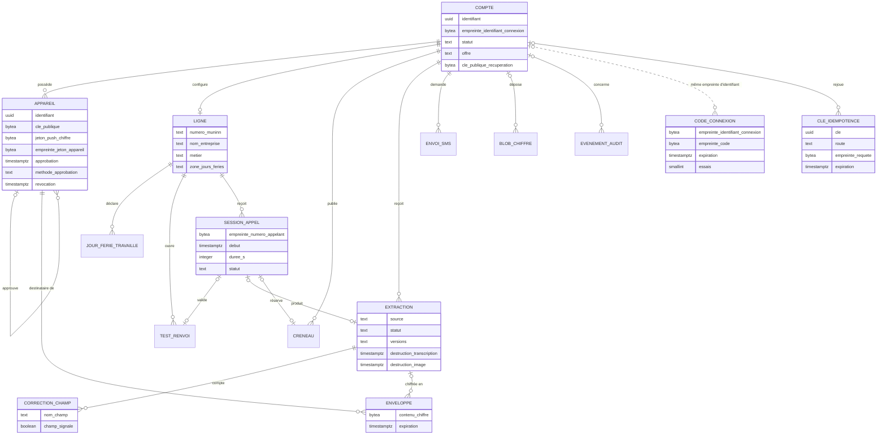
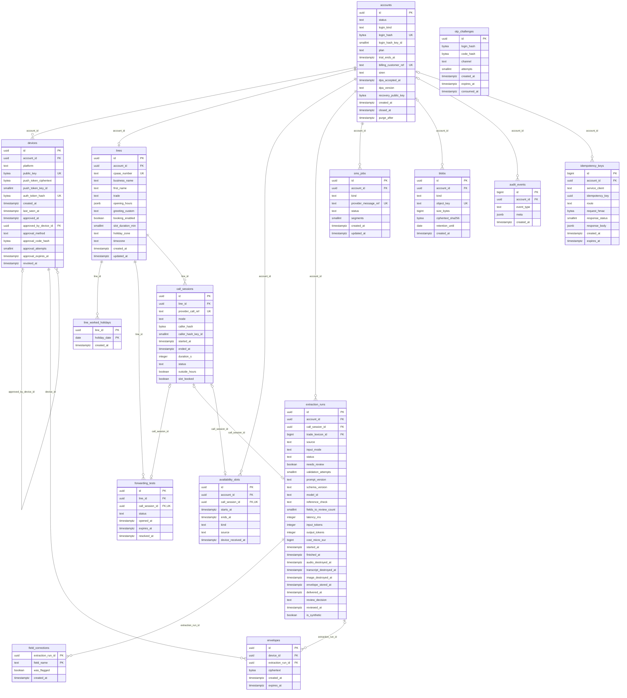
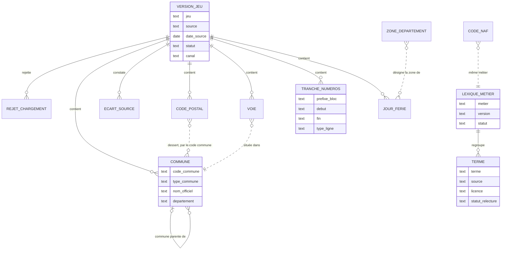
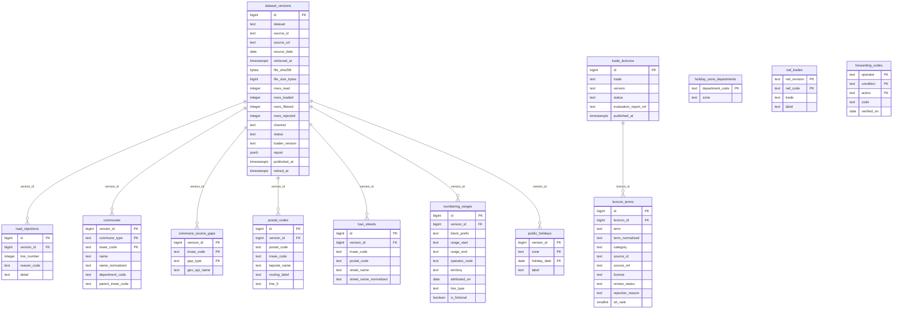
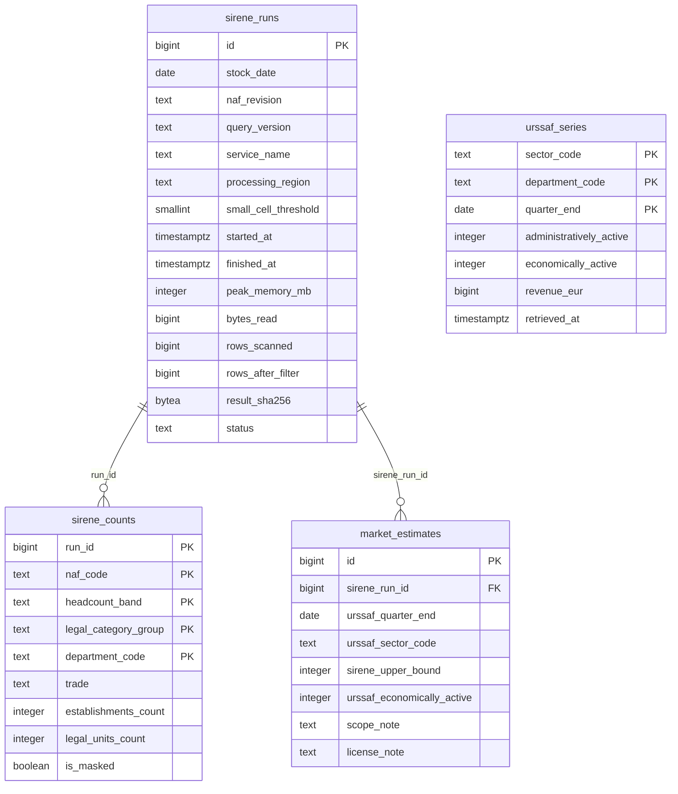
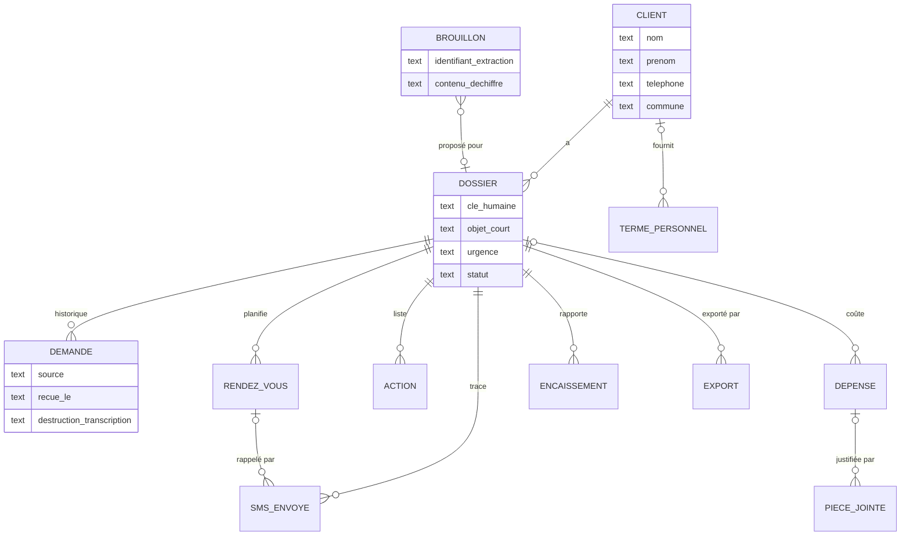
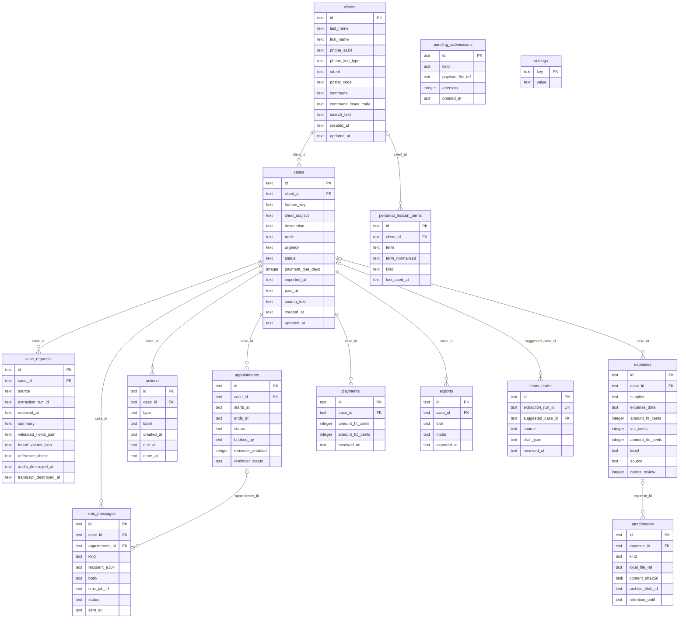
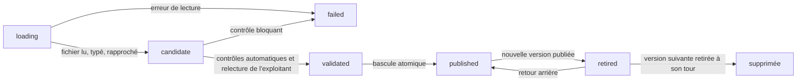

# Modèle de données de Muninn

**Version :** 1.2
**Date :** 12 octobre 2026
**Historique :** la v1.1 applique la relecture croisée avec les documents 03 et 05 et les arbitrages A1 à A8 de l'orchestrateur.
La v1.2 intègre les impacts du contrat d'API de la phase 2 (document 04, section 11.1, MD-A1 à
MD-A9), l'écart EC-01 du document 03 de la phase 2 (`was_flagged`) et les décisions D-24 à D-29 :
approbation des appareils, clé publique de récupération, date de destruction de l'image, bloc
`contact`, nouveaux types d'audit, table `app.idempotency_keys`.
**Phase :** 1 (architecture de données)
**Statut :** proposition, à valider par le porteur
**Compétences servies :** C4 (modèles conceptuel et physique, conformité RGPD) ; préparation de
C2 (requêtes SQL), C3 (agrégation) et C5 (API des référentiels)
**Documents liés :** `01-cartographie-des-donnees.md` (identifiants `DAT-xx`),
`03-acces-et-exposition.md`, `05-registre-rgpd.md` ; en phase 0 : `01-user-stories.md`,
`02-flux-de-donnees.md`, `03-sources-de-donnees.md`

Ce document ne contient aucune ligne de code. Les contraintes sont décrites en français ; leur
écriture en SQL relève de la phase 3, par des migrations Alembic.

## 0. Liste des tables

Cette liste est stable : les autres livrables de la phase 1 s'y réfèrent. Les noms physiques sont
en anglais, en `snake_case`, préfixés par leur schéma.

### Périmètre 1 : base serveur des métadonnées techniques (PostgreSQL 16, schéma `app`)

| Table                           | Rôle                                                                                 |
| ------------------------------- | ------------------------------------------------------------------------------------ |
| `app.accounts`                  | Compte de l'artisan, identifiant de connexion haché, abonnement                      |
| `app.otp_challenges`            | Codes de connexion à usage unique (empreinte, expiration, essais)                    |
| `app.devices`                   | Appareils : clé publique X25519, jeton push chiffré, jeton haché, état d'approbation |
| `app.lines`                     | Ligne Muninn : numéro, règles de l'agent, durée de créneau, zone                     |
| `app.line_worked_holidays`      | Jours fériés que l'artisan déclare travailler                                        |
| `app.forwarding_tests`          | Fenêtres de test du renvoi et leur résultat                                          |
| `app.availability_slots`        | Créneaux libres ou occupés, sans nom, fenêtre de 14 jours                            |
| `app.call_sessions`             | Métadonnées d'appel, numéro appelant haché                                           |
| `app.extraction_runs`           | Exécutions d'extraction : statuts, versions, latences, destructions                  |
| `app.field_corrections`         | Noms des champs corrigés par l'artisan, sans valeur                                  |
| `app.envelopes`                 | Enveloppes chiffrées pour un appareil, en attente (7 jours)                          |
| `app.sms_jobs`                  | Envois de SMS : identifiant du fournisseur et statut seulement                       |
| `app.blobs`                     | Métadonnées des blobs chiffrés de sauvegarde et d'archive                            |
| `app.audit_events`              | Événements d'audit sans donnée personnelle de client                                 |
| `app.processed_webhooks`        | Identifiants des webhooks traités (idempotence)                                      |
| `app.idempotency_keys`          | Clés d'idempotence des requêtes de l'api, gardées 24 heures                          |
| `app.purge_runs`                | Journal d'exécution des purges                                                       |
| `app.extraction_metrics_hourly` | Agrégats horaires de qualité, sans colonne de compte                                 |
| `app.field_metrics_hourly`      | Agrégats horaires des corrections, sans colonne de compte                            |

### Périmètre 2 : base des référentiels (PostgreSQL 16, schéma `ref`)

| Table                          | Rôle                                                           |
| ------------------------------ | -------------------------------------------------------------- |
| `ref.dataset_versions`         | Version de chaque jeu chargé : source, date, contrôles, statut |
| `ref.load_rejections`          | Lignes rejetées au chargement, avec leur motif                 |
| `ref.communes`                 | Communes du COG, noms officiels, communes déléguées            |
| `ref.commune_source_gaps`      | Écarts entre le COG et l'API Géo                               |
| `ref.postal_codes`             | Codes postaux de La Poste rattachés aux codes communes         |
| `ref.ban_streets`              | Voies de la BAN (voie, code postal, code commune)              |
| `ref.numbering_ranges`         | Tranches de numéros de l'ARCEP, type mobile ou fixe            |
| `ref.holiday_zone_departments` | Correspondance département vers zone de jours fériés           |
| `ref.public_holidays`          | Jours fériés par zone et par année                             |
| `ref.naf_trades`               | Codes NAF de la tête de pont rattachés à un métier Muninn      |
| `ref.trade_lexicons`           | Lexiques métier versionnés                                     |
| `ref.lexicon_terms`            | Termes d'un lexique, source, licence, statut de relecture      |
| `ref.forwarding_codes`         | Codes de renvoi d'appel par opérateur                          |

### Agrégats big data (PostgreSQL 16, schéma `market`)

| Table                     | Rôle                                                       |
| ------------------------- | ---------------------------------------------------------- |
| `market.sirene_runs`      | Exécutions du traitement Sirene et leurs mesures           |
| `market.sirene_counts`    | Comptages agrégés, après application du secret statistique |
| `market.urssaf_series`    | Séries trimestrielles Urssaf des auto-entrepreneurs du BTP |
| `market.market_estimates` | Encadrement du marché : borne haute Sirene, actifs Urssaf  |

### Périmètre 3 : base locale de l'appareil (SQLite chiffrée)

| Table                    | Rôle                                                      |
| ------------------------ | --------------------------------------------------------- |
| `clients`                | Clients finaux de l'artisan                               |
| `cases`                  | Dossiers, avec leur clé humaine                           |
| `case_requests`          | Demandes successives d'un dossier, preuves de destruction |
| `inbox_drafts`           | Brouillons reçus, en attente de validation                |
| `appointments`           | Rendez-vous de l'agenda Muninn                            |
| `actions`                | Actions à faire                                           |
| `expenses`               | Dépenses                                                  |
| `payments`               | Encaissements                                             |
| `attachments`            | Pièces jointes (tickets, factures) et lien vers l'archive |
| `sms_messages`           | Historique des SMS envoyés                                |
| `exports`                | Historique des exports vers l'outil de facturation        |
| `personal_lexicon_terms` | Lexique personnel                                         |
| `pending_submissions`    | Débriefs et dépenses en attente de réseau                 |
| `settings`               | Réglages locaux                                           |

## 1. Principes structurants

1. **Le serveur ne peut pas stocker un dossier en clair, par construction.** Aucune table du
   schéma `app` n'a de colonne destinée à un nom, une adresse, un texte de demande, un texte de
   SMS ou un numéro de client en clair. Le seul contenu de dossier présent sur le serveur est
   `app.envelopes.ciphertext`, chiffré par la clé publique de l'appareil (R1). La règle ne repose
   donc pas sur la discipline du code : une colonne absente ne peut pas être remplie. Trois colonnes
   font exception, car elles acceptent un texte : `app.audit_events.meta` (JSON),
   `app.lines.greeting_custom` (texte libre de l'artisan) et `app.idempotency_keys.response_body`
   (JSON). Pour elles, la garantie repose sur un contrôle applicatif (schéma fermé, longueur,
   liste fermée des routes dont la réponse est gardée), une contrainte CHECK sur les clés
   permises de `meta`, et le test canari G-2 (section 10).
2. **Trois périmètres, trois niveaux de confiance.** Les métadonnées (`app`) concernent des
   personnes et sont minimisées. Les référentiels (`ref`) et les agrégats (`market`) sont publics
   ou agrégés après secret statistique. La base locale de l'appareil contient tout le dossier, chiffrée par une clé que le
   serveur ne détient pas.
3. **Une seule grappe PostgreSQL, trois schémas** [H : choix à confirmer en phase 2, C15]. Le
   schéma sépare les droits : le rôle de l'API des référentiels ne lit que `ref`, le rôle du
   voice-gateway ne lit que ce qui lui sert dans `app` (document 03). Une base séparée pour `ref`
   reste possible sans changer le modèle.
4. **Les identifiants sont des UUID aléatoires** pour toute ligne exposée par l'API (pas
   d'identifiant séquentiel qui révèle un volume ou permet l'énumération). Les tables internes à
   fort volume (audit, rejets, référentiels) utilisent un entier auto-incrémenté.
5. **Les horodatages sont en `timestamptz`**, en UTC. Le fuseau de l'artisan est un attribut de
   sa ligne (outre-mer compris).
6. **Les valeurs fermées sont des `text` contraints par une liste** (contrainte CHECK) plutôt que
   des types énumérés PostgreSQL : une valeur s'ajoute par une migration simple et réversible.

## 2. Périmètre 1 : base serveur des métadonnées techniques

### 2.1 Modèle conceptuel

Les entités sont nommées en français ; les noms physiques correspondants sont en section 2.2.

Lecture des cardinalités :

| Association                   | Cardinalité                             | Justification                                                                                                                                                                                           |
| ----------------------------- | --------------------------------------- | ------------------------------------------------------------------------------------------------------------------------------------------------------------------------------------------------------- |
| Compte et ligne               | 1 à 0..1                                | La ligne naît à l'attribution du numéro Muninn ; un numéro par compte au plus (passation, section 9)                                                                                                    |
| Compte et appareil            | 1 à 0..n                                | Plusieurs appareils possibles ; aucun pendant l'inscription                                                                                                                                             |
| Appareil et appareil approuvé | 0..1 à 0..n                             | Un appareil approuvé approuve les suivants (D-22) ; le premier appareil et l'approbation par la phrase de récupération (D-28) n'ont pas d'approbateur ; le lien devient nul à la purge de l'approbateur |
| Compte et clé d'idempotence   | 0..1 à 0..n                             | Une clé appartient à un compte, ou à un jeton de service (compte nul) ; elle vit 24 heures                                                                                                              |
| Compte et code de connexion   | Association logique, sans clé étrangère | Un code est demandé avant que le compte existe (première inscription) ; le lien passe par l'empreinte de l'identifiant                                                                                  |
| Session d'appel et extraction | 0..1 à 0..1                             | Un appel de test ou un appel coupé ne produit pas d'extraction ; un débrief n'a pas de session                                                                                                          |
| Extraction et enveloppe       | 0..1 à 0..n                             | Une enveloppe par appareil approuvé et non révoqué ; le débrief revient en HTTPS, sans enveloppe                                                                                                        |
| Session d'appel et créneau    | 0..1 à 0..1                             | Un appel réserve un créneau au plus (une réservation par appel, document 03, M-02) ; unicité de `call_session_id`                                                                                       |
| Compte et blob                | 0..1 à 0..n                             | Une archive survit à la clôture du compte (10 ans) : le lien peut devenir nul                                                                                                                           |
| Compte et événement d'audit   | 0..1 à 0..n                             | À la suppression du compte, le lien est mis à nul : l'événement n'est plus rattaché à aucun compte                                                                                                      |

L'extraction référence aussi la version du lexique métier utilisée (`ref.trade_lexicons`) : c'est
le seul lien entre les périmètres 1 et 2.

### 2.2 Modèle physique

Cinq tables ne figurent pas dans ce diagramme : `app.otp_challenges` (liée aux comptes par
l'empreinte de l'identifiant, sans clé étrangère), `app.processed_webhooks`, `app.purge_runs` et
les deux tables d'agrégats horaires, qui n'ont aucune clé étrangère. Elles sont décrites
ci-dessous.

Conventions des tables suivantes : « NN » signifie NOT NULL ; « clé étrangère avec suppression en
cascade » signifie que la ligne disparaît avec sa ligne parente. Une colonne sans mention NN
accepte la valeur nulle.

#### `app.accounts`

| Colonne                | Type          | Contraintes                                                           | Mesure RGPD                                                                                                                                       |
| ---------------------- | ------------- | --------------------------------------------------------------------- | ------------------------------------------------------------------------------------------------------------------------------------------------- |
| `id`                   | `uuid`        | Clé primaire, aléatoire                                               | Identifiant opaque                                                                                                                                |
| `status`               | `text`        | NN ; liste : `pending`, `active`, `suspended`, `closing`, `closed`    | Aucune donnée de contenu                                                                                                                          |
| `login_kind`           | `text`        | NN ; liste : `phone`, `email`                                         | Dit seulement le canal                                                                                                                            |
| `login_hash`           | `bytea`       | NN ; UNIQUE ; exactement 32 octets                                    | HMAC-SHA256 de l'identifiant normalisé (E.164, ou e-mail en minuscules), poivre « connexion »                                                     |
| `login_hash_key_id`    | `smallint`    | NN ; supérieur à 0                                                    | Version du poivre, pour la rotation                                                                                                               |
| `plan`                 | `text`        | NN ; liste : `trial`, `monthly`, `annual`                             | Aucune                                                                                                                                            |
| `trial_ends_at`        | `timestamptz` | Postérieur à `created_at`                                             | Aucune                                                                                                                                            |
| `billing_customer_ref` | `text`        | UNIQUE                                                                | Référence opaque du prestataire de paiement ; aucune donnée bancaire                                                                              |
| `siren`                | `text`        | Exactement 9 chiffres                                                 | Facultatif, saisi par l'artisan ; DP pour un entrepreneur individuel                                                                              |
| `dpa_accepted_at`      | `timestamptz` | NN dès que `status` vaut `active` (contrainte CHECK)                  | Preuve de l'acceptation du contrat de sous-traitance (document 05, section 5)                                                                     |
| `dpa_version`          | `text`        | NN si `dpa_accepted_at` est renseigné                                 | Version du contrat acceptée                                                                                                                       |
| `recovery_public_key`  | `bytea`       | Exactement 32 octets ; facultatif                                     | Clé publique de vérification dérivée sur l'appareil de la phrase de récupération (D-28) ; ni la phrase ni la clé de sauvegarde ne sont transmises |
| `created_at`           | `timestamptz` | NN ; défaut : maintenant                                              | Aucune                                                                                                                                            |
| `closed_at`            | `timestamptz` | Renseigné si et seulement si `status` vaut `closed`                   | Déclenche la purge                                                                                                                                |
| `purge_after`          | `timestamptz` | Renseigné si `closed_at` l'est ; égal à `closed_at` plus 30 jours [H] | Date de suppression définitive                                                                                                                    |

- Index : unicité de `login_hash` (recherche du compte à la connexion, à chaque demande de code) ;
  unicité de `billing_customer_ref` (rapprochement des webhooks de paiement) ; index partiel sur
  `purge_after` pour les seules lignes où il est renseigné (tâche de purge, quelques lignes).
- P-12, décidé : D-26 (document 03, section 5.3) : **aucune copie lisible de l'identifiant
  n'est gardée, seulement son empreinte.** L'artisan saisit son identifiant à chaque demande de
  code ; le serveur le hache, le compare, l'envoie au fournisseur et l'oublie. Conséquence
  acceptée : Muninn ne peut pas écrire de lui-même à l'artisan par SMS ou par e-mail ; il passe
  par la notification push ou par le prestataire de paiement, qui détient l'adresse de
  facturation.
- **Recours par la phrase de récupération, décidé : D-28.** À la création de la sauvegarde,
  l'application dérive de la phrase (D-14) une paire de clés de signature, dans un contexte de
  dérivation distinct de celui de la clé de sauvegarde [H : fonction de dérivation choisie en
  phase 3], et n'envoie que la clé publique (`PUT /v1/account/recovery-key`). Un nouvel appareil
  qui signe le défi du serveur avec cette clé est approuvé sans autre appareil (`app.devices`,
  méthode `recovery_phrase`). La clé publique ne permet ni de déchiffrer la sauvegarde ni de
  retrouver la phrase : R1 et D-14 restent tenues. Sans la phrase et sans appareil approuvé,
  aucun recours en ligne n'existe (D-28).
- Purge : suppression du compte et, en cascade, de ses appareils, ligne, créneaux, extractions,
  SMS et clés d'idempotence, à `purge_after`. Les archives et l'audit sont détachés (section 2.2, `app.blobs` et
  `app.audit_events`).

#### `app.otp_challenges`

| Colonne       | Type          | Contraintes                                                    | Mesure RGPD                                                                 |
| ------------- | ------------- | -------------------------------------------------------------- | --------------------------------------------------------------------------- |
| `id`          | `uuid`        | Clé primaire                                                   | Identifiant opaque                                                          |
| `login_hash`  | `bytea`       | NN ; 32 octets ; pas de clé étrangère (compte pas encore créé) | Même empreinte que `app.accounts.login_hash`                                |
| `code_hash`   | `bytea`       | NN ; 32 octets                                                 | HMAC du code avec un poivre « code » distinct ; le code n'est jamais stocké |
| `channel`     | `text`        | NN ; liste : `sms`, `email`                                    | Aucune                                                                      |
| `attempts`    | `smallint`    | NN ; défaut 0 ; entre 0 et 5 [H]                               | Aucune                                                                      |
| `created_at`  | `timestamptz` | NN                                                             | Aucune                                                                      |
| `expires_at`  | `timestamptz` | NN ; au plus `created_at` plus 10 minutes [H]                  | Aucune                                                                      |
| `consumed_at` | `timestamptz` | Postérieur à `created_at`                                      | Aucune                                                                      |

- Index : (`login_hash`, `created_at` décroissant), pour retrouver le dernier code d'un
  identifiant et compter les demandes de l'heure (limitation de débit) ; `expires_at`, pour la
  purge.
- Un code à 6 chiffres n'a que 1 000 000 de valeurs : son empreinte seule ne le protège pas. La
  protection vient de la clé secrète du HMAC, de l'expiration à 10 minutes et du plafond de 5
  essais (US-01, critère 3).
- `channel` (canal d'envoi du code : `sms`, `email`) et `app.accounts.login_kind` (type
  d'identifiant : `phone`, `email`) sont deux notions distinctes : l'une dit comment le code part,
  l'autre ce que l'artisan a saisi.
- Validité du code : 10 minutes. Purge de l'empreinte : 24 heures après `expires_at` [H].

#### `app.devices`

| Colonne                 | Type          | Contraintes                                                                                                                                                                                             | Mesure RGPD                                                                                                                                                                                                                                |
| ----------------------- | ------------- | ------------------------------------------------------------------------------------------------------------------------------------------------------------------------------------------------------- | ------------------------------------------------------------------------------------------------------------------------------------------------------------------------------------------------------------------------------------------ |
| `id`                    | `uuid`        | Clé primaire                                                                                                                                                                                            | Identifiant opaque                                                                                                                                                                                                                         |
| `account_id`            | `uuid`        | NN ; clé étrangère vers `app.accounts`, suppression en cascade                                                                                                                                          | Identifiant interne rattaché à l'artisan (DP)                                                                                                                                                                                              |
| `platform`              | `text`        | NN ; liste : `android`, `ios`                                                                                                                                                                           | Aucune                                                                                                                                                                                                                                     |
| `public_key`            | `bytea`       | NN ; UNIQUE ; exactement 32 octets (X25519)                                                                                                                                                             | Clé publique : sans secret ; la clé privée ne quitte jamais l'appareil (test de US-01)                                                                                                                                                     |
| `push_token_ciphertext` | `bytea`       | Mis à nul à la révocation                                                                                                                                                                               | Chiffré par une clé applicative du serveur (AEAD, clé dans le gestionnaire de secrets) [H]                                                                                                                                                 |
| `push_token_key_id`     | `smallint`    | NN si `push_token_ciphertext` est renseigné                                                                                                                                                             | Version de la clé, pour la rotation                                                                                                                                                                                                        |
| `auth_token_hash`       | `bytea`       | UNIQUE sur les valeurs non nulles ; 32 octets ; nul si et seulement si `revoked_at` est renseigné (CHECK)                                                                                               | SHA-256 du jeton d'appareil, aléatoire de 256 bits ; le jeton n'est jamais stocké ; effacé à la révocation (US-54, critère 2)                                                                                                              |
| `created_at`            | `timestamptz` | NN                                                                                                                                                                                                      | Aucune                                                                                                                                                                                                                                     |
| `last_seen_at`          | `timestamptz` | Postérieur à `created_at`                                                                                                                                                                               | Granularité à l'heure [H], pour ne pas tracer l'usage minute par minute                                                                                                                                                                    |
| `approved_at`           | `timestamptz` | Nul tant que l'appareil est en attente ; égal à `created_at` pour le premier appareil du compte                                                                                                         | Aucune ; seul un appareil approuvé et non révoqué reçoit des enveloppes (D-22)                                                                                                                                                             |
| `approved_by_device_id` | `uuid`        | Clé étrangère vers `app.devices`, mise à nul à la suppression ; nul pour les méthodes `first_device` et `recovery_phrase` ; appareil du même compte, distinct de la ligne (contrôle applicatif et test) | Identifiant interne rattaché à l'artisan (DP)                                                                                                                                                                                              |
| `approval_method`       | `text`        | Liste : `first_device`, `device`, `recovery_phrase` ; renseigné si et seulement si `approved_at` l'est (CHECK)                                                                                          | Aucune ; méthode citée dans l'audit (`meta.approval_method`)                                                                                                                                                                               |
| `approval_code_hash`    | `bytea`       | 32 octets ; renseigné seulement pendant l'attente, mis à nul à l'approbation, au refus ou à l'expiration                                                                                                | HMAC-SHA256 du code à 6 chiffres, poivre « approbation » ; le code est dérivé de la clé publique [H : 6 chiffres tirés de son empreinte SHA-256], il n'est donc pas un secret : la protection vient du plafond d'essais et de l'expiration |
| `approval_attempts`     | `smallint`    | NN ; défaut 0 ; entre 0 et 3 ; au troisième code faux, l'appareil en attente est révoqué                                                                                                                | Aucune                                                                                                                                                                                                                                     |
| `approval_expires_at`   | `timestamptz` | Renseigné si et seulement si l'appareil est en attente (`approved_at` et `revoked_at` nuls) [H : durée fixée par le contrat, section 6.3]                                                               | Aucune                                                                                                                                                                                                                                     |
| `revoked_at`            | `timestamptz` | Postérieur à `created_at`                                                                                                                                                                               | Déclenche l'effacement de l'empreinte du jeton, du jeton push et des enveloppes en attente                                                                                                                                                 |

- Index : unicité de `auth_token_hash` (authentification de chaque requête de l'appareil) ;
  PostgreSQL accepte par défaut plusieurs valeurs nulles dans une contrainte UNIQUE, ce qui
  laisse nulles les empreintes des appareils révoqués [H : comportement par défaut, à confirmer
  par le test de la section 10.2] ; index partiel sur `account_id` pour les seuls appareils
  approuvés et non révoqués (lecture des clés publiques par le relay, F-02 message 32) ; index
  partiel sur `approval_expires_at` pour les seuls appareils en attente (expiration des
  demandes).
- **Cycle de vie (D-22, D-28 ; contrat d'API de la phase 2, section 6.3).** Le premier appareil
  d'un compte naît approuvé (`first_device`). Tout appareil suivant naît en attente : il n'a ni
  `approved_at` ni enveloppe. Un appareil approuvé saisit le code affiché par le nouvel appareil
  (`device`, `approved_by_device_id` renseigné), ou l'artisan signe un défi avec sa phrase de
  récupération sur le nouvel appareil (`recovery_phrase`, `approved_by_device_id` nul). Un refus
  ou trois codes faux révoquent l'appareil en attente.
- **Révocation (US-54).** Une seule transaction pose `revoked_at`, met à nul `auth_token_hash`,
  `push_token_ciphertext`, `push_token_key_id` et `approval_code_hash`, et supprime les
  enveloppes en attente de l'appareil. La requête suivante de l'appareil ne trouve plus son
  empreinte et reçoit 401 `device_revoked` [H : l'api distingue un jeton inconnu d'un jeton
  révoqué par un index d'empreintes révoquées tenu ailleurs, ou rend 401 dans les deux cas ; à
  trancher en phase 3].
- **RLS du relay (MD-A4).** Le relay ne lit que les appareils où `approved_at` est renseigné et
  `revoked_at` est nul (document 03, section 5.2) : un appareil en attente ne reçoit aucune
  enveloppe, même pour les appels qui arrivent pendant l'attente.
- Le jeton d'appareil est aléatoire et long : un SHA-256 sans clé suffit, aucune attaque par
  dictionnaire n'est possible. Ce n'est pas le cas d'un numéro de téléphone (voir `caller_hash`).
- Le jeton push est chiffré par une clé que le serveur détient : ce n'est **pas** un chiffrement de
  bout en bout. Il protège contre la lecture de la base seule (copie, sauvegarde de la base). R1
  vise les dossiers ; le jeton push n'en est pas un.
- Expiration du jeton d'appareil : à la révocation, ou après 90 jours sans usage [H] (document
  03, section 5.3) ; `last_seen_at` sert ce contrôle.
- Purge : 30 jours après `revoked_at` [H].

#### `app.lines`

| Colonne             | Type          | Contraintes                                                                 | Mesure RGPD                                                                              |
| ------------------- | ------------- | --------------------------------------------------------------------------- | ---------------------------------------------------------------------------------------- |
| `id`                | `uuid`        | Clé primaire                                                                | Identifiant opaque                                                                       |
| `account_id`        | `uuid`        | NN ; UNIQUE ; clé étrangère vers `app.accounts`, suppression en cascade     | Identifiant interne rattaché à l'artisan (DP)                                            |
| `cpaas_number`      | `text`        | NN ; UNIQUE ; format E.164                                                  | Numéro attribué par Muninn ; DP de l'artisan, en clair car il sert au routage des appels |
| `business_name`     | `text`        | NN ; 1 à 80 caractères                                                      | En clair : prononcé par l'agent (R6) ; aucun nom de client                               |
| `first_name`        | `text`        | NN ; 1 à 40 caractères                                                      | En clair : prononcé par l'agent                                                          |
| `trade`             | `text`        | NN ; liste : `plomberie`, `chauffage`, `electricite`, `serrurerie`, `autre` | Aucune                                                                                   |
| `opening_hours`     | `jsonb`       | NN ; objet JSON validé par le schéma Pydantic des horaires                  | Habitudes de travail de l'artisan                                                        |
| `greeting_custom`   | `text`        | 0 à 300 caractères [H]                                                      | Partie libre seulement ; l'annonce de l'assistant n'est pas stockée (voir ci-dessous)    |
| `booking_enabled`   | `boolean`     | NN ; défaut faux                                                            | Aucune                                                                                   |
| `slot_duration_min` | `smallint`    | NN ; défaut 60 [H] ; entre 15 et 480                                        | Aucune                                                                                   |
| `holiday_zone`      | `text`        | NN ; défaut `metropole` ; liste des 13 zones de SRC-08                      | Seule la zone est gardée, pas le département ni l'adresse de l'artisan                   |
| `timezone`          | `text`        | NN ; défaut `Europe/Paris` ; nom de fuseau IANA                             | Aucune                                                                                   |
| `created_at`        | `timestamptz` | NN                                                                          | Aucune                                                                                   |
| `updated_at`        | `timestamptz` | NN                                                                          | Aucune                                                                                   |

- Index : unicité de `cpaas_number` (le webhook d'appel entrant donne le numéro appelé ; il faut
  retrouver la ligne en une lecture) ; unicité de `account_id`.
- **R6 par construction.** La phrase d'annonce de l'assistant automatique (D-04) n'est pas une
  donnée : elle est produite par le code, toujours en premier, puis suivie de `greeting_custom`.
  Aucune configuration ne peut donc la supprimer (US-02, critère 1). Le contrôle T4 de F-01
  devient un contrôle de longueur et de contenu de la seule partie libre.
- Ajouts demandés par P-11 et US-05 : `holiday_zone`, `slot_duration_min`, `timezone`, et la
  table `app.line_worked_holidays`.
- Purge : durée du contrat, puis 30 jours, par la cascade du compte.

#### `app.line_worked_holidays`

| Colonne        | Type          | Contraintes                                                        | Mesure RGPD                                   |
| -------------- | ------------- | ------------------------------------------------------------------ | --------------------------------------------- |
| `line_id`      | `uuid`        | Clé primaire composée ; clé étrangère vers `app.lines`, en cascade | Identifiant interne rattaché à l'artisan (DP) |
| `holiday_date` | `date`        | Clé primaire composée                                              | Aucune                                        |
| `created_at`   | `timestamptz` | NN                                                                 | Aucune                                        |

- Index : la clé primaire (`line_id`, `holiday_date`) sert la seule requête, « ce jour est-il
  travaillé par cette ligne ».
- Le contrôle que la date est bien un jour férié de la zone se fait à l'écriture, par l'API des
  référentiels : une contrainte ne peut pas lire une autre version de référentiel.
- Purge : dates passées, chaque nuit.

#### `app.forwarding_tests`

| Colonne           | Type          | Contraintes                                                                  | Mesure RGPD                                   |
| ----------------- | ------------- | ---------------------------------------------------------------------------- | --------------------------------------------- |
| `id`              | `uuid`        | Clé primaire                                                                 | Opaque                                        |
| `line_id`         | `uuid`        | NN ; clé étrangère vers `app.lines`, en cascade                              | Identifiant interne rattaché à l'artisan (DP) |
| `call_session_id` | `uuid`        | UNIQUE ; clé étrangère vers `app.call_sessions`, mise à nul à la suppression | Identifiant interne rattaché à l'artisan (DP) |
| `status`          | `text`        | NN ; liste : `pending`, `verified`, `expired`                                | Aucune                                        |
| `opened_at`       | `timestamptz` | NN                                                                           | Aucune                                        |
| `expires_at`      | `timestamptz` | NN ; au plus `opened_at` plus 2 minutes (US-04)                              | Aucune                                        |
| `resolved_at`     | `timestamptz` | Renseigné si `status` n'est pas `pending`                                    | Aucune                                        |

- Index : unicité partielle sur `line_id` pour les seuls tests `pending`. Elle impose une seule
  fenêtre ouverte par ligne et sert la question posée à chaque appel entrant : « un test est-il
  ouvert sur cette ligne ? ».
- Un appel de test crée une `app.call_sessions` en mode `test` et aucune extraction (US-04,
  critère 3).
- Purge : 30 jours [H].

#### `app.availability_slots`

| Colonne              | Type          | Contraintes                                                                                                                                                                       | Mesure RGPD                                   |
| -------------------- | ------------- | --------------------------------------------------------------------------------------------------------------------------------------------------------------------------------- | --------------------------------------------- |
| `id`                 | `uuid`        | Clé primaire                                                                                                                                                                      | Opaque                                        |
| `account_id`         | `uuid`        | NN ; clé étrangère vers `app.accounts`, en cascade                                                                                                                                | Identifiant interne rattaché à l'artisan (DP) |
| `call_session_id`    | `uuid`        | UNIQUE ; clé étrangère vers `app.call_sessions`, mise à nul ; NN à l'insertion si `source` vaut `agent`, contrôlé par l'API (pas de CHECK, pour que la mise à nul reste possible) | Identifiant interne rattaché à l'artisan (DP) |
| `starts_at`          | `timestamptz` | NN                                                                                                                                                                                | Aucune                                        |
| `ends_at`            | `timestamptz` | NN ; strictement après `starts_at` ; durée au plus 24 heures                                                                                                                      | Aucune                                        |
| `kind`               | `text`        | NN ; liste : `free`, `busy`                                                                                                                                                       | Aucune                                        |
| `source`             | `text`        | NN ; liste : `device`, `agent` ; `agent` implique `kind` = `busy`                                                                                                                 | Aucune                                        |
| `device_received_at` | `timestamptz` | Renseigné seulement pour `source` = `agent`                                                                                                                                       | Aucune                                        |

- **Sans nom par construction** : la table n'a aucune colonne de libellé, de client ou de lieu
  (US-05, critère 1 ; US-26, critère 3).
- Contrainte d'exclusion : deux créneaux `agent` d'un même compte ne peuvent pas se chevaucher. Elle
  garantit US-08, critère 3, même si deux appels simultanés acceptent le même créneau : la
  seconde écriture échoue et l'agent propose un autre créneau. Elle demande l'extension
  `btree_gist`, qui prend en charge l'égalité sur `uuid` dans un index GiST ; la clause de
  restriction (`source` = `agent`) est permise par PostgreSQL 16 (vérifié dans la documentation
  officielle, pages `sql-createtable` et `btree-gist`).
- Écrivains : l'api (créneaux `device`, à la synchronisation) et voice-gateway, qui ne fait
  qu'insérer un créneau `source` = `agent`, `kind` = `busy` ; il ne peut ni modifier ni supprimer
  un créneau (document 03, sections 4.1 et 5.2).
- Règle de US-05, critère 2 : une synchronisation de l'appareil remplace les créneaux `device` de
  la fenêtre et garde les créneaux `agent` dont `device_received_at` est nul.
  `device_received_at` est renseigné à l'accusé de réception de l'enveloppe de l'appel concerné.
- Index : (`account_id`, `starts_at`), pour lire la fenêtre de 14 jours pendant un appel et la
  remplacer à la synchronisation ; l'index GiST de la contrainte d'exclusion.
- Purge : créneaux dont `ends_at` est passé, à chaque synchronisation et chaque nuit.

#### `app.call_sessions`

| Colonne              | Type          | Contraintes                                                                                                    | Mesure RGPD                                                                 |
| -------------------- | ------------- | -------------------------------------------------------------------------------------------------------------- | --------------------------------------------------------------------------- |
| `id`                 | `uuid`        | Clé primaire                                                                                                   | Opaque                                                                      |
| `line_id`            | `uuid`        | NN ; clé étrangère vers `app.lines`, en cascade                                                                | Identifiant interne rattaché à l'artisan (DP)                               |
| `provider_call_ref`  | `text`        | NN ; UNIQUE                                                                                                    | Identifiant d'appel du CPaaS ; ne permet une ré-identification que chez lui |
| `mode`               | `text`        | NN ; liste : `normal`, `test`, `simulated`                                                                     | Aucune                                                                      |
| `caller_hash`        | `bytea`       | 32 octets ; nul si le numéro est masqué                                                                        | HMAC-SHA256 du numéro en E.164, poivre « appelant » ; jamais le numéro      |
| `caller_hash_key_id` | `smallint`    | NN si `caller_hash` est renseigné                                                                              | Version du poivre                                                           |
| `started_at`         | `timestamptz` | NN                                                                                                             | Aucune                                                                      |
| `ended_at`           | `timestamptz` | Postérieur ou égal à `started_at`                                                                              | Aucune                                                                      |
| `duration_s`         | `integer`     | Positif ou nul                                                                                                 | Aucune                                                                      |
| `status`             | `text`        | NN ; liste : `ringing`, `in_progress`, `completed`, `caller_refused`, `safety_redirect`, `abandoned`, `failed` | Le motif d'arrêt, sans contenu                                              |
| `outside_hours`      | `boolean`     | NN ; défaut faux                                                                                               | Aucune                                                                      |
| `slot_booked`        | `boolean`     | NN ; défaut faux                                                                                               | Aucune                                                                      |

- Index : unicité de `provider_call_ref` (le webhook de fin d'appel retrouve la session) ;
  (`line_id`, `started_at`), pour l'historique d'une ligne et les comptages ; (`caller_hash`,
  `started_at`), pour le plafond d'appels par numéro et l'effacement à la demande ; index BRIN sur
  `started_at`, pour la purge : la table est remplie dans l'ordre du temps, un index BRIN y est
  minuscule et suffit à cibler les lignes de plus de 90 jours.
- **Pourquoi un HMAC et non un SHA-256 simple.** L'espace des numéros français est d'environ un
  milliard de valeurs. Une empreinte sans clé se renverse par énumération complète, en peu de
  temps sur du matériel courant [H : ordre de grandeur non mesuré]. Le HMAC n'est réversible que
  par qui détient le poivre, gardé hors de la base (R8).
- **Finalité de `caller_hash` : limitation des abus.** Le serveur plafonne à 5 appels par numéro
  et par jour [H] (document 03, section 5.4 ; registre, fiche RT-04). Muninn est responsable de
  cette seule finalité. Le rapprochement d'un client connu (US-20) n'en a pas besoin : il se fait
  sur l'appareil, avec le numéro en clair.
- **Effacement à la demande** (document 03, X-06 ; document 05, section 8.2) : l'appareil envoie
  le numéro du client ; l'api le normalise en E.164, calcule `caller_hash` avec chaque version
  active du poivre, supprime les sessions du compte qui portent cette empreinte, puis oublie le
  numéro. L'index (`caller_hash`, `started_at`) sert cette suppression comme le plafond.
- Purge : 90 jours après `started_at` [H : à valider dans l'AIPD].

#### `app.extraction_runs`

| Colonne                   | Type          | Contraintes                                                                                                      | Mesure RGPD                                                                                 |
| ------------------------- | ------------- | ---------------------------------------------------------------------------------------------------------------- | ------------------------------------------------------------------------------------------- |
| `id`                      | `uuid`        | Clé primaire ; transmis dans le brouillon sous le nom `draft_id` (contrat 1.1)                                   | Opaque                                                                                      |
| `account_id`              | `uuid`        | NN ; clé étrangère vers `app.accounts`, en cascade                                                               | Identifiant interne rattaché à l'artisan (DP)                                               |
| `call_session_id`         | `uuid`        | UNIQUE ; clé étrangère vers `app.call_sessions`, mise à nul                                                      | Identifiant interne rattaché à l'artisan (DP)                                               |
| `trade_lexicon_id`        | `bigint`      | Clé étrangère vers `ref.trade_lexicons`, suppression refusée (RESTRICT) : un lexique cité reste                  | Aucune                                                                                      |
| `source`                  | `text`        | NN ; liste : `missed_call`, `debrief`, `expense_voice`, `receipt_scan`                                           | Aucune                                                                                      |
| `input_mode`              | `text`        | NN ; liste : `audio`, `text`, `image`, `simulated`                                                               | Aucune                                                                                      |
| `status`                  | `text`        | NN ; liste : `running`, `succeeded`, `failed_validation`, `failed_provider`, `failed_relay`, `no_active_device`  | Aucune                                                                                      |
| `needs_review`            | `boolean`     | NN                                                                                                               | Aucune                                                                                      |
| `validation_attempts`     | `smallint`    | NN ; 1 ou 2 (une relance au plus)                                                                                | Aucune                                                                                      |
| `prompt_version`          | `text`        | NN                                                                                                               | Aucune (US-40, critère 2)                                                                   |
| `schema_version`          | `text`        | NN                                                                                                               | Aucune                                                                                      |
| `model_id`                | `text`        | NN                                                                                                               | Aucune                                                                                      |
| `reference_check`         | `text`        | NN ; liste : `ok`, `flagged`, `unchecked`, `not_applicable`                                                      | Résultat global du contrôle, sans les valeurs contrôlées                                    |
| `fields_to_review_count`  | `smallint`    | NN ; positif ou nul                                                                                              | Aucune                                                                                      |
| `latency_ms`              | `integer`     | Positif ou nul                                                                                                   | Aucune                                                                                      |
| `input_tokens`            | `integer`     | Positif ou nul                                                                                                   | Aucune                                                                                      |
| `output_tokens`           | `integer`     | Positif ou nul                                                                                                   | Aucune                                                                                      |
| `cost_micro_eur`          | `bigint`      | Positif ou nul ; en millionièmes d'euro                                                                          | Aucune                                                                                      |
| `started_at`              | `timestamptz` | NN                                                                                                               | Aucune                                                                                      |
| `finished_at`             | `timestamptz` | Postérieur ou égal à `started_at`                                                                                | Aucune                                                                                      |
| `audio_destroyed_at`      | `timestamptz` | Nul si `input_mode` n'est pas `audio` ; NN si `input_mode` = `audio` et `finished_at` est renseigné              | Preuve de destruction (US-31), assertion du serveur                                         |
| `transcript_destroyed_at` | `timestamptz` | Postérieur ou égal à `started_at`                                                                                | Preuve de destruction (US-31)                                                               |
| `image_destroyed_at`      | `timestamptz` | Nul si `input_mode` n'est pas `image` ; NN si `input_mode` = `image` et `finished_at` est renseigné              | Preuve de destruction de l'image du ticket (US-21, critère 3 ; US-31), assertion du serveur |
| `envelope_stored_at`      | `timestamptz` | Seulement pour `source` = `missed_call`                                                                          | Mesure du délai de 30 secondes (US-12)                                                      |
| `delivered_at`            | `timestamptz` | Postérieur à `envelope_stored_at`                                                                                | Premier accusé de réception                                                                 |
| `review_decision`         | `text`        | Liste : `validated`, `validated_with_corrections`, `rejected` ; renseigné si et seulement si `reviewed_at` l'est | Décision, sans les valeurs                                                                  |
| `reviewed_at`             | `timestamptz` | Postérieur à `started_at`                                                                                        | Aucune                                                                                      |
| `is_synthetic`            | `boolean`     | NN ; défaut faux                                                                                                 | Sépare la démo et l'évaluation du trafic réel                                               |

- **Aucune colonne de contenu.** Ni transcription, ni brouillon, ni valeur extraite, ni valeur
  contrôlée. Le lieu unique des compteurs, laissé ouvert par F-02 (message 44 depuis X-05), est fixé ici :
  la base, puis les agrégats horaires.
- Les trois colonnes `*_destroyed_at` portent les mêmes valeurs que le bloc `destruction` du
  brouillon 1.1 (D-24 ; contrat d'API de la phase 2, section 3.3, règle 7).
- **Brouillon de secours (D-29).** Quand le LLM est indisponible en fin d'appel, voice-gateway
  construit un brouillon `fallback_no_llm` qui ne porte que le numéro et l'heure de l'appel,
  marqué à vérifier. La ligne garde `status` = `failed_provider` et `needs_review` vrai ;
  `transcript_destroyed_at` est renseigné comme pour toute extraction (R3), et
  `envelope_stored_at` l'est si l'enveloppe de secours est écrite [H : correspondance entre
  `provenance.extraction_status` et `status` à confirmer par les tests de contrat].
- Index : (`account_id`, `started_at`), pour l'historique d'un compte et la réponse à une demande
  d'accès de l'artisan ; BRIN sur `started_at`, pour l'agrégation horaire et la purge ; unicité de
  `call_session_id`.
- Si le schéma `ref` passe un jour dans une base séparée (MD-08), cette clé étrangère devient une
  référence logique, contrôlée par l'api et par un test.
- Purge : 90 jours après `started_at` [H], après agrégation dans
  `app.extraction_metrics_hourly`.

#### `app.field_corrections`

| Colonne             | Type          | Contraintes                                                                               | Mesure RGPD                                                           |
| ------------------- | ------------- | ----------------------------------------------------------------------------------------- | --------------------------------------------------------------------- |
| `extraction_run_id` | `uuid`        | Clé primaire composée ; clé étrangère vers `app.extraction_runs`, en cascade              | Identifiant interne rattaché à l'artisan (DP)                         |
| `field_name`        | `text`        | Clé primaire composée ; liste fermée des chemins de champs du `DossierDraft` (ci-dessous) | Nom de champ seulement (US-17, critère 3)                             |
| `was_flagged`       | `boolean`     | NN                                                                                        | Le champ corrigé portait-il la mention « à vérifier » ; aucune valeur |
| `created_at`        | `timestamptz` | NN                                                                                        | Aucune                                                                |

- Liste fermée de `field_name` : `client.nom`, `client.prenom`, `client.telephone`,
  `client.adresse.rue`, `client.adresse.code_postal`, `client.adresse.commune`,
  `contact.nom`, `contact.prenom`, `contact.telephone`, `contact.relation`,
  `demande.objet_court`, `demande.description`, `demande.metier`, `demande.urgence`,
  `demande.disponibilites_client`, `demande.rdv_propose`, `cle_humaine`, `actions`,
  `depense.fournisseur`, `depense.date`, `depense.montant_ht`, `depense.montant_ttc`,
  `depense.tva`, `depense.libelle`, `depense.dossier_cle_humaine_mentionnee`.
- Les chemins `contact.*` viennent du bloc `contact` du contrat 1.1 (D-25 ; appel pour un tiers).
  La liste est égale à l'énumération `FieldPath` du contrat (test de contrat TC-04 de la phase 2).
- **`was_flagged` (écart EC-01 du document 03 de la phase 2).** L'appareil l'envoie avec le nom du
  champ : vrai si le champ était signalé « à vérifier » (confiance sous 0,7 ou présence dans
  `champs_manquants`) au moment de la revue. Une correction d'un champ non signalé est une erreur
  silencieuse vue en service (indicateur AL-08, document 04, VE-26). La colonne est un booléen :
  elle ne porte ni la valeur ni la confiance.
- **Sans valeur par construction** : la liste fermée interdit d'y écrire autre chose qu'un nom de
  champ, et la table n'a pas de colonne de valeur.
- Index : la clé primaire suffit (lecture par extraction).
- Purge : avec l'extraction, par la cascade.

#### `app.envelopes`

| Colonne             | Type          | Contraintes                                          | Mesure RGPD                                                       |
| ------------------- | ------------- | ---------------------------------------------------- | ----------------------------------------------------------------- |
| `id`                | `uuid`        | Clé primaire                                         | Opaque                                                            |
| `device_id`         | `uuid`        | NN ; clé étrangère vers `app.devices`, en cascade    | Identifiant interne rattaché à l'artisan (DP)                     |
| `extraction_run_id` | `uuid`        | Clé étrangère vers `app.extraction_runs`, mise à nul | Identifiant interne rattaché à l'artisan (DP)                     |
| `ciphertext`        | `bytea`       | NN ; entre 49 octets et 64 Kio [H]                   | SealedBox X25519 pour l'appareil ; le serveur ne peut pas la lire |
| `created_at`        | `timestamptz` | NN                                                   | Aucune                                                            |
| `expires_at`        | `timestamptz` | NN ; au plus `created_at` plus 7 jours               | Aucune                                                            |

- Une sealed box ajoute 48 octets au message : 32 octets de clé publique éphémère et 16 octets de
  code d'authentification (constantes de libsodium, vérifiées dans ses fichiers d'en-tête). Une
  enveloppe d'un brouillon de 2 Ko pèse donc environ 2,05 Ko.
- Le contenu chiffré ne se compresse pas. Le stockage de la colonne doit désactiver la
  compression (stockage « externe » de PostgreSQL), qui coûterait du calcul sans rien gagner.
- Index : (`device_id`, `created_at`), pour `GET /envelopes` ; `expires_at`, pour la purge.
- Suppression à l'accusé de réception (la ligne disparaît : la colonne `acked_at` de la passation
  n'a plus de raison d'être ; l'heure de l'accusé est gardée dans
  `app.extraction_runs.delivered_at`). Sinon, purge à `expires_at`.

#### `app.sms_jobs`

| Colonne                | Type          | Contraintes                                                         | Mesure RGPD                                   |
| ---------------------- | ------------- | ------------------------------------------------------------------- | --------------------------------------------- |
| `id`                   | `uuid`        | Clé primaire                                                        | Opaque                                        |
| `account_id`           | `uuid`        | NN ; clé étrangère vers `app.accounts`, en cascade                  | Identifiant interne rattaché à l'artisan (DP) |
| `kind`                 | `text`        | NN ; liste : `reminder`, `reschedule`                               | Aucune                                        |
| `provider_message_ref` | `text`        | UNIQUE ; renseigné après l'envoi                                    | Ré-identifiable seulement chez le fournisseur |
| `status`               | `text`        | NN ; liste : `queued`, `sent`, `delivered`, `failed`, `undelivered` | Aucune                                        |
| `segments`             | `smallint`    | Entre 1 et 10                                                       | Aucune ; sert au coût                         |
| `created_at`           | `timestamptz` | NN                                                                  | Aucune                                        |
| `updated_at`           | `timestamptz` | NN                                                                  | Aucune                                        |

- **Ni texte ni destinataire, par construction** (US-27, critère 3).
- L'envoi se fait dans la requête `POST /sms`, sans passer par la file Redis : le texte et le
  numéro ne transitent ainsi par aucun stockage (P-01 étendu aux SMS, dans l'esprit de D-11).
- Index : unicité de `provider_message_ref` (webhooks de statut) ; (`account_id`, `created_at`),
  pour le plafond d'envois par compte et le coût ; `created_at`, pour la purge.
- Purge : 90 jours [H].

#### `app.blobs`

| Colonne             | Type          | Contraintes                                                                                                                            | Mesure RGPD                                                                           |
| ------------------- | ------------- | -------------------------------------------------------------------------------------------------------------------------------------- | ------------------------------------------------------------------------------------- |
| `id`                | `uuid`        | Clé primaire                                                                                                                           | Opaque                                                                                |
| `account_id`        | `uuid`        | Clé étrangère vers `app.accounts`, mise à nul à la suppression du compte                                                               | Identifiant interne rattaché à l'artisan (DP) ; mis à nul à la clôture                |
| `kind`              | `text`        | NN ; liste : `backup`, `archive`                                                                                                       | Aucune                                                                                |
| `object_key`        | `text`        | NN ; UNIQUE ; aléatoire, sans identifiant de compte ni préfixe ; l'objet est dans le compartiment `backups` ou `archives` selon `kind` | La clé d'objet ne dit rien de l'artisan                                               |
| `size_bytes`        | `bigint`      | NN ; strictement positif ; plafond par type [H : 200 Mo pour une sauvegarde, 10 Mo pour une pièce]                                     | Aucune                                                                                |
| `ciphertext_sha256` | `bytea`       | NN ; 32 octets                                                                                                                         | Empreinte du contenu chiffré : contrôle d'intégrité, ne révèle rien                   |
| `retention_until`   | `date`        | NN si `kind` = `archive`, nul si `kind` = `backup` ; au plus 11 ans après `created_at`                                                 | Échéance de l'obligation comptable : 10 ans à compter de la clôture de l'exercice [H] |
| `created_at`        | `timestamptz` | NN                                                                                                                                     | Aucune                                                                                |

- Index : unicité de `object_key` ; unicité partielle sur `account_id` pour les seules lignes
  `backup` (une sauvegarde active par compte : la nouvelle remplace l'ancienne, D-13) ; index
  partiel sur `retention_until` pour les seules lignes `archive` (tâche de purge) ;
  (`account_id`, `created_at`), pour lister les archives d'un compte.
- Le contenu n'est jamais en base : il est dans le stockage objet, chiffré sur l'appareil.
- Deux compartiments distincts : `backups` (versionnage désactivé, D-13) et `archives`. L'accès
  d'un composant à un objet est borné par `app.blobs.account_id` (contrôle applicatif et RLS,
  document 03), pas par un préfixe : la clé d'objet ne porte aucun identifiant.
- Remplacement d'une sauvegarde : l'api dépose le nouvel objet, met à jour la ligne `backup` du
  compte, puis supprime l'ancien objet. C'est son seul droit de suppression (document 03, A2).
- Purge : sauvegarde à son remplacement, et 30 jours après la clôture du compte [H], juste avant
  la suppression du compte, pour qu'aucune sauvegarde ne reste sans compte ; archive à
  `retention_until`, par le worker (F-07, messages 20 à 23), avec une règle de cycle de vie du
  compartiment `archives` (âge maximal de 11 ans [H]) en filet de sécurité.

#### `app.audit_events`

| Colonne      | Type          | Contraintes                                                                                         | Mesure RGPD                                                                          |
| ------------ | ------------- | --------------------------------------------------------------------------------------------------- | ------------------------------------------------------------------------------------ |
| `id`         | `bigint`      | Clé primaire, auto-incrémentée                                                                      | Interne                                                                              |
| `account_id` | `uuid`        | Clé étrangère vers `app.accounts`, mise à nul à la suppression du compte                            | Identifiant interne rattaché à l'artisan (DP) ; mis à nul à la suppression du compte |
| `event_type` | `text`        | NN ; liste fermée (ci-dessous)                                                                      | Aucune                                                                               |
| `meta`       | `jsonb`       | NN ; objet JSON ; CHECK : aucune clé hors de la liste permise ; schéma par type validé par Pydantic | Compteurs et identifiants opaques seulement                                          |
| `created_at` | `timestamptz` | NN                                                                                                  | Aucune                                                                               |

- Liste de `event_type` : `account_created`, `account_closure_requested`, `account_closed`,
  `account_exported`, `device_registered`, `device_approval_requested`, `device_approved`,
  `device_rejected`, `device_revoked`, `line_updated`, `case_erased`, `backup_replaced`,
  `archive_stored`, `archive_purged`, `login_locked`. Les cinq types ajoutés en v1.2 viennent du
  contrat d'API de la phase 2 (sections 6.2 et 6.3, MD-A8).
- Clés permises dans `meta` [H : liste à figer en phase 2] : `device_id`, `approval_method`,
  `archives_kept`, `rows_deleted`, `objects_deleted`, `reason_code`, `app_version`. La
  contrainte CHECK refuse toute autre clé ; elle ne contrôle pas les valeurs, d'où le test canari
  G-2.
- Les événements d'appareil ne portent que des identifiants opaques et la méthode d'approbation
  (US-54, critère 4) : ni plateforme, ni empreinte de clé, ni code.
- `case_erased` (US-35) ne porte aucun identifiant de dossier : seulement la date et le nombre de
  pièces comptables restées en archive.
- Index : (`account_id`, `created_at`), pour répondre à une demande d'accès de l'artisan ; BRIN sur
  `created_at`, pour la purge.
- Purge : 1 an [H].

#### `app.processed_webhooks`

| Colonne       | Type          | Contraintes                                               | Mesure RGPD                              |
| ------------- | ------------- | --------------------------------------------------------- | ---------------------------------------- |
| `provider`    | `text`        | Clé primaire composée ; liste : `cpaas`, `sms`, `billing` | Aucune                                   |
| `event_id`    | `text`        | Clé primaire composée                                     | Identifiant du fournisseur, sans contenu |
| `received_at` | `timestamptz` | NN                                                        | Aucune                                   |

- Sert l'idempotence des webhooks (critère du lot 6 de la passation : webhooks de paiement
  idempotents ; même besoin pour le CPaaS et le SMS). Le corps du webhook n'est jamais stocké.
- Index : la clé primaire. Purge : 7 jours [H].

#### `app.idempotency_keys`

Table ajoutée en v1.2 (MD-A9) : elle porte l'en-tête `Idempotency-Key` du contrat d'API de la
phase 2 (section 2.5), requis sur `POST /v1/sms`, `POST /v1/archive/blobs`,
`POST /v1/billing/checkout` et `POST /v1/erasures`, accepté sur l'accusé de réception d'une
enveloppe et sur la revue d'un brouillon.

| Colonne           | Type          | Contraintes                                                                                                                                   | Mesure RGPD                                                                                     |
| ----------------- | ------------- | --------------------------------------------------------------------------------------------------------------------------------------------- | ----------------------------------------------------------------------------------------------- |
| `id`              | `bigint`      | Clé primaire, auto-incrémentée                                                                                                                | Interne                                                                                         |
| `account_id`      | `uuid`        | Clé étrangère vers `app.accounts`, en cascade ; exactement un de `account_id` et `service_client` est renseigné (CHECK)                       | Identifiant interne rattaché à l'artisan (DP)                                                   |
| `service_client`  | `text`        | Liste fermée des appelants à jeton de service (`console`) [H] ; nul pour une requête d'appareil                                               | Aucune                                                                                          |
| `idempotency_key` | `uuid`        | NN ; valeur de l'en-tête, choisie par le client (champ `key` de la demande MD-A9)                                                             | Aléatoire, sans signification                                                                   |
| `route`           | `text`        | NN ; liste fermée des modèles de chemin qui acceptent l'en-tête, sans paramètre ni identifiant                                                | Aucune                                                                                          |
| `request_hmac`    | `bytea`       | NN ; exactement 32 octets                                                                                                                     | HMAC-SHA256 du corps de la requête, poivre « idempotence » : compare deux corps sans les garder |
| `response_status` | `smallint`    | Nul pendant le traitement (409 `request_in_progress` à une seconde requête) ; entre 200 et 599 ensuite                                        | Aucune                                                                                          |
| `response_body`   | `jsonb`       | Renseigné seulement pour les routes d'une liste fermée dont la réponse ne contient aucune DP (SMS, archive, paiement, effacement) ; nul sinon | Aucune DP par construction de la liste ; test canari G-2                                        |
| `created_at`      | `timestamptz` | NN                                                                                                                                            | Aucune                                                                                          |
| `expires_at`      | `timestamptz` | NN ; égal à `created_at` plus 24 heures [H]                                                                                                   | Aucune                                                                                          |

- Index : unicité partielle de (`account_id`, `route`, `idempotency_key`) pour les lignes à
  compte, et de (`service_client`, `route`, `idempotency_key`) pour les lignes de service : la
  clé est propre au compte, ou au jeton de service, et au chemin (contrat, section 2.5) ;
  `expires_at`, pour la purge.
- **Ce qui n'est jamais gardé.** Le corps de la requête (seule son empreinte HMAC), et toute
  réponse qui pourrait contenir une DP. L'extraction n'a pas d'idempotence : rejouer une
  extraction exigerait de garder le brouillon en clair (R1 ; contrat, section 2.5).
- Une réponse sans corps (204 de l'accusé et de la revue) ne garde que son statut.
- Écrivain : l'api. Lecteur : l'api, dans le périmètre du compte (RLS, document 03).
- Purge : à `expires_at`, par une tâche horaire de worker-maintenance.

#### `app.purge_runs`

| Colonne           | Type          | Contraintes                                    | Mesure RGPD |
| ----------------- | ------------- | ---------------------------------------------- | ----------- |
| `id`              | `bigint`      | Clé primaire, auto-incrémentée                 | Interne     |
| `job_name`        | `text`        | NN ; liste des tâches de purge de la section 9 | Aucune      |
| `status`          | `text`        | NN ; liste : `running`, `succeeded`, `failed`  | Aucune      |
| `rows_deleted`    | `integer`     | Positif ou nul                                 | Aucune      |
| `objects_deleted` | `integer`     | Positif ou nul                                 | Aucune      |
| `error_code`      | `text`        | Code fermé, sans message libre                 | Aucune      |
| `started_at`      | `timestamptz` | NN                                             | Aucune      |
| `finished_at`     | `timestamptz` | Postérieur ou égal à `started_at`              | Aucune      |

- Sert US-41 : le nombre d'éléments purgés est journalisé, un échec déclenche une alerte.
- Index : (`job_name`, `started_at`), pour le tableau de bord et l'alerte « purge non exécutée
  depuis plus de 26 heures » [H]. Purge : 13 mois [H].

#### `app.extraction_metrics_hourly` et `app.field_metrics_hourly`

| Table                           | Grain (clé primaire)                                                            | Mesures                                                                                                                                                                                                    |
| ------------------------------- | ------------------------------------------------------------------------------- | ---------------------------------------------------------------------------------------------------------------------------------------------------------------------------------------------------------- |
| `app.extraction_metrics_hourly` | Heure, `source`, `prompt_version`, `schema_version`, `model_id`, `is_synthetic` | Nombre d'extractions ; `needs_review` ; échecs de validation au premier essai ; échecs ; contrôles `unchecked` et `flagged` ; brouillons revus ; validés sans correction ; latence p50 et p95 ; coût total |
| `app.field_metrics_hourly`      | Heure, `prompt_version`, `schema_version`, `field_name`                         | Brouillons revus ; corrections du champ ; corrections du champ alors qu'il n'était pas signalé (`was_flagged` faux), qui servent l'indicateur d'erreurs silencieuses                                       |

- **Sans colonne de compte ; anonymat à démontrer** : une cellule de moins de 5 extractions
  n'est pas affichée seule [H] (document 03, section 5.5). Elles servent le tableau de bord de US-38 et le seuil
  d'alerte [H : `needs_review` au-dessus de 20 % sur une heure, 20 extractions au moins].
- Elles sont calculées chaque heure à partir de `app.extraction_runs` et
  `app.field_corrections`, puis survivent à leur purge.
- Index : la clé primaire, dont l'heure est la première colonne (lecture par période).
- Purge : 13 mois [H].

## 3. Périmètre 2 : base des référentiels

### 3.1 Modèle conceptuel

Les liens en pointillé sont logiques : ils passent par un code (code commune, métier, zone), pas
par une clé étrangère. Raison : les sources ont des millésimes différents. Un code postal de La
Poste peut citer une commune absente du COG de la version servie ; la cohérence est contrôlée au
chargement et les écarts sont tracés (`ref.load_rejections`, `ref.commune_source_gaps`) au lieu
d'être refusés par une contrainte.

`ref.forwarding_codes` et `ref.holiday_zone_departments` sont des tables autonomes, saisies à la
main ; `ref.naf_trades` est rattaché aux lexiques par le seul code métier.

### 3.2 Modèle physique

Aucune table du schéma `ref` ne concerne une personne. La colonne « Mesure RGPD » est donc
remplacée par une colonne « Contrôle au chargement » (C3).

#### `ref.dataset_versions`

| Colonne           | Type          | Contraintes                                                                                   | Contrôle au chargement                                                               |
| ----------------- | ------------- | --------------------------------------------------------------------------------------------- | ------------------------------------------------------------------------------------ |
| `id`              | `bigint`      | Clé primaire, auto-incrémentée                                                                | sans objet                                                                           |
| `dataset`         | `text`        | NN ; liste : `communes`, `postal_codes`, `ban_streets`, `numbering_ranges`, `public_holidays` | sans objet                                                                           |
| `source_id`       | `text`        | NN ; liste : `SRC-03`, `SRC-05`, `SRC-06`, `SRC-07`, `SRC-08`, `SRC-13`                       | sans objet                                                                           |
| `source_url`      | `text`        | NN                                                                                            | URL réellement appelée                                                               |
| `source_date`     | `date`        | NN                                                                                            | Date du fichier (en-tête `Last-Modified` ou millésime)                               |
| `retrieved_at`    | `timestamptz` | NN                                                                                            | sans objet                                                                           |
| `file_sha256`     | `bytea`       | NN ; 32 octets                                                                                | Fichier identique à la version servie : pas de nouvelle version                      |
| `file_size_bytes` | `bigint`      | NN ; strictement positif                                                                      | Taille du fichier reçu, pas celle de la fiche (US-47, critère 3)                     |
| `rows_read`       | `integer`     | NN ; égal à `rows_loaded` plus `rows_filtered` plus `rows_rejected`                           | Aucune ligne écartée en silence (US-46, critère 2)                                   |
| `rows_loaded`     | `integer`     | NN                                                                                            | Variation de plus de 5 % [H] par rapport à la version servie : relecture obligatoire |
| `rows_filtered`   | `integer`     | NN ; défaut 0                                                                                 | Filtrage voulu (sous-ensemble de départements de la BAN)                             |
| `rows_rejected`   | `integer`     | NN                                                                                            | Détail dans `ref.load_rejections`                                                    |
| `channel`         | `text`        | NN ; liste : `production`, `test`                                                             | `test` : plage fictive de numéros (F-11, T1)                                         |
| `status`          | `text`        | NN ; liste : `loading`, `candidate`, `validated`, `published`, `retired`, `failed`            | Cycle de vie de la section 8                                                         |
| `loader_version`  | `text`        | NN                                                                                            | Empreinte de commit du code de chargement                                            |
| `report`          | `jsonb`       | NN ; objet JSON                                                                               | Résumé : comptes par motif, échantillons de contrôle                                 |
| `published_at`    | `timestamptz` | Renseigné à partir de `published`                                                             | sans objet                                                                           |
| `retired_at`      | `timestamptz` | Renseigné pour `retired`                                                                      | sans objet                                                                           |

- Index : unicité partielle sur (`dataset`, `channel`) pour les seules lignes `published`. Elle
  impose une seule version servie par jeu et par canal ; la bascule (section 8) se fait dans une
  transaction. L'index partiel unique est une fonction documentée de PostgreSQL 16 (page
  `indexes-partial`, vérifiée).
- La réponse de l'API des référentiels cite `source_id` et `source_date` de la version utilisée
  (US-50, critère 4).

#### `ref.load_rejections`

| Colonne       | Type      | Contraintes                                                                                                    | Contrôle au chargement                      |
| ------------- | --------- | -------------------------------------------------------------------------------------------------------------- | ------------------------------------------- |
| `id`          | `bigint`  | Clé primaire                                                                                                   | sans objet                                  |
| `version_id`  | `bigint`  | NN ; clé étrangère vers `ref.dataset_versions`, en cascade                                                     | sans objet                                  |
| `line_number` | `integer` | NN ; strictement positif                                                                                       | Ligne du fichier source                     |
| `reason_code` | `text`    | NN ; liste : `bad_format`, `bad_encoding`, `end_before_start`, `unknown_commune`, `duplicate`, `missing_field` | Motif (US-46, critère 2 ; US-47, critère 2) |
| `detail`      | `text`    | NN ; 500 caractères au plus                                                                                    | Extrait de la ligne : donnée publique       |

- Index : (`version_id`, `reason_code`), pour le rapport par motif.

#### `ref.communes`

| Colonne             | Type     | Contraintes                                                                      | Contrôle au chargement                                                                          |
| ------------------- | -------- | -------------------------------------------------------------------------------- | ----------------------------------------------------------------------------------------------- |
| `version_id`        | `bigint` | Clé primaire composée ; clé étrangère vers `ref.dataset_versions`, en cascade    | sans objet                                                                                      |
| `commune_type`      | `text`   | Clé primaire composée ; liste : `COM`, `COMD`, `COMA`, `ARM`                     | Une commune déléguée peut porter le code de sa commune nouvelle [H] : le type entre dans la clé |
| `insee_code`        | `text`   | Clé primaire composée ; 5 caractères, chiffres ou `2A` et `2B` pour la Corse [H] | Lu comme texte : le zéro initial est gardé                                                      |
| `name`              | `text`   | NN                                                                               | Nom officiel accentué (`LIBELLE` du COG)                                                        |
| `name_normalized`   | `text`   | NN                                                                               | Minuscules, sans accents, tirets et apostrophes remplacés par des espaces                       |
| `department_code`   | `text`   | NN ; 2 ou 3 caractères                                                           | Outre-mer sur 3 chiffres                                                                        |
| `parent_insee_code` | `text`   | NN pour `COMD`, `COMA` et `ARM`                                                  | Rattachement à la commune parente (`COMPARENT`)                                                 |

- Index :
  - (`version_id`, `name_normalized`), pour la recherche exacte d'une commune entendue ;
  - GIN trigramme (`pg_trgm`) sur `name_normalized`, pour retrouver une commune mal transcrite
    (US-51, critère 2). Il est justifié par la cible de latence de US-50 (p95 sous 50 ms [H]) :
    sans index, chaque contrôle calculerait une similarité sur 37 496 noms. `pg_trgm` fournit
    les classes d'opérateurs GIN et GiST pour l'opérateur de similarité (page `pgtrgm` de
    PostgreSQL 16, vérifiée) ;
  - (`version_id`, `parent_insee_code`), pour remonter d'une commune déléguée à sa commune
    nouvelle.

#### `ref.commune_source_gaps`

| Colonne        | Type     | Contraintes                                                                              | Contrôle au chargement                                                                                  |
| -------------- | -------- | ---------------------------------------------------------------------------------------- | ------------------------------------------------------------------------------------------------------- |
| `version_id`   | `bigint` | Clé primaire composée ; clé étrangère vers la version `communes`, en cascade             | sans objet                                                                                              |
| `insee_code`   | `text`   | Clé primaire composée                                                                    | sans objet                                                                                              |
| `gap_type`     | `text`   | Clé primaire composée ; liste : `absent_from_cog`, `absent_from_geo_api`, `name_differs` | Écart de 34 969 contre 34 875 communes (US-46, critère 2 ; document 03 de la phase 0, SRC-03 et SRC-07) |
| `geo_api_name` | `text`   | NN pour `absent_from_cog` et `name_differs`                                              | Nom donné par l'API Géo                                                                                 |

- Index : la clé primaire.

#### `ref.postal_codes`

| Colonne         | Type     | Contraintes                                                | Contrôle au chargement                                                           |
| --------------- | -------- | ---------------------------------------------------------- | -------------------------------------------------------------------------------- |
| `id`            | `bigint` | Clé primaire                                               | sans objet                                                                       |
| `version_id`    | `bigint` | NN ; clé étrangère vers `ref.dataset_versions`, en cascade | sans objet                                                                       |
| `postal_code`   | `text`   | NN ; exactement 5 chiffres                                 | Lu comme texte, depuis le fichier brut et non l'API `data-fair` qui perd le zéro |
| `insee_code`    | `text`   | NN ; 5 caractères                                          | Code commune absent du COG : ligne rejetée (`unknown_commune`) [H]               |
| `laposte_name`  | `text`   | NN                                                         | Converti de l'ISO-8859-1 en UTF-8                                                |
| `routing_label` | `text`   | NN                                                         | sans objet                                                                       |
| `line_5`        | `text`   | Valeur facultative de la source                            | Lieu-dit ou commune déléguée                                                     |

- Unicité de (`version_id`, `postal_code`, `insee_code`, `line_5`), les valeurs nulles étant
  traitées comme égales (option de PostgreSQL 15 et plus [H : à vérifier dans la documentation]).
- Index : (`version_id`, `postal_code`), pour « communes d'un code postal » et le contrôle du
  couple (US-50, critère 1) ; (`version_id`, `insee_code`), pour le sens inverse.

#### `ref.ban_streets`

| Colonne                  | Type     | Contraintes                                                | Contrôle au chargement                                               |
| ------------------------ | -------- | ---------------------------------------------------------- | -------------------------------------------------------------------- |
| `id`                     | `bigint` | Clé primaire                                               | sans objet                                                           |
| `version_id`             | `bigint` | NN ; clé étrangère vers `ref.dataset_versions`, en cascade | sans objet                                                           |
| `insee_code`             | `text`   | NN                                                         | Projection sur la voie, le code postal et le code commune (F-09, T3) |
| `postal_code`            | `text`   | NN ; exactement 5 chiffres                                 | Lu comme texte                                                       |
| `street_name`            | `text`   | NN                                                         | Aucun numéro de rue n'est chargé                                     |
| `street_name_normalized` | `text`   | NN                                                         | Même normalisation que les communes                                  |

- Unicité de (`version_id`, `insee_code`, `postal_code`, `street_name_normalized`) : les
  26 millions d'adresses (document 03 de la phase 0, SRC-05) deviennent une liste de voies.
- Index : (`version_id`, `insee_code`). **Pas d'index trigramme** : la recherche approchée d'une
  voie se fait toujours dans une commune déjà connue, soit quelques centaines à quelques milliers
  de voies [H : maximum à mesurer, Paris en tête], sur lesquelles le calcul de similarité reste
  rapide. Un index trigramme sur 2,6 millions de voies coûterait de la place sans servir.
- **Écart à trancher.** Le contrat de US-50 et de US-51 ne contrôle que le code postal, la commune
  et le préfixe du numéro. La table ne sert donc au MVP qu'à générer des adresses synthétiques
  (F-11, T1). Le contrôle de la rue enverrait un nom de voie, plus identifiant, à l'API des
  référentiels : décision du porteur avant de l'ajouter.

#### `ref.numbering_ranges`

| Colonne         | Type      | Contraintes                                                            | Contrôle au chargement                                                 |
| --------------- | --------- | ---------------------------------------------------------------------- | ---------------------------------------------------------------------- |
| `id`            | `bigint`  | Clé primaire                                                           | sans objet                                                             |
| `version_id`    | `bigint`  | NN ; clé étrangère vers `ref.dataset_versions`, en cascade             | sans objet                                                             |
| `block_prefix`  | `text`    | NN ; chiffres seulement                                                | Colonne `EZABPQM` de MAJNUM, lue comme texte                           |
| `range_start`   | `text`    | NN ; chiffres                                                          | Lu comme texte                                                         |
| `range_end`     | `text`    | NN ; même longueur que `range_start` et supérieur ou égal              | Fin avant le début : ligne rejetée (`end_before_start`)                |
| `operator_code` | `text`    | NN                                                                     | Mnémo de l'opérateur, une personne morale                              |
| `territory`     | `text`    | NN                                                                     | sans objet                                                             |
| `attributed_on` | `date`    | Date facultative de la source                                          | sans objet                                                             |
| `line_type`     | `text`    | NN ; liste : `mobile`, `fixed`, `non_geographic`, `special`, `unknown` | Déduit du préfixe [H : règle à confirmer dans le plan de numérotation] |
| `is_fictional`  | `boolean` | NN ; défaut faux ; vrai seulement dans une version du canal `test`     | Plage fictive des jeux synthétiques, jamais servie en production       |

- Index : (`version_id`, `block_prefix`). Le contrôle reçoit un préfixe de 7 chiffres (US-50,
  critère 3) ; un bloc MAJNUM couvre de 1 000 à 1 000 000 de numéros (spécification de l'ARCEP, document 03 de la
  phase 0, SRC-13), soit un préfixe de 4 à 7
  chiffres. La requête cherche donc les 4 préfixes candidats (4, 5, 6 et 7 premiers chiffres) par
  égalité : quatre lectures d'index, sans balayage.
- La règle « `is_fictional` seulement dans le canal `test` » relie deux tables : elle est
  contrôlée par le chargeur et par un test de conformité, pas par une contrainte.

#### `ref.holiday_zone_departments`, `ref.public_holidays`, `ref.naf_trades`, `ref.forwarding_codes`

| Table                          | Colonnes et contraintes                                                                                                                                                                                                                                        | Index et remarque                                                                                                        |
| ------------------------------ | -------------------------------------------------------------------------------------------------------------------------------------------------------------------------------------------------------------------------------------------------------------- | ------------------------------------------------------------------------------------------------------------------------ |
| `ref.holiday_zone_departments` | `department_code` (`text`, clé primaire) ; `zone` (`text`, NN, liste des 13 zones de SRC-08)                                                                                                                                                                   | Clé primaire. Sert à proposer la zone à la configuration de la ligne ; seule la zone est gardée dans `app.lines`         |
| `ref.public_holidays`          | `version_id` (`bigint`, clé étrangère, en cascade), `zone` (`text`), `holiday_date` (`date`) : clé primaire composée ; `label` (`text`, NN)                                                                                                                    | Clé primaire : lecture par zone et par intervalle de dates. Année en cours et suivante (US-49, critère 1)                |
| `ref.naf_trades`               | `naf_revision` (`text`, liste : `rev2`, `naf2025`) et `naf_code` (`text`) : clé primaire composée ; `trade` (`text`, NN, liste des 5 métiers) ; `label` (`text`, NN)                                                                                           | Clé primaire. Sert la correspondance NAF vers métier (F-01, T3) et les deux révisions (US-53, critère 1)                 |
| `ref.forwarding_codes`         | `operator` (`text`, liste : `orange`, `sfr`, `bouygues`, `free`), `condition` (`text`, liste : `no_answer`, `busy`, `unreachable`), `action` (`text`, liste : `activate`, `deactivate`) : clé primaire composée ; `code` (`text`, NN) ; `verified_on` (`date`) | Clé primaire. `verified_on` nul signifie « non testé » : l'écran de US-03 l'affiche [H : codes à vérifier par opérateur] |

Ces quatre tables sont petites et changent rarement. `ref.holiday_zone_departments`,
`ref.naf_trades` et `ref.forwarding_codes` sont alimentées par des migrations de données
versionnées (section 8.3), pas par le pipeline. `ref.public_holidays` suit le pipeline et la
table `ref.dataset_versions`.

#### `ref.trade_lexicons`

| Colonne                 | Type          | Contraintes                                               | Contrôle au chargement                                                                           |
| ----------------------- | ------------- | --------------------------------------------------------- | ------------------------------------------------------------------------------------------------ |
| `id`                    | `bigint`      | Clé primaire                                              | sans objet                                                                                       |
| `trade`                 | `text`        | NN ; liste des 5 métiers                                  | sans objet                                                                                       |
| `version`               | `text`        | NN ; UNIQUE avec `trade`                                  | Format daté [H : année, mois, rang]                                                              |
| `status`                | `text`        | NN ; liste : `draft`, `candidate`, `published`, `retired` | sans objet                                                                                       |
| `evaluation_report_ref` | `text`        | NN si `status` vaut `published`                           | Chemin et commit du rapport d'évaluation : pas de publication sans évaluation (US-48, critère 4) |
| `created_at`            | `timestamptz` | NN                                                        | sans objet                                                                                       |
| `published_at`          | `timestamptz` | Renseigné à partir de `published`                         | sans objet                                                                                       |

- Index : unicité de (`trade`, `version`) ; unicité partielle sur `trade` pour les seules lignes
  `published` (une version servie par métier).
- Toutes les versions sont gardées : une évaluation ancienne doit rester reproductible avec son
  lexique (US-37, critère 4).

#### `ref.lexicon_terms`

| Colonne            | Type       | Contraintes                                                             | Contrôle au chargement                                          |
| ------------------ | ---------- | ----------------------------------------------------------------------- | --------------------------------------------------------------- |
| `id`               | `bigint`   | Clé primaire                                                            | sans objet                                                      |
| `lexicon_id`       | `bigint`   | NN ; clé étrangère vers `ref.trade_lexicons`, en cascade                | sans objet                                                      |
| `term`             | `text`     | NN ; 1 à 80 caractères                                                  | Titre de page, libellé ou saisie                                |
| `term_normalized`  | `text`     | NN ; UNIQUE avec `lexicon_id`                                           | Dédoublonnage (US-48, critère 3)                                |
| `category`         | `text`     | NN ; liste : `brand`, `part`, `equipment`, `fault`, `material`, `other` | sans objet                                                      |
| `source_id`        | `text`     | NN ; liste : `SRC-11`, `SRC-12`, `manual`                               | sans objet                                                      |
| `source_ref`       | `text`     | NN pour `SRC-11` et `SRC-12`                                            | Identifiant Wikidata ou titre de page                           |
| `license`          | `text`     | NN ; liste : `CC0-1.0`, `CC-BY-SA-4.0`, `internal`                      | Attribution de chaque terme (US-48, critère 4)                  |
| `review_status`    | `text`     | NN ; liste : `candidate`, `accepted`, `rejected`                        | Relecture humaine                                               |
| `rejection_reason` | `text`     | NN si `rejected`                                                        | Motif d'écart (US-48, critère 3)                                |
| `stt_rank`         | `smallint` | Entre 1 et 100 ; UNIQUE avec `lexicon_id` quand il est renseigné        | Sélection documentée des 100 termes injectés (US-15, critère 4) |

- Index : unicité de (`lexicon_id`, `term_normalized`) ; (`lexicon_id`, `review_status`), pour
  servir les termes acceptés ; unicité partielle de (`lexicon_id`, `stt_rank`).
- La passation stockait les termes en JSON dans une seule ligne. Une ligne par terme permet la
  relecture terme à terme, la licence par terme, le dédoublonnage par contrainte et les requêtes
  SQL de C2. L'API reconstruit la liste JSON à la lecture.

## 4. Agrégats big data (schéma `market`)

### 4.1 Grain, dimensions et mesures

Le traitement Sirene tourne sur le service géré externalisé (D-09). Seule sa sortie agrégée entre
dans PostgreSQL, par un chargeur qui contrôle le secret statistique avant l'écriture.

| Élément                | Définition                                                                                                                                                                                                                                               |
| ---------------------- | -------------------------------------------------------------------------------------------------------------------------------------------------------------------------------------------------------------------------------------------------------- |
| Fait                   | Établissements actifs de la tête de pont dans un stock Sirene daté                                                                                                                                                                                       |
| Grain                  | Une exécution × un code NAF × une tranche d'effectif × un groupe de catégorie juridique × un département                                                                                                                                                 |
| Dimension NAF          | `naf_code` et `trade` (4 codes : 43.21A, 43.22A, 43.22B, 43.32B ; double codage NAF 2025 dès les stocks de 2027, `ref.naf_trades` ; document 03 de la phase 0, SRC-01 et SRC-09)                                                                         |
| Dimension effectif     | `headcount_band` : `NN`, `00`, `empty` (valeur vide), `employer` (toute autre tranche, regroupée)                                                                                                                                                        |
| Dimension juridique    | `legal_category_group` : `ei` (1000, document 03 de la phase 0, SRC-01), `sarl` (54xx), `sas` (57xx), `other` [H : codes 54xx et 57xx à vérifier dans la nomenclature des catégories juridiques ; regroupement proposé pour éviter les petites cellules] |
| Dimension géographique | `department_code` ; `ZZ` pour les cellules regroupées par le secret statistique ; `FR` pour le total national                                                                                                                                            |
| Mesures                | `establishments_count` (établissements) et `legal_units_count` (SIREN distincts)                                                                                                                                                                         |
| Mesures d'exécution    | Date du stock, version de la requête, service, durée, mémoire maximale, octets lus, lignes balayées, lignes après filtre, empreinte du résultat (US-52, critère 3)                                                                                       |

### 4.2 Secret statistique [H]

Une cellule de 1 ou 2 entreprises, croisée par code NAF, tranche, forme juridique et département,
peut désigner un entrepreneur individuel. Règle proposée, appliquée **avant** l'écriture en base :

1. **Seuil primaire.** Une cellule dont l'une des deux mesures est inférieure à 5 [H] perd son
   département : elle est ajoutée à la cellule `ZZ` de mêmes NAF, tranche et forme juridique.
2. **Cellule regroupée trop petite.** Si la cellule `ZZ` reste sous le seuil, ses mesures sont
   masquées (valeur nulle, `is_masked` vrai).
3. **Total national et secret secondaire.** Le total national de chaque groupe (NAF, tranche,
   forme juridique) est calculé par le chargeur sur les données complètes, avant toute
   suppression, et stocké dans `market.sirene_counts` avec `department_code` = `FR`. Quand la
   cellule `ZZ` du groupe est masquée, ce total permettrait de la retrouver par différence : il
   est alors arrondi au multiple de 5 supérieur [H]. L'arrondi ne laisse qu'un intervalle de 5
   valeurs ; masquer aussi le total est plus sûr (MD-04). Un total inférieur au seuil est masqué.
4. Le seuil appliqué est enregistré dans `market.sirene_runs.small_cell_threshold`, pour que le
   rapport le cite.
5. **Aucune exception.** Toute cellule non masquée, `ZZ` et `FR` compris, atteint le seuil.

Aucun SIREN, aucun SIRET, aucune commune et aucun code postal n'entrent dans le schéma `market`.

### 4.3 Modèle physique

| Table                     | Contraintes principales                                                                                                                                                                                                                           | Index                                                          |
| ------------------------- | ------------------------------------------------------------------------------------------------------------------------------------------------------------------------------------------------------------------------------------------------- | -------------------------------------------------------------- |
| `market.sirene_runs`      | `stock_date`, `query_version`, `service_name` NN ; `processing_region` NN, région UE ; `small_cell_threshold` NN, défaut 5 ; `result_sha256` de 32 octets : deux exécutions sur le même stock doivent donner la même empreinte (US-52, critère 3) | (`stock_date`, `query_version`), pour comparer deux exécutions |
| `market.sirene_counts`    | `is_masked` vrai si et seulement si les deux mesures sont nulles ; toute mesure non masquée, `ZZ` et `FR` compris, supérieure ou égale au seuil de l'exécution (contrôlé par le chargeur et par un test) ; listes fermées pour chaque dimension   | La clé primaire, dont l'exécution est la première colonne      |
| `market.urssaf_series`    | `sector_code` NN (`F1`, `F2`, `F3`) ; `department_code` vaut `00` pour la série nationale ; mesures positives ou nulles                                                                                                                           | La clé primaire                                                |
| `market.market_estimates` | `scope_note` NN (écart de périmètre entre F2 et les quatre métiers, US-53, critère 3) ; `license_note` NN (ODbL et attribution à l'Urssaf, US-53, critère 4)                                                                                      | `sirene_run_id`                                                |

Conservation : 5 ans [H] pour les quatre tables du schéma `market`.

Ce schéma sert C2 : les requêtes d'extraction du livrable E1 portent sur ces tables et sur les
référentiels.

## 5. Périmètre 3 : base locale de l'appareil

### 5.1 Chiffrement et moteur

| Choix                          | Proposition                                                                                                                                                                                                 | Statut                                                        |
| ------------------------------ | ----------------------------------------------------------------------------------------------------------------------------------------------------------------------------------------------------------- | ------------------------------------------------------------- |
| Moteur                         | SQLite, tables `STRICT` (types imposés à l'écriture, depuis SQLite 3.37.0, vérifié)                                                                                                                         | [H : version embarquée à vérifier avec la pile mobile]        |
| Chiffrement de la base         | SQLCipher : tout le fichier chiffré en AES-256 (mode CBC), un HMAC-SHA512 par page ; le fichier paraît aléatoire (documentation de conception de SQLCipher, vérifiée)                                       | [H : bibliothèque à confirmer en phase 2 avec la pile mobile] |
| Clé de la base                 | 256 bits aléatoires, générée sur l'appareil, gardée dans le Keystore (Android) ou le Keychain (iOS), libérée après déverrouillage par code ou biométrie (US-32, critère 3)                                  | [H]                                                           |
| Clé privée X25519              | Coffre du système, jamais dans la base, jamais transmise (US-01, critère 2)                                                                                                                                 | Retenu (passation)                                            |
| Clé de sauvegarde et d'archive | Dérivée de la phrase de récupération gardée par l'artisan (D-14) ; deux sous-clés distinctes, une par usage                                                                                                 | [H : fonction de dérivation à choisir en phase 2]             |
| Effacement sûr                 | `secure_delete` activé : SQLite écrase par des zéros le contenu supprimé (documentation des pragmas, vérifiée). Réserve vérifiée : le mode `FAST` et les tables fantômes de FTS5 peuvent laisser des traces | Retenu, d'où l'absence de FTS5 (section 7)                    |
| Clés étrangères                | Activées à chaque ouverture de connexion (SQLite ne les applique pas par défaut [H : documentation de SQLite non relue])                                                                                    | Retenu                                                        |

Conventions de types : identifiants en `TEXT` (UUID) ; dates et heures en `TEXT` au format ISO
8601 en UTC ; montants en `INTEGER`, en centimes, jamais en nombre flottant ; booléens en
`INTEGER` contraint à 0 ou 1 ; fichiers (images, débriefs en attente) hors de la base, dans des
fichiers chiffrés par une sous-clé de la clé de la base, référencés par leur chemin.

### 5.2 Modèle conceptuel

`ENVOI_EN_ATTENTE` (débriefs hors réseau) et `REGLAGE` sont des entités autonomes, sans
association.

| Association               | Cardinalité | Justification                                                                                         |
| ------------------------- | ----------- | ----------------------------------------------------------------------------------------------------- |
| Client et dossier         | 1 à 0..n    | Un client peut avoir plusieurs chantiers (US-20 : rattacher la nouvelle demande d'un client connu)    |
| Dossier et demande        | 1 à 1..n    | Chaque appel ou débrief rattaché devient une demande datée de l'historique (US-20, critère 2)         |
| Dossier et dépense        | 0..1 à 0..n | Une dépense peut rester « à classer » (US-25) ou survivre à l'effacement du dossier (pièce comptable) |
| Client et terme personnel | 0..1 à 0..n | Un nom ou une rue appris d'un client est effacé avec lui (US-35)                                      |
| Brouillon et dossier      | 0..n à 0..1 | Le rapprochement sur l'appareil propose un dossier existant (US-20, critère 1)                        |

### 5.3 Modèle physique

| Table                    | Contraintes principales                                                                                                                                                                                                | Index et justification                                                                                                                                                                             | Effacement et durée                                                                                                 |
| ------------------------ | ---------------------------------------------------------------------------------------------------------------------------------------------------------------------------------------------------------------------- | -------------------------------------------------------------------------------------------------------------------------------------------------------------------------------------------------- | ------------------------------------------------------------------------------------------------------------------- |
| `clients`                | `phone_e164` au format E.164 ; `phone_line_type` : `mobile`, `fixed`, `unknown` (US-51, critère 3) ; `search_text` NN                                                                                                  | `phone_e164` : rapprochement d'une demande entrante par le numéro (US-20, critère 1), à chaque brouillon reçu                                                                                      | Effacement à la demande (US-35), en cascade sur ses dossiers ; durée proposée à l'artisan [H : 3 ans sans activité] |
| `cases`                  | `client_id` NN, en cascade ; `human_key` NN au format « Nom, Commune, objet court » ; `urgency` : `securite`, `urgent`, `normal`, `non_precise` ; `status` : `open`, `scheduled`, `done`, `exported`, `paid`, `closed` | `client_id` ; (`status`, `updated_at`) pour l'écran d'accueil                                                                                                                                      | Avec le client                                                                                                      |
| `case_requests`          | `case_id` NN, en cascade ; `source` : `missed_call`, `debrief`, `expense_voice`, `receipt_scan`, `manual` ; `received_at` NN                                                                                           | (`case_id`, `received_at`) : historique daté (US-20, critère 2)                                                                                                                                    | Avec le dossier                                                                                                     |
| `inbox_drafts`           | `extraction_run_id` NN, UNIQUE (une enveloppe reçue deux fois ne crée pas deux brouillons) ; `draft_json` NN ; `suggested_case_id` mis à nul à la suppression du dossier                                               | Unicité de `extraction_run_id`                                                                                                                                                                     | Supprimé à la validation ou au rejet (US-17, critère 4)                                                             |
| `appointments`           | `case_id` NN, en cascade ; `ends_at` après `starts_at` ; `booked_by` : `artisan`, `assistant` (US-26, critère 1) ; `reminder_status` : `none`, `scheduled`, `sent`, `failed`                                           | `starts_at` : agenda, calcul des créneaux publiés (F-06, T1), rendez-vous touchés par un imprévu (US-28)                                                                                           | Avec le dossier                                                                                                     |
| `actions`                | `case_id` NN, en cascade ; `created_at` NN ; `type` : `rappeler`, `envoyer_devis`, `commander`, `relancer_paiement`, `autre`                                                                                           | Index partiel sur `created_at` pour les actions non faites : écran « À faire » (US-30)                                                                                                             | Avec le dossier                                                                                                     |
| `expenses`               | `case_id` mis à nul à l'effacement ; montants positifs ou nuls ; si les trois montants sont présents, hors taxe plus TVA égal TTC à 1 centime près ; `source` : `receipt_scan`, `expense_voice`, `manual`, `e_invoice` | `case_id` : tableau des dépenses et calcul de la marge (US-23)                                                                                                                                     | Survit à l'effacement du dossier, détachée : pièce comptable de l'artisan                                           |
| `payments`               | `case_id` NN, en cascade ; `amount_ht_cents` NN, strictement positif ; `received_on` NN                                                                                                                                | `case_id` : calcul de la marge                                                                                                                                                                     | Avec le dossier : les écritures légales vivent dans l'outil de facturation                                          |
| `attachments`            | `expense_id` mis à nul à la suppression de la dépense ; `kind` : `receipt_image`, `e_invoice` ; `content_sha256` de 32 octets ; `retention_until` NN si `archive_blob_id` est renseigné                                | `expense_id`                                                                                                                                                                                       | Fichier local supprimé après 12 mois [H] si l'archive est confirmée ; la ligne reste jusqu'à `retention_until`      |
| `sms_messages`           | `case_id` NN, en cascade ; `appointment_id` mis à nul à la suppression du rendez-vous ; `kind` : `reminder`, `reschedule` ; `status` : `pending`, `sent`, `delivered`, `failed`                                        | `case_id` : historique du dossier (US-27, critère 1)                                                                                                                                               | Avec le dossier                                                                                                     |
| `exports`                | `case_id` NN, en cascade ; `mode` : `api`, `file`                                                                                                                                                                      | `case_id`                                                                                                                                                                                          | Avec le dossier                                                                                                     |
| `personal_lexicon_terms` | `term_normalized` NN ; unicité de (`client_id`, `term_normalized`) ; `kind` : `client_name`, `street`, `other` ; `client_id` en cascade                                                                                | Unicité de (`client_id`, `term_normalized`), qui sert aussi l'effacement par client ; un terme sans client est dédoublonné par l'application, car SQLite tient deux valeurs nulles pour distinctes | Suppression terme par terme (US-16, critère 3) ou avec le client                                                    |
| `pending_submissions`    | `kind` : `debrief`, `expense_voice`, `receipt_scan` ; `payload_file_ref` NN (fichier chiffré)                                                                                                                          | Aucun : quelques lignes au plus                                                                                                                                                                    | Supprimé, fichier compris, après l'envoi réussi (US-13, critère 4)                                                  |
| `settings`               | `key` dans une liste fermée : `reminders_enabled`, `reminder_lead_hours`, `default_payment_due_days`, `local_attachment_retention_days`, `client_retention_years`, `last_backup_at`, `backup_blob_id`                  | Clé primaire                                                                                                                                                                                       | Durée d'installation                                                                                                |

Remarques :

- `case_requests.audio_destroyed_at` et `transcript_destroyed_at` reprennent les horodatages de
  destruction du brouillon (US-31). `heard_values_json` garde la valeur entendue quand le
  contrôle a remplacé une graphie par le nom officiel (US-51, critère 2). Ces deux points
  supposent le contrat `DossierDraft` 1.1 (P-10).
- Aucun créneau publié n'est stocké sur l'appareil : il est recalculé depuis `appointments` à
  chaque synchronisation (F-06, T1).
- Le lexique personnel n'est jamais envoyé pendant un appel (D-12) ; il accompagne seulement le
  débrief.

## 6. Recherche par clé humaine sur l'appareil

Ce point prépare la décision sur l'indexation (section 7).

1. La requête, dite ou écrite, est normalisée : minuscules, sans accents, mots vides retirés
   (« le », « de »).
2. Chaque dossier porte un `search_text` construit des mêmes règles à partir du nom du client,
   de la commune et de l'objet court.
3. Le score combine : égalité ou distance d'une lettre sur le nom (US-18, critère 2), égalité de
   la commune, mots communs avec l'objet.
4. Si plusieurs dossiers ont le meilleur score, Muninn pose une seule question sur l'attribut qui
   les sépare : la commune, puis l'objet, puis la date (US-19).

Pour environ 1 800 dossiers, arrondis à 2 000 (3 ans à 50 dossiers par mois, HV-08), un
parcours complet de `search_text` avec un calcul de distance par dossier reste sous les 100 ms
sur un téléphone courant [H : à mesurer en phase 3]. Seuil de révision : si la recherche dépasse
100 ms au 95e centile sur 10 000 dossiers, ajouter un index plein texte.

## 7. Indexation documentaire et embeddings

**Décision : aucun index vectoriel, ni sur le serveur ni sur l'appareil, au MVP.**

### 7.1 Côté serveur : non, par construction

| Corpus envisageable              | Pourquoi un index vectoriel n'est pas utile                                                                                                                                                      |
| -------------------------------- | ------------------------------------------------------------------------------------------------------------------------------------------------------------------------------------------------ |
| Dossiers des clients             | Le serveur ne les détient pas (R1). Indexer leur contenu exigerait de le garder en clair ou d'en garder une représentation vectorielle, elle-même réversible en partie : contraire à R1 et R3    |
| Référentiels (communes, voies)   | La recherche porte sur des codes exacts et sur des noms propres mal transcrits. Une similarité de caractères (trigrammes) répond à ce besoin ; un embedding rapproche des sens, pas des graphies |
| Lexiques métier                  | Quelques centaines de termes par métier. Ils sont choisis et ordonnés par l'exploitant (`stt_rank`), puis injectés tels quels ; aucune recherche par proximité n'est demandée                    |
| Documentation, règles de l'agent | Le prompt est versionné et court ; aucun corpus documentaire n'est interrogé pendant un appel                                                                                                    |

Un index vectoriel ajouterait aussi un fournisseur d'embeddings ou un modèle à héberger, soumis à
R5, pour aucun besoin exprimé dans les stories.

### 7.2 Côté appareil : non au MVP, option documentée pour la V2

| Critère                      | Constat                                                                                                                                                                                                  |
| ---------------------------- | -------------------------------------------------------------------------------------------------------------------------------------------------------------------------------------------------------- |
| Nature de la requête         | « Dupont, Montreuil, fuite évier » : un nom propre, une commune, un objet court. Les deux premiers n'ont pas de sens sémantique ; seule leur graphie compte                                              |
| Risque d'erreur              | Un embedding rapproche « Dupont » et « Durand » plus volontiers qu'un calcul de distance d'édition. US-19 vise « éviter toute erreur de dossier » : la proximité sémantique y est un risque, pas un gain |
| Volume                       | Quelques milliers de dossiers : un parcours complet suffit (section 6)                                                                                                                                   |
| Coût sur l'appareil          | Un modèle d'embedding embarqué pèse sur la taille de l'application, la mémoire et la batterie [H : ordre de grandeur à mesurer en veille, phase 0b]                                                      |
| Embedding calculé à distance | Interdit : il enverrait le contenu des dossiers au serveur ou à un fournisseur (R1)                                                                                                                      |
| Lexique personnel            | Il sert de liste de biais pour la transcription : on l'injecte en entier, on ne le cherche pas par proximité                                                                                             |

**Où un index vectoriel pourrait servir.** L'objet court : « fuite évier » et « évier qui goutte »
désignent le même chantier sans partager de mot. Si les mesures de la phase 3 montrent des
recherches manquées pour cette raison, une option V2 serait :

- découpage : un vecteur par dossier, calculé sur l'objet court et le début de la description
  (200 caractères au plus) ; les noms et adresses n'entrent pas dans le vecteur ;
- modèle : petit modèle multilingue exécuté sur l'appareil [H : à choisir lors de la veille de la
  phase 0b, sur des critères de taille, de qualité en français et de licence] ;
- emplacement : une table `case_embeddings` dans la base locale chiffrée, avec une extension
  vectorielle pour SQLite [H : à évaluer] ; aucune copie sur le serveur ;
- usage : le score vectoriel ne fait que départager les dossiers déjà candidats par le nom ou la
  commune ; il ne remplace jamais la question de désambiguïsation.

Critère de réouverture : plus de 5 % [H] des recherches suivies d'une seconde recherche dans la
minute, mesuré sur l'appareil sans transmettre la requête.

**Pas d'index plein texte (FTS5) non plus au MVP.** Le volume ne le justifie pas, et ses tables
fantômes peuvent garder des traces de texte effacé malgré `secure_delete` (réserve vérifiée dans
la documentation de SQLite) : un risque pour l'effacement de US-35.

## 8. Versionnage des référentiels et migrations

### 8.1 Cycle de vie d'une version de référentiel

| Étape          | Règle                                                                                                                                                                                               |
| -------------- | --------------------------------------------------------------------------------------------------------------------------------------------------------------------------------------------------- |
| Chargement     | Le fichier brut va dans la zone de travail ; son empreinte est comparée à la version servie. Identique : aucune nouvelle version                                                                    |
| Contrôles      | Comptes cohérents (`rows_read`) ; variation de plus de 5 % [H] du nombre de lignes : relecture obligatoire ; échantillons connus (« 93100 » donne Montreuil, code 93048) ; zéros initiaux conservés |
| Bascule        | Dans une seule transaction : l'ancienne version passe à `retired`, la nouvelle à `published`. L'index unique partiel empêche deux versions servies (US-46, critère 4)                               |
| Lecture        | L'API des référentiels lit l'identifiant de la version publiée au début de chaque requête et le renvoie dans la réponse (source et date, US-50, critère 4)                                          |
| Retour arrière | La version `retired` la plus récente repasse à `published` par la même transaction inverse                                                                                                          |
| Conservation   | Version servie et précédente ; les plus anciennes sont supprimées, lignes comprises (suppression en cascade) ; leurs métadonnées dans `ref.dataset_versions` restent 2 ans [H]                      |
| Fichiers bruts | Supprimés après la publication (F-09, T7)                                                                                                                                                           |
| Canal `test`   | La version du référentiel de numérotation qui déclare valide la plage fictive vit dans le canal `test` ; l'API de production ne lit que le canal `production`                                       |

Fréquences de rafraîchissement proposées (laissées ouvertes par F-09) :

| Jeu                       | Rythme de la source (document 03 de la phase 0) | Rafraîchissement proposé [H]                                                        |
| ------------------------- | ----------------------------------------------- | ----------------------------------------------------------------------------------- |
| BAN (SRC-05)              | Quotidien                                       | Hebdomadaire : une voie nouvelle par jour n'a pas d'effet mesurable sur le contrôle |
| Codes postaux (SRC-06)    | Semestriel déclaré                              | Contrôle mensuel de l'empreinte ; chargement si elle change                         |
| COG (SRC-07)              | Annuel                                          | En janvier, et à la demande en cas de fusion de communes                            |
| MAJNUM (SRC-13)           | Après chaque collège de l'ARCEP                 | Contrôle hebdomadaire de l'empreinte                                                |
| Jours fériés (SRC-08)     | Régénéré chaque jour                            | En décembre, pour l'année suivante ; contrôle mensuel                               |
| Lexiques (SRC-11, SRC-12) | Continu                                         | À la demande de l'exploitant, après évaluation (US-48)                              |

### 8.2 Versionnage des lexiques

Le lexique suit un cycle propre (`ref.trade_lexicons.status`), parce que sa publication dépend
d'une évaluation et non d'un contrôle de fichier. Une version ne passe à `published` qu'avec
`evaluation_report_ref` renseigné. Chaque extraction garde l'identifiant du lexique utilisé
(`app.extraction_runs.trade_lexicon_id`), ce qui rend une évaluation reproductible.

### 8.3 Migrations du schéma serveur (Alembic)

| Règle                                   | Contenu                                                                                                                                                                                                                                          |
| --------------------------------------- | ------------------------------------------------------------------------------------------------------------------------------------------------------------------------------------------------------------------------------------------------ |
| Un environnement Alembic, trois schémas | La table de version d'Alembic est placée dans le schéma `app` (option `version_table_schema`) ; l'autogénération parcourt les trois schémas (option `include_schemas`). Les deux options sont décrites dans la documentation d'Alembic (vérifié) |
| Structure seulement                     | Les migrations créent les tables, contraintes, index et extensions (`pg_trgm`, `btree_gist`). Les données des référentiels sont chargées par le pipeline, jamais par une migration                                                               |
| Migrations de données                   | Réservées aux petites tables statiques : `ref.holiday_zone_departments`, `ref.naf_trades`, `ref.forwarding_codes`. Elles ne contiennent aucune DP (R9)                                                                                           |
| Réversibilité                           | Chaque migration a sa descente. Une migration irréversible (suppression de colonne) le dit dans son en-tête et passe en deux temps : la colonne cesse d'être écrite, puis elle est supprimée à la version suivante                               |
| Nommage des contraintes                 | Convention de nommage fixée dans les métadonnées SQLAlchemy, pour que les noms de contraintes soient stables d'une base à l'autre                                                                                                                |
| Chaîne d'intégration                    | Montée complète sur base vide, descente complète, nouvelle montée ; contrôle qu'aucune différence ne reste entre le modèle SQLAlchemy et la base ; tests de conformité de la section 10 après la montée                                          |
| Classement des colonnes                 | Toute nouvelle colonne doit être ajoutée au fichier de classification RGPD versionné (section 10, test G-1), sinon la chaîne échoue                                                                                                              |

### 8.4 Migrations de la base locale

Le numéro de version du schéma local est gardé dans l'en-tête de la base (`user_version` de
SQLite). L'application applique ses migrations à l'ouverture. Une sauvegarde porte ce numéro :
une restauration sur une application plus récente applique les migrations manquantes ; une
restauration sur une application plus ancienne est refusée avec un message clair. Le
`DossierDraft` porte sa propre version (`schema_version`) : l'application sait lire la version
1.0 et la version 1.1.

## 9. Conformité RGPD par construction

### 9.1 Minimisation, pseudonymisation et chiffrement, colonne par colonne

Cette table couvre chaque colonne du serveur qui touche une personne. Les colonnes purement
techniques (statuts, horodatages, compteurs) ne sont pas répétées ; elles sont rattachées à un
compte, donc des DP de l'artisan.

| Colonne                                      | Personne concernée | Mesure                                                                                                                                                  |
| -------------------------------------------- | ------------------ | ------------------------------------------------------------------------------------------------------------------------------------------------------- |
| `app.accounts.login_hash`                    | Artisan            | Pseudonymisation : HMAC-SHA256, poivre « connexion » ; valeur en clair jamais stockée (P-12)                                                            |
| `app.accounts.siren`                         | Artisan            | Minimisation : facultatif, saisi par l'artisan                                                                                                          |
| `app.accounts.billing_customer_ref`          | Artisan            | Minimisation : référence opaque ; données bancaires chez le prestataire seulement                                                                       |
| `app.otp_challenges.login_hash`, `code_hash` | Artisan            | Pseudonymisation : HMAC, poivres distincts ; purge à 24 heures                                                                                          |
| `app.devices.public_key`                     | Artisan            | Aucune mesure nécessaire : clé publique ; la clé privée reste sur l'appareil                                                                            |
| `app.devices.push_token_ciphertext`          | Artisan            | Chiffrement applicatif par une clé du serveur ; effacement à la révocation                                                                              |
| `app.devices.auth_token_hash`                | Artisan            | Empreinte SHA-256 d'un secret aléatoire ; effacée à la révocation (US-54)                                                                               |
| `app.devices.approval_code_hash`             | Artisan            | Empreinte HMAC, poivre « approbation » ; effacée dès la fin de l'attente                                                                                |
| `app.accounts.recovery_public_key`           | Artisan            | Clé publique seulement (D-28) ; la phrase et la clé de sauvegarde restent chez l'artisan (D-14)                                                         |
| `app.devices.last_seen_at`                   | Artisan            | Minimisation : granularité à l'heure [H]                                                                                                                |
| `app.lines.cpaas_number`                     | Artisan            | En clair : nécessaire au routage des appels                                                                                                             |
| `app.lines.business_name`, `first_name`      | Artisan            | En clair : prononcés par l'agent (R6) ; accès limité au voice-gateway et à l'api (document 03)                                                          |
| `app.lines.greeting_custom`                  | Artisan, tiers     | Minimisation : 300 caractères au plus ; l'écran de saisie demande de ne citer aucun client [H]                                                          |
| `app.lines.opening_hours`, `holiday_zone`    | Artisan            | Minimisation : la zone remplace le département et l'adresse                                                                                             |
| `app.line_worked_holidays.holiday_date`      | Artisan            | Purge des dates passées                                                                                                                                 |
| `app.availability_slots`, toutes colonnes    | Artisan, clients   | Minimisation par construction : aucune colonne de nom, de lieu ni de motif                                                                              |
| `app.call_sessions.caller_hash`              | Client final       | Pseudonymisation : HMAC-SHA256, poivre « appelant », numéro normalisé en E.164 ; purge à 90 jours ; finalité : limitation des abus (document 05, RT-04) |
| `app.call_sessions.provider_call_ref`        | Client final       | Identifiant opaque, ré-identifiable seulement chez le CPaaS ; purge à 90 jours                                                                          |
| `app.extraction_runs`, toutes colonnes       | Artisan            | Minimisation par construction : aucune colonne de contenu ; purge à 90 jours, agrégats sans colonne de compte ensuite                                   |
| `app.field_corrections.field_name`           | Artisan            | Minimisation : liste fermée de noms de champs, `contact.*` compris, aucune valeur                                                                       |
| `app.field_corrections.was_flagged`          | Artisan            | Minimisation : un booléen, ni valeur ni confiance                                                                                                       |
| `app.idempotency_keys`, toutes colonnes      | Artisan            | Corps de requête réduit à une empreinte HMAC ; réponse gardée seulement si elle ne contient aucune DP ; purge à 24 heures                               |
| `app.envelopes.ciphertext`                   | Client final       | Chiffrement de bout en bout : SealedBox X25519 pour l'appareil ; suppression à l'accusé ou à 7 jours                                                    |
| `app.sms_jobs.provider_message_ref`          | Client final       | Ni texte ni destinataire par construction ; identifiant opaque ; purge à 90 jours                                                                       |
| `app.blobs.object_key`, `ciphertext_sha256`  | Artisan, clients   | Contenu chiffré sur l'appareil (D-14) ; clé d'objet aléatoire, sans identifiant de compte                                                               |
| `app.audit_events.meta`                      | Artisan            | Schéma fermé par type, sans DP de client ; lien au compte rompu à sa suppression ; purge à 1 an                                                         |
| `market.sirene_counts`                       | Entrepreneurs      | Agrégation et secret statistique avant écriture ; aucun SIREN (section 4.2)                                                                             |

### 9.2 Gestion des poivres et des clés du serveur

| Secret                 | Usage                   | Rotation                                                                                                                                                                         |
| ---------------------- | ----------------------- | -------------------------------------------------------------------------------------------------------------------------------------------------------------------------------- |
| Poivre « connexion »   | `login_hash`            | Nouvelle version : l'empreinte est recalculée à la connexion suivante, quand l'identifiant arrive en clair ; les deux versions sont acceptées pendant la transition              |
| Poivre « code »        | `code_hash`             | Libre : les codes vivent 10 minutes                                                                                                                                              |
| Poivre « appelant »    | `caller_hash`           | Nouvelle version pour les appels suivants ; les anciennes empreintes disparaissent avec la purge à 90 jours ; deux numéros identiques sous deux versions ne sont plus rapprochés |
| Clé « jeton push »     | `push_token_ciphertext` | Rechiffrement des jetons par une tâche, colonne `push_token_key_id`                                                                                                              |
| Poivre « approbation » | `approval_code_hash`    | Libre : une demande d'approbation ne vit que le temps de l'attente                                                                                                               |
| Poivre « idempotence » | `request_hmac`          | Libre : une clé d'idempotence vit 24 heures ; une rotation fait seulement échouer, par 422, le rejeu d'une requête en cours                                                      |

Chaque secret est distinct, gardé hors de la base et hors du dépôt (R8), et lu par les seuls
composants qui en ont besoin (document 03). Un secret partagé entre deux usages permettrait de
relier deux empreintes ; la séparation l'interdit.

### 9.3 Paramètres du serveur PostgreSQL

| Paramètre ou réglage                                           | Valeur proposée                 | Raison                                                                                                                                                            |
| -------------------------------------------------------------- | ------------------------------- | ----------------------------------------------------------------------------------------------------------------------------------------------------------------- |
| `log_statement`                                                | `none`                          | Une requête journalisée peut contenir une valeur contrôlée (P-05)                                                                                                 |
| `log_error_verbosity`                                          | `terse`                         | Le détail d'une violation d'unicité peut contenir la valeur de la clé [H] ; `terse` retire DETAIL, HINT, QUERY et CONTEXT (document 03, sections 5.5 et 11)       |
| `log_parameter_max_length`                                     | 0                               | Sa valeur par défaut (-1) journalise les paramètres en entier quand une requête est journalisée (vérifié, documentation de PostgreSQL 16)                         |
| `log_parameter_max_length_on_error`                            | 0 (valeur par défaut, à garder) | Aucun paramètre dans les messages d'erreur (vérifié)                                                                                                              |
| Chiffrement du disque de la base et des sauvegardes de la base | Activé chez l'hébergeur         | Protège les métadonnées au repos [H : ADR-06]                                                                                                                     |
| Sauvegardes de la base                                         | Rétention de 30 jours [H]       | Une ligne purgée survit dans les sauvegardes de la base jusqu'à leur expiration : toute purge est prolongée d'autant (cartographie, DAT-75 ; registre, section 7) |

### 9.4 Purges et durées de vie

| Table ou objet                                   | Règle [H sauf mention]                                                                                                        | Mécanisme                                                                                     | Contrôle                                                              |
| ------------------------------------------------ | ----------------------------------------------------------------------------------------------------------------------------- | --------------------------------------------------------------------------------------------- | --------------------------------------------------------------------- |
| `app.otp_challenges`                             | Validité 10 minutes ; empreinte purgée 24 heures après `expires_at`                                                           | Tâche planifiée horaire                                                                       | `app.purge_runs`                                                      |
| `app.envelopes`                                  | À l'accusé de réception ; sinon à `expires_at` (7 jours, passation)                                                           | Suppression dans la requête d'accusé ; tâche horaire                                          | `app.purge_runs` ; alerte si une enveloppe dépasse 7 jours et 1 heure |
| `app.availability_slots`                         | `ends_at` passé                                                                                                               | À chaque synchronisation ; tâche nocturne                                                     | `app.purge_runs`                                                      |
| `app.line_worked_holidays`                       | Date passée                                                                                                                   | Tâche nocturne                                                                                | `app.purge_runs`                                                      |
| `app.forwarding_tests`                           | 30 jours                                                                                                                      | Tâche nocturne                                                                                | `app.purge_runs`                                                      |
| `app.call_sessions`                              | 90 jours (passation, à valider dans l'AIPD)                                                                                   | Tâche nocturne                                                                                | `app.purge_runs` ; alerte en cas d'échec (US-41)                      |
| `app.extraction_runs` et `app.field_corrections` | 90 jours, après agrégation                                                                                                    | Tâche nocturne ; cascade                                                                      | `app.purge_runs`                                                      |
| `app.sms_jobs`                                   | 90 jours                                                                                                                      | Tâche nocturne                                                                                | `app.purge_runs`                                                      |
| `app.devices` révoqués                           | 30 jours après `revoked_at`                                                                                                   | Tâche nocturne                                                                                | `app.purge_runs`                                                      |
| Jeton d'appareil inactif                         | 90 jours sans usage [H]                                                                                                       | Contrôle à chaque requête (`last_seen_at`) ; tâche nocturne de révocation                     | `app.audit_events` (`device_revoked`)                                 |
| `app.blobs` et objets `backup`                   | Remplacement ; 30 jours après la clôture du compte                                                                            | Dans la requête de dépôt ; tâche nocturne                                                     | `app.purge_runs`                                                      |
| `app.blobs` et objets `archive`                  | `retention_until` : 10 ans à compter de la clôture de l'exercice comptable [H : article L123-22 du Code de commerce à relire] | Tâche nocturne (F-07) ; règle de cycle de vie du compartiment `archives` en filet de sécurité | `app.purge_runs`                                                      |
| `app.accounts`                                   | `purge_after` : durée du contrat, puis 30 jours ; ligne, appareils, créneaux, extractions et SMS partent par la cascade       | Tâche nocturne ; cascade                                                                      | `app.purge_runs` et `app.audit_events`                                |
| `app.audit_events`                               | 1 an                                                                                                                          | Tâche mensuelle                                                                               | `app.purge_runs`                                                      |
| `app.processed_webhooks`                         | 7 jours                                                                                                                       | Tâche nocturne                                                                                | `app.purge_runs`                                                      |
| `app.idempotency_keys`                           | 24 heures (`expires_at`)                                                                                                      | Tâche horaire                                                                                 | `app.purge_runs`                                                      |
| Demandes d'approbation d'appareil                | À `approval_expires_at`, l'appareil en attente est révoqué [H]                                                                | Tâche horaire                                                                                 | `app.audit_events` (`device_rejected`)                                |
| Agrégats horaires                                | 13 mois                                                                                                                       | Tâche mensuelle                                                                               | `app.purge_runs`                                                      |
| `app.purge_runs`                                 | 13 mois                                                                                                                       | Tâche mensuelle                                                                               | Ligne de la purge elle-même                                           |
| Versions de référentiels                         | Au-delà de la version précédente                                                                                              | À la publication d'une nouvelle version                                                       | `ref.dataset_versions`                                                |

Toutes les tâches de purge passent par les workers ; aucune ne dépend d'une action humaine. Les
sauvegardes de la base PostgreSQL (30 jours [H], section 9.3) prolongent d'autant chaque durée de
cette table.

## 10. Tests de conformité vérifiables

### 10.1 Tests transverses

| ID  | Test                                 | Méthode                                                                                                                                                                                                                                                                                                             |
| --- | ------------------------------------ | ------------------------------------------------------------------------------------------------------------------------------------------------------------------------------------------------------------------------------------------------------------------------------------------------------------------- |
| G-1 | Liste blanche des colonnes           | La liste des colonnes des schémas `app`, `ref` et `market`, lue dans le catalogue de la base, est comparée à un fichier de classification versionné (colonne, classe RGPD, mesure). Toute colonne absente du fichier fait échouer la chaîne                                                                         |
| G-2 | Canaris dans toutes les colonnes     | Des données de test identifiables (nom, prénom, numéro de la plage fictive, adresse, objet) traversent tous les flux simulés. Le test parcourt ensuite toutes les colonnes `text`, `jsonb` et `bytea` de toutes les tables, sous plusieurs formes (casse, sans accents, E.164, numéro national) : aucune occurrence |
| G-3 | Canaris dans les journaux de la base | Même recherche dans les journaux de PostgreSQL après les flux simulés (P-05)                                                                                                                                                                                                                                        |
| G-4 | Paramètres de journalisation         | Lecture des paramètres de la section 9.3 sur la base de test : `log_statement` = `none`, `log_error_verbosity` = `terse`, `log_parameter_max_length` = 0, `log_parameter_max_length_on_error` = 0                                                                                                                   |
| G-5 | Aucun dossier dans Redis             | Après les flux simulés, toutes les clés et valeurs de Redis ne contiennent que des identifiants opaques (D-11)                                                                                                                                                                                                      |

### 10.2 Un test par table du serveur

| Table                           | Test de conformité                                                                                                                                                                                                                                                                                                                                                                  |
| ------------------------------- | ----------------------------------------------------------------------------------------------------------------------------------------------------------------------------------------------------------------------------------------------------------------------------------------------------------------------------------------------------------------------------------- |
| `app.accounts`                  | Après une inscription par un identifiant canari, aucune colonne ne contient l'identifiant ; `login_hash` diffère du SHA-256 simple de l'identifiant ; `recovery_public_key` fait 32 octets et aucun mot de la phrase canari n'apparaît en base                                                                                                                                      |
| `app.otp_challenges`            | Aucune colonne ne contient le code envoyé ; une ligne expirée depuis plus de 24 heures a disparu après la purge                                                                                                                                                                                                                                                                     |
| `app.devices`                   | `push_token_ciphertext` ne contient pas le jeton en clair ; aucune colonne ne contient le jeton d'appareil ni le code d'approbation ; la révocation met à nul le jeton push et l'empreinte du jeton, et deux appareils révoqués coexistent sans violer l'unicité ; un appareil en attente n'est pas lu par `muninn_relay` ; un `approved_by_device_id` d'un autre compte est refusé |
| `app.lines`                     | Aucune colonne ne contient la phrase d'annonce de l'assistant (elle est produite par le code) ; une partie libre de plus de 300 caractères est refusée                                                                                                                                                                                                                              |
| `app.line_worked_holidays`      | Une date passée a disparu après la purge                                                                                                                                                                                                                                                                                                                                            |
| `app.forwarding_tests`          | Deux tests `pending` sur une même ligne sont refusés ; un appel de test ne crée aucune ligne dans `app.extraction_runs`                                                                                                                                                                                                                                                             |
| `app.availability_slots`        | Le nom et l'adresse du rendez-vous canari ne figurent nulle part ; deux créneaux `agent` qui se chevauchent sont refusés                                                                                                                                                                                                                                                            |
| `app.call_sessions`             | Le numéro canari ne figure dans aucune colonne, sous aucune forme ; `caller_hash` diffère du SHA-256 simple du numéro ; une session de 91 jours a disparu                                                                                                                                                                                                                           |
| `app.extraction_runs`           | Aucune colonne ne contient de mot de la transcription canari ; `transcript_destroyed_at` est renseigné même quand une exception est provoquée (US-31) ; `image_destroyed_at` est renseigné pour un ticket ; un brouillon de secours (D-29) laisse une ligne `needs_review` sans contenu                                                                                             |
| `app.field_corrections`         | Une valeur de champ à la place d'un nom de champ est refusée par la contrainte ; la liste fermée est égale à `FieldPath` du contrat 1.1, `contact.*` compris ; `was_flagged` nul est refusé                                                                                                                                                                                         |
| `app.envelopes`                 | Le déchiffrement échoue avec toutes les données et tous les secrets du serveur (US-12, critère 4) ; aucun canari en clair ; une enveloppe accusée a disparu                                                                                                                                                                                                                         |
| `app.sms_jobs`                  | Ni le texte ni le numéro du SMS canari ne figurent dans la base après l'envoi (US-27, critère 3)                                                                                                                                                                                                                                                                                    |
| `app.blobs`                     | `object_key` ne contient pas l'identifiant du compte ; le serveur ne peut pas déchiffrer le blob (US-33, critère 1) ; une seule sauvegarde par compte                                                                                                                                                                                                                               |
| `app.audit_events`              | `meta` respecte le schéma de son type ; une clé hors de la liste permise est refusée par la contrainte ; aucun canari ; un événement `case_erased` ne porte aucun identifiant de dossier                                                                                                                                                                                            |
| `app.processed_webhooks`        | Aucun corps de webhook n'est stocké : la table n'a que trois colonnes                                                                                                                                                                                                                                                                                                               |
| `app.idempotency_keys`          | Après un `POST /v1/sms` canari, aucune colonne ne contient le texte ni le numéro ; `response_body` est nul pour une route hors de la liste ; une ligne échue a disparu après la purge                                                                                                                                                                                               |
| `app.purge_runs`                | Chaque tâche de purge écrit une ligne ; une tâche en échec produit une alerte (US-41, critère 3)                                                                                                                                                                                                                                                                                    |
| `app.extraction_metrics_hourly` | La table n'a aucune colonne de compte (catalogue) ; aucun canari                                                                                                                                                                                                                                                                                                                    |
| `app.field_metrics_hourly`      | La table n'a aucune colonne de compte ; `field_name` appartient à la liste fermée                                                                                                                                                                                                                                                                                                   |
| `ref.*` (toutes les tables)     | Après des contrôles par l'API portant des valeurs canaris, aucune valeur canari n'est écrite dans le schéma `ref` (les contrôles sont en lecture seule)                                                                                                                                                                                                                             |
| `ref.numbering_ranges`          | Aucune ligne `is_fictional` dans une version du canal `production`                                                                                                                                                                                                                                                                                                                  |
| `ref.trade_lexicons`            | Aucune version `published` sans `evaluation_report_ref`                                                                                                                                                                                                                                                                                                                             |
| `ref.lexicon_terms`             | Chaque terme accepté a une licence ; chaque terme rejeté a un motif                                                                                                                                                                                                                                                                                                                 |
| `market.sirene_counts`          | Aucune cellule non masquée sous le seuil, sans exception ; aucune colonne de SIREN, SIRET, commune ou code postal (catalogue)                                                                                                                                                                                                                                                       |
| `market.sirene_runs`            | Deux exécutions sur le même stock et la même requête ont la même empreinte de résultat                                                                                                                                                                                                                                                                                              |

### 10.3 Base locale

| Table ou fichier         | Test de conformité                                                                                                           |
| ------------------------ | ---------------------------------------------------------------------------------------------------------------------------- |
| Fichier de la base       | Copié hors du téléphone et ouvert sans la clé, il est illisible ; aucun canari n'apparaît dans les octets du fichier (US-32) |
| `clients` et `cases`     | Après effacement d'un client canari et nettoyage, ses valeurs n'apparaissent plus dans les octets du fichier (US-35)         |
| `personal_lexicon_terms` | L'effacement d'un client supprime les termes qui lui sont liés                                                               |
| `inbox_drafts`           | Un brouillon rejeté n'existe plus (US-17, critère 4) ; une enveloppe reçue deux fois ne crée qu'un brouillon                 |
| `expenses`               | L'effacement d'un dossier laisse les dépenses, détachées                                                                     |
| `pending_submissions`    | Après l'envoi réussi, la ligne et le fichier chiffré ont disparu (US-13, critère 4)                                          |
| Sauvegarde               | La sauvegarde suivant l'effacement ne contient plus le client canari (US-35, critère 1)                                      |

## 11. Couverture

### 11.1 Stories de données (US-46 à US-53)

| Story | Ce que le modèle fournit                                                                                                                                                                       |
| ----- | ---------------------------------------------------------------------------------------------------------------------------------------------------------------------------------------------- |
| US-46 | `ref.communes`, `ref.postal_codes`, `ref.ban_streets`, `ref.commune_source_gaps` ; codes en texte ; noms officiels ; `ref.dataset_versions` et `ref.load_rejections` (écarts, rejets, bascule) |
| US-47 | `ref.numbering_ranges` ; bornes en texte ; rejet des tranches inversées ; contrôle du fichier reçu (`file_size_bytes`, `file_sha256`) ; `line_type`                                            |
| US-48 | `ref.trade_lexicons`, `ref.lexicon_terms` : relecture, motifs, licences, version, publication conditionnée à l'évaluation                                                                      |
| US-49 | `ref.public_holidays`, `ref.holiday_zone_departments`, `app.lines.holiday_zone`, `app.line_worked_holidays`                                                                                    |
| US-50 | Lecture de la version publiée et de sa source ; index justifiés par la cible p95 de 50 ms ; valeurs contrôlées jamais écrites (G-2, G-3)                                                       |
| US-51 | Index trigramme des communes ; `app.extraction_runs.reference_check` ; compteurs `unchecked` et `flagged` des agrégats ; `case_requests.heard_values_json` sur l'appareil                      |
| US-52 | `market.sirene_runs` (mesures d'exécution, empreinte), `market.sirene_counts` (grain, secret statistique, aucun SIREN)                                                                         |
| US-53 | `market.urssaf_series`, `market.market_estimates` (écart de périmètre, licence ODbL), `ref.naf_trades` (NAF rév. 2 et NAF 2025)                                                                |

### 11.2 Autres stories qui demandent une structure de données

| Story        | Structure                                                                                                        |
| ------------ | ---------------------------------------------------------------------------------------------------------------- |
| US-01        | `app.accounts` (dont `recovery_public_key`, D-28), `app.otp_challenges`, `app.devices` (approbation, critère 5)  |
| US-02        | `app.lines` (annonce produite par le code, partie libre seule stockée)                                           |
| US-03        | `ref.forwarding_codes`                                                                                           |
| US-04        | `app.forwarding_tests`, `app.call_sessions.mode`                                                                 |
| US-05, US-08 | `app.availability_slots` (contrainte d'exclusion, `device_received_at`) ; `appointments`                         |
| US-12        | `app.envelopes`, `app.extraction_runs.envelope_stored_at` et `delivered_at`                                      |
| US-13        | `pending_submissions` (débrief hors réseau)                                                                      |
| US-16        | `personal_lexicon_terms`                                                                                         |
| US-11        | `app.extraction_runs` (brouillon de secours, D-29) ; `app.field_corrections` (`contact.*`, D-25)                 |
| US-17        | `app.field_corrections` (`was_flagged`), `app.extraction_runs.review_decision`, `inbox_drafts`                   |
| US-18, US-19 | `clients.search_text`, `cases.search_text`, `cases.human_key`                                                    |
| US-20        | `clients.phone_e164`, `case_requests`, `inbox_drafts.suggested_case_id`                                          |
| US-21, US-22 | `expenses`, `attachments`, `app.extraction_runs.image_destroyed_at`                                              |
| US-23        | `expenses`, `payments`                                                                                           |
| US-24        | `exports`                                                                                                        |
| US-26        | `appointments.booked_by`                                                                                         |
| US-27        | `app.sms_jobs`, `sms_messages`, `appointments.reminder_status`, `settings`                                       |
| US-28, US-29 | `appointments`, `sms_messages`                                                                                   |
| US-30        | `actions`, `cases.payment_due_days`, `settings`                                                                  |
| US-31        | `app.extraction_runs.*_destroyed_at`, `case_requests.*_destroyed_at`                                             |
| US-32        | Base locale entière, chiffrée (section 5.1)                                                                      |
| US-33, US-34 | `app.blobs`, `attachments`                                                                                       |
| US-35        | Cascades de la base locale, `app.audit_events` (`case_erased`)                                                   |
| US-38        | `app.extraction_metrics_hourly`, `app.field_metrics_hourly`                                                      |
| US-40        | Versions dans `app.extraction_runs`                                                                              |
| US-41        | `app.purge_runs`                                                                                                 |
| US-54        | `app.devices` (`revoked_at`, empreinte du jeton effacée), `app.envelopes`, `app.audit_events` (`device_revoked`) |

Tables sans story :

| Table                    | Raison                                                                                                                                |
| ------------------------ | ------------------------------------------------------------------------------------------------------------------------------------- |
| `app.processed_webhooks` | Sans story : exigence de la passation, lot 6 (webhooks idempotents) ; même besoin pour le CPaaS et le SMS                             |
| `app.idempotency_keys`   | Sans story propre : convention du contrat d'API de la phase 2 (section 2.5) ; protège US-27, US-34 et US-35 contre les doubles envois |
| `ref.ban_streets`        | Jeux synthétiques seulement (MD-02)                                                                                                   |

### 11.3 Contrôle croisé avec la cartographie

Chaque table a au moins une donnée de la cartographie (document 01), et chaque donnée stockée a
sa table :

| Table ou groupe                                             | Données (document 01)  |
| ----------------------------------------------------------- | ---------------------- |
| `app.accounts`                                              | DAT-04, DAT-06         |
| `app.otp_challenges`                                        | DAT-05                 |
| `app.devices`                                               | DAT-08, DAT-09, DAT-10 |
| `app.accounts.recovery_public_key`                          | DAT-76                 |
| `app.idempotency_keys`                                      | DAT-77                 |
| `app.lines`                                                 | DAT-11, SRC-02         |
| `app.line_worked_holidays`                                  | DAT-12                 |
| `app.forwarding_tests`                                      | DAT-13                 |
| `app.availability_slots`                                    | DAT-14                 |
| `app.call_sessions`                                         | DAT-18, DAT-19         |
| `app.extraction_runs`                                       | DAT-23                 |
| `app.field_corrections`                                     | DAT-24                 |
| `app.envelopes`                                             | DAT-21                 |
| `app.sms_jobs`                                              | DAT-32                 |
| `app.blobs`                                                 | DAT-36, DAT-37, DAT-38 |
| `app.audit_events`                                          | DAT-39                 |
| `app.processed_webhooks`                                    | DAT-43                 |
| `app.purge_runs`                                            | DAT-44                 |
| `app.extraction_metrics_hourly`, `app.field_metrics_hourly` | DAT-42                 |
| `ref.dataset_versions`, `ref.load_rejections`               | DAT-47, DAT-48         |
| `ref.communes`, `ref.commune_source_gaps`                   | SRC-07, SRC-03         |
| `ref.postal_codes`                                          | SRC-06                 |
| `ref.ban_streets`                                           | SRC-05                 |
| `ref.numbering_ranges`                                      | SRC-13, DAT-49         |
| `ref.holiday_zone_departments`, `ref.public_holidays`       | DAT-02, SRC-08         |
| `ref.naf_trades`                                            | SRC-09                 |
| `ref.trade_lexicons`, `ref.lexicon_terms`                   | SRC-11, SRC-12, DAT-03 |
| `ref.forwarding_codes`                                      | DAT-01                 |
| `market.sirene_runs`, `market.sirene_counts`                | SRC-01, DAT-51, DAT-52 |
| `market.urssaf_series`, `market.market_estimates`           | SRC-10, DAT-53         |
| Tables de la base locale                                    | DAT-60 à DAT-71        |

## 12. Écarts avec la passation back-end

| Élément de la passation (section 9)       | Modèle proposé                                                                                                                                                                                    | Raison                                                                                                                         |
| ----------------------------------------- | ------------------------------------------------------------------------------------------------------------------------------------------------------------------------------------------------- | ------------------------------------------------------------------------------------------------------------------------------ |
| `accounts` sans identifiant de connexion  | `login_kind`, `login_hash`, `login_hash_key_id`, `billing_customer_ref`, `dpa_accepted_at`, `dpa_version`, `closed_at`, `purge_after`                                                             | P-12 ; preuve du contrat de sous-traitance (document 05, section 5) ; purge du compte ; rapprochement des webhooks de paiement |
| `devices.push_token` en clair             | `push_token_ciphertext` et `push_token_key_id` ; ajout de `auth_token_hash`                                                                                                                       | Protection au repos ; authentification par jeton haché                                                                         |
| `lines.greeting`                          | `greeting_custom` (partie libre) ; l'annonce est produite par le code                                                                                                                             | R6 et D-04 garantis par construction                                                                                           |
| `lines` sans durée de créneau ni zone     | `slot_duration_min`, `holiday_zone`, `timezone`, table `app.line_worked_holidays`                                                                                                                 | US-05 (critère 3), P-11, outre-mer                                                                                             |
| `availability_slots.start`, `end`         | `starts_at`, `ends_at`, plus `source`, `call_session_id`, `device_received_at`, contrainte d'exclusion                                                                                            | `end` est un mot réservé ; US-05 (critère 2) ; US-08 (critère 3)                                                               |
| `call_sessions.extraction_status`         | Déplacé dans `app.extraction_runs.status`, qui couvre aussi le débrief, le ticket et la dépense                                                                                                   | Un seul lieu pour les statuts et les versions (US-38, US-40)                                                                   |
| `envelopes.acked_at`                      | Supprimé : la ligne disparaît à l'accusé ; heure gardée dans `app.extraction_runs.delivered_at` ; ajout de `extraction_run_id`                                                                    | Une colonne jamais lue sur une ligne supprimée                                                                                 |
| `sms_jobs.provider_id`                    | `provider_message_ref`, plus `kind` et `segments`                                                                                                                                                 | Nom explicite ; coût                                                                                                           |
| `blobs.size`                              | `size_bytes`, plus `ciphertext_sha256` ; `account_id` peut devenir nul                                                                                                                            | Unité explicite ; intégrité ; archive au-delà de la clôture                                                                    |
| Stockage objet sans organisation précisée | Deux compartiments, `backups` et `archives` ; clés d'objet aléatoires sans préfixe ; accès borné par `app.blobs.account_id`                                                                       | A1 ; aucune information sur l'artisan dans les noms d'objets                                                                   |
| `trade_lexicons(terms JSON)`              | `ref.trade_lexicons` et `ref.lexicon_terms`, dans le schéma `ref`                                                                                                                                 | Relecture, licence et dédoublonnage par terme (US-48)                                                                          |
| `audit_events.meta` libre                 | Schéma fermé par type                                                                                                                                                                             | R4                                                                                                                             |
| Tables absentes (P-09)                    | `app.otp_challenges`, `app.forwarding_tests`, `app.extraction_runs`, `app.field_corrections`, `app.processed_webhooks`, `app.idempotency_keys`, `app.purge_runs`, agrégats horaires               | Codes de connexion, fenêtre de test, compteurs de correction, idempotence des webhooks et des requêtes, US-41                  |
| `devices` sans état d'approbation         | `approved_at`, `approved_by_device_id`, `approval_method`, colonnes du code d'approbation ; `auth_token_hash` nul après révocation                                                                | D-22, D-28, US-54                                                                                                              |
| Base des référentiels et agrégats         | Schémas `ref` et `market`                                                                                                                                                                         | US-46 à US-53, absentes de la passation                                                                                        |
| Contrat `DossierDraft` 1.0                | Contrat 1.1 (D-24), spécifié par le contrat d'API de la phase 2 (section 3) : `draft_id`, `destruction` (audio, transcription, image), `checks` par champ, valeur entendue, bloc `contact` (D-25) | P-10 ; besoins de US-17, US-31 et US-51 ; sans `draft_id`, l'appareil ne peut pas signaler ses corrections                     |

## 13. Points incertains et décisions attendues

| ID    | Point                                                                                                                                                                                    | Proposition                                                                                                                                                                                                                  |
| ----- | ---------------------------------------------------------------------------------------------------------------------------------------------------------------------------------------- | ---------------------------------------------------------------------------------------------------------------------------------------------------------------------------------------------------------------------------- |
| MD-01 | Finalité de `app.call_sessions.caller_hash`                                                                                                                                              | Retenue : limitation des abus, 5 appels par numéro et par jour (document 03, section 5.4 ; RT-04). Point clos                                                                                                                |
| MD-02 | `ref.ban_streets` ne sert aucun contrôle du contrat de US-50                                                                                                                             | Garder la table pour les jeux synthétiques ; décider avant d'ajouter un contrôle de la rue                                                                                                                                   |
| MD-03 | Archives conservées 10 ans après la clôture du compte, sans lien au compte                                                                                                               | Décidé : D-23. Archives gardées 10 ans après la fermeture du compte, chiffrées et lisibles par le seul artisan, sous réserve d'une clause contractuelle et de l'avis de l'avocat (Q-06 du document 05 ; cartographie, CA-02) |
| MD-04 | Seuil du secret statistique (5) et règle du secret secondaire                                                                                                                            | Valider dans le registre ; comparer aux pratiques des producteurs de statistiques publiques                                                                                                                                  |
| MD-05 | Pile mobile non choisie : SQLite, SQLCipher et la version de SQLite embarquée restent à confirmer                                                                                        | Phase 2 (C15)                                                                                                                                                                                                                |
| MD-06 | Contrat `DossierDraft` 1.1                                                                                                                                                               | Décidé : D-24. Spécifié par le contrat d'API de la phase 2 (section 3) ; ses impacts sur ce modèle (MD-A1 à MD-A9) sont intégrés en v1.2                                                                                     |
| MD-07 | Durées : 90 jours (sessions, extractions, SMS), 1 an (audit), 13 mois (agrégats), 7 jours (webhooks), 30 jours (journal de diagnostic, sauvegardes de la base), 6 mois (journal d'accès) | Registre et AIPD (document 05)                                                                                                                                                                                               |
| MD-08 | Une ou deux bases PostgreSQL pour `app` et `ref`                                                                                                                                         | Une grappe, trois schémas, sauf avis contraire en phase 2                                                                                                                                                                    |
| MD-09 | Plafonds de taille (enveloppe 64 Kio, sauvegarde 200 Mo, pièce 10 Mo) et granularité à l'heure de `last_seen_at`                                                                         | Mesurer en phase 3                                                                                                                                                                                                           |
| MD-10 | Lieu du défi de récupération (`POST /v1/devices/me/recovery-challenge`, valable 5 minutes) et compteur des 5 échecs de la phrase (D-28)                                                  | Garder le défi hors de la base, dans Redis sous un identifiant opaque avec expiration, et compter les échecs par la limitation de débit [H] ; à figer en phase 3 avec le contrat                                             |
| MD-11 | Expiration d'une demande d'approbation ; code 401 rendu à un appareil révoqué dont l'empreinte du jeton est effacée                                                                      | Révocation automatique à `approval_expires_at` [H] ; code d'erreur (`device_revoked` ou `unauthenticated`) à trancher en phase 3 (section 2.2, `app.devices`)                                                                |
