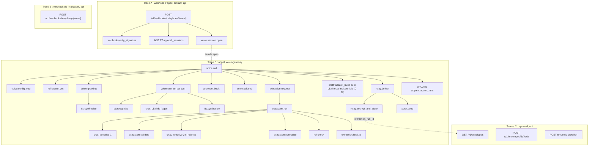
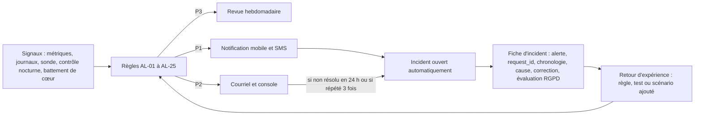
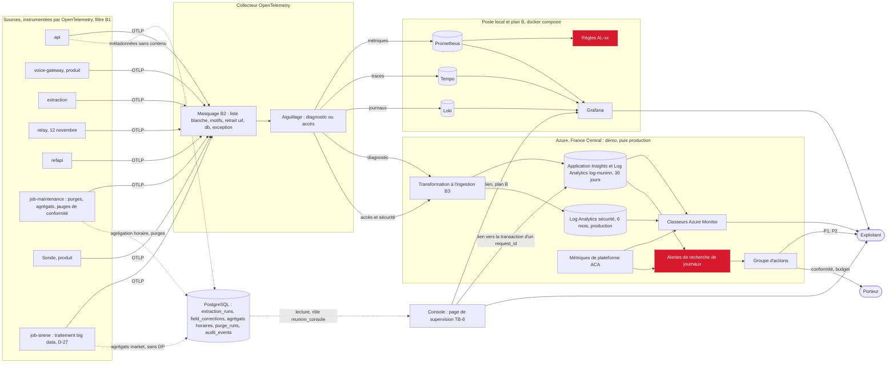
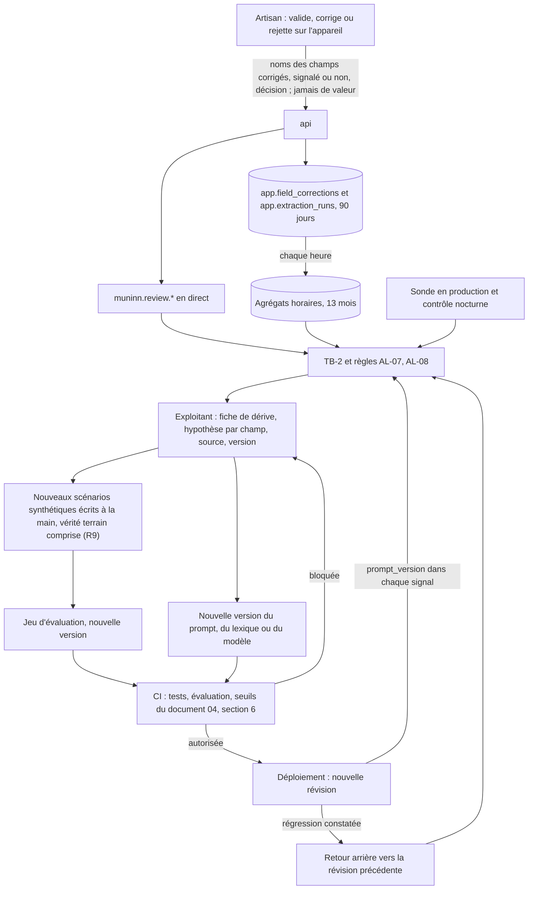

# Observabilité de Muninn

**Version :** 1.0
**Date :** 12 octobre 2026
**Phase :** 2 (industrialisation)
**Statut :** proposition, à valider par le porteur
**Compétences servies :** C11 (monitorage du modèle), C20 (surveillance et détection d'incident) ;
appui à C13 (livraison contrôlée) et à C21 (résolution d'incident)
**Documents liés :** `../sources_de_donnees/02-flux-de-donnees.md` (F-02, F-11, F-12),
`../architecture_de_donnees/02-modele-de-donnees.md`, `../architecture_de_donnees/03-acces-et-exposition.md`,
`../architecture_de_donnees/04-verification-exactitude.md`, `../architecture_de_donnees/05-registre-rgpd.md`,
`01-besoin-de-production.md` (SLO, budgets d'erreur, modes dégradés), `02-plan-de-tests.md`,
`05-chaine-llmops.md` (canari, contrôle nocturne, incidents d'agent),
`06-architecture-technique.md` (déploiement, coûts), `04-contrat-api.md` (brouillon de secours),
`../architecture_de_donnees/06-big-data-externalise.md`, `../../decisions.md` (D-27, D-29)

Ce document ne contient aucune ligne de code. Les noms de métriques, d'attributs et de règles sont
des propositions, à figer à l'implémentation (phases 4 à 6). Les hypothèses sont marquées **[H]**.

## 1. Objet, principes et objectifs de service

### 1.1 Objet

Dire ce que Muninn mesure, trace et journalise, où ces signaux vont, combien de temps ils
restent, qui les lit, et quelles alertes en découlent. Le périmètre couvre le flux principal F-02
(appel manqué jusqu'à l'enveloppe chiffrée), la démo F-12, les tâches de F-11 (évaluation,
purges, retour arrière) et le traitement big data de Sirene (D-27, section 5.7).

Noms des composants : ceux du document 06 de la phase 2. `job-maintenance` y correspond à
worker-maintenance de la phase 1, `refapi` à l'API des référentiels.

### 1.2 Principes

| ID   | Principe                                                                                                                                                                                                                                                | Règle      |
| ---- | ------------------------------------------------------------------------------------------------------------------------------------------------------------------------------------------------------------------------------------------------------- | ---------- |
| OB-1 | Aucun contenu dans un signal : ni transcription, ni prompt rempli, ni réponse du LLM, ni valeur extraite, ni valeur contrôlée, ni DP d'un client final. Les signaux décrivent, ils ne copient pas                                                       | R1, R3, R4 |
| OB-2 | Liste blanche, jamais liste noire : un attribut, un champ de journal ou un label n'existe que s'il est déclaré dans ce document ; tout le reste est retiré                                                                                              | R4         |
| OB-3 | Trois barrières indépendantes : dans le processus, dans le collecteur, à l'ingestion du stockage Azure                                                                                                                                                  | R4         |
| OB-4 | Corrélation : le `request_id` est l'identifiant de trace W3C (32 caractères hexadécimaux) ; les traces d'un même appel ou d'une même extraction sont reliées par des identifiants métier opaques (`muninn.call_session_id`, `muninn.extraction_run_id`) | US-39      |
| OB-5 | Aucun identifiant de compte, de ligne, d'appareil ou d'appel dans un label de métrique : ni DP, ni cardinalité explosive                                                                                                                                | R4         |
| OB-6 | Une conception, deux destinations : la même instrumentation et le même collecteur servent le poste local et Azure ; seul l'export change                                                                                                                | C13        |
| OB-7 | Mesuré, pas déclaré : une affirmation de conformité (audio détruit, purge faite) a sa métrique et son alerte ; quand la métrique n'est qu'une assertion du code, ce document le dit                                                                     | R2, US-31  |

### 1.3 Objectifs de service

Les SLO sont ceux du document 01 de la phase 2 (section 4.2), repris ici avec l'indicateur qui les
mesure. Ce document n'en crée aucun : il dit où chaque point de mesure est émis.

| SLO    | Cible produit                                                   | Cible démo                                    | Indicateur de ce document                                                       | Alertes                    |
| ------ | --------------------------------------------------------------- | --------------------------------------------- | ------------------------------------------------------------------------------- | -------------------------- |
| SLO-01 | Disponibilité de l'api 99,5 %                                   | 99 % pendant les créneaux                     | `http.server.request.duration` par classe de statut ; `muninn.dependency.up`    | AL-05, AL-23               |
| SLO-02 | Prise d'appel 99,9 %                                            | sans objet                                    | `muninn.voice.calls` par issue                                                  | AL-22, AL-23               |
| SLO-03 | Fin d'appel à enveloppe : p50 ≤ 10 s, p95 ≤ 30 s                | sans objet le 29/10 ; mêmes cibles le 12/11   | `muninn.delivery.latency`, seaux à 10 s et 30 s                                 | AL-02, AL-02b, AL-23       |
| SLO-04 | sans objet                                                      | Scénario à brouillon : p50 ≤ 10 s, p95 ≤ 30 s | `muninn.demo.scenario.duration`                                                 | AL-02c                     |
| SLO-05 | Extraction : p50 ≤ 6 s, p95 ≤ 20 s                              | Idem                                          | `muninn.extraction.duration`                                                    | AL-16                      |
| SLO-06 | `refapi` : p95 ≤ 50 ms                                          | Idem                                          | `http.server.request.duration`, `service.name` = `refapi`                       | AL-16                      |
| SLO-07 | Exactitude des champs clés ≥ 90 %, borne basse de Wilson ≥ 85 % | ≥ 90 % mesurés, intervalle publié             | Évaluation (document 05) ; en service, contrôle nocturne et sonde (section 7.3) | AL-06                      |
| SLO-08 | 0 échec sur les cas à tolérance nulle                           | Idem                                          | Idem                                                                            | AL-06                      |
| SLO-09 | `needs_review` ≤ 20 % par heure, 20 extractions au moins        | ≤ 20 % sur une évaluation                     | `muninn.extraction.runs`                                                        | AL-01                      |
| SLO-10 | Champs « non contrôlé » ≤ 1 %                                   | 0 % hors panne volontaire                     | `muninn.reference_check.results`                                                | AL-10                      |
| SLO-11 | ≤ 1 champ corrigé par brouillon validé, en moyenne              | mesuré                                        | `muninn.review.field_corrections`, `muninn.review.decisions`                    | AL-07                      |
| SLO-12 | Appels perdus ≤ 0,1 %                                           | 0 scénario sans brouillon ni erreur           | `muninn.calls.lost`, `muninn.extraction.runs`, `muninn.draft.fallback` (D-29)   | AL-03, AL-04, AL-23, AL-24 |
| SLO-13 | Coût d'une extraction ≤ 0,01 €                                  | Idem                                          | `muninn.call.cost`, `muninn.provider.cost`                                      | AL-15                      |
| SLO-14 | Coût d'un appel pris ≤ 0,15 € [H]                               | sans objet                                    | `muninn.call.cost`                                                              | AL-15                      |
| SLO-15 | Retard des purges ≤ 24 h ; enveloppe ≤ 7 j + 1 h                | ≤ 24 h                                        | `muninn.retention.oldest_age`, `muninn.envelopes.overdue`, `muninn.purge.*`     | AL-11, AL-12               |
| SLO-16 | Coût Azure mensuel à fixer                                      | ≤ 60 €                                        | Budget du groupe de ressources (document 06, section 5.1), hors de ce document  | Budget Azure               |

S'y ajoute un objectif de conformité sans budget, tiré de la passation : **zéro audio ni
transcription conservés** (R2, R3), mesuré par `muninn.sensitive.destroyed` et
`muninn.audio.tempfiles` (AL-13).

**Budget de latence de SLO-03** [H : à mesurer en phase 4]. Il répartit les 30 s du p95 entre les
étapes de F-02, pour qu'une alerte désigne l'étape fautive. L'extraction reprend SLO-05.

| Étape (messages de F-02)                                         | Budget p95 |
| ---------------------------------------------------------------- | ---------- |
| Fermeture du flux et remise à l'extraction (T4, message 24)      | 1 s        |
| Extraction complète, relance comprise (messages 24 à 29, SLO-05) | 20 s       |
| dont contrôle par `refapi` (messages 27, 28, SLO-06)             | 0,05 s     |
| Chiffrement et stockage des enveloppes (messages 30 à 34)        | 1 s        |
| Marge                                                            | 8 s        |

Le mode dégradé MD-3 (deux nouvelles tentatives sur 60 s) dépasse ce budget par construction : ces
appels consomment le budget d'erreur de SLO-03, et ils sont comptés à part (section 5.2).

## 2. Outillage retenu

### 2.1 Choix

La démo du 29 octobre tourne sur Azure, comme la production ; `docker compose` sert au
développement et de plan B (document 06, sections 4 et 11.3 ; document 01, section 6.3). Les deux
environnements reçoivent les mêmes signaux par le même collecteur.

| Besoin                         | Poste local et plan B (docker compose)              | Azure : démo, puis production (France Central)                                                                                                 | Justification                                                                                                                                                                  |
| ------------------------------ | --------------------------------------------------- | ---------------------------------------------------------------------------------------------------------------------------------------------- | ------------------------------------------------------------------------------------------------------------------------------------------------------------------------------ |
| Instrumentation                | SDK OpenTelemetry Python, spans manuels pour le LLM | Identique                                                                                                                                      | Standard ouvert ; un seul code pour les deux destinations (OB-6) ; FastAPI, httpx, SQLAlchemy, Redis et `logging` ont une instrumentation                                      |
| Collecteur                     | OpenTelemetry Collector, distribution contrib       | Même image, application de conteneur interne `ca-otel` [H : nom]                                                                               | Deuxième barrière de masquage (OB-3) ; seul point de sortie des signaux ; l'export change par configuration                                                                    |
| Traces                         | Grafana Tempo                                       | Application Insights, ressource basée sur l'espace `log-muninn`                                                                                | Tempo s'affiche dans Grafana à côté des journaux ; Application Insights montre une transaction de bout en bout                                                                 |
| Métriques                      | Prometheus                                          | Application Insights (table `AppMetrics`)                                                                                                      | Prometheus est la référence locale ; sur Azure, un seul service à exploiter pour une personne seule                                                                            |
| Journaux de diagnostic         | Grafana Loki                                        | Application Insights (table `AppTraces`), espace `log-muninn`, 30 jours                                                                        | Recherche par `request_id` ; rétention par table                                                                                                                               |
| Journal d'accès et de sécurité | Loki, flux distinct                                 | Démo : même espace `log-muninn`, distingué par `muninn.log.stream`, 30 jours. Production : second espace « sécurité », 6 mois, accès restreint | Séparation exigée par les durées et les lecteurs différents (section 6.5)                                                                                                      |
| Tableaux de bord               | Grafana                                             | Page de supervision de la console (TB-6) ; classeurs Azure Monitor (Workbooks)                                                                 | La console lit déjà les métriques en base (document 06, section 3.2) ; les classeurs n'ajoutent ni service ni coût fixe [H : coût d'Azure Managed Grafana non estimé ; écarté] |
| Alertes                        | Règles Prometheus                                   | Alertes de recherche de journaux Azure Monitor et groupe d'actions ; état de AL-01 calculé par la console                                      | Les règles portent le même identifiant (AL-xx) et la même expression logique dans les trois formes                                                                             |
| Agrégats de qualité durables   | PostgreSQL, `app.*_metrics_hourly` (13 mois)        | Identique                                                                                                                                      | Déjà conçus en phase 1 ; source de vérité de la boucle de rétroaction (section 10)                                                                                             |

Versions des images : fixées en phase 3, avec un numéro exact [H]. Licences : Prometheus et le
collecteur sont sous Apache 2.0 ; Grafana, Loki et Tempo sous AGPL v3, employés sans modification
ni distribution, sur le seul poste local (section 15).

**Maturité.** Le processeur `redaction` est en bêta pour les traces et en alpha pour les journaux
et les métriques ; le connecteur `routing` et le processeur `filter` sont en alpha ; l'exportateur
`azuremonitor` est en bêta pour les trois signaux (section 15). B2 n'est donc jamais la seule
barrière : B1 reste la protection principale.

### 2.2 Options écartées

| Option                                                                 | Raison                                                                                                                                                                                                                                                   |
| ---------------------------------------------------------------------- | -------------------------------------------------------------------------------------------------------------------------------------------------------------------------------------------------------------------------------------------------------- |
| Agent OpenTelemetry géré d'Azure Container Apps                        | En préversion ; aucun processeur de filtrage ou de masquage documenté ; le point Application Insights n'accepte pas les métriques ; configuration au niveau de l'environnement ; secrets à écrire en clair dans les modèles, sans Key Vault (section 15) |
| Distribution Azure Monitor directement dans chaque processus           | Elle supprime la barrière du collecteur ; son échantillonnage par défaut est limité à 5 traces par seconde, à reconfigurer (section 15). Gardée en repli si le collecteur pose problème                                                                  |
| Prometheus et Grafana auto-hébergés en production                      | Prometheus ne prend pas en charge un stockage local non POSIX ni NFS (risque de corruption, section 15) ; le volume persistant d'ACA serait Azure Files [H : classé non POSIX] ; mises à jour et sauvegardes pour une personne seule                     |
| Service géré Prometheus d'Azure Monitor                                | Règles PromQL partagées avec la démo, avantage réel ; mais un second service, une authentification d'écriture distante à monter, et une rétention fixée par le service [H : non vérifiée]. Évolution possible après le MVP                               |
| Outil de suivi d'erreurs qui capture les variables locales             | Copierait une transcription ou un brouillon (P-06)                                                                                                                                                                                                       |
| Instrumentation automatique des appels LLM par une bibliothèque tierce | Certaines capturent le contenu des prompts par défaut (section 4.5) ; les spans du LLM sont écrits à la main                                                                                                                                             |

### 2.3 Outil de traçage de LLM qui stocke les prompts

Des outils spécialisés (Langfuse, par exemple) enregistrent les prompts remplis et les réponses du
modèle pour les rejouer et les comparer. **Un tel outil n'est acceptable qu'avec des données
synthétiques.** Conditions, toutes requises s'il est un jour utilisé :

1. instance séparée, sur le poste de l'exploitant ou dans la CI, sans route réseau vers la
   production ;
2. alimentée par le seul harnais d'évaluation (F-11), sur le jeu synthétique versionné (R9) ;
3. aucune clé ni adresse de cet outil dans la configuration de production ; un test de la CI
   échoue si une variable de cet outil apparaît dans un conteneur de production (extension de
   TA-39) ;
4. jamais branché sur la console ni sur l'environnement Azure de démo, même avec des données synthétiques, pour que le chemin
   de code de la démo reste celui de la production.

**Décision proposée : non retenu pour le 29 octobre.** Le rapport d'évaluation du document 04
(section 7) contient déjà les erreurs cas par cas, sur données synthétiques. L'outil n'apporterait
qu'un confort de lecture.

### 2.4 Coûts

Prix et méthode du document 06 de la phase 2 (section 10), hors taxes.

| Poste                            | Estimation                                                                                                                                                                                                                                                                                                                       | Statut                             |
| -------------------------------- | -------------------------------------------------------------------------------------------------------------------------------------------------------------------------------------------------------------------------------------------------------------------------------------------------------------------------------- | ---------------------------------- |
| Pile locale (plan B)             | 0 € ; environ 1,5 Go de mémoire pour cinq conteneurs de plus                                                                                                                                                                                                                                                                     | [H : à mesurer en phase 5]         |
| Collecteur `ca-otel` sur Azure   | Une application de 0,25 vCPU et 0,5 Gio de plus, au même régime que les autres : environ 1,02 € par mois (scénario bas, (1,90 + 2,17) / 4) ; 17,33 € (scénario haut, 69,33 / 4)                                                                                                                                                  | Calcul sur les prix du document 06 |
| Ingestion Log Analytics          | 5 Go par mois gratuits par compte de facturation (partagé), puis 2,4287 € par Go                                                                                                                                                                                                                                                 | Vérifié le 12 octobre 2026         |
| Volume sur Azure, démo           | Environ 20 Ko de signaux par extraction (15 spans, 10 lignes, métriques). Les évaluations de la CI (24 740 extractions par mois sur le jeu du 12 novembre, document 01 de la phase 2, section 2.3) n'exportent pas vers Azure [H] ; même comptées, elles donneraient 0,49 Go par mois                                            | [H : 20 Ko à mesurer]              |
| Volume, produit à 1 000 artisans | 136 000 extractions par mois (document 01, section 2.2) donnent 2,7 Go par mois. C'est un plancher : il ne compte ni les spans de l'agent vocal (un par tour, pour le STT, le LLM et le TTS), ni le flux d'accès, ni la sortie standard. Sous la franchise si elle n'est pas consommée ailleurs ; sinon 6,60 € par mois au moins | [H]                                |
| Rétention au-delà de l'inclus    | 31 jours inclus (90 jours pour les tables Application Insights), puis 0,1056 € par Go et par mois ; le journal de sécurité à 6 mois en relève                                                                                                                                                                                    | Vérifié le 12 octobre 2026         |
| Sonde synthétique en production  | 40 extractions par jour, 1 200 par mois : 1 200 × 0,000885 = 1,06 $ avec Mistral Small 4 ; 1 200 × 0,00975 = 11,70 $ avec Mistral Medium 3.5 (coûts unitaires du document 01 de la phase 2, section 4.3). Avec 10 % de relances (HP-03) : 1,16 $ et 12,84 $                                                                      | Production seulement               |
| Rafale de l'alerte de démo       | 20 extractions par répétition : 0,02 $ à 0,20 $, mêmes coûts unitaires ; 0,21 $ au plus avec 10 % de relances                                                                                                                                                                                                                    | Idem                               |

Le collecteur pèse environ 3 % du scénario bas du document 06 (30,89 €) : SLO-16 (60 € par mois)
reste tenu. Le document 06 l'a repris dans ses ressources et son coût (sections 5.1 et 10.3).

## 3. Ce qui peut entrer dans un signal

### 3.1 Attributs autorisés

Liste blanche commune aux spans et au flux de journaux de diagnostic. Elle n'a **aucun joker** :
chaque clé est nommée. La colonne « Label » dit si l'attribut peut devenir un label de métrique.

| Attribut                                                                                                                                                                                                                                                                      | Type         | Valeurs                                                                                                                                                                                                                                                                              | Label                                                               | Justification                                                                                                          |
| ----------------------------------------------------------------------------------------------------------------------------------------------------------------------------------------------------------------------------------------------------------------------------- | ------------ | ------------------------------------------------------------------------------------------------------------------------------------------------------------------------------------------------------------------------------------------------------------------------------------ | ------------------------------------------------------------------- | ---------------------------------------------------------------------------------------------------------------------- |
| `service.name`                                                                                                                                                                                                                                                                | énuméré      | `api`, `extraction`, `refapi`, `console`, `worker`, `job-maintenance`, `job-ingest`, `relay`, `voice-gateway`, `probe`, `job-sirene` (11 valeurs ; `job-migrate` n'émet que sur la sortie standard ; `job-sirene` est le job du traitement big data de D-27, `caj-sirene` sur Azure) | oui                                                                 | Ressource OpenTelemetry ; noms du document 06                                                                          |
| `service.version`                                                                                                                                                                                                                                                             | texte        | SHA de l'image, motif fermé                                                                                                                                                                                                                                                          | oui                                                                 | Document 05, section 4                                                                                                 |
| `deployment.environment.name`                                                                                                                                                                                                                                                 | énuméré      | `local`, `demo`, `prod`                                                                                                                                                                                                                                                              | oui                                                                 | Sépare les destinations                                                                                                |
| `muninn.revision`                                                                                                                                                                                                                                                             | texte        | Nom de la révision Container Apps, motif fermé ; 2 actives au plus (document 05, section 6.2)                                                                                                                                                                                        | oui                                                                 | Comparaison candidate et précédente pendant le canari                                                                  |
| `muninn.request_id`                                                                                                                                                                                                                                                           | texte        | Identifiant de trace, 32 caractères hexadécimaux                                                                                                                                                                                                                                     | non                                                                 | OB-4 ; redondant dans les spans, utile en journal                                                                      |
| `muninn.account_id`                                                                                                                                                                                                                                                           | UUID         | Identifiant opaque du compte                                                                                                                                                                                                                                                         | **non**                                                             | Diagnostic ; DP pseudonymisée de l'artisan (RT-04)                                                                     |
| `muninn.call_session_id`                                                                                                                                                                                                                                                      | UUID         | Opaque                                                                                                                                                                                                                                                                               | non                                                                 | Relie les traces d'un même appel                                                                                       |
| `muninn.extraction_run_id`                                                                                                                                                                                                                                                    | UUID         | Opaque, `draft_id` du contrat 1.1                                                                                                                                                                                                                                                    | non                                                                 | Relie trace, journal et ligne de `app.extraction_runs`                                                                 |
| `muninn.mode`                                                                                                                                                                                                                                                                 | énuméré      | `normal`, `test`, `simulated`                                                                                                                                                                                                                                                        | oui                                                                 | `app.call_sessions.mode`                                                                                               |
| `muninn.is_synthetic`                                                                                                                                                                                                                                                         | booléen      | `true`, `false`                                                                                                                                                                                                                                                                      | oui                                                                 | Sépare démo, sonde, canari et trafic réel                                                                              |
| `muninn.scenario_id`                                                                                                                                                                                                                                                          | texte        | Identifiant du scénario synthétique, motif fermé ; **seulement si `is_synthetic` vaut `true`**                                                                                                                                                                                       | non                                                                 | Démo, sonde, canari                                                                                                    |
| `muninn.source`                                                                                                                                                                                                                                                               | énuméré      | `missed_call`, `debrief`, `expense_voice`, `receipt_scan`                                                                                                                                                                                                                            | oui                                                                 | Contrat `DossierDraft`                                                                                                 |
| `muninn.input_mode`                                                                                                                                                                                                                                                           | énuméré      | `audio`, `text`, `image`, `simulated`                                                                                                                                                                                                                                                | oui                                                                 | `app.extraction_runs`                                                                                                  |
| `muninn.extraction.status`                                                                                                                                                                                                                                                    | énuméré      | Les 6 valeurs de `app.extraction_runs.status`                                                                                                                                                                                                                                        | oui                                                                 | Idem                                                                                                                   |
| `muninn.draft.extraction_status`                                                                                                                                                                                                                                              | énuméré      | `complete`, `partial_after_retry`, `fallback_no_llm`                                                                                                                                                                                                                                 | oui                                                                 | `provenance.extraction_status` du contrat `DossierDraft` 1.1 ; `fallback_no_llm` marque le brouillon de secours (D-29) |
| `muninn.needs_review`                                                                                                                                                                                                                                                         | booléen      | `true`, `false`                                                                                                                                                                                                                                                                      | oui                                                                 | US-38                                                                                                                  |
| `muninn.validation_attempts`                                                                                                                                                                                                                                                  | entier       | 1 ou 2                                                                                                                                                                                                                                                                               | non                                                                 | VE-02                                                                                                                  |
| `muninn.validation.error_types`                                                                                                                                                                                                                                               | liste        | Liste fermée : `missing`, `extra_forbidden`, `enum`, `literal_error`, `string_type`, `string_too_long`, `int_type`, `float_type`, `bool_type`, `greater_than_equal`, `less_than_equal`, `json_invalid`, `value_error` ; tout autre type devient `other`                              | non                                                                 | Diagnostic de VE-01, sans valeur d'entrée                                                                              |
| `muninn.validation.error_fields`                                                                                                                                                                                                                                              | liste        | Chemins de la liste fermée de `app.field_corrections` ; un chemin hors liste (clé inventée par le LLM, cas `extra_forbidden`) devient `invalid` et n'est jamais recopié                                                                                                              | non                                                                 | Idem                                                                                                                   |
| `muninn.prompt_version`                                                                                                                                                                                                                                                       | texte        | Version du paquet d'extraction, motif fermé                                                                                                                                                                                                                                          | oui                                                                 | VE-29, US-40                                                                                                           |
| `muninn.model_id`                                                                                                                                                                                                                                                             | texte        | Identifiant daté du modèle, liste de la configuration                                                                                                                                                                                                                                | oui                                                                 | Idem                                                                                                                   |
| `muninn.schema_version`, `muninn.lexicon_version`, `muninn.referential_version`                                                                                                                                                                                               | texte        | Versions déclarées, motif fermé                                                                                                                                                                                                                                                      | non (dans `muninn.build.info` seulement)                            | Idem                                                                                                                   |
| `muninn.confidence_classes`                                                                                                                                                                                                                                                   | liste        | Couples (chemin de la liste fermée, classe de confiance de largeur 0,1), sans valeur                                                                                                                                                                                                 | non                                                                 | Document 05, section 8.2                                                                                               |
| `muninn.fields_to_review_count`                                                                                                                                                                                                                                               | entier       | 0 à 21                                                                                                                                                                                                                                                                               | non                                                                 | US-38                                                                                                                  |
| `muninn.field_name`                                                                                                                                                                                                                                                           | énuméré      | Liste fermée des 21 chemins (document 02 de la phase 1, `app.field_corrections`)                                                                                                                                                                                                     | oui                                                                 | Boucle de rétroaction                                                                                                  |
| `muninn.flag_reason`                                                                                                                                                                                                                                                          | énuméré      | `low_confidence`, `missing`, `reference_flagged`, `reference_unchecked`                                                                                                                                                                                                              | oui                                                                 | Champs à vérifier                                                                                                      |
| `muninn.reference_check`                                                                                                                                                                                                                                                      | énuméré      | `ok`, `flagged`, `unchecked`, `not_applicable`                                                                                                                                                                                                                                       | oui                                                                 | US-51                                                                                                                  |
| `muninn.check`                                                                                                                                                                                                                                                                | énuméré      | `postal_code`, `commune`, `phone_prefix`                                                                                                                                                                                                                                             | oui                                                                 | Nature du contrôle, jamais sa valeur                                                                                   |
| `muninn.trade`                                                                                                                                                                                                                                                                | énuméré      | `plomberie`, `chauffage`, `electricite`, `serrurerie`, `autre`                                                                                                                                                                                                                       | **non**                                                             | Diagnostic du lexique ; voir section 14                                                                                |
| `muninn.call.status`                                                                                                                                                                                                                                                          | énuméré      | Les 7 valeurs de `app.call_sessions.status`                                                                                                                                                                                                                                          | oui                                                                 | Motif d'arrêt                                                                                                          |
| `muninn.turn.index`                                                                                                                                                                                                                                                           | entier       | Rang du tour de parole                                                                                                                                                                                                                                                               | non                                                                 | Agent vocal                                                                                                            |
| `muninn.agent.tool`                                                                                                                                                                                                                                                           | énuméré      | `propose_slot`, `book_slot`, `end_call`                                                                                                                                                                                                                                              | oui                                                                 | Document 03 de la phase 1, M-02                                                                                        |
| `muninn.agent.tool_verdict`                                                                                                                                                                                                                                                   | énuméré      | `accepted`, `refused`                                                                                                                                                                                                                                                                | oui                                                                 | Document 05, section 8.2                                                                                               |
| `muninn.guardrail`                                                                                                                                                                                                                                                            | énuméré      | `safety_gas`, `safety_other`, `caller_refused`, `commitment_blocked`, `silence_close`, `duration_cap`                                                                                                                                                                                | oui                                                                 | Garde-fous déclenchés (document 05, section 8.3), sans la phrase déclenchante                                          |
| `muninn.degraded_mode`                                                                                                                                                                                                                                                        | énuméré      | `MD-1` à `MD-9` (document 01, section 6.2) ; `demo_fake_llm`                                                                                                                                                                                                                         | oui                                                                 | Chaque bascule émet un événement (document 01, section 6.1)                                                            |
| `muninn.input.chars`, `muninn.output.chars`                                                                                                                                                                                                                                   | entier       | Longueur en caractères, jamais le texte                                                                                                                                                                                                                                              | non                                                                 | Coût, détection d'entrée anormale (M-11)                                                                               |
| `muninn.audio.duration_ms`                                                                                                                                                                                                                                                    | entier       | Durée d'audio traitée                                                                                                                                                                                                                                                                | non                                                                 | Coût en minutes                                                                                                        |
| `muninn.devices.count`, `muninn.envelopes.count`                                                                                                                                                                                                                              | entier       | Compteurs                                                                                                                                                                                                                                                                            | non                                                                 | Relay                                                                                                                  |
| `muninn.destroyed`                                                                                                                                                                                                                                                            | énuméré      | `audio`, `transcript`, `draft_plaintext`                                                                                                                                                                                                                                             | oui                                                                 | Preuve de destruction (US-31), assertion du code                                                                       |
| `muninn.review.decision`                                                                                                                                                                                                                                                      | énuméré      | `validated`, `validated_with_corrections`, `rejected`                                                                                                                                                                                                                                | oui                                                                 | US-17                                                                                                                  |
| `muninn.review.corrected_fields`                                                                                                                                                                                                                                              | liste        | Chemins de la liste fermée                                                                                                                                                                                                                                                           | non                                                                 | US-17, critère 3                                                                                                       |
| `muninn.job_name`                                                                                                                                                                                                                                                             | énuméré      | Tâches de purge et d'agrégation (15 au plus, liste du document 02 de la phase 1, section 9.4)                                                                                                                                                                                        | oui                                                                 | `app.purge_runs`                                                                                                       |
| `muninn.error_code`                                                                                                                                                                                                                                                           | énuméré      | Liste fermée des codes d'erreur de l'api (30 au plus), figée par le contrat d'API                                                                                                                                                                                                    | oui                                                                 | Format d'erreur unique                                                                                                 |
| `error.type`                                                                                                                                                                                                                                                                  | énuméré      | `timeout`, `rate_limited`, `client_error`, `server_error`, `network_error`, `validation_error`, `db_error`, `internal_error`, `_OTHER` ; B1 traduit chaque exception vers l'une de ces valeurs, jamais son nom de classe                                                             | oui                                                                 | Convention OpenTelemetry, valeur de repli `_OTHER`                                                                     |
| `http.request.method`                                                                                                                                                                                                                                                         | énuméré      | `GET`, `POST`, `PUT`, `DELETE`, `_OTHER`                                                                                                                                                                                                                                             | oui                                                                 | Convention OpenTelemetry                                                                                               |
| `http.route`                                                                                                                                                                                                                                                                  | texte        | Gabarit déclaré par FastAPI (`/v1/envelopes/{id}/ack`), jamais le chemin réel                                                                                                                                                                                                        | oui                                                                 | Idem                                                                                                                   |
| `http.response.status_code`                                                                                                                                                                                                                                                   | entier       | Code HTTP                                                                                                                                                                                                                                                                            | en classe (`2xx` à `5xx`)                                           | Idem                                                                                                                   |
| `server.address`                                                                                                                                                                                                                                                              | énuméré      | Nom d'hôte d'un fournisseur ou d'un service interne, liste fermée de la configuration (12 au plus)                                                                                                                                                                                   | oui                                                                 | Dépendances                                                                                                            |
| `db.system.name`, `db.operation.name`, `db.collection.name`                                                                                                                                                                                                                   | texte        | `postgresql` ; `SELECT`, `INSERT`, `UPDATE`, `DELETE` ; nom de table                                                                                                                                                                                                                 | non                                                                 | Sans texte de requête (section 3.2)                                                                                    |
| `gen_ai.operation.name`, `gen_ai.provider.name`, `gen_ai.request.model`, `gen_ai.response.model`, `gen_ai.request.temperature`, `gen_ai.request.max_tokens`, `gen_ai.usage.input_tokens`, `gen_ai.usage.output_tokens`, `gen_ai.response.finish_reasons`, `gen_ai.token.type` | selon la clé | Section 4.5                                                                                                                                                                                                                                                                          | `gen_ai.provider.name`, `gen_ai.request.model`, `gen_ai.token.type` | Conventions GenAI d'OpenTelemetry, version 1.37.0                                                                      |

`muninn.prompt_version` porte la version du paquet d'extraction (document 05, section 4, par
exemple `extraction-1.4.0`) : le nom de la phase 1 est gardé, pour rester celui de
`app.extraction_runs`.

Les valeurs `UUID` et les textes à motif fermé sont contrôlés par expression régulière ; les
énumérés, par appartenance à leur liste. Une valeur hors liste est remplacée par `invalid` et
comptée (`muninn.redaction.events`).

**Labels propres aux métriques.** Les métriques de la section 5 emploient aussi les labels
suivants, qui n'existent que sur les métriques, chacun à liste fermée.

| Label                          | Valeurs                                                                                                                                      | Métriques                                                                                            |
| ------------------------------ | -------------------------------------------------------------------------------------------------------------------------------------------- | ---------------------------------------------------------------------------------------------------- |
| `provider`                     | Nom du fournisseur pris dans la configuration (8 au plus)                                                                                    | `muninn.provider.*`, `muninn.audio.duration`                                                         |
| `operation`                    | `chat`, `stt_stream`, `stt_batch`, `tts`, `cpaas`, `push`, `sms`                                                                             | Idem                                                                                                 |
| `outcome`                      | Liste propre à chaque métrique, écrite dans sa ligne de la section 5                                                                         | Compteurs d'issue                                                                                    |
| `status_class`                 | `2xx`, `3xx`, `4xx`, `5xx`                                                                                                                   | Métriques HTTP                                                                                       |
| `dependency`                   | `postgres`, `redis`, `object_storage`, `refapi`, `extraction`                                                                                | `muninn.dependency.up`                                                                               |
| `queue`                        | Files arq déclarées (3 au plus)                                                                                                              | `muninn.queue.*`                                                                                     |
| `table`                        | Tables purgées de la section 9.4 du document 02 de la phase 1 (12 au plus)                                                                   | `muninn.retention.oldest_age`                                                                        |
| `limit`                        | Limites de la section 5.4 du document 03 de la phase 1 (12 au plus)                                                                          | `muninn.ratelimit.rejections`                                                                        |
| `reason`                       | Liste propre à chaque métrique, écrite dans sa ligne                                                                                         | `muninn.webhook.rejections`, `muninn.envelopes.closed`, `muninn.calls.lost`, `muninn.draft.fallback` |
| `cost_item`                    | `llm_input`, `llm_output`, `stt`, `tts`, `cpaas`, `sms`                                                                                      | `muninn.provider.cost`                                                                               |
| `audit_type`                   | Les 10 valeurs de `app.audit_events.event_type`                                                                                              | `muninn.audit.events`                                                                                |
| `purge_status`                 | `succeeded`, `failed`                                                                                                                        | `muninn.purge.runs`                                                                                  |
| `signal`, `barrier`, `pattern` | `span`, `log`, `metric` ; `process`, `collector` ; `phone`, `email`, `ip`, `iban`, `postal_code`, `long_text`, `unknown_key`, `invalid_enum` | `muninn.redaction.events`                                                                            |
| `family`                       | `nominal`, `gas`, `medical`, `injection`                                                                                                     | `muninn.probe.runs`                                                                                  |
| `flagged`, `confident`         | `true`, `false`                                                                                                                              | `muninn.review.field_corrections`, `muninn.probe.field_results`                                      |
| `result`                       | Liste propre à chaque métrique, écrite dans sa ligne                                                                                         | `muninn.reference_check.results`, `muninn.probe.field_results`                                       |
| `failed_step`                  | `none`, `read`, `aggregate`, `disclosure_control`, `checks`, `load`                                                                          | `muninn.bigdata.runs`                                                                                |
| `case`                         | `VD-20` à `VD-26`                                                                                                                            | `muninn.bigdata.checks`                                                                              |

**Flux d'accès et de sécurité.** Il a sa propre liste blanche, plus courte, et lui seul porte une
adresse IP.

| Attribut                                                                                              | Valeurs                                                                                                                                                                                                                                                |
| ----------------------------------------------------------------------------------------------------- | ------------------------------------------------------------------------------------------------------------------------------------------------------------------------------------------------------------------------------------------------------ |
| `client.address`                                                                                      | Adresse IP complète du client, lue dans l'en-tête de l'ingress [H : nom et fiabilité de l'en-tête dans Azure Container Apps à vérifier]                                                                                                                |
| `service.name`, `muninn.request_id`, `http.request.method`, `http.route`, `http.response.status_code` | Comme ci-dessus                                                                                                                                                                                                                                        |
| `duration_ms`                                                                                         | Entier                                                                                                                                                                                                                                                 |
| `muninn.device_id`                                                                                    | UUID opaque de l'appareil authentifié, absent sinon                                                                                                                                                                                                    |
| `muninn.app_version`                                                                                  | Version de l'application mobile, motif fermé (`x.y.z`)                                                                                                                                                                                                 |
| `muninn.security_event`                                                                               | `otp_rejected`, `login_locked`, `rate_limited`, `webhook_signature_rejected`, `webhook_replayed`, `breakglass_opened`, `breakglass_closed`, `revoked_device_access` : le type d'événement, jamais la valeur d'un code ni d'un identifiant de connexion |

Composants qui l'alimentent : `api` et `console`, qui reçoivent des requêtes d'Internet, et
`voice-gateway`, dont la connexion entrante vient du CPaaS. Aucun autre composant n'a d'entrée
publique (document 06, section 2.1).

### 3.2 Données interdites dans tout signal

| Donnée                                                                                                                                                                               | Pourquoi                                                                                                       | Barrière principale                                                                                                                                                                                              |
| ------------------------------------------------------------------------------------------------------------------------------------------------------------------------------------ | -------------------------------------------------------------------------------------------------------------- | ---------------------------------------------------------------------------------------------------------------------------------------------------------------------------------------------------------------- |
| Audio, transcription, texte reconnu par le STT                                                                                                                                       | R2, R3                                                                                                         | Jamais passé à un appel de journal ; `body` limité aux codes d'événement (section 6.2)                                                                                                                           |
| Prompt rempli, messages de la conversation, réponse du LLM, JSON candidat                                                                                                            | R3 ; la réponse contient les valeurs extraites                                                                 | Spans du LLM écrits à la main ; capture de contenu à `NO_CONTENT` ; clés absentes de la liste blanche                                                                                                            |
| Valeur d'un champ du `DossierDraft`, clé humaine                                                                                                                                     | R1, R4                                                                                                         | Liste blanche                                                                                                                                                                                                    |
| Code postal, commune, préfixe envoyés au contrôle                                                                                                                                    | P-05 : DP en combinaison                                                                                       | Corps de `POST`, jamais journalisé ; aucune clé d'URL autorisée                                                                                                                                                  |
| Numéro appelant, `caller_hash`                                                                                                                                                       | R4 ; `caller_hash` reste une DP pseudonymisée réservée à l'anti-abus (RT-04)                                   | Liste blanche ; motif de numéro                                                                                                                                                                                  |
| Adresse IP                                                                                                                                                                           | DP ; seulement dans le flux d'accès et de sécurité                                                             | Liste blanche propre à ce flux (section 3.1)                                                                                                                                                                     |
| Jeton d'appareil, jeton push, clé publique, signature de webhook, en-têtes HTTP                                                                                                      | Secrets ou identifiants techniques sans utilité de diagnostic                                                  | Aucune clé `http.request.header.*` ni `http.response.header.*` autorisée                                                                                                                                         |
| Texte ou destinataire d'un SMS                                                                                                                                                       | US-27                                                                                                          | Liste blanche                                                                                                                                                                                                    |
| Valeur lue dans Sirene ou Urssaf : SIREN, SIRET, dénomination, adresse, code NAF ou département d'une cellule                                                                        | Sirene nomme des entrepreneurs individuels, donc des personnes ; une cellule fine peut désigner une entreprise | `job-sirene` n'émet que des comptes, des durées, des volumes et des statuts ; liste blanche                                                                                                                      |
| Corps de requête ou de réponse HTTP                                                                                                                                                  | Document 03 de la phase 1, section 5.5                                                                         | Instrumentation sans capture de corps                                                                                                                                                                            |
| URL réelle et chaîne de requête : `url.full`, `url.path`, `url.query`, et les noms hérités `http.url`, `http.target`                                                                 | Une valeur peut s'y glisser                                                                                    | Absents de la liste blanche en B1 et B2 ; seule `http.route` reste                                                                                                                                               |
| Adresse du pair hors flux d'accès : `client.address`, `http.client_ip`, `net.peer.ip`, `user_agent.original`                                                                         | DP                                                                                                             | Idem                                                                                                                                                                                                             |
| Texte SQL et paramètres : `db.query.text`, `db.statement`, `db.statement.parameters`                                                                                                 | P-05 ; l'instrumentation SQLAlchemy capture le texte de la requête (section 15)                                | Idem                                                                                                                                                                                                             |
| Message d'exception (`exception.message`) et pile d'appels (`exception.stacktrace`)                                                                                                  | Un message de `ValidationError` contient la valeur reçue (section 6.4)                                         | B1 : `record_exception` désactivé sur les spans écrits à la main, événements d'exception de l'instrumentation FastAPI réduits à `error.type` par le processeur de spans ; B2 : clés absentes de la liste blanche |
| Contenu GenAI : `gen_ai.input.messages`, `gen_ai.output.messages`, `gen_ai.system_instructions`, `gen_ai.tool.definitions`, et les noms hérités `gen_ai.prompt`, `gen_ai.completion` | Contenu complet de l'appel au LLM                                                                              | Absents de la liste blanche en B1 et B2                                                                                                                                                                          |
| Bagage OpenTelemetry (`baggage`)                                                                                                                                                     | Porte n'importe quelle donnée d'un service à l'autre                                                           | Propagateur désactivé                                                                                                                                                                                            |
| Label de métrique par compte, ligne, appareil, appel, extraction                                                                                                                     | OB-5                                                                                                           | Vues OpenTelemetry qui ne gardent que les labels déclarés                                                                                                                                                        |

### 3.3 Les trois barrières

| Barrière       | Où                        | Mécanisme                                                                                                                                                                                                                                               | Ce qu'elle rattrape                                                    |
| -------------- | ------------------------- | ------------------------------------------------------------------------------------------------------------------------------------------------------------------------------------------------------------------------------------------------------- | ---------------------------------------------------------------------- |
| B1, processus  | Chaque composant Python   | Processeur de spans et filtre de journal à liste blanche de clés ; contrôle des valeurs (motifs, listes fermées) ; `body` des journaux limité aux codes d'événement ; vues de métriques qui fixent les labels ; capture de contenu GenAI à `NO_CONTENT` | L'essentiel : rien ne sort du processus hors liste                     |
| B2, collecteur | OpenTelemetry Collector   | Processeur `redaction` en liste blanche de clés (`allowed_keys`, échec fermé : une clé non listée est supprimée), avec `blocked_values` pour les motifs de la section 6.2 ; une configuration par flux (diagnostic, accès)                              | Une bibliothèque mal configurée, une instrumentation ajoutée plus tard |
| B3, ingestion  | Azure, démo et production | Transformation à l'ingestion de l'espace Log Analytics (règle de collecte de données) sur les tables `App*` : retrait des colonnes d'URL et d'IP de l'espace de diagnostic                                                                              | Un export direct qui contournerait le collecteur                       |

**Sortie standard des conteneurs.** C'est le flux le moins protégé : elle ne passe que par B1. Sur
Azure, elle arrive dans `ContainerAppConsoleLogs_CL` en mode Log Analytics, table pour laquelle la
prise en charge des transformations n'est pas vérifiée (section 15). Deux réponses : un
gestionnaire global qui n'écrit sur la sortie standard que le type d'une exception non rattrapée
(section 6.4) ; et, si la vérification échoue, le passage de l'environnement en mode Azure
Monitor, dont la table `ContainerAppConsoleLogs` prend en charge les transformations (section 15).
Le test de la section 3.4 cherche aussi dans ce flux.

### 3.4 Preuve : le test canari

Extension de TA-23, de TC-14 et de US-39 (critère 1). La CI l'exécute sur la pile locale
complète. La recette le rejoue sur l'environnement Azure de démo.

1. Un scénario synthétique porte des valeurs canari uniques : un nom, un numéro de la plage
   fictive, une rue, un code postal inventé, une phrase de description.
2. Il traverse F-12, avec une erreur provoquée pendant l'extraction, une `ValidationError`
   provoquée par le LLM factice et une clé inventée dans le JSON candidat.
3. La recherche porte sur Tempo, Loki et Prometheus (par leurs API) et sur la sortie standard des
   conteneurs ; en recette, sur les tables `App*` et `ContainerAppConsoleLogs_CL`.
4. Une seule occurrence fait échouer la livraison.

Le même test vérifie que chaque attribut et chaque label présents figurent dans les listes
blanches de la section 3.1.

## 4. Points de trace

### 4.1 Propagation du contexte

| Frontière                             | Règle                                                                                                                                                                                                       |
| ------------------------------------- | ----------------------------------------------------------------------------------------------------------------------------------------------------------------------------------------------------------- |
| Internet vers api et voice-gateway    | Tout en-tête `traceparent`, `tracestate` ou `baggage` reçu est ignoré : une nouvelle trace commence. Un appelant externe ne choisit ni nos identifiants ni l'échantillonnage                                |
| Retour vers le client                 | En-tête `X-Request-Id` et champ `request_id` du format d'erreur : identifiant de trace (OB-4)                                                                                                               |
| Appels internes HTTP                  | Propagateur W3C `tracecontext` seul ; `baggage` désactivé                                                                                                                                                   |
| Dans un processus asynchrone          | Variables de contexte d'`asyncio`. Les tâches de la chaîne de l'agent vocal (Pipecat) qui ne copient pas le contexte reçoivent le contexte de l'appel explicitement [H : à vérifier sur la version retenue] |
| Webhook d'appel entrant et flux média | Deux traces : la session de l'appel (trace B) porte un lien de span vers la trace du webhook (trace A), retrouvée par `muninn.call_session_id`                                                              |
| File Redis (arq)                      | La charge utile ne porte qu'un identifiant opaque (D-11, TA-26) : pas de `traceparent`. La tâche ouvre une trace racine ; la corrélation passe par l'identifiant métier en attribut                         |
| Fournisseurs (LLM, STT, TTS, push)    | Aucun en-tête de trace envoyé : inutile chez eux, et un identifiant de plus chez un tiers                                                                                                                   |

### 4.2 Arbre des traces de F-02

### 4.3 Spans de F-02

« Messages » renvoie à la table de F-02 (document 02 de la phase 0, section 7). Les attributs
cités s'ajoutent aux attributs communs (`service.*`, `deployment.environment.name`,
`muninn.request_id`).

| Span                                  | Composant     | Type    | Messages     | Attributs autorisés propres                                                                                                                                                                                                                  | Interdits à surveiller                                     |
| ------------------------------------- | ------------- | ------- | ------------ | -------------------------------------------------------------------------------------------------------------------------------------------------------------------------------------------------------------------------------------------- | ---------------------------------------------------------- |
| `POST /v1/webhooks/telephony/{event}` | api           | serveur | 3, 23        | `http.*`, `muninn.call_session_id`, `muninn.mode`, `muninn.call.status` (fin d'appel)                                                                                                                                                        | Numéros de l'événement, corps du webhook                   |
| `webhook.verify_signature`            | api           | interne | 3 (T1)       | `muninn.error_code` en cas de refus                                                                                                                                                                                                          | Signature, jeton du CPaaS                                  |
| `INSERT app.call_sessions`            | api           | client  | 4            | `db.*` sans texte                                                                                                                                                                                                                            | `caller_hash`                                              |
| `voice.session.open`                  | api           | client  | 5            | `muninn.call_session_id`, `muninn.account_id`                                                                                                                                                                                                | Numéro appelant passé en mémoire                           |
| `voice.call`                          | voice-gateway | serveur | 10 à 23      | `muninn.call_session_id`, `muninn.account_id`, `muninn.mode`, `muninn.call.status`, nombre de tours, durée, créneau réservé (booléen)                                                                                                        | Tout texte de la conversation                              |
| `voice.config.load`                   | voice-gateway | client  | 6, 7         | `db.*`                                                                                                                                                                                                                                       | Nom d'entreprise, prénom de l'artisan, créneaux            |
| `ref.lexicon.get`                     | voice-gateway | client  | 8, 9         | `muninn.trade`, `muninn.lexicon_version`, nombre de termes                                                                                                                                                                                   | Termes du lexique (données, mais inutiles et volumineuses) |
| `voice.greeting`                      | voice-gateway | interne | 11 à 13      | Annonce prononcée (booléen, R6)                                                                                                                                                                                                              | Texte d'accueil                                            |
| `tts.synthesize`                      | voice-gateway | client  | 11, 19       | `server.address`, `muninn.output.chars`, `muninn.audio.duration_ms`                                                                                                                                                                          | Texte à dire (contient la reformulation)                   |
| `voice.turn`                          | voice-gateway | interne | 14 à 21      | `muninn.turn.index`, latence du tour, `muninn.agent.tool`                                                                                                                                                                                    | Texte reconnu, réponse                                     |
| `stt.recognize`                       | voice-gateway | client  | 15, 16       | `server.address`, `muninn.audio.duration_ms`, délai du résultat final                                                                                                                                                                        | Texte reconnu                                              |
| `chat {model}` (agent)                | voice-gateway | client  | 17, 18       | Section 4.5                                                                                                                                                                                                                                  | Messages, réponse                                          |
| `voice.slot.book`                     | voice-gateway | client  | 22           | `db.*`, résultat (réservé, refusé)                                                                                                                                                                                                           | Horaires du créneau                                        |
| `voice.call.end`                      | voice-gateway | interne | T4           | `muninn.destroyed` = `audio`, résultat                                                                                                                                                                                                       | Aucun                                                      |
| `extraction.request`                  | voice-gateway | client  | 24, 29       | `muninn.extraction_run_id`                                                                                                                                                                                                                   | Transcription, numéro                                      |
| `extraction.run`                      | extraction    | serveur | 24 à 29      | `muninn.extraction_run_id`, `muninn.source`, `muninn.input_mode`, versions, `muninn.extraction.status`, `muninn.needs_review`, `muninn.validation_attempts`, `muninn.fields_to_review_count`, `muninn.reference_check`, `muninn.input.chars` | Transcription, brouillon                                   |
| `chat {model}` (extraction)           | extraction    | client  | 25, 26       | Section 4.5, plus le rang de la tentative                                                                                                                                                                                                    | Prompt rempli, JSON candidat                               |
| `extraction.validate`                 | extraction    | interne | T5           | Résultat, `muninn.validation.error_types`, `muninn.validation.error_fields`                                                                                                                                                                  | Message de `ValidationError`                               |
| `extraction.normalize`                | extraction    | interne | T6           | Nombre de champs normalisés                                                                                                                                                                                                                  | Valeurs avant et après                                     |
| `ref.check`                           | extraction    | client  | 27, 28       | `muninn.check`, résultat par contrôle, `muninn.referential_version`                                                                                                                                                                          | Code postal, commune, préfixe                              |
| `extraction.finalize`                 | extraction    | interne | T7           | `muninn.destroyed` = `transcript`, `muninn.fields_to_review_count`                                                                                                                                                                           | Clé humaine                                                |
| `draft.fallback_build`                | voice-gateway | interne | MD-3 (D-29)  | `muninn.extraction_run_id`, `muninn.draft.extraction_status` = `fallback_no_llm`, `error.type` de la dernière tentative, `muninn.destroyed` = `transcript`                                                                                   | Numéro appelant, transcription                             |
| `relay.deliver`                       | relay         | serveur | 30           | `muninn.extraction_run_id`                                                                                                                                                                                                                   | Brouillon                                                  |
| `relay.encrypt_and_store`             | relay         | interne | 32 à 34 (T8) | `muninn.devices.count`, `muninn.envelopes.count`, `muninn.destroyed` = `draft_plaintext`, délai de livraison                                                                                                                                 | Clés publiques, chiffré                                    |
| `push.send`                           | relay         | client  | 35           | `server.address`, résultat                                                                                                                                                                                                                   | Jeton push                                                 |
| `UPDATE app.extraction_runs`          | voice-gateway | client  | 31           | `db.*`                                                                                                                                                                                                                                       | Aucun                                                      |
| `GET /v1/envelopes`                   | api           | serveur | 37, 38       | `http.*`, `muninn.envelopes.count`                                                                                                                                                                                                           | Chiffré, jeton d'appareil                                  |
| `POST /v1/envelopes/{id}/ack`         | api           | serveur | 39, 40       | `http.*`, `muninn.extraction_run_id`                                                                                                                                                                                                         | Chemin réel                                                |
| Revue du brouillon                    | api           | serveur | 43, 44       | `muninn.review.decision`, `muninn.review.corrected_fields`                                                                                                                                                                                   | Valeurs corrigées (jamais envoyées par l'appareil)         |

Le nom du point d'accès de la revue est fixé par le contrat d'API de la phase 2 (P-09).

### 4.4 Spans de F-12 (démo)

F-12 garde le sous-arbre `extraction.run` à l'identique : c'est la preuve, devant le jury, que le
code instrumenté est celui de la production.

| Span                                     | Composant       | Messages de F-12 | Différence avec F-02                                                                                   |
| ---------------------------------------- | --------------- | ---------------- | ------------------------------------------------------------------------------------------------------ |
| `POST /v1/demo/scenarios/{id}/run`       | api             | 2, 3             | Racine de la trace ; `muninn.mode` = `simulated`, `muninn.is_synthetic` = `true`, `muninn.scenario_id` |
| `sim.call`                               | api             | 4 (T1)           | Remplace les traces A, B et E ; aucun audio, donc pas de `stt` ni de `tts`                             |
| `extraction.request` et sous-arbre       | api, extraction | 5 à 13           | Identique à F-02 ; l'appelant est l'api (X-05)                                                         |
| `INSERT app.extraction_runs`             | api             | 14               | Écrit par l'api au lieu de voice-gateway                                                               |
| Revue du brouillon                       | api             | 17, 18           | Identique ; appelée par la console                                                                     |
| Lecture du tableau de bord et du journal | console         | 19               | Lecture de PostgreSQL (TB-6) et lien vers la transaction ; sans trace propre [H]                       |

Pas de relay ni d'enveloppe dans la démo (écart P-03, D-07) : la trace s'arrête à la réponse HTTPS.

### 4.5 Spans du LLM

Écrits à la main, sur le modèle des conventions sémantiques GenAI d'OpenTelemetry. Elles sont
« en développement » et ont quitté le dépôt principal pour un dépôt dédié (section 15). Les noms
retenus ici sont ceux de la version 1.37.0 des conventions, figée : le dépôt dédié renomme déjà
les métriques (`gen_ai.client.inference.duration`, compteurs `gen_ai.client.inference.usage.*`).
Tout passage à une version plus récente est une décision consignée, avec mise à jour des
tableaux de bord et des alertes.

| Attribut                                                                          | Valeur                                     | Autorisé |
| --------------------------------------------------------------------------------- | ------------------------------------------ | -------- |
| `gen_ai.operation.name`                                                           | `chat`                                     | oui      |
| `gen_ai.provider.name`                                                            | Nom du fournisseur                         | oui      |
| `gen_ai.request.model`, `gen_ai.response.model`                                   | Identifiant du modèle                      | oui      |
| `gen_ai.request.temperature`, `gen_ai.request.max_tokens`                         | Paramètres d'appel                         | oui      |
| `gen_ai.usage.input_tokens`, `gen_ai.usage.output_tokens`                         | Entiers                                    | oui      |
| `gen_ai.response.finish_reasons`                                                  | Liste fermée du fournisseur                | oui      |
| `error.type`                                                                      | `timeout`, `rate_limited`, `server_error`… | oui      |
| Messages d'entrée, instructions système, messages de sortie, définitions d'outils | Contenu                                    | **non**  |

Les conventions classent les messages d'entrée, de sortie et les instructions système en
« opt-in », à ne pas capturer par défaut. Côté Python, la variable
`OTEL_INSTRUMENTATION_GENAI_CAPTURE_MESSAGE_CONTENT` vaut par défaut `NO_CONTENT` ; un test de
configuration vérifie qu'elle n'a pas d'autre valeur dans aucun conteneur. Aucune bibliothèque
d'instrumentation automatique des appels LLM n'est installée : OpenLLMetry, par exemple, écrit
les prompts et les réponses dans les spans par défaut (section 15).

### 4.6 Échantillonnage

Toutes les traces sont gardées au MVP [H] : le volume est faible (section 2.4) et une trace perdue
est une preuve perdue. L'échantillonnage est donc configuré explicitement à 100 %, car le défaut de
la distribution Azure Monitor pour Python est limité à 5 traces par seconde (section 15). À revoir
si le volume dépasse la franchise d'ingestion : échantillonnage en queue au collecteur, qui garde
toutes les traces en erreur ou lentes.

## 5. Métriques

### 5.1 Conventions

- Noms au format OpenTelemetry (`muninn.extraction.duration`). À l'export Prometheus, les points
  deviennent des soulignés, l'unité est ajoutée, et un compteur prend le suffixe `_total`
  (`muninn_extraction_duration_seconds`).
- Les labels sont ceux de la colonne « Label » de la section 3.1, et eux seuls. Une vue
  OpenTelemetry par métrique fixe sa liste de labels ; tout autre attribut est ignoré à
  l'agrégation.
- « Cardinalité max » est le produit des tailles des listes de labels, sans les seaux
  d'histogramme. `prompt_version` et `model_id` sont comptés à 3 valeurs au plus dans la fenêtre d'une requête
  [H] ; `muninn.revision` à 2, les révisions actives (document 05, section 6.2) ; `service.name`
  à 11.
- Dans les tables suivantes, les labels écrits en français renvoient aux labels de la section 3.1 :
  fournisseur = `provider`, opération = `operation`, issue = `outcome`, résultat = `result`,
  motif = `reason` ou `pattern`, poste = `cost_item`, type = `audit_type`, statut =
  `purge_status`, dépendance = `dependency`, file = `queue`, limite = `limit`, famille =
  `family`, signalé = `flagged`, confiant = `confident`, classe de statut = `status_class`.
- `muninn.build.info` (jauge à 1) porte toutes les versions d'un composant. Les autres métriques
  ne portent que `prompt_version` et `model_id`, pour borner la cardinalité.

### 5.2 Métriques techniques (latence, erreurs, saturation)

| Nom                                                                            | Type        | Unité       | Labels                                                                                                                                                                                                                  | Cardinalité max                                                                                 | Source                                                                                                                                                  |
| ------------------------------------------------------------------------------ | ----------- | ----------- | ----------------------------------------------------------------------------------------------------------------------------------------------------------------------------------------------------------------------- | ----------------------------------------------------------------------------------------------- | ------------------------------------------------------------------------------------------------------------------------------------------------------- |
| `http.server.request.duration`                                                 | histogramme | s           | `service.name`, `muninn.revision`, `http.route`, `http.request.method`, classe de statut                                                                                                                                | 4 × 2 × 50 couples route-méthode × 4 = 1 600                                                    | Instrumentation FastAPI (api, API des référentiels, voice-gateway, extraction)                                                                          |
| `http.client.request.duration`                                                 | histogramme | s           | `service.name`, `server.address`, classe de statut ou `error.type`                                                                                                                                                      | 11 × 12 × 6 = 792                                                                               | Instrumentation httpx                                                                                                                                   |
| `muninn.provider.requests`                                                     | compteur    | 1           | `service.name`, `gen_ai.provider.name` ou fournisseur, opération (`chat`, `stt_stream`, `stt_batch`, `tts`, `push`, `sms`), résultat (`ok`, `timeout`, `rate_limited`, `client_error`, `server_error`, `network_error`) | 4 × 8 × 6 × 6 = 1 152                                                                           | Adaptateurs des fournisseurs                                                                                                                            |
| `muninn.dependency.up`                                                         | jauge       | 1           | `service.name`, dépendance (`postgres`, `redis`, `object_storage`, `refapi`, `extraction`)                                                                                                                              | 11 × 5 = 55                                                                                     | Sonde `/ready` (US-41)                                                                                                                                  |
| `muninn.voice.calls.active`                                                    | jauge       | 1           | aucun                                                                                                                                                                                                                   | 1                                                                                               | voice-gateway                                                                                                                                           |
| `muninn.voice.calls`                                                           | compteur    | 1           | issue (`answered`, `fallback_message`, `failed`), `muninn.mode`                                                                                                                                                         | 9                                                                                               | voice-gateway et api : prise d'appel (SLO-02) ; `fallback_message` = message de secours du CPaaS (MD-2), compté par le webhook d'appel sans session [H] |
| `muninn.agent.tool_calls`                                                      | compteur    | 1           | `muninn.agent.tool`, `muninn.agent.tool_verdict`                                                                                                                                                                        | 6                                                                                               | voice-gateway (document 05, section 8.2)                                                                                                                |
| `muninn.agent.guardrails`                                                      | compteur    | 1           | `muninn.guardrail`                                                                                                                                                                                                      | 6                                                                                               | voice-gateway (document 05, section 8.3)                                                                                                                |
| `muninn.degraded_mode.activations`                                             | compteur    | 1           | `muninn.degraded_mode`, `service.name`                                                                                                                                                                                  | 10 × 4 = 40                                                                                     | Chaque bascule en mode dégradé (document 01, section 6)                                                                                                 |
| `muninn.demo.scenario.duration`                                                | histogramme | s           | issue (`ok`, `error`)                                                                                                                                                                                                   | 2                                                                                               | api : lancement du scénario jusqu'au brouillon rendu (SLO-04) ; configuration `demo` seulement                                                          |
| `muninn.voice.turn.latency`                                                    | histogramme | s           | `muninn.model_id`                                                                                                                                                                                                       | 3                                                                                               | voice-gateway : fin de parole de l'appelant jusqu'au premier octet audio rendu                                                                          |
| `muninn.voice.call.duration`                                                   | histogramme | s           | `muninn.call.status`                                                                                                                                                                                                    | 7                                                                                               | voice-gateway                                                                                                                                           |
| `muninn.queue.depth`                                                           | jauge       | 1           | file (3 au plus)                                                                                                                                                                                                        | 3                                                                                               | job-maintenance, lecture de Redis                                                                                                                       |
| `muninn.queue.oldest_age`                                                      | jauge       | s           | file                                                                                                                                                                                                                    | 3                                                                                               | Idem                                                                                                                                                    |
| `db.client.connection.count`                                                   | jauge       | 1           | `service.name`, état (`idle`, `used`)                                                                                                                                                                                   | 18                                                                                              | Instrumentation SQLAlchemy                                                                                                                              |
| `process.cpu.utilization`, `process.memory.usage`                              | jauge       | 1, octet    | `service.name`                                                                                                                                                                                                          | 11                                                                                              | Instrumentation système (local)                                                                                                                         |
| Métriques de plateforme d'ACA (CPU, mémoire, réplicas, redémarrages, requêtes) | selon Azure | selon Azure | Application de conteneur                                                                                                                                                                                                | 11 : 7 applications (dont `ca-redis`) et 4 jobs (dont `caj-sirene`) du document 06, section 5.1 | Azure Monitor, sans instrumentation (production)                                                                                                        |
| `muninn.ratelimit.rejections`                                                  | compteur    | 1           | limite (12 au plus, section 5.4 du document 03)                                                                                                                                                                         | 12                                                                                              | api, voice-gateway                                                                                                                                      |
| `muninn.webhook.rejections`                                                    | compteur    | 1           | fournisseur (`cpaas`, `sms`, `billing`), motif (`signature`, `timestamp`, `replay`)                                                                                                                                     | 9                                                                                               | api                                                                                                                                                     |
| `muninn.telemetry.heartbeat`                                                   | compteur    | 1           | `service.name`                                                                                                                                                                                                          | 11                                                                                              | Chaque composant actif, toutes les 60 s ; sert à AL-19 ; un job n'émet que pendant son exécution                                                        |
| `muninn.build.info`                                                            | jauge       | 1           | `service.name`, `service.version`, versions du prompt, du schéma, du modèle, du lexique, du référentiel                                                                                                                 | 1 par composant et par déploiement                                                              | Démarrage de chaque composant                                                                                                                           |

### 5.3 Métriques du modèle

| Nom                                    | Type        | Unité | Labels                                                                                                                                                    | Cardinalité max                   | Source                                                                                                                                                                                                                                           |
| -------------------------------------- | ----------- | ----- | --------------------------------------------------------------------------------------------------------------------------------------------------------- | --------------------------------- | ------------------------------------------------------------------------------------------------------------------------------------------------------------------------------------------------------------------------------------------------ |
| `muninn.extraction.runs`               | compteur    | 1     | `muninn.source`, `muninn.extraction.status`, `muninn.needs_review`, `prompt_version`, `model_id`, `muninn.revision`, `muninn.is_synthetic`                | 4 × 6 × 2 × 3 × 3 × 2 × 2 = 1 728 | extraction (statut final écrit par l'appelant pour `failed_relay` et `no_active_device`)                                                                                                                                                         |
| `muninn.extraction.duration`           | histogramme | s     | `muninn.source`, `prompt_version`, `model_id`, `muninn.revision`, `muninn.is_synthetic`                                                                   | 144                               | extraction (SLO-05) ; seaux 1, 2, 4, 6, 8, 10, 15, 20, 30, 60                                                                                                                                                                                    |
| `gen_ai.client.operation.duration`     | histogramme | s     | `service.name` (agent ou extraction), `gen_ai.provider.name`, `gen_ai.request.model`, `error.type`                                                        | 2 × 2 × 3 × 6 = 72                | Spans du LLM : **latence du LLM**                                                                                                                                                                                                                |
| `gen_ai.client.token.usage`            | histogramme | jeton | `service.name`, `gen_ai.provider.name`, `gen_ai.request.model`, `gen_ai.token.type`                                                                       | 24                                | Idem : **jetons par appel au LLM**                                                                                                                                                                                                               |
| `muninn.audio.duration`                | compteur    | s     | fournisseur, opération (`stt_stream`, `stt_batch`, `tts`, `cpaas`)                                                                                        | 16                                | voice-gateway, api : **minutes** traitées                                                                                                                                                                                                        |
| `muninn.provider.cost`                 | compteur    | EUR   | `service.name`, fournisseur, poste (`llm_input`, `llm_output`, `stt`, `tts`, `cpaas`, `sms`), `muninn.is_synthetic`                                       | 4 × 8 × 6 × 2 = 384               | Adaptateurs, à partir d'une table de prix versionnée, datée (document 04, section 7.1)                                                                                                                                                           |
| `muninn.call.cost`                     | histogramme | EUR   | `muninn.source`, `muninn.is_synthetic`                                                                                                                    | 8                                 | Fin d'appel ou fin d'extraction : **coût par appel**, p50 et p95                                                                                                                                                                                 |
| `muninn.extraction.validation_retries` | compteur    | 1     | `prompt_version`, `model_id`, issue (`recovered`, `needs_review`)                                                                                         | 18                                | extraction : **taux de relance de validation** = relances / exécutions                                                                                                                                                                           |
| `muninn.extraction.fields_flagged`     | compteur    | 1     | `muninn.field_name`, `muninn.flag_reason`, `prompt_version`, `muninn.is_synthetic`                                                                        | 21 × 4 × 3 × 2 = 504              | extraction : **champs à vérifier**, par champ et par motif                                                                                                                                                                                       |
| `muninn.extraction.fields_to_review`   | histogramme | 1     | `muninn.source`, `prompt_version`                                                                                                                         | 12                                | extraction : nombre de champs à vérifier par brouillon                                                                                                                                                                                           |
| `muninn.extraction.field_confidence`   | histogramme | 1     | `muninn.field_name` (6 champs clés), `prompt_version`, `model_id`                                                                                         | 54                                | extraction : distribution des confiances, seaux de 0,1 ; dérive de calibration                                                                                                                                                                   |
| `muninn.reference_check.results`       | compteur    | 1     | `muninn.check`, résultat (`ok`, `flagged`, `unchecked`), `muninn.is_synthetic`                                                                            | 18                                | extraction (US-51)                                                                                                                                                                                                                               |
| `muninn.delivery.latency`              | histogramme | s     | `muninn.mode`, `muninn.is_synthetic`                                                                                                                      | 6                                 | relay : fin d'appel jusqu'à l'enveloppe stockée (SLO-03) ; seaux 1, 2, 5, 10, 15, 20, 25, 30, 45, 60, 120                                                                                                                                        |
| `muninn.draft.fallback`                | compteur    | 1     | motif (`provider_error`, `timeout`, `capacity_exhausted`), `muninn.is_synthetic`                                                                          | 6                                 | voice-gateway : brouillons de secours `fallback_no_llm` construits sans LLM après MD-3 (D-29). La demande n'est pas perdue : elle n'entre pas dans `muninn.calls.lost`, mais chaque bascule compte aussi dans `muninn.degraded_mode.activations` |
| `muninn.review.decisions`              | compteur    | 1     | `muninn.review.decision`, `muninn.source`, `prompt_version`, `muninn.is_synthetic`                                                                        | 72                                | api (US-17)                                                                                                                                                                                                                                      |
| `muninn.review.field_corrections`      | compteur    | 1     | `muninn.field_name`, signalé (`true`, `false`), `prompt_version`, `muninn.is_synthetic`                                                                   | 252                               | api : corrections par champ, **sans valeur** ; « signalé » demande l'écart EC-01 (section 13)                                                                                                                                                    |
| `muninn.probe.field_results`           | compteur    | 1     | `muninn.field_name` (6 champs clés), résultat (`exact`, `wrong`, `invented`), confiant (`true` si confiance d'au moins 0,7), `prompt_version`, `model_id` | 6 × 3 × 2 × 3 × 3 = 324           | Sonde synthétique : **exactitude par champ** en production ; **erreurs silencieuses** = `wrong` et confiant                                                                                                                                      |
| `muninn.probe.runs`                    | compteur    | 1     | famille (`nominal`, `gas`, `medical`, `injection`), issue (`ok`, `zero_tolerance_failed`, `error`)                                                        | 12                                | Sonde synthétique                                                                                                                                                                                                                                |

Erreurs silencieuses : la sonde les mesure exactement (vérité terrain connue). Le trafic réel n'en
donne qu'un indicateur, les corrections de champs non signalés, qui sous-estime : un champ faux que
l'artisan ne corrige pas reste invisible.

### 5.4 Métriques de conformité

| Nom                            | Type     | Unité | Labels                                                                                                                                                                 | Cardinalité max | Source                                                                                                                   |
| ------------------------------ | -------- | ----- | ---------------------------------------------------------------------------------------------------------------------------------------------------------------------- | --------------- | ------------------------------------------------------------------------------------------------------------------------ |
| `muninn.purge.runs`            | compteur | 1     | `muninn.job_name`, statut (`succeeded`, `failed`)                                                                                                                      | 30              | job-maintenance, en miroir de `app.purge_runs`                                                                           |
| `muninn.purge.rows_deleted`    | compteur | 1     | `muninn.job_name`                                                                                                                                                      | 15              | Idem : **purges effectuées**                                                                                             |
| `muninn.purge.objects_deleted` | compteur | 1     | `muninn.job_name`                                                                                                                                                      | 15              | Idem, stockage objet                                                                                                     |
| `muninn.purge.last_success`    | jauge    | s     | `muninn.job_name`                                                                                                                                                      | 15              | Horodatage Unix du dernier succès                                                                                        |
| `muninn.envelopes.closed`      | compteur | 1     | motif (`acked`, `expired`, `device_revoked`)                                                                                                                           | 3               | api, job-maintenance : **enveloppes expirées** = motif `expired`                                                         |
| `muninn.calls.lost`            | compteur | 1     | motif (`no_active_device`, `failed_relay`, `no_envelope_10min`)                                                                                                        | 3               | job-maintenance : sessions terminées sans enveloppe, complète ou dégradée, 10 minutes après la fin (SLO-12)              |
| `muninn.envelopes.pending`     | jauge    | 1     | aucun                                                                                                                                                                  | 1               | job-maintenance, toutes les 5 minutes, par comptage sans lire `ciphertext`                                               |
| `muninn.envelopes.overdue`     | jauge    | 1     | aucun                                                                                                                                                                  | 1               | Idem : enveloppes dont `expires_at` est dépassé de plus d'une heure ; doit valoir 0                                      |
| `muninn.retention.oldest_age`  | jauge    | s     | table (12 au plus)                                                                                                                                                     | 12              | job-maintenance : âge de la ligne la plus ancienne de chaque table purgée, comparé à sa durée (document 02, section 9.4) |
| `muninn.sensitive.destroyed`   | compteur | 1     | `muninn.destroyed`, `service.name`, issue (`destroyed`, `failed`)                                                                                                      | 3 × 4 × 2 = 24  | Blocs `finally` de voice-gateway, api, extraction, relay : **audio détruit**                                             |
| `muninn.audio.tempfiles`       | jauge    | 1     | `service.name`                                                                                                                                                         | 2               | voice-gateway et api : fichiers présents dans le répertoire temporaire chiffré, lus toutes les 30 s                      |
| `muninn.redaction.events`      | compteur | 1     | signal (`span`, `log`, `metric`), barrière (`process`, `collector`), motif (`phone`, `email`, `ip`, `iban`, `postal_code`, `long_text`, `unknown_key`, `invalid_enum`) | 3 × 2 × 8 = 48  | B1 et B2 : chaque événement est un défaut à corriger                                                                     |
| `muninn.audit.events`          | compteur | 1     | type (les 10 valeurs de `app.audit_events.event_type`)                                                                                                                 | 10              | api, job-maintenance                                                                                                     |
| `muninn.breakglass.active`     | jauge    | 1     | aucun                                                                                                                                                                  | 1               | Ouverture du rôle `muninn_breakglass`                                                                                    |

Limite à dire : `muninn.sensitive.destroyed` compte l'exécution d'un bloc `finally`. C'est une
assertion du code, adossée aux tests de conformité, pas une preuve d'effacement physique de la
mémoire (même réserve que US-31). `muninn.audio.tempfiles` est, elle, une observation.

### 5.5 Rétention des métriques

| Données                                    | Poste local et plan B                       | Azure, démo                  | Production                                                        | Fondement                            |
| ------------------------------------------ | ------------------------------------------- | ---------------------------- | ----------------------------------------------------------------- | ------------------------------------ |
| Séries de métriques                        | 15 jours, défaut de Prometheus (section 15) | 30 jours, table `AppMetrics` | 90 jours, table `AppMetrics`, sans coût de rétention (section 15) | Diagnostic et tendance trimestrielle |
| Agrégats de qualité `app.*_metrics_hourly` | Volume supprimé après l'oral                | Base de démo                 | 13 mois (document 02 de la phase 1)                               | Comparaison d'une année sur l'autre  |
| `app.purge_runs`                           | Idem                                        | Base de démo                 | 13 mois                                                           | Idem                                 |

### 5.6 Contrôle de cohérence

Deux chemins comptent les mêmes événements : les compteurs en direct (OpenTelemetry) et les
agrégats horaires calculés dans PostgreSQL. Chaque nuit, job-maintenance compare, pour la
veille, le nombre d'extractions et de corrections des deux sources. Un écart de plus de 1 % [H]
lève AL-20. Un indicateur dont la source dérive sans bruit n'est plus un indicateur.

### 5.7 Métriques du traitement big data (D-27)

Le traitement de Sirene est un job planifié Azure Container Apps (`job-sirene`, document 06 de la
phase 2). Il interroge en SQL, avec un moteur en colonnes (DuckDB [H : lecture directe du lac à
vérifier au lot 0]), les fichiers Parquet déposés sur le lac ADLS Gen2, applique le
secret statistique, exécute VD-20 à VD-26 et écrit les agrégats dans le schéma `market` de
PostgreSQL. Il est instrumenté comme les autres composants (B1, collecteur), mais n'émet que des
comptes, des durées, des volumes et des statuts : aucune valeur de Sirene (section 3.2).

| Nom                            | Type        | Unité | Labels                                       | Cardinalité max | Source                                                                            |
| ------------------------------ | ----------- | ----- | -------------------------------------------- | --------------- | --------------------------------------------------------------------------------- |
| `muninn.bigdata.runs`          | compteur    | 1     | issue (`succeeded`, `failed`), `failed_step` | 12              | `job-sirene`, une fois par exécution ; `failed_step` vaut `none` en cas de succès |
| `muninn.bigdata.duration`      | histogramme | s     | issue                                        | 2               | Durée d'une exécution (VD-22)                                                     |
| `muninn.bigdata.bytes_scanned` | jauge       | octet | aucun                                        | 1               | Volume lu par le moteur à la dernière exécution (VD-22)                           |
| `muninn.bigdata.memory_peak`   | jauge       | octet | aucun                                        | 1               | Mémoire maximale de la dernière exécution (VD-22) ; sert à dimensionner le job    |
| `muninn.bigdata.last_success`  | jauge       | s     | aucun                                        | 1               | Horodatage Unix du dernier succès ; sert à AL-25                                  |
| `muninn.bigdata.checks`        | compteur    | 1     | `case`, résultat (`passed`, `failed`)        | 14              | Résultat de VD-20 à VD-26 à chaque exécution                                      |
| `muninn.bigdata.cells_merged`  | compteur    | 1     | aucun                                        | 1               | Cellules regroupées par le secret statistique (VD-21), sans leur contenu          |

Un échec à n'importe quelle étape, ou un cas VD bloquant en échec, lève AL-25. La criticité est
basse (CAP-18 du document 01 de la phase 2) : l'agrégat précédent reste servi.

## 6. Journaux

### 6.1 Format

Une ligne JSON par événement, selon le modèle de données des journaux d'OpenTelemetry, émise par le
gestionnaire de journaux OpenTelemetry vers le collecteur. Le message est un **code d'événement
constant**, jamais une phrase construite avec des valeurs.

| Champ                             | Type              | Exemple (fictif)                                  | Obligatoire                 |
| --------------------------------- | ----------------- | ------------------------------------------------- | --------------------------- |
| `timestamp`                       | ISO 8601, UTC, ms | `2026-10-29T09:14:03.512Z`                        | oui                         |
| `severity_text`                   | énuméré           | `INFO`                                            | oui                         |
| `body`                            | code              | `extraction.completed`                            | oui                         |
| `service.name`, `service.version` | texte             | `extraction`, `0.4.1`                             | oui                         |
| `deployment.environment.name`     | énuméré           | `demo`                                            | oui                         |
| `trace_id`, `span_id`             | hexadécimal       | identifiants W3C                                  | oui si une trace est active |
| `muninn.log.stream`               | énuméré           | `diagnostic` ou `access`                          | oui                         |
| Attributs de la section 3.1       | selon liste       | `muninn.extraction_run_id`, `muninn.needs_review` | selon l'événement           |
| `duration_ms`                     | entier            | `8421`                                            | si mesurée                  |
| `error.type`, `muninn.error_code` | texte             | `timeout`, `E_LLM_TIMEOUT`                        | en cas d'erreur             |

Les codes d'événement forment une liste fermée, versionnée avec le code (par exemple
`call.started`, `call.ended`, `extraction.retry`, `extraction.completed`, `reference.unchecked`,
`relay.stored`, `relay.failed`, `draft.fallback_built`, `bigdata.run_completed`, `bigdata.run_failed`,
`purge.completed`, `redaction.hit`).

### 6.2 Filtre de masquage

Appliqué dans chaque processus (B1), dans cet ordre, puis de nouveau au collecteur (B2) pour les
étapes 2 et 4 :

1. **Message** : le `body` doit appartenir à la liste fermée des codes d'événement. Sinon il est
   remplacé par `invalid` et compté. Un journal de bibliothèque tierce garde son niveau et le nom
   de son logger (`third_party.httpx`, par exemple), jamais son texte.
2. **Clés** : toute clé absente de la liste blanche du flux est retirée et comptée
   (`muninn.redaction.events`, motif `unknown_key`).
3. **Types** : un énuméré hors liste devient `invalid` ; un identifiant hors motif `UUID` est
   retiré ; un entier reste un entier.
4. **Motifs sur les valeurs textuelles restantes** : numéro de téléphone français ou E.164,
   adresse électronique, adresse IP (hors flux `access`), IBAN, code postal isolé à 5 chiffres,
   texte de plus de 120 caractères [H]. La valeur est remplacée par `[masqué:motif]` et comptée.
   Ces motifs ne reconnaissent ni un nom ni une commune : c'est l'étape 1 qui les arrête.
5. **Exceptions** : seuls `error.type` (liste fermée) et `muninn.error_code` sont gardés. Le
   message et la pile d'appels ne sont journalisés ni en production ni sur l'environnement Azure
   de démo. Sur le poste local et le plan B, la pile est gardée sans message, pour le diagnostic
   sur données synthétiques.
6. **Comptage** : chaque masquage émet aussi un événement `redaction.hit` (motif, clé, composant,
   jamais la valeur). Un masquage est toujours un défaut : il signale un appel de journal qui
   n'aurait pas dû exister (AL-14).

Les motifs rattrapent l'oubli ; ils ne sont pas la protection principale. La liste blanche l'est
(document 03 de la phase 1, section 5.5).

### 6.3 Niveaux

| Niveau     | Usage                                                                                            | En production                                                                                    |
| ---------- | ------------------------------------------------------------------------------------------------ | ------------------------------------------------------------------------------------------------ |
| `DEBUG`    | Développement sur données synthétiques, poste local seulement                                    | Désactivé, refusé au démarrage si demandé, en production comme sur l'environnement Azure de démo |
| `INFO`     | Événements normaux de la liste fermée                                                            | Actif                                                                                            |
| `WARNING`  | Mode dégradé sans perte : relance de validation, contrôle `unchecked`, échec du push             | Actif                                                                                            |
| `ERROR`    | Échec d'une opération : extraction échouée, relais en échec, purge en échec                      | Actif                                                                                            |
| `CRITICAL` | Atteinte possible à une règle : destruction en échec, masquage déclenché, fichier audio résiduel | Actif, lié à une alerte P1 ou P2                                                                 |

### 6.4 Journaux de tiers à neutraliser

| Source                         | Risque                                                                                                                                      | Réglage                                                                                                                                            |
| ------------------------------ | ------------------------------------------------------------------------------------------------------------------------------------------- | -------------------------------------------------------------------------------------------------------------------------------------------------- |
| Serveur ASGI (Uvicorn)         | Son journal d'accès écrit par défaut l'adresse du client et la ligne de requête, dont le chemin (section 15)                                | Journal d'accès désactivé ; remplacé par le journal d'accès de l'api (section 6.5)                                                                 |
| Pydantic                       | Par défaut, le message d'une `ValidationError` contient la valeur reçue (`input_value`, section 15)                                         | `hide_input_in_errors` activé sur tous les modèles ; message jamais journalisé                                                                     |
| Pipecat (agent vocal)          | Journalisation par loguru ; en DEBUG, le texte à synthétiser et l'instruction système ; en TRACE, la représentation des trames (section 15) | Niveau `WARNING` au moins ; loguru redirigé vers le filtre B1 ; test qui échoue si un niveau inférieur est configuré                               |
| httpx                          | Une ligne par requête avec l'URL                                                                                                            | Niveau `WARNING`                                                                                                                                   |
| SQLAlchemy                     | Écho des requêtes et paramètres                                                                                                             | Écho désactivé                                                                                                                                     |
| arq                            | En INFO, une ligne par tâche avec le `repr` de ses arguments (80 caractères) ; en cas d'échec, message et pile de l'exception (section 15)  | Arguments limités à un identifiant opaque (TA-26) ; résultats non journalisés ; journaux d'arq passés par le filtre B1, qui retire message et pile |
| PostgreSQL                     | Requêtes et paramètres                                                                                                                      | Réglages du document 02 de la phase 1, section 9.3                                                                                                 |
| Sortie standard des conteneurs | Toute sortie non filtrée, dont une trace d'exception non rattrapée                                                                          | Gestionnaire d'exceptions global qui n'écrit que le type ; table de console en diagnostic, 30 jours                                                |

### 6.5 Flux de journaux séparés

| Flux               | Contenu                                                                                                                                                                                                                                                                                   | Adresse IP            | Destination en production                                             | Rétention  | Lecteurs                                     |
| ------------------ | ----------------------------------------------------------------------------------------------------------------------------------------------------------------------------------------------------------------------------------------------------------------------------------------- | --------------------- | --------------------------------------------------------------------- | ---------- | -------------------------------------------- |
| Diagnostic         | Événements applicatifs de la section 6.1                                                                                                                                                                                                                                                  | Aucune, ni tronquée   | Espace « diagnostic » : `AppTraces`, `AppRequests`, `AppDependencies` | 30 jours   | Exploitant                                   |
| Accès et sécurité  | Une ligne par requête entrante (horodatage, IP, méthode, route en gabarit, statut, durée, `request_id`, `device_id` opaque si authentifié, version de l'application) ; événements de sécurité (code refusé, verrouillage, limite de débit, signature de webhook refusée, accès d'urgence) | Complète              | Espace « sécurité » distinct                                          | 6 mois     | Exploitant, accès par table, nominatif       |
| Audit              | `app.audit_events` (document 02 de la phase 1)                                                                                                                                                                                                                                            | Aucune                | PostgreSQL                                                            | 1 an       | Exploitant, par l'accès d'urgence journalisé |
| Accès aux journaux | Requêtes faites sur les espaces Log Analytics par une personne (table `LAQueryLogs`)                                                                                                                                                                                                      | Celle de l'exploitant | Espace « sécurité »                                                   | 6 mois [H] | Porteur                                      |

Mécanisme en production : le collecteur aiguille les journaux selon `muninn.log.stream` vers deux
exportateurs, un par ressource Application Insights, chacune liée à son espace Log Analytics en
France Central. Dans l'environnement de démo, un seul espace existe (`log-muninn`, document 06,
section 5.1) : les deux flux y vont, distingués par l'attribut, et gardés 30 jours. Le trafic de
démo ne vient que de l'exploitant et du jury, par une console filtrée par adresse IP ; 30 jours
suffisent : la durée de 6 mois du registre (document 05 de la phase 1, section 7, source S-14)
vise un service réel [H].
L'IP n'est connue que de l'api, qui la lit dans l'en-tête transmis par l'ingress [H : nom et
fiabilité de l'en-tête dans Azure Container Apps à vérifier]. Application Insights écrit
`0.0.0.0` à la place de l'IP du client par défaut (section 15) : l'IP du flux d'accès est donc un
attribut du journal, pas la colonne `client_IP`.

Le journal d'audit des requêtes ne trace que les requêtes lancées par une personne, pas
l'évaluation des alertes planifiées (section 15).

Écart avec le document 03 de la phase 1 (section 5.5) : il proposait une IP tronquée dans le journal
applicatif. Ce document n'en garde aucune, ce qui est plus strict et suffit au diagnostic.

### 6.6 Rétention des journaux et des traces

| Signal                         | Poste local et plan B                       | Azure, démo  | Production | Fondement                             |
| ------------------------------ | ------------------------------------------- | ------------ | ---------- | ------------------------------------- |
| Journal de diagnostic          | 7 jours [H], volumes supprimés après l'oral | 30 jours     | 30 jours   | Document 05 de la phase 1, section 7  |
| Traces                         | 7 jours [H]                                 | 30 jours     | 30 jours   | Même usage que le diagnostic          |
| Journal d'accès et de sécurité | 7 jours [H]                                 | 30 jours     | 6 mois     | Document 05, section 7 (S-14)         |
| Journal d'accès aux journaux   | sans objet                                  | 30 jours     | 6 mois [H] | Traçabilité des accès de l'exploitant |
| Journal d'audit                | Base locale                                 | Base de démo | 1 an       | Document 05, section 7                |

La rétention se règle table par table dans Log Analytics, de 4 à 730 jours en rétention
interactive (section 15). Dans l'espace de diagnostic, `AppTraces`, `AppRequests`, `AppDependencies` et `AppExceptions`
sont réglées à 30 jours. La durée incluse de 90 jours n'oblige à rien : la réduire ne coûte rien.
`AppMetrics` garde 90 jours en production, car elle ne porte ni compte ni IP (section 5.5).

**Effacement dans un journal.** Si une DP est trouvée malgré les barrières, l'API de purge de Log
Analytics supprime les lignes visées. Son délai contractuel est de 30 jours et elle est
irréversible (section 15). Le runbook RB-10 l'emploie.

## 7. Alertes

### 7.1 Gravités et destinataires

Une seule personne tient les rôles d'exploitant et de porteur [H, document 03 de la phase 1,
section 2.1]. Les rôles restent distincts dans les règles, pour le jour où ils seront tenus par
deux personnes.

| Gravité | Sens                                                                             | Canal (groupe d'actions en production)                                              | Délai de prise en compte [H]                   |
| ------- | -------------------------------------------------------------------------------- | ----------------------------------------------------------------------------------- | ---------------------------------------------- |
| P1      | Perte de données de l'artisan, atteinte possible à R1 à R4, service indisponible | Notification de l'application mobile Azure et SMS ; incident ouvert automatiquement | 30 minutes aux heures d'ouverture des artisans |
| P2      | Dégradation mesurable d'un SLO ou d'une obligation, sans perte                   | Courriel ; alerte visible dans la console                                           | Dans la journée ouvrée                         |
| P3      | Tendance à surveiller                                                            | Revue hebdomadaire                                                                  | Semaine                                        |

Toute alerte de conformité (AL-11 à AL-14) est aussi adressée au porteur, au titre du responsable
de traitement : elle peut appeler une notification de violation à la CNIL sous 72 heures (RGPD,
article 33, section 15).

### 7.2 Règles

« Volume min. » : l'alerte ne s'évalue qu'au-dessus de ce nombre d'événements dans la fenêtre, pour
ne pas alerter sur un seul cas. Les règles portent sur `is_synthetic = false`, sauf AL-06 (sonde),
le canari (section 7.5) et les variantes de démo (section 11). Les seuils viennent des SLO du
document 01 de la phase 2 ; ceux qui n'en viennent pas sont marqués [H].

| ID     | Condition                                                                                                                                                                                                                                                                                 | Fenêtre et volume min.                                                                                                                  | Rattachement                                            | Gravité                                          | Destinataire        | Runbook      |
| ------ | ----------------------------------------------------------------------------------------------------------------------------------------------------------------------------------------------------------------------------------------------------------------------------------------- | --------------------------------------------------------------------------------------------------------------------------------------- | ------------------------------------------------------- | ------------------------------------------------ | ------------------- | ------------ |
| AL-01  | Part des extractions `needs_review` au-dessus de 20 %                                                                                                                                                                                                                                     | 1 h ; 20 extractions                                                                                                                    | SLO-09, US-38 (critère 2)                               | P2                                               | Exploitant          | RB-01        |
| AL-02  | p95 du délai fin d'appel à enveloppe au-dessus de 30 s ; p50 au-dessus de 10 s                                                                                                                                                                                                            | 1 h ; 10 appels                                                                                                                         | SLO-03                                                  | P2 ; P3                                          | Exploitant          | RB-02        |
| AL-02b | Plus de la moitié des livraisons au-delà de 30 s                                                                                                                                                                                                                                          | 15 min ; 3 appels [H]                                                                                                                   | SLO-03                                                  | P1                                               | Exploitant          | RB-02        |
| AL-02c | Démo : p95 du scénario au-dessus de 30 s ; p50 au-dessus de 10 s                                                                                                                                                                                                                          | Chaque évaluation ou répétition                                                                                                         | SLO-04                                                  | P2                                               | Exploitant          | RB-02        |
| AL-03  | Une perte d'appel : `failed_relay`, `no_active_device` ou session sans enveloppe 10 minutes après la fin                                                                                                                                                                                  | Sous 2 min [H] ; 1                                                                                                                      | SLO-12 ; F-02, T8                                       | P1 (P2 pour `no_active_device`)                  | Exploitant          | RB-03        |
| AL-04  | Part des extractions `failed_provider` ou `failed_validation` au-dessus de 5 % ; au-dessus de 50 %                                                                                                                                                                                        | 1 h, 20 ; 10 min, 5                                                                                                                     | SLO-12 ; MD-3 ; VE-01 [H : seuils]                      | P2 ; P1                                          | Exploitant          | RB-04        |
| AL-05  | `/ready` en échec 3 fois de suite ; part des réponses 5xx au-dessus de 0,5 %                                                                                                                                                                                                              | 3 min ; 1 h, 100 requêtes                                                                                                               | SLO-01, US-41                                           | P1 ; P2                                          | Exploitant          | RB-05        |
| AL-06  | Exactitude des champs clés sous 90 %, ou borne basse de Wilson sous 85 % ; un échec d'une famille à tolérance nulle (`gas`, `medical`, `injection`)                                                                                                                                       | Sonde : 24 h, 60 instances de champs clés (environ 50 par passage) ; contrôle nocturne : chaque nuit ; tolérance nulle : sous 2 min [H] | SLO-07, SLO-08, C11                                     | P2 ; P1                                          | Exploitant          | RB-06        |
| AL-07  | Taux de correction d'un champ clé en hausse de plus de 10 points sur la référence, avec la borne basse de Wilson du taux récent au-dessus de la référence ; hausse de plus de 20 points ; moyenne de champs corrigés par brouillon validé au-dessus de 1                                  | 7 jours glissants, 30 brouillons revus ; référence : 28 jours précédents                                                                | SLO-11, C11, section 7.3                                | P3 ; P2 ; P2                                     | Exploitant          | RB-07        |
| AL-08  | Indicateur d'erreurs silencieuses (corrections de champs clés non signalés) au-dessus de 5 % des champs clés revus                                                                                                                                                                        | 7 jours ; 100 champs revus                                                                                                              | Document 04 de la phase 1, VE-26                        | P2                                               | Exploitant          | RB-07        |
| AL-09  | Taux de relance de validation au-dessus de 2 % ; au-dessus de 10 %                                                                                                                                                                                                                        | 24 h, 50 ; 1 h, 20                                                                                                                      | VE-02 (98 % au premier essai)                           | P3 ; P2                                          | Exploitant          | RB-04        |
| AL-10  | Part des champs « non contrôlé » au-dessus de 1 % ; au-dessus de 20 % (`refapi` muette, MD-4) [H : 20 %]                                                                                                                                                                                  | 24 h, 100 contrôles ; 15 min, 10                                                                                                        | SLO-10, US-51 (critère 4)                               | P3 ; P2                                          | Exploitant          | RB-05        |
| AL-11  | Une tâche de purge en échec ; ou aucun succès depuis plus de 26 h                                                                                                                                                                                                                         | Sous 2 min [H] ; continu (26 h, document 02 de la phase 1)                                                                              | SLO-15, US-41                                           | P2                                               | Exploitant, porteur | RB-08        |
| AL-12  | `muninn.envelopes.overdue` au-dessus de 0 ; ou `muninn.retention.oldest_age` au-dessus de la durée de la table plus 24 h                                                                                                                                                                  | 15 min                                                                                                                                  | SLO-15 ; document 02 de la phase 1, 9.4                 | P2                                               | Exploitant, porteur | RB-08        |
| AL-13  | Une destruction en échec ; ou `muninn.audio.tempfiles` au-dessus de 0 pendant plus de 5 minutes                                                                                                                                                                                           | Sous 2 min [H] ; 5 min [H]                                                                                                              | R2, R3                                                  | P1                                               | Exploitant, porteur | RB-09        |
| AL-14  | Un événement de masquage, quel que soit son motif                                                                                                                                                                                                                                         | Sous 2 min [H] ; 1                                                                                                                      | R4, US-39                                               | P2 (P1 si motif `phone`, `email` ou `long_text`) | Exploitant, porteur | RB-10        |
| AL-15  | Coût moyen d'une extraction au-dessus de 0,01 € ; d'un appel au-dessus de 0,15 € ; coût des fournisseurs à 50 %, 80 %, 100 % du budget mensuel                                                                                                                                            | 24 h, 50 ; 24 h, 20 ; continu                                                                                                           | SLO-13, SLO-14 ; document 03, section 5.4               | P3 ; P3 ; P3, P2, P1                             | Porteur             | RB-11        |
| AL-16  | p95 de l'extraction au-dessus de 20 s ; p50 de l'extraction au-dessus de 6 s ; p95 de `refapi` au-dessus de 50 ms ; p95 d'un tour de l'agent au-dessus de 1,5 s [H]                                                                                                                       | 1 h ; 10 extractions, 50 requêtes ou 10 tours                                                                                           | SLO-05, SLO-06                                          | P2 ; P3 ; P3 ; P3                                | Exploitant          | RB-04        |
| AL-17  | CPU au-dessus de 80 % ou mémoire au-dessus de 85 % pendant 15 minutes ; réplicas au maximum ; plus de 3 redémarrages par heure                                                                                                                                                            | 15 min ; 1 h                                                                                                                            | Saturation [H]                                          | P2                                               | Exploitant          | RB-12        |
| AL-18  | Ouverture de l'accès d'urgence                                                                                                                                                                                                                                                            | Sous 2 min [H]                                                                                                                          | Document 03 de la phase 1, section 5.3                  | P3 (information)                                 | Porteur             | sans objet   |
| AL-19  | Aucun battement de cœur d'un composant actif ; ou aucune donnée reçue par le stockage                                                                                                                                                                                                     | 10 min                                                                                                                                  | C20 : surveillance de la surveillance                   | P2                                               | Exploitant          | RB-13        |
| AL-20  | Écart de plus de 1 % entre compteurs directs et agrégats horaires                                                                                                                                                                                                                         | Quotidien                                                                                                                               | Section 5.6 [H : seuil]                                 | P3                                               | Exploitant          | RB-13        |
| AL-21  | Plus de 10 webhooks refusés pour signature ; ou plus de 50 rejets de limite de débit                                                                                                                                                                                                      | 10 min                                                                                                                                  | Document 03 de la phase 1, 5.3 et 5.4 [H]               | P2                                               | Exploitant          | RB-14        |
| AL-22  | Un appel `failed` ; part des appels `failed` au-dessus de 1 %                                                                                                                                                                                                                             | Sous 2 min [H] ; 1 h, 10 appels [H : 1 %]                                                                                               | SLO-02                                                  | P2 ; P1                                          | Exploitant          | RB-05        |
| AL-23  | Budget d'erreur de SLO-01, SLO-02, SLO-03 ou SLO-12 consommé à 50 % ; à 100 %                                                                                                                                                                                                             | Fenêtre du SLO                                                                                                                          | Document 01 de la phase 2, section 5.2                  | P3 ; P2 (gel des livraisons)                     | Exploitant, porteur | RB-15        |
| AL-24  | Bascule en mode dégradé : MD-1, MD-3 (dont chaque brouillon de secours `fallback_no_llm`, D-29), MD-7 ; MD-4, MD-5, MD-6, MD-9 ; `demo_fake_llm`. MD-2 (back-end injoignable) ne peut pas être compté par le back-end : il est vu par AL-05 et AL-19, puis dans les journaux du CPaaS [H] | Sous 2 min [H] ; 1                                                                                                                      | Document 01 de la phase 2, section 6                    | P1 ; P2 ; information                            | Exploitant          | RB-04, RB-05 |
| AL-25  | Exécution de `job-sirene` en échec, à n'importe quelle étape ; un cas VD bloquant en échec, qui empêche la publication ; aucun succès depuis plus de 35 jours [H : stock Sirene mensuel]                                                                                                  | À la fin de l'exécution ; continu (35 jours)                                                                                            | D-27, CAP-18 ; document 04 de la phase 1, VD-20 à VD-26 | P3                                               | Porteur             | RB-16        |

Sur Azure, chaque règle est une alerte de recherche de journaux sur les tables `App*`, évaluée
toutes les 5 minutes [H], et chaque minute pour les règles P1 (minimum possible : 1 minute, avec
des restrictions de requête, section 15). « Sous 2 min » s'entend hors délai d'ingestion, non
mesuré [H]. En local, ce sont des règles Prometheus. La console
calcule elle-même AL-01 et AL-02c à partir de `app.extraction_runs`, pour les afficher (US-38,
critère 2) sans dépendre d'Azure Monitor. Le budget mensuel Azure (SLO-16) est surveillé par le
budget du groupe de ressources (document 06, section 5.1), pas par ce document.

### 7.3 Dérive de l'exactitude (C11)

En production, la vérité terrain n'existe pas : la transcription est détruite (R3) et l'exploitant
ne voit aucune valeur (R4). La dérive se lit donc par quatre signaux complémentaires.

| Signal                                         | Ce qu'il mesure                                                                                      | Force                                                                                           | Faiblesse                                                                  |
| ---------------------------------------------- | ---------------------------------------------------------------------------------------------------- | ----------------------------------------------------------------------------------------------- | -------------------------------------------------------------------------- |
| Contrôle nocturne `derive-fournisseur` (AL-06) | Paquet en service rejoué chaque nuit sur le jeu de test complet, dans la CI (document 05, section 3) | Jeu complet, intervalles, comparaison à la référence                                            | Hors du chemin de production (réseau, configuration, révision)             |
| Sonde en production (AL-06)                    | 10 scénarios toutes les 6 heures sur la révision active, contre leur vérité terrain                  | Chemin réel de production ; détecte une révision ou une configuration fautive, même sans trafic | Petit échantillon ; jeu synthétique                                        |
| Corrections par champ (AL-07, AL-08)           | Ce que les artisans corrigent                                                                        | Trafic réel                                                                                     | Sous-estime : une erreur non vue n'est pas corrigée ; volume faible au MVP |
| Indicateurs avancés (TB-2)                     | `needs_review`, confiances, champs à vérifier, contrôles `flagged`                                   | Réagissent vite, sans attendre la revue                                                         | Indirects : une hausse peut venir des appels, pas du modèle                |

**Sonde en production.** Une tâche planifiée de Container Apps envoie 10 scénarios tirés du jeu
de test versionné (dont un « gaz », un « médical » et un « injection ») à l'extraction de la
révision active, avec `is_synthetic = true`, et compare chaque champ clé à la vérité terrain selon
les règles du document 04 de la phase 1 (section 3). Les résultats alimentent `muninn.probe.*`. Le
simulateur de la console étant désactivé en production (TA-24), la sonde est un nouveau sujet de la
matrice d'accès : écart EC-02 (section 13). Coût : section 2.4.

**Règle de dérive des corrections.** Pour chaque champ clé, le taux de correction des 7 derniers
jours est comparé à celui des 28 jours précédents. L'alerte demande à la fois une hausse de plus de
10 points et une borne basse de l'intervalle de Wilson à 95 % du taux récent au-dessus du taux de
référence [H]. Avec 30 brouillons revus, l'intervalle est large (environ 35 points de large autour
de 50 %) : au MVP, cette règle détecte les dérives fortes seulement, et ce document ne promet pas
plus.

**Changement de version.** Les métriques portent `prompt_version`, `model_id` et
`muninn.revision`. Après une livraison, TB-2 compare la nouvelle version à la référence sur les
mêmes indicateurs. Une comparaison statistique entre versions sur le trafic réel n'est pas possible
au volume du MVP [H] : la décision de livraison reste celle de l'évaluation hors ligne (document
04 de la phase 1, section 6) ; le canari (section 7.5) n'arrête qu'une panne franche.

### 7.4 Détection automatique d'incident (C20)

- **Ce qui ouvre un incident.** Toute alerte P1 ; une alerte P2 non résolue en 24 heures ou
  répétée trois fois en 7 jours [H] ; l'épuisement d'un budget d'erreur (AL-23, document 01,
  section 5.2).
- **Ouverture automatique.** Sur Azure, le groupe d'actions appelle un webhook qui crée un ticket
  « incident » dans le dépôt, avec l'identifiant de l'alerte, sa valeur, l'heure et les liens vers
  les requêtes ; jamais de valeur extraite [H : composant intermédiaire à choisir en phase 6, par
  exemple une fonction ou un flux d'automatisation]. Non montré le 29 octobre : C20 est évaluée
  dans E5, le 12 novembre.
- **Fiche d'incident** (US-39, critère 3) : identifiant, gravité, alerte déclenchante, heures de
  détection, de prise en compte et de résolution, `request_id` cités, cause, correction, mesure
  préventive, et une rubrique « violation de données ? » (oui, non, à instruire). Aucune DP ; le
  test TC-26 du document 02 de la phase 2 le vérifie. Pour un incident d'agent, la fiche suit le
  modèle du document 05 (section 8.6), qui ajoute le scénario de non-régression.
- **Surveillance de la surveillance.** AL-19 détecte un collecteur arrêté ou un composant muet :
  sans elle, une panne de l'observabilité ressemble à une nuit calme.

### 7.5 Critères d'arrêt du canari

Le document 05 de la phase 2 (section 6.2) renvoie ici ses seuils. Le canari y a deux temps :
le job de contrôle envoie des scénarios synthétiques à l'URL d'étiquette de la révision
candidate ; puis la candidate reçoit 10 % du trafic réel. La fenêtre est de 30 minutes, avec 20
extractions au moins sur la candidate [H, comme dans le document 05]. Les scénarios ne passent
pas par le simulateur de la console, désactivé en production (TA-24) : le job de contrôle les
joue lui-même, avec un jeton de service propre (écart EC-02). Les signaux portent
`muninn.revision`, ce qui permet de comparer la candidate et la révision précédente sur la même
fenêtre.

| Critère                                | Arrêt si, sur la révision candidate                                                        | Fondement                       |
| -------------------------------------- | ------------------------------------------------------------------------------------------ | ------------------------------- |
| Schéma                                 | Une extraction `failed_validation`                                                         | VE-01 : tolérance nulle         |
| Relance de validation                  | Au moins 10 % des extractions, soit 2 sur 20                                               | AL-09                           |
| `needs_review`                         | Au-dessus de 20 %, ou plus de 10 points au-dessus de la révision précédente                | SLO-09 ; document 04, section 6 |
| Exactitude sur les scénarios du canari | Sous 90 % des champs clés ; ou un échec à tolérance nulle                                  | SLO-07, SLO-08                  |
| Erreurs du fournisseur                 | Part de `failed_provider` supérieure de plus de 5 points à celle de la révision précédente | SLO-12 ; MD-3                   |
| Erreurs HTTP                           | Part des 5xx au-dessus de 1 % et au-dessus de la révision précédente                       | SLO-01                          |
| Latence de l'extraction                | p95 au-dessus de 20 s, ou de plus de 20 % au-dessus de la révision précédente              | SLO-05 ; document 04, section 6 |
| Conformité                             | Un événement de masquage (AL-14) ou une destruction en échec (AL-13)                       | R2 à R4                         |

Avec 20 extractions, une part de 5 % représente une seule extraction : ces critères n'arrêtent
qu'une panne franche, comme le dit le document 05.

### 7.6 Runbooks courts

| ID    | Situation                                             | Procédure                                                                                                                                                                                                                                                                                                                                                                                                                                                                                                          |
| ----- | ----------------------------------------------------- | ------------------------------------------------------------------------------------------------------------------------------------------------------------------------------------------------------------------------------------------------------------------------------------------------------------------------------------------------------------------------------------------------------------------------------------------------------------------------------------------------------------------ |
| RB-01 | `needs_review` élevé                                  | 1. Filtrer par `prompt_version` et `model_id` : une livraison récente ? 2. Lire `muninn.extraction.fields_flagged` par motif : confiance, absence ou contrôle. 3. Contrôle `unchecked` : voir RB-05. 4. Lancer la sonde à la main. 5. Retour arrière si une version est en cause (US-40, critère 3)                                                                                                                                                                                                                |
| RB-02 | Livraison au-delà de 30 s                             | 1. Ouvrir une trace lente : quel span dépasse son budget (section 1.3) ? 2. LLM lent : RB-04. 3. Relay lent : saturation de la base (RB-12). 4. Noter les `request_id` dans la fiche                                                                                                                                                                                                                                                                                                                               |
| RB-03 | Brouillon perdu                                       | 1. Retrouver la trace par `muninn.extraction_run_id`. 2. `no_active_device` : compte sans appareil actif, vérifier une révocation récente (audit). 3. `failed_relay` : erreur du relay ou de la base. 4. Session sans enveloppe : un brouillon de secours `fallback_no_llm` (MD-3, D-29) aurait dû partir ; lire `muninn.draft.fallback` ; base indisponible au-delà de 10 minutes (MD-7) ? 5. L'artisan garde l'appel manqué dans son journal d'appels (F-02, T8) ; le prévenir par notification sans contenu [H] |
| RB-04 | Fournisseur LLM en échec ou lent                      | 1. `muninn.provider.requests` par résultat : `timeout`, `rate_limited`, `server_error`. 2. Page d'état du fournisseur. 3. Quota atteint : AL-15 et budget. 4. Panne longue : bascule sur le modèle de repli s'il a passé l'évaluation [H : ADR-03]. 5. Jamais de rejeu des transcriptions : elles n'existent plus (R3) ; pendant la panne, les appels partent en brouillon de secours (`muninn.draft.fallback`, D-29)                                                                                              |
| RB-05 | api ou dépendance indisponible                        | 1. `muninn.dependency.up` désigne la dépendance. 2. Journaux système du conteneur. 3. Révision précédente de Container Apps si le défaut suit un déploiement. 4. API des référentiels absente : l'extraction marque « non contrôlé » et continue (US-51)                                                                                                                                                                                                                                                           |
| RB-06 | Exactitude sous le seuil (sonde ou contrôle nocturne) | 1. Champs en cause et familles ; les deux signaux concordent-ils ? 2. `model_id` a-t-il changé chez le fournisseur ? 3. Rejouer l'évaluation complète sur la version en service et sur la référence (document 04, section 6). 4. Tolérance nulle échouée : retour arrière immédiat ou arrêt de l'agent                                                                                                                                                                                                             |
| RB-07 | Dérive des corrections                                | 1. Champ, source, `prompt_version`, période. 2. Croiser avec les confiances et les contrôles. 3. Formuler une hypothèse et écrire des scénarios synthétiques qui la reproduisent (section 10). 4. Nouvelle version candidate, évaluée en entier                                                                                                                                                                                                                                                                    |
| RB-08 | Purge ou rétention                                    | 1. `app.purge_runs` : `error_code`. 2. Relancer la tâche. 3. Si une donnée a dépassé sa durée : la purger, consigner l'écart et sa durée dans la fiche, informer le porteur                                                                                                                                                                                                                                                                                                                                        |
| RB-09 | Audio ou transcription non détruits                   | 1. Arrêter le composant fautif (une révision à zéro réplica). 2. Supprimer les fichiers temporaires. 3. Identifier le chemin de code qui a sauté le bloc `finally` ; test de conformité ajouté. 4. Évaluer la violation de données avec le porteur (article 33)                                                                                                                                                                                                                                                    |
| RB-10 | DP suspectée dans un signal                           | 1. Identifier la clé, le composant et la version par l'événement `redaction.hit`. 2. Chercher dans les espaces les lignes concernées, sans les recopier. 3. Purger par l'API de purge si une valeur est passée. 4. Corriger l'appel de journal ; étendre le test canari. 5. Évaluer la violation de données                                                                                                                                                                                                        |
| RB-11 | Budget                                                | 1. Coût par poste et par composant. 2. Hausse anormale du volume : abus (limites, `caller_hash`). 3. À 100 % : l'agent annonce un rappel (document 03, section 5.4)                                                                                                                                                                                                                                                                                                                                                |
| RB-12 | Saturation                                            | 1. Composant et ressource. 2. Fuite mémoire si la mémoire croît sans palier : redémarrer, puis analyser. 3. Ajuster le nombre maximal de réplicas après mesure                                                                                                                                                                                                                                                                                                                                                     |
| RB-13 | Observabilité muette ou incohérente                   | 1. État du collecteur et de ses exportateurs. 2. Clés de connexion d'Application Insights. 3. Écart compteurs et agrégats : compter les lignes de `app.extraction_runs` de la veille                                                                                                                                                                                                                                                                                                                               |
| RB-14 | Sécurité                                              | 1. Journal d'accès et de sécurité : IP et routes en cause. 2. Signatures refusées : rotation du secret si une fuite est possible. 3. Blocage réseau ciblé si l'abus continue                                                                                                                                                                                                                                                                                                                                       |
| RB-15 | Budget d'erreur                                       | 1. Quel SLO, depuis quand, quelles alertes l'ont consommé. 2. À 50 % : livraisons de fiabilité d'abord ; un changement de prompt ou de modèle joint un rapport de latence. 3. À 100 % : gel des livraisons fonctionnelles, fiche d'incident, revue en rétrospective (document 01 de la phase 2, section 5.2)                                                                                                                                                                                                       |
| RB-16 | Traitement big data en échec                          | 1. `muninn.bigdata.runs` par `failed_step`. 2. Journaux du job : codes d'événement seulement, aucune valeur de Sirene. 3. Échec `checks` : lire le cas VD en échec ; rien n'est publié, l'agrégat précédent reste servi (RPO de `market` : dernière exécution, document 01 de la phase 2, section 7.2). 4. Relancer le job à la main après correction. 5. Ne copier aucune ligne de Sirene dans la fiche                                                                                                           |

## 8. Schéma d'ensemble

Lecture : les traits pleins portent des signaux filtrés ; les traits pointillés, des métadonnées
écrites ou lues en base par les flux F-02, F-11 et F-12. Aucun trait ne porte de contenu. La
console ne lit aucun espace Log Analytics : elle affiche un lien vers la transaction dans le
portail, que l'exploitant ouvre avec son propre compte. Elle ne reçoit donc aucun droit de plus.

## 9. Tableaux de bord

| ID   | Public                                          | Panneaux                                                                                                                                                                                                                                                                                                                                                                                                                                     | Poste local, plan B | Azure, démo | Production |
| ---- | ----------------------------------------------- | -------------------------------------------------------------------------------------------------------------------------------------------------------------------------------------------------------------------------------------------------------------------------------------------------------------------------------------------------------------------------------------------------------------------------------------------- | ------------------- | ----------- | ---------- |
| TB-1 | Exploitant : service                            | Requêtes, erreurs et latence p50, p95 par composant et route ; état des dépendances ; appels actifs ; profondeur des files ; CPU, mémoire, réplicas, redémarrages ; état des alertes ; consommation des budgets d'erreur (document 01, section 5) ; bascules en mode dégradé et brouillons de secours (D-29) ; exécutions de `job-sirene` (D-27)                                                                                             | Grafana             | Classeur    | Classeur   |
| TB-2 | Exploitant, jury : qualité du modèle            | Volume d'extractions ; taux de `needs_review` ; échec de validation au premier essai et relances ; champs à vérifier par champ et par motif ; contrôles `ok`, `flagged`, `unchecked` ; décisions de revue et part validée sans correction ; taux de correction par champ et moyenne par brouillon (SLO-11) ; distribution des confiances par champ clé ; exactitude de la sonde par champ ; comparaison par `prompt_version` et par révision | Grafana             | Classeur    | Classeur   |
| TB-3 | Exploitant, porteur : coût et latence du modèle | Latence du LLM p50, p95 par composant ; latence de l'extraction (SLO-05) et de `refapi` (SLO-06) ; latence d'un tour de l'agent ; délai de livraison, p50 et p95 (SLO-03) ; jetons par appel ; minutes d'audio ; coût par extraction et par appel (SLO-13, SLO-14) ; coût cumulé du mois contre le budget                                                                                                                                    | Grafana             | Classeur    | Classeur   |
| TB-4 | Exploitant, porteur : conformité                | Purges par tâche (lignes, objets, dernier succès) ; enveloppes en attente, expirées, en retard ; âge de la plus vieille ligne par table contre sa durée (SLO-15) ; destructions par type et issue ; fichiers temporaires ; événements de masquage ; accès d'urgence ; événements d'audit                                                                                                                                                     | Grafana             | Classeur    | Classeur   |
| TB-5 | Exploitant : agent vocal                        | Appels par issue (SLO-02) et par statut (`completed`, `caller_refused`, `safety_redirect`…) ; durée des appels ; latence des tours ; outils appelés et refusés ; garde-fous déclenchés ; échecs STT et TTS                                                                                                                                                                                                                                   | non                 | non         | Classeur   |
| TB-6 | Jury : démo                                     | Une page de la console : volume, `needs_review`, champs corrigés et taux « non contrôlé », restreints à `is_synthetic = true`, lus dans `app.extraction_runs` et `app.field_corrections` ; état de AL-01 et de AL-02c ; durée du dernier scénario (SLO-04) ; `request_id` du dernier scénario, avec le lien vers sa trace ; versions servies (`/version`, document 05, section 6.5)                                                          | Console             | Console     | non        |

Règle d'affichage du document 03 de la phase 1 (section 5.5) : sur le trafic réel, une cellule de
moins de 5 événements n'est pas affichée seule ; le panneau affiche « moins de 5 ». Elle ne
s'applique pas aux données synthétiques de la démo, qui ne concernent personne. Les séries brutes
restent dans le stockage des métriques, dont seul l'exploitant a la lecture.

## 10. Boucle de rétroaction

| Étape                   | Ce qui circule                                                                                     | Garde-fou                                                                                           |
| ----------------------- | -------------------------------------------------------------------------------------------------- | --------------------------------------------------------------------------------------------------- |
| Revue sur l'appareil    | Décision, noms des champs corrigés (liste fermée), indicateur « champ signalé à vérifier »         | Aucune valeur par construction (US-17, critère 3 ; table sans colonne de valeur)                    |
| Comptage                | Compteurs par champ, par `prompt_version`, sans compte                                             | OB-5 ; agrégats sans colonne de compte                                                              |
| Lecture                 | Taux par champ, source, version ; erreurs silencieuses de la sonde                                 | Cellules de moins de 5 masquées                                                                     |
| Hypothèse               | Ce que les chiffres suggèrent (« `commune` corrigée plus souvent depuis la version 1.3 »)          | L'exploitant ne voit jamais l'appel réel : il raisonne sur des chiffres, pas sur des cas            |
| Scénarios               | Cas synthétiques qui reproduisent l'hypothèse (homonymes, commune associée, numéro dicté en blocs) | R9 ; scénarios versionnés ; jeu de test figé, nouvelle version consignée (document 04, section 3.3) |
| Évaluation et livraison | Rapport, comparaison avec la référence, verdict                                                    | Seuils de blocage (document 04, section 6) ; retour arrière (US-40)                                 |
| Vérification            | Indicateurs par `prompt_version` après déploiement, sonde                                          | AL-06, AL-07                                                                                        |

**Limite à dire.** Sans contenu, certaines erreurs ne se comprennent pas : on sait que `nom` est
corrigé, pas pourquoi. Le jeu d'appels réels anonymisés (fiche RT-06) répondrait à ce manque ; il
n'est pas mis en œuvre et demande une analyse d'impact et une décision. La boucle repose donc sur
la qualité des hypothèses et des scénarios synthétiques.

## 11. Ce qui sera montré le 29 octobre, comparé à la production

La démo tourne dans l'environnement Azure de démo (document 06). Le plan B, sur le poste, montre la
même chose dans Grafana.

| Aspect                 | Démo du 29 octobre (Azure)                                                                                                                                                         | Plan B (poste local)                         | Production                                                                      | À dire au jury                                                                                              |
| ---------------------- | ---------------------------------------------------------------------------------------------------------------------------------------------------------------------------------- | -------------------------------------------- | ------------------------------------------------------------------------------- | ----------------------------------------------------------------------------------------------------------- |
| Pile                   | Collecteur `ca-otel`, Application Insights, espace `log-muninn`                                                                                                                    | Collecteur, Prometheus, Tempo, Loki, Grafana | Démo, plus l'espace « sécurité »                                                | Même instrumentation, même collecteur ; seuls les exportateurs changent                                     |
| Flux tracé             | F-12 : scénario, extraction réelle, contrôle par `refapi`, revue                                                                                                                   | Idem                                         | F-02 complet, avec agent vocal, relay et push                                   | Le sous-arbre `extraction.run` est identique                                                                |
| Données                | Synthétiques ; `is_synthetic = true`                                                                                                                                               | Idem                                         | Réelles, jamais dans un signal                                                  | Le test canari prouve l'absence de DP (section 3.4)                                                         |
| Tableaux de bord       | TB-6 dans la console ; TB-2 en classeur                                                                                                                                            | TB-6 ; TB-2 à TB-4 dans Grafana              | TB-1 à TB-5 en classeurs                                                        | Mêmes indicateurs                                                                                           |
| Trace                  | Vue de transaction de bout en bout d'Application Insights, ouverte depuis le `request_id`                                                                                          | Tempo                                        | Idem démo                                                                       | Durées par étape, aucun texte                                                                               |
| Alerte                 | AL-01 en variante de démo, calculée par la console : même expression, sur `is_synthetic = true`, fenêtre de 5 minutes, déclenchée par une rafale de 20 scénarios dont 5 incomplets | Idem                                         | AL-01 sur le trafic réel, fenêtre d'une heure, notifiée par le groupe d'actions | Seuls le filtre et la fenêtre changent, pour tenir dans la démo                                             |
| Journal                | Lignes du `request_id` dans la vue de transaction                                                                                                                                  | Loki                                         | Espace de diagnostic                                                            | US-39                                                                                                       |
| Dérive (C11)           | TB-2 par `prompt_version` ; rapport d'évaluation et blocage de la version dégradée (étape 7 de la démo) ; résultat du dernier contrôle nocturne                                    | Idem                                         | Contrôle nocturne, sonde toutes les 6 heures, AL-06 à AL-08                     | La dérive en production repose sur des scénarios synthétiques et sur les corrections, jamais sur un contenu |
| Incident (C20)         | Non montré                                                                                                                                                                         | Non montré                                   | Ouverture automatique, fiche d'incident                                         | Prévu pour E5, le 12 novembre                                                                               |
| Journal d'accès séparé | Flux distingué par attribut, même espace                                                                                                                                           | Flux distinct dans Loki                      | Espace « sécurité », 6 mois                                                     | Montré par une requête, si le temps le permet                                                               |
| Rétention              | 30 jours                                                                                                                                                                           | 7 jours, volumes supprimés après l'oral      | 30 jours, 6 mois, 13 mois                                                       | Section 6.6                                                                                                 |

Déroulé proposé pour l'étape 6 de la démo (document 01 de la phase 0, section 8.1), environ 90 s :

1. Après la validation du brouillon, TB-6 montre la métrique mise à jour : une extraction de plus,
   une correction enregistrée sur `client.adresse.commune`, le taux de champs « non contrôlé ».
2. Un clic sur le `request_id` ouvre la transaction dans Application Insights : les spans `chat`,
   `ref.check`, `extraction.finalize` et leurs durées, puis les lignes de journal du même
   identifiant ; codes, versions, identifiants opaques, aucun texte.
3. La rafale de 20 scénarios fait passer AL-01 de démo à l'état « déclenchée », visible dans la
   console (US-38, critère 2). Coût : 0,02 $ à 0,20 $, relances non comprises (section 2.4).

Délai d'ingestion : l'écart entre l'émission d'un signal et sa présence dans Log Analytics n'est
pas mesuré [H : à relever pendant les répétitions]. C'est pourquoi TB-6 et l'alerte de démo lisent PostgreSQL, et la vue de transaction
est ouverte en dernier.

## 12. Risques et dettes

| Risque                                                                                                             | Effet                                             | Réponse                                                                                                                                             |
| ------------------------------------------------------------------------------------------------------------------ | ------------------------------------------------- | --------------------------------------------------------------------------------------------------------------------------------------------------- |
| Règles d'alerte écrites en trois formes (PromQL en local, KQL sur Azure, SQL dans la console pour AL-01 et AL-02c) | Divergence silencieuse                            | Identifiant AL-xx commun ; tableau de la section 7.2 comme source ; test qui rejoue le jeu de TI-22 (document 02 de la phase 2) contre chaque forme |
| Volume faible au MVP                                                                                               | Règles statistiques peu sensibles                 | Volumes minimaux explicites ; sonde synthétique indépendante du trafic                                                                              |
| Conventions GenAI d'OpenTelemetry en développement                                                                 | Noms d'attributs qui changent                     | Spans écrits à la main ; noms figés dans ce document, revus à chaque mise à jour                                                                    |
| Bibliothèque nouvelle qui journalise du contenu                                                                    | Fuite de DP                                       | Barrières B2 et B3 ; test canari à chaque livraison ; AL-14                                                                                         |
| Collecteur en panne                                                                                                | Aveuglement                                       | AL-19 ; métriques de plateforme d'ACA indépendantes du collecteur                                                                                   |
| Coût de la sonde                                                                                                   | Facture du LLM                                    | Fréquence réglable ; coût suivi par `muninn.is_synthetic`                                                                                           |
| Délai d'ingestion de Log Analytics pendant la démo                                                                 | Trace ou métrique absente au moment de la montrer | TB-6 et l'alerte de démo lisent PostgreSQL ; la vue de transaction est ouverte en dernier ; délai mesuré pendant les répétitions                    |
| Variable de capture du contenu GenAI réglée par erreur                                                             | Prompts et réponses dans les traces               | Test de configuration sur chaque conteneur ; collecteur qui retire `gen_ai.input.messages`, `gen_ai.output.messages`, `gen_ai.system_instructions`  |
| `muninn.sensitive.destroyed` est une assertion du code                                                             | Fausse assurance                                  | Le dire ; observation par `muninn.audio.tempfiles` ; tests de conformité                                                                            |

## 13. Écarts avec les documents existants

Aucun n'est contourné. Chacun appelle une décision ou une mise à jour du document concerné.

| ID    | Écart                                                                                                                                                                                                                                      | Document concerné                                                              | Proposition                                                                                                                                        |
| ----- | ------------------------------------------------------------------------------------------------------------------------------------------------------------------------------------------------------------------------------------------ | ------------------------------------------------------------------------------ | -------------------------------------------------------------------------------------------------------------------------------------------------- |
| EC-01 | L'indicateur d'erreurs silencieuses demande de savoir si le champ corrigé était signalé « à vérifier ». `app.field_corrections` ne le dit pas                                                                                              | Document 02 de la phase 1 ; contrat d'API                                      | Colonne booléenne `was_flagged` (aucune valeur), envoyée par l'appareil avec le nom du champ                                                       |
| EC-02 | La sonde synthétique appelle l'extraction de production : sujet absent de la matrice d'accès                                                                                                                                               | Document 03 de la phase 1, sections 2.2 et 4.2                                 | Tâche planifiée dédiée, jeton de service propre, limité aux scénarios versionnés et à `is_synthetic = true`                                        |
| EC-03 | IP tronquée proposée dans le journal applicatif ; ce document n'en garde aucune                                                                                                                                                            | Document 03 de la phase 1, section 5.5 ; registre, RT-04                       | Retenir l'absence d'IP hors journal d'accès                                                                                                        |
| EC-04 | Outil de journalisation « non choisi » au registre                                                                                                                                                                                         | Document 05 de la phase 1, RT-04                                               | Inscrire Log Analytics et Application Insights (Microsoft, France Central) comme sous-traitant ultérieur                                           |
| EC-05 | Durée du journal d'accès aux journaux (`LAQueryLogs`) absente du registre                                                                                                                                                                  | Document 05 de la phase 1, section 7                                           | 6 mois [H]                                                                                                                                         |
| EC-06 | La passation laisse l'hébergeur ouvert (ADR-06) ; ce document suppose Azure Container Apps, comme le document 06 de la phase 2                                                                                                             | Passation ; document 06, ADR-06 et ADR-11                                      | Consigner le choix dans une décision du porteur                                                                                                    |
| EC-07 | Le document 05 de la phase 2 (section 8.2) range `caller_hash` dans la trace d'un agent ; ce document l'interdit dans tout signal                                                                                                          | Document 05 de la phase 2 ; document 03 de la phase 1 (X-04) ; registre, RT-04 | Traité : `caller_hash` retiré des traces du document 05 de la phase 2 (section 8.2) ; sa seule finalité est le plafond d'appels, servi par la base |
| EC-08 | Le document 06 prévoit une seule ressource Application Insights ; la production en demande une seconde, liée à l'espace « sécurité »                                                                                                       | Document 06 de la phase 2, section 5.1                                         | L'ajouter avec l'espace « sécurité » (EC-09) avant tout trafic réel                                                                                |
| EC-09 | Le second espace Log Analytics « sécurité » (6 mois) n'existe qu'en production                                                                                                                                                             | Document 06 de la phase 2, section 5.1 ; registre, section 7                   | Le créer avant tout trafic réel ; en démo, un espace unique à 30 jours (section 6.5)                                                               |
| EC-10 | Les tests de canaris cherchent dans la base, Redis, le stockage et les journaux, pas dans les traces ni dans les métriques exportées                                                                                                       | Document 02 de la phase 2, TC-14 et TC-16                                      | Traité : TC-14 et TC-16 du document 02 de la phase 2 étendus aux traces, à la sortie standard et aux métriques exportées (section 3.4)             |
| EC-11 | Les exemples de valeurs du document 05 (section 8.2) diffèrent des énumérés de ce document : `reserver` contre `book_slot`, `securite_gaz` contre `safety_gas`, `refus_assistant` contre `caller_refused`, « incohérent » contre `flagged` | Document 05 de la phase 2, section 8.2                                         | Traité : le document 05 de la phase 2 emploie désormais les énumérés de la section 3.1                                                             |

## 14. Autocritique : un attribut ou un label peut-il porter une DP ?

Contrôle fait attribut par attribut sur les sections 3.1, 5.2 à 5.4 et 6.1, puis par une relecture indépendante. Défauts trouvés et
corrigés dans ce document :

| Attribut ou label                                                                | Risque trouvé                                                                                                                                                             | Décision                                                                                                                                               |
| -------------------------------------------------------------------------------- | ------------------------------------------------------------------------------------------------------------------------------------------------------------------------- | ------------------------------------------------------------------------------------------------------------------------------------------------------ |
| `muninn.trade` comme label                                                       | Avec peu d'artisans, un métier rare (une seule serrurière) rend un compteur horaire propre à une personne                                                                 | Retiré des labels ; gardé en attribut de span                                                                                                          |
| `muninn.line_id`                                                                 | Équivaut au compte ; doublon inutile                                                                                                                                      | Retiré ; `muninn.account_id` seul, jamais en label                                                                                                     |
| `caller_hash`                                                                    | DP pseudonymisée du client final, réservée à l'anti-abus                                                                                                                  | Interdit dans tout signal                                                                                                                              |
| `muninn.scenario_id`                                                             | Sans risque sur la sonde et la démo, mais un attribut libre pourrait recevoir autre chose                                                                                 | Autorisé seulement si `is_synthetic` vaut `true` ; motif fermé                                                                                         |
| `exception.message`                                                              | Message d'une `ValidationError` qui contient la valeur reçue                                                                                                              | Retiré en B1 et B2                                                                                                                                     |
| `url.path`, `url.full`, `url.query`                                              | Chemin réel avec identifiant, chaîne de requête avec valeur                                                                                                               | Seule `http.route` reste                                                                                                                               |
| `db.query.text`                                                                  | Une requête écrite avec une valeur littérale l'exposerait                                                                                                                 | Retiré ; table et opération seulement                                                                                                                  |
| `muninn.input.chars`                                                             | Longueur seule ; ne révèle rien du contenu                                                                                                                                | Autorisé en attribut, pas en label                                                                                                                     |
| `muninn.validation.error_fields`                                                 | Chemins de champs seulement                                                                                                                                               | Autorisé ; liste fermée contrôlée                                                                                                                      |
| `server.address`                                                                 | Nom d'hôte d'un fournisseur ou d'un service interne                                                                                                                       | Liste fermée ; une autre valeur devient `invalid`                                                                                                      |
| IP dans le flux d'accès                                                          | DP voulue                                                                                                                                                                 | Seul flux autorisé, 6 mois, accès restreint et tracé                                                                                                   |
| `muninn.account_id` dans les traces                                              | DP pseudonymisée de l'artisan                                                                                                                                             | Gardé pour le diagnostic (RT-04), 30 jours ; jamais en label ; jamais dans la console de démo hors synthétique                                         |
| Jokers `http.*`, `db.*`, `gen_ai.*` dans la première version de la liste blanche | Laissaient passer `http.url`, `http.target`, les en-têtes, `db.statement`, `gen_ai.prompt`, `gen_ai.completion`                                                           | Chaque clé nommée ; noms hérités interdits explicitement (section 3.2) ; B2 en `allowed_keys`                                                          |
| `body` d'un journal                                                              | Un message court de bibliothèque tierce, avec un nom ou une commune, échappait aux motifs                                                                                 | `body` limité à la liste fermée des codes d'événement (section 6.2, étape 1)                                                                           |
| `muninn.validation.error_fields`                                                 | Le chemin d'une erreur `extra_forbidden` est une clé inventée par le LLM, donc un contenu libre                                                                           | Chemin hors liste remplacé par `invalid`                                                                                                               |
| `error.type`                                                                     | Nom de classe libre, label sans liste fermée                                                                                                                              | Liste fermée de 9 valeurs                                                                                                                              |
| Flux d'accès                                                                     | `device_id` et version de l'application hors liste ; « code refusé » ambigu                                                                                               | Liste blanche propre au flux ; type d'événement seulement (section 3.1)                                                                                |
| Sortie standard des conteneurs                                                   | Seule B1 la protège ; absente du test canari                                                                                                                              | Ajoutée au test ; gestionnaire d'exceptions global ; repli en mode Azure Monitor (section 3.3)                                                         |
| `muninn.revision`                                                                | Nom de révision, sans lien avec une personne                                                                                                                              | Autorisé, y compris en label (2 valeurs actives)                                                                                                       |
| `muninn.guardrail`                                                               | Révèle qu'un appel portait sur une odeur de gaz ou un refus, sans la phrase ; relié à `account_id` dans une trace, il dit qu'un client de cet artisan a signalé un danger | Autorisé en label sans compte ; dans une trace, gardé 30 jours au titre du diagnostic de sécurité ; aucune valeur médicale n'existe dans la liste (R7) |
| `muninn.confidence_classes`                                                      | Classe de confiance par champ, sans valeur                                                                                                                                | Autorisé en attribut, pas en label                                                                                                                     |
| `gen_ai.input.messages`, `gen_ai.output.messages`, `gen_ai.system_instructions`  | Contenu complet de l'appel au LLM                                                                                                                                         | Interdits ; retirés au collecteur même si une instrumentation les pose                                                                                 |

Faille la plus probable restante : un appel de journal ajouté plus tard avec une clé autorisée
(`muninn.error_code`, par exemple) mais une valeur construite à partir d'un champ. Les énumérés
fermés et le test canari la bornent ; une revue de code reste nécessaire.

## 15. Sources

Sources consultées le 12 octobre 2026, pages officielles ou code source des projets. Toutes les
pages ont été lues par un outil de lecture web qui les résume : les valeurs citées sont celles
qu'il a restituées, pas des extraits copiés à la main. Les prix viennent de l'API des prix de
détail d'Azure, lue directement.

| Sujet                                   | Source                                                                                                                            | Ce qui a été lu                                                                                                                                                                                   |
| --------------------------------------- | --------------------------------------------------------------------------------------------------------------------------------- | ------------------------------------------------------------------------------------------------------------------------------------------------------------------------------------------------- |
| Destinations des journaux d'ACA         | https://learn.microsoft.com/en-us/azure/container-apps/log-options                                                                | Log Analytics, Azure Monitor par paramètres de diagnostic, ou aucune                                                                                                                              |
| Tables des journaux d'ACA               | https://learn.microsoft.com/en-us/azure/container-apps/log-monitoring                                                             | `ContainerAppConsoleLogs_CL`, `ContainerAppSystemLogs_CL` en mode Log Analytics                                                                                                                   |
| Agent OpenTelemetry géré d'ACA          | https://learn.microsoft.com/en-us/azure/container-apps/opentelemetry-agents                                                       | Préversion ; Application Insights reçoit traces et journaux, pas les métriques ; aucun processeur documenté ; configuration par environnement ; secrets en clair dans les modèles, sans Key Vault |
| Répartition du trafic entre révisions   | https://learn.microsoft.com/en-us/azure/container-apps/traffic-splitting                                                          | Mode multi-révision, poids dont la somme fait 100 %                                                                                                                                               |
| Métriques de plateforme d'ACA           | https://learn.microsoft.com/en-us/azure/container-apps/metrics                                                                    | CPU, mémoire, réplicas, redémarrages, requêtes                                                                                                                                                    |
| Rétention de Log Analytics              | https://learn.microsoft.com/en-us/azure/azure-monitor/logs/data-retention-configure                                               | 4 à 730 jours par table ; 30 jours par défaut ; 31 jours inclus ; 90 jours inclus pour les tables Application Insights ; jusqu'à 12 ans au total                                                  |
| IP dans Application Insights            | https://learn.microsoft.com/en-us/azure/azure-monitor/app/ip-collection                                                           | `0.0.0.0` écrit dans `client_IP` par défaut                                                                                                                                                       |
| Distribution Azure Monitor pour Python  | https://learn.microsoft.com/en-us/python/api/overview/azure/monitor-opentelemetry-readme?view=azure-python                        | Trois signaux ; échantillonneur par défaut limité à 5 traces par seconde                                                                                                                          |
| Échantillonnage                         | https://learn.microsoft.com/en-us/azure/azure-monitor/app/opentelemetry-configuration                                             | Défaut limité en débit ; 100 % à configurer                                                                                                                                                       |
| Filtrage et tables `App*`               | https://learn.microsoft.com/en-us/azure/azure-monitor/app/opentelemetry-filter                                                    | `AppRequests`, `AppDependencies`, `AppTraces`, `AppExceptions`, `AppMetrics` ; retrait de l'IP et de la chaîne de requête                                                                         |
| Audit des requêtes                      | https://learn.microsoft.com/en-us/azure/azure-monitor/logs/query-audit                                                            | Table `LAQueryLogs` ; requêtes d'alertes planifiées non tracées                                                                                                                                   |
| Transformations à l'ingestion           | https://learn.microsoft.com/en-us/azure/azure-monitor/data-collection/data-collection-transformations                             | Filtrage et retrait de colonnes ; prise en charge des tables `App*` et de `ContainerAppConsoleLogs` ; non vérifié pour `ContainerAppConsoleLogs_CL`                                               |
| Contrôle d'accès                        | https://learn.microsoft.com/en-us/azure/azure-monitor/logs/manage-access                                                          | Accès par table ; contrôle granulaire recommandé                                                                                                                                                  |
| Alertes de recherche de journaux        | https://learn.microsoft.com/en-us/azure/azure-monitor/alerts/alerts-create-log-alert-rule                                         | Fréquence de 1 minute à 24 heures ; restrictions à 1 minute                                                                                                                                       |
| Groupes d'actions                       | https://learn.microsoft.com/en-us/azure/azure-monitor/alerts/action-groups                                                        | Courriel, SMS (France prise en charge), notification de l'application mobile, voix ; webhook                                                                                                      |
| Purge des données personnelles          | https://learn.microsoft.com/en-us/azure/azure-monitor/logs/personal-data-mgmt                                                     | API de purge ; délai de 30 jours ; irréversible ; 50 requêtes par heure                                                                                                                           |
| Prix de Log Analytics                   | https://azure.microsoft.com/en-us/pricing/details/monitor/                                                                        | 5 Go gratuits par mois et par compte de facturation                                                                                                                                               |
| Prix en euros, France Central           | API Azure Retail Prices, `serviceName eq 'Log Analytics'`, `armRegionName eq 'francecentral'`                                     | 2,4287 € par Go au-delà de 5 Go ; rétention 0,1056 € par Go et par mois                                                                                                                           |
| Disponibilité par catégorie de service  | https://learn.microsoft.com/en-us/azure/reliability/availability-service-by-category                                              | Azure Monitor « Mainstream » ; Container Apps « Strategic »                                                                                                                                       |
| Processeur `redaction` du collecteur    | https://github.com/open-telemetry/opentelemetry-collector-contrib/tree/main/processor/redactionprocessor                          | `allowed_keys` en échec fermé, `blocked_values`, `blocked_key_patterns` ; traces en bêta, journaux et métriques en alpha                                                                          |
| Exportateur Azure Monitor du collecteur | https://github.com/open-telemetry/opentelemetry-collector-contrib/tree/main/exporter/azuremonitorexporter                         | Traces, journaux, métriques vers Application Insights, en bêta                                                                                                                                    |
| Connecteur `routing`                    | https://github.com/open-telemetry/opentelemetry-collector-contrib/tree/main/connector/routingconnector                            | Alpha, trois signaux                                                                                                                                                                              |
| Conventions GenAI, version 1.37.0       | https://github.com/open-telemetry/semantic-conventions/blob/v1.37.0/docs/gen-ai/gen-ai-metrics.md                                 | `gen_ai.client.token.usage` (`{token}`, `gen_ai.token.type`) et `gen_ai.client.operation.duration` (s), en développement                                                                          |
| Conventions GenAI, dépôt dédié          | https://github.com/open-telemetry/semantic-conventions-genai                                                                      | Attributs `gen_ai.*` ; contenu des messages « opt-in » ; métriques d'inférence renommées                                                                                                          |
| Capture de contenu GenAI en Python      | https://github.com/open-telemetry/opentelemetry-python-genai/tree/main/util/opentelemetry-util-genai                              | `OTEL_INSTRUMENTATION_GENAI_CAPTURE_MESSAGE_CONTENT`, défaut `NO_CONTENT`                                                                                                                         |
| OpenLLMetry                             | https://www.traceloop.com/docs/openllmetry/privacy/traces                                                                         | Prompts et réponses dans les spans par défaut ; `TRACELOOP_TRACE_CONTENT=false` les retire                                                                                                        |
| Langfuse                                | https://langfuse.com/docs/observability/overview                                                                                  | Entrées et sorties des appels LLM stockées ; auto-hébergeable ; cœur sous licence MIT                                                                                                             |
| Stockage de Prometheus                  | https://prometheus.io/docs/prometheus/latest/storage/                                                                             | Rétention par défaut de 15 jours ; systèmes de fichiers non POSIX et NFS non pris en charge                                                                                                       |
| Pydantic                                | https://pydantic.dev/docs/validation/latest/api/pydantic/config/                                                                  | `hide_input_in_errors`, faux par défaut ; message d'erreur avec `input_value`                                                                                                                     |
| Uvicorn                                 | https://github.com/encode/uvicorn/blob/master/uvicorn/config.py                                                                   | Format d'accès par défaut avec adresse du client et ligne de requête ; `--no-access-log`                                                                                                          |
| Pipecat                                 | https://github.com/pipecat-ai/pipecat/blob/main/src/pipecat/services/tts_service.py                                               | loguru ; texte à synthétiser journalisé en DEBUG                                                                                                                                                  |
| arq                                     | https://github.com/python-arq/arq/blob/main/arq/worker.py                                                                         | `repr` des arguments journalisé en INFO, tronqué à 80 caractères                                                                                                                                  |
| OpenTelemetry Python                    | https://github.com/open-telemetry/opentelemetry-python/blob/main/opentelemetry-sdk/src/opentelemetry/sdk/trace/__init__.py        | `record_exception` écrit `exception.message` et `exception.stacktrace` ; actif par défaut dans `start_as_current_span` et l'instrumentation FastAPI                                               |
| Instrumentation SQLAlchemy              | https://github.com/open-telemetry/opentelemetry-python-contrib/tree/main/instrumentation/opentelemetry-instrumentation-sqlalchemy | Texte de requête capturé, paramètres non capturés                                                                                                                                                 |
| Licence de Grafana                      | https://github.com/grafana/grafana/blob/main/LICENSE                                                                              | AGPL v3                                                                                                                                                                                           |
| Licence de Loki                         | https://github.com/grafana/loki/blob/main/LICENSE                                                                                 | AGPL v3                                                                                                                                                                                           |
| Licence de Tempo                        | https://github.com/grafana/tempo/blob/main/LICENSE                                                                                | AGPL v3                                                                                                                                                                                           |
| Licence de Prometheus                   | https://github.com/prometheus/prometheus/blob/main/LICENSE                                                                        | Apache 2.0                                                                                                                                                                                        |
| Licence du collecteur                   | https://github.com/open-telemetry/opentelemetry-collector-contrib/blob/main/LICENSE                                               | Apache 2.0                                                                                                                                                                                        |
| RGPD, article 33                        | https://eur-lex.europa.eu/eli/reg/2016/679/oj                                                                                     | Notification d'une violation à l'autorité de contrôle dans les meilleurs délais et, si possible, 72 heures au plus après en avoir pris connaissance                                               |
| Durée des journaux d'accès              | Document 05 de la phase 1, section 13 (S-14)                                                                                      | Recommandation de la CNIL de 2021 : 6 mois à 1 an ; non relue ici                                                                                                                                 |

Non vérifié à ce jour, donc marqué [H] dans le texte : la présence d'Azure Container Apps en France
Central (page des produits par région illisible pour l'outil ; à confirmer par une création de
test) ; la prise en charge des transformations sur `ContainerAppConsoleLogs_CL` ; la présence de la
chaîne de requête dans la colonne `Url` de `AppRequests` ; le nom de l'en-tête d'IP transmis par
l'ingress d'ACA ; le coût du collecteur sur Container Apps.
