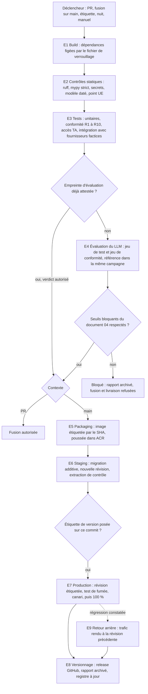
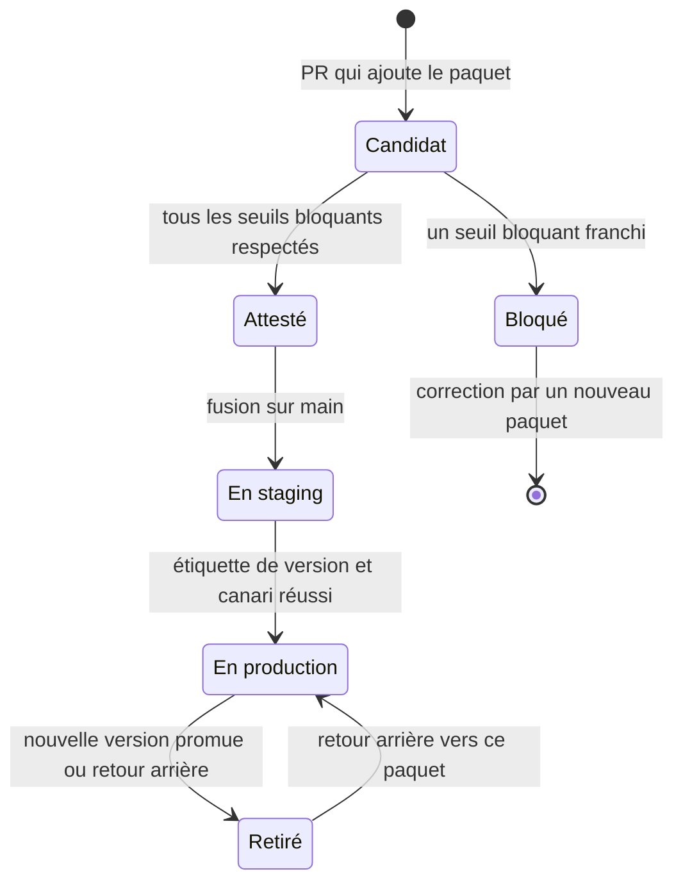
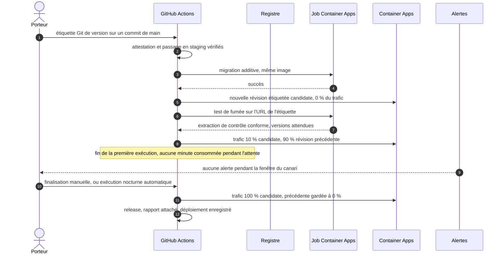

# Chaîne LLMOps et AgentOps de Muninn

**Version :** 1
**Date :** 12 octobre 2026
**Phase :** 2 (industrialisation), livrable 5 de la feuille de route
**Statut :** proposition, à valider par le porteur
**Compétences servies :** C13 (E3) ; C18, C19 (E4) ; appui à C12

## 1. Objet, périmètre et conventions

### 1.1 Objet

Ce document décrit, sans ligne de code, comment une version de Muninn passe du dépôt à la
production : build, tests, évaluation du LLM, packaging, livraison, versionnage et retour
arrière. Il décrit aussi les pratiques AgentOps : traçabilité des décisions des agents,
garde-fous, tests de comportement, revue humaine et journal des incidents.

Le jury admet, pour C12 et C13, des tests automatisés d'évaluation des réponses et de validation
des formats, avec la description des pratiques LLMOps et AgentOps (décision D-03). Aucun modèle
n'est entraîné. Ce qui est livré comme « modèle » est défini en 1.2.

### 1.2 Ce que « modèle » veut dire ici : le paquet d'extraction

Le comportement du LLM dépend de plusieurs éléments qui changent indépendamment. On les livre
ensemble, sous un identifiant unique : le **paquet d'extraction** (par exemple
`extraction-1.4.0`). Un paquet publié est immuable. Toute modification crée un nouveau paquet.

| Élément du paquet         | Contenu                                                                         | Exemple de version                                                 |
| ------------------------- | ------------------------------------------------------------------------------- | ------------------------------------------------------------------ |
| Prompt système            | Consignes d'extraction, règles « ne jamais inventer », refus médical (R7)       | `prompt-extraction 1.4.0`                                          |
| Gabarit du message        | Délimitation de la transcription comme bloc de données (menace M-04)            | inclus dans le prompt                                              |
| Schéma de sortie          | `DossierDraft` (contrat 1.0, puis 1.1, décision D-24)                           | `schema 1.1`                                                       |
| Lexiques métier           | Une version par métier, relue (US-48)                                           | `lexique-plomberie 2026.10.1`                                      |
| Modèle du fournisseur     | Identifiant **daté** du modèle, jamais un alias mobile (section 9, chemin C-05) | `mistral-small-2603` [H : fournisseur et modèle provisoires, D-32] |
| Paramètres d'appel        | Température, nombre maximal de jetons, graine, format de sortie structuré       | `temperature 0`, graine fixe [H]                                   |
| Règles de post-traitement | Seuil « à vérifier » (0,7), normalisation, recalibration éventuelle (ADR-08)    | `post 1.0`                                                         |

Le **paquet de l'agent vocal** suit le même modèle (prompt de conduite, textes fixes d'ouverture
et de sécurité, liste des outils, paramètres). Il n'est pas dans la démo du 29 octobre
(document 01, section 8.3) ; sa chaîne est décrite pour le 12 novembre (section 8).

### 1.3 Sources internes

| Document                                 | Éléments utilisés                                                                         |
| ---------------------------------------- | ----------------------------------------------------------------------------------------- |
| `docs/decisions.md`                      | D-03, D-04, D-07, D-11, D-15, D-16, D-18, D-19, D-24, D-29, D-31, D-32                    |
| `docs/roadmap.md`                        | Calendrier des oraux, phase 2, point 5                                                    |
| `sources_de_donnees/01-user-stories.md`             | US-06, US-09, US-10, US-11, US-37, US-38, US-39, US-40 ; section 8 (démo)                 |
| `sources_de_donnees/02-flux-de-donnees.md`          | F-11 (messages 1 à 23, T1 à T4), F-12                                                     |
| `architecture_de_donnees/03-acces-et-exposition.md`      | Composants (2.2), secrets (5.6), menaces LLM M-01 à M-13 (section 7)                      |
| `architecture_de_donnees/04-verification-exactitude.md`  | Cas VE-01 à VE-30, tailles de jeu (4.3, 4.4), LLM comme juge (5), seuils (6), rapport (7) |
| La passation back-end du 11 octobre 2026 | Règles R1 à R10, contrat `DossierDraft`, sections 5, 7, 10, 11 et 14                      |

Les autres documents de la phase 2 ont été relus avec celui-ci : `01-besoin-de-production.md`
(SLO, tailles d'évaluation), `02-plan-de-tests.md` (tests VE, HE, TC), `03-observabilite.md`
(seuils du canari, énumérés des traces, alertes), `04-contrat-api.md` (`DossierDraft` 1.1, bloc
`provenance`, brouillon de secours) et `06-architecture-technique.md`.

### 1.4 Conventions

- **[H]** marque une hypothèse ou une valeur proposée, à confirmer par la mesure ou le porteur.
- Les durées et les coûts sont des estimations, sauf mention d'une source.
- Les noms de fichiers et de workflows sont indicatifs ; ils seront fixés au lot 0.
- Gravités « bloquante », « majeure », « mineure » : définitions du document 04 (section 1.4).
- **R10.** Le premier déploiement sur Azure, la création du registre de conteneurs et l'usage de
  la clé du fournisseur LLM en CI sont des actions payantes : elles attendent l'accord du porteur.

### 1.5 Principes

1. **Tout ce qui change une réponse du LLM passe par l'évaluation.** La décision ne dépend pas de
   ce que l'auteur déclare avoir modifié, mais d'une empreinte calculée (section 5.2).
2. **Une seule image, promue d'un environnement à l'autre.** L'image testée en staging est celle
   qui va en production, au même condensat (digest). Rien n'est reconstruit entre les deux.
3. **Fermé par défaut.** Un paquet sans évaluation réussie ne peut pas être chargé : le service
   refuse de démarrer (section 6.5). Une absence de preuve vaut un refus.
4. **Pas de relance opportuniste** (document 04, section 1.4). Un verdict « bloqué » pour une
   empreinte ne s'efface pas par une nouvelle exécution (section 5.7).
5. **Aucune donnée personnelle dans la chaîne.** La CI ne manipule que des données synthétiques
   (R9). Les traces de production ne portent aucune valeur de champ (R4, section 8.2).

## 2. Vue d'ensemble de la chaîne



| Étape | Action                                                                                                              | Sortie                                              | Bloque si                                                                   | Durée estimée [H]                |
| ----- | ------------------------------------------------------------------------------------------------------------------- | --------------------------------------------------- | --------------------------------------------------------------------------- | -------------------------------- |
| E1    | Installation des dépendances depuis le fichier de verrouillage, sans résolution nouvelle                            | Environnement reproductible                         | Fichier de verrouillage incohérent                                          | 1 min                            |
| E2    | Lint, typage strict, recherche de secrets, contrôles de configuration (modèle daté, point UE, paquets immuables)    | Rapport des contrôles                               | Une erreur ; un secret ; un alias de modèle mobile ; un point hors UE       | 2 min                            |
| E3    | Tests unitaires, de conformité (R1 à R10) et d'accès (TA-xx du document 03), intégration avec fournisseurs factices | Rapport de tests, couverture                        | Un test en échec ; couverture sous 85 % sur `extraction`, `relay`, `crypto` | 5 à 7 min                        |
| E4    | Évaluation du paquet candidat et de la référence (section 5)                                                        | Rapport d'évaluation horodaté, verdict              | Un seuil bloquant du document 04, section 6                                 | 3 à 15 min                       |
| E5    | Construction de l'image, étiquette égale au SHA du commit, publication dans le registre                             | Image et condensat                                  | Échec de construction                                                       | 4 min                            |
| E6    | Migration additive par un job Container Apps, nouvelle révision en staging, extraction de contrôle synthétique      | Révision saine en staging                           | Migration en échec ; extraction de contrôle non conforme                    | 5 min                            |
| E7    | Révision étiquetée en production à 0 % du trafic, test de fumée, canari, bascule                                    | Révision active en production                       | Test de fumée en échec ; alerte pendant le canari                           | 10 min, plus l'attente du canari |
| E8    | Release GitHub de la version, rapport attaché, registre et déploiement enregistrés                                  | Trace permanente                                    | Sans objet                                                                  | 1 min                            |
| E9    | Retour du trafic à la révision précédente, ou au paquet précédent (section 7)                                       | Version précédente rétablie, extraction de contrôle | Sans objet                                                                  | 5 min au plus                    |

Une PR s'arrête après E4 : elle ne publie aucune image et ne déploie rien. Seul `main` publie.

## 3. Workflows GitHub Actions

### 3.1 Liste des workflows

| Workflow         | Déclencheurs                                                              | Jobs                                                                                                            | Rôle                                                   |
| ---------------- | ------------------------------------------------------------------------- | --------------------------------------------------------------------------------------------------------------- | ------------------------------------------------------ |
| `ci`             | PR vers `main` (ouverte, mise à jour, prête pour revue) ; push sur `main` | `plan`, `qualite`, `tests`, `image-pr`, `verdict`                                                               | E1 à E3 ; construit l'image sans la publier sur une PR |
| `evaluation`     | Appelé par `ci` ; étiquette de PR `eval-complete` ; nuit ; manuel         | `empreinte`, `eval`, `rapport`                                                                                  | E4 ; attestation par empreinte                         |
| `livraison`      | Fin réussie de `ci` sur `main` ; étiquette Git de version ; manuel        | `publier-image`, `migrer-staging`, `deployer-staging`, `controle-staging`, `deployer-prod`, `canari`, `release` | E5 à E8                                                |
| `retour-arriere` | Manuel seulement                                                          | `verifier-cible`, `basculer`, `controle`                                                                        | E9                                                     |
| `nocturne`       | Nuit (tous les jours) ; manuel                                            | `derive-fournisseur`, `stabilite` (hebdomadaire), `derive-config`, `secrets-historique`, `dependances`          | Surveillance de la chaîne elle-même                    |

### 3.2 Ce que lance chaque déclencheur

| Déclencheur                             | E1 à E3                   | E4 (évaluation)                                                                 | E5 à E8                      | Remarque                                                                              |
| --------------------------------------- | ------------------------- | ------------------------------------------------------------------------------- | ---------------------------- | ------------------------------------------------------------------------------------- |
| PR ouverte ou mise à jour               | Oui, sauf PR en brouillon | Si l'empreinte d'évaluation est nouvelle                                        | Non                          | L'image est construite sans être publiée si le Dockerfile ou les dépendances changent |
| Étiquette de PR `eval-complete`         | Non                       | Oui, jeu complet et stabilité, même si l'empreinte est connue                   | Non                          | Sert à mesurer, jamais à contourner : aucune étiquette ne saute l'évaluation          |
| Fusion sur `main`                       | Oui                       | Réutilise l'attestation de la PR si l'empreinte est identique ; sinon l'exécute | E5 et E6 (staging)           | La production n'est jamais touchée par une fusion seule                               |
| Étiquette Git de version (`v1.4.0` [H]) | Non                       | Vérifie l'attestation, sans réexécuter                                          | E7 et E8 (production)        | L'étiquette doit désigner un commit déjà sain en staging                              |
| Nuit (`schedule`)                       | Non                       | Paquet en production, sur le jeu de test (dérive du fournisseur)                | Non                          | Alerte, ne déploie rien                                                               |
| Manuel (`workflow_dispatch`)            | Selon le workflow         | Selon le workflow                                                               | Retour arrière, ou promotion | Restreint à la branche `main`                                                         |

### 3.3 Jobs et conditions de blocage

| Job                | Contenu                                                                                                                                                                                                     | Bloque si                                                                                                                                  |
| ------------------ | ----------------------------------------------------------------------------------------------------------------------------------------------------------------------------------------------------------- | ------------------------------------------------------------------------------------------------------------------------------------------ |
| `plan`             | Calcule l'empreinte d'évaluation et la liste des zones modifiées ; décide des jobs à lancer                                                                                                                 | Échec du calcul (fermé par défaut : tout est lancé)                                                                                        |
| `qualite`          | ruff (lint et format), mypy strict, recherche de secrets, contrôles de configuration                                                                                                                        | Une erreur ; un secret ; un identifiant de modèle non daté ; un point de terminaison hors UE (US-40, critère 4) ; un paquet publié modifié |
| `tests`            | pytest : unitaires, conformité (audio détruit, journaux propres, pas de clair en base, ouverture de l'agent, refus médical), accès (TA-xx), intégration avec fournisseurs factices et PostgreSQL de service | Un test en échec ; couverture sous 85 % sur `extraction`, `relay` et `crypto` (passation, section 10)                                      |
| `image-pr`         | Construction de l'image sans publication                                                                                                                                                                    | Échec de construction                                                                                                                      |
| `eval`             | Harnais d'évaluation (section 5)                                                                                                                                                                            | Un seuil bloquant du document 04, section 6 ; une version manquante dans le rapport (VE-29)                                                |
| `verdict`          | Seul contrôle requis par la protection de `main` ; agrège les résultats                                                                                                                                     | Un job requis en échec, annulé, ou absent alors qu'il était requis par `plan`                                                              |
| `publier-image`    | Construction, étiquette égale au SHA, publication dans le registre                                                                                                                                          | Le commit n'a pas de `verdict` réussi                                                                                                      |
| `migrer-staging`   | Job Container Apps qui exécute la migration sur la base de staging                                                                                                                                          | Migration en échec ; migration non additive sans décision (section 6.3)                                                                    |
| `deployer-staging` | Nouvelle révision, même image au même condensat                                                                                                                                                             | Révision non saine (sondes de santé)                                                                                                       |
| `controle-staging` | Extraction de contrôle synthétique, lecture de `/version`                                                                                                                                                   | Brouillon non conforme ; versions affichées différentes des versions attendues                                                             |
| `deployer-prod`    | Vérifie l'attestation et le passage en staging du même condensat, migration, révision étiquetée à 0 %, test de fumée                                                                                        | Une des vérifications échoue                                                                                                               |
| `canari`           | Répartition du trafic (section 6.2)                                                                                                                                                                         | Alerte de qualité ou d'erreurs pendant la fenêtre                                                                                          |
| `release`          | Release GitHub, rapport d'évaluation attaché, enregistrement du déploiement                                                                                                                                 | Sans objet                                                                                                                                 |

**Un seul contrôle requis.** Un contrôle requis dont le workflow est écarté par un filtre de
chemins reste en attente et bloque la fusion (documentation GitHub, section 13, S-06). La chaîne n'utilise donc pas
de filtre de chemins au niveau du déclencheur. Le job `plan` décide, et le job `verdict` tourne
toujours. Il échoue si un job que `plan` a déclaré nécessaire n'a pas réussi.

### 3.4 Protection de la branche `main`

- Fusion par PR seulement ; push direct interdit, y compris pour l'administrateur.
- Contrôle requis : `verdict` ; branche à jour avant fusion.
- Historique linéaire ; suppression et réécriture de `main` interdites.
- Les modifications de `.github/workflows/`, du harnais `eval/` et des seuils portent l'étiquette
  `chaine` et citent leur justification dans la PR. Une baisse de seuil passe par
  `decisions.md` (document 04, section 1.4).

**Limite à dire.** Le porteur est seul développeur et administrateur. Aucune revue par une
seconde personne n'est possible, et un administrateur peut lever une protection. La parade est
la traçabilité : la levée d'une protection apparaît dans le journal d'audit du dépôt, et le
contrôle nocturne de dérive (section 6.5) détecte une production qui ne correspond à aucune
version attestée.

**Ce que GitHub Pro permet sur un dépôt privé** (S-02, S-03). Le porteur est en GitHub Pro
(D-31) : la protection de `main` et le contrôle requis `verdict` sont disponibles dès J0.

| Fonction                                  | GitHub Pro, dépôt privé    | Conséquence pour la chaîne                                                 |
| ----------------------------------------- | -------------------------- | -------------------------------------------------------------------------- |
| Branches protégées, contrôle requis       | Oui                        | Activés dès J0 sur `main` ; contrôle requis `verdict`                      |
| Environnements et secrets d'environnement | Oui                        | La clé d'évaluation est un secret de l'environnement `evaluation`          |
| Branches de déploiement autorisées        | Oui                        | Restreint `production` à `main` et aux étiquettes de version               |
| Relecteurs requis, délai d'attente        | Non (Enterprise seulement) | L'approbation humaine est l'étiquette Git de version, posée par le porteur |

Le 12 octobre 2026, l'API de GitHub répondait « Branch not protected » pour `main` : la
protection n'était pas encore activée. Son activation est la première tâche du lot 0.

### 3.5 Secrets et identités

| Secret ou identité                                 | Où il vit                                                                 | Utilisé par                               | Remarque                                                                                                                                                                                     |
| -------------------------------------------------- | ------------------------------------------------------------------------- | ----------------------------------------- | -------------------------------------------------------------------------------------------------------------------------------------------------------------------------------------------- |
| Clé LLM d'évaluation                               | Secret de l'environnement GitHub `evaluation`                             | `eval`, `derive-fournisseur`              | Distincte de la clé de production [H : deux clés à demander au porteur, D-15] ; plafond de dépense chez le fournisseur [H : non vérifié]                                                     |
| Clé LLM de production                              | Azure Key Vault                                                           | Container Apps `extraction`               | Jamais dans GitHub ; lue par l'identité managée de l'application                                                                                                                             |
| Identité de déploiement                            | Identité managée affectée par l'utilisateur, dans le groupe de ressources | `livraison`, `retour-arriere`, `nocturne` | Connexion OIDC sans secret (S-07) ; une information d'identification fédérée par sujet exact (environnement, branche `main` ou étiquette), sans caractère générique, 20 au plus par identité |
| Identifiants Azure (client, locataire, abonnement) | Variables d'environnement GitHub                                          | Connexion OIDC                            | Identifiants, pas des secrets                                                                                                                                                                |
| Droits de l'identité de déploiement                | Rôles au niveau du groupe de ressources                                   | Sans objet                                | Push sur le registre ; contributeur sur les seules Container Apps ; aucun accès aux secrets du coffre                                                                                        |
| Accès du registre par les applications             | Identité managée de chaque application, rôle de lecture du registre       | Container Apps                            | Pas de mot de passe d'administration du registre                                                                                                                                             |
| `GITHUB_TOKEN`                                     | Fourni par GitHub                                                         | Tous                                      | Permissions minimales déclarées par workflow (lecture du contenu par défaut)                                                                                                                 |

Le porteur est Owner du groupe de ressources et Reader de l'abonnement (D-19). Ces droits
suffisent à créer l'identité managée, ses informations d'identification fédérées et les rôles au
niveau du groupe [H : à vérifier au lot 0 par une création réelle]. Aucune inscription
d'application dans l'annuaire n'est requise. Piège documenté : si le sujet ne correspond pas
exactement, l'échange de jeton échoue sans message explicite, alors que la création de
l'information d'identification a réussi (S-07). Le premier essai le vérifie.

Autres règles :

- Les actions tierces sont épinglées par SHA complet, pas par étiquette mobile.
- Les secrets ne sont jamais passés à un job déclenché par une PR venant d'un dépôt dupliqué. Le
  dépôt est privé ; le cas reste couvert par la configuration par défaut de GitHub.
- La clé d'évaluation n'est exposée qu'au job `eval`, dans l'environnement `evaluation`.

### 3.6 Concurrence et maîtrise du coût

- Groupe de concurrence par PR, avec annulation de l'exécution précédente : seul le dernier push
  consomme des minutes.
- Groupe de concurrence unique pour `livraison` et `retour-arriere`, sans annulation : deux
  livraisons ne se croisent jamais.
- Délai maximal par job ; l'évaluation a un plafond de durée et de nombre d'appels.
- L'attente du canari ne consomme pas de minutes : elle est découpée en deux exécutions (section
  6.2).

### 3.7 Coût en minutes

**Quota.** Pour un dépôt privé, GitHub Pro inclut 3 000 minutes par mois (S-01). Le stockage
d'artefacts inclus est donné à 1 Go par la page de facturation et à 2 Go par la page des
forfaits : écart non tranché. Au-delà du quota, une minute de runner Linux à 2 cœurs coûte
0,006 $ (S-01), dans la limite de dépense réglée sur le compte [H : réglage à lire au lot 0].
Chaque job est arrondi à la minute supérieure.

**Estimation par exécution** [H : durées à mesurer au lot 0 ; appels au LLM à 5 s, 8 en
parallèle, comme le document 01 de la phase 2] :

| Exécution                                               | Jobs facturés                                                                            | Minutes [H] |
| ------------------------------------------------------- | ---------------------------------------------------------------------------------------- | ----------- |
| PR, empreinte inchangée                                 | `plan` 1, `qualite` 2, `tests` 6, `verdict` 1                                            | 10          |
| Supplément si le Dockerfile ou les dépendances changent | `image-pr`                                                                               | 4           |
| Supplément d'évaluation, jeu du 29 octobre              | 266 appels avec la référence                                                             | 5           |
| Supplément d'évaluation, jeu du 12 novembre             | 1 056 appels avec la référence, juge compris                                             | 14          |
| Fusion sur `main`                                       | CI 10, `publier-image` 5, `migrer-staging` 2, `deployer-staging` 3, `controle-staging` 2 | 22          |
| Livraison en production                                 | `deployer-prod` 6, `canari` 2, finalisation 2, `release` 1                               | 11          |
| Retour arrière                                          | `verifier-cible`, `basculer`, `controle`                                                 | 4           |
| Nuit                                                    | Dérive du fournisseur 5, dérive de configuration 1, secrets 2, dépendances 1             | 9           |
| Stabilité hebdomadaire                                  | 500 appels                                                                               | 8           |

**Estimation mensuelle** [H : rythme de développement entre le 15 octobre et le 12 novembre] :

| Poste                           | Volume par mois [H] | Minutes   |
| ------------------------------- | ------------------- | --------- |
| Push sur une PR                 | 80                  | 800       |
| Image construite sur une PR     | 10                  | 40        |
| Évaluation (jeu du 12 novembre) | 15                  | 210       |
| Fusion sur `main`               | 25                  | 550       |
| Livraison en production         | 6                   | 66        |
| Retour arrière                  | 2                   | 8         |
| Nuit                            | 30                  | 270       |
| Stabilité hebdomadaire          | 4                   | 32        |
| **Total**                       | sans objet          | **1 976** |

Lecture : le total laisse environ 1 000 minutes de marge sur le quota de 3 000 de GitHub Pro.

Le parallélisme de 8 appels est aussi celui du document 01 de la phase 2 (section 2.3), qui
calcule les volumes du mois sur le jeu du 12 novembre : 24 740 extractions. Ce parallélisme dépend
des limites de débit du fournisseur, non lues [H] ; il est mesuré au lot 0. À 4 appels en
parallèle, l'évaluation du 12 novembre durerait environ 29 minutes au lieu de 14, et le total du
mois passerait à environ 2 210 minutes, toujours sous le quota. Leviers si la marge baisse :
contrôle nocturne les jours ouvrés seulement (environ 80 minutes de moins), recherche de secrets
sur l'historique une fois par semaine, fusions groupées. Un dépassement de 500 minutes coûterait
3 $.

**Rétention.** Les artefacts et journaux sont gardés 90 jours par défaut ; un dépôt privé peut
aller jusqu'à 400 jours (S-04). Les attestations d'évaluation sont gardées 400 jours, pour que la
réutilisation par empreinte (5.6) reste possible au-delà de la durée du projet. Le rapport d'une
version promue est en plus attaché à sa release, sans limite de durée.

## 4. Versionnage des artefacts

### 4.1 Artefacts versionnés

| Artefact                | Où il vit                                             | Identifiant de version                                 | Qui le change, et comment                              | Où la version est tracée                            |
| ----------------------- | ----------------------------------------------------- | ------------------------------------------------------ | ------------------------------------------------------ | --------------------------------------------------- |
| Prompt d'extraction     | `paquets/extraction/<version>/` (fichiers texte)      | Version sémantique du paquet                           | PR ; dossier immuable une fois publié                  | `DossierDraft` (bloc `provenance`), traces, rapport |
| Schéma `DossierDraft`   | Code du service et schéma JSON exporté                | `schema_version` (1.0, puis 1.1)                       | PR ; contrat d'API mis à jour                          | Chaque brouillon (`schema_version`), rapport        |
| Lexiques métier         | `lexiques/<metier>/<version>` (fichiers relus, US-48) | Version datée (`2026.10.1`)                            | PR après relecture des termes                          | Paquet, `DossierDraft`, rapport                     |
| Choix du modèle         | Fichier de paramètres du paquet                       | Identifiant daté du fournisseur                        | PR ; changement de modèle = nouveau paquet             | Paquet, traces, rapport                             |
| Paramètres d'appel      | Fichier de paramètres du paquet                       | Version du paquet                                      | PR                                                     | Rapport (document 04, section 7.1)                  |
| Paquet de l'agent vocal | `paquets/agent-vocal/<version>/`                      | Version sémantique                                     | PR                                                     | Traces de l'agent, rapport de comportement          |
| Prompt du juge          | `eval/juge/<version>/`                                | Version sémantique                                     | PR, puis nouvel étalonnage (document 04, section 5.3)  | Rapport                                             |
| Jeu de scénarios        | `eval/scenarios/` (synthétique, R9)                   | `version_jeu` (document 04, section 4.1)               | PR ; ajout d'une formulation = nouvelle version du jeu | Rapport                                             |
| Référentiels            | Base PostgreSQL des référentiels                      | Version de chargement (VD-19)                          | Chaîne d'E1 (F-09), avec ses propres cas bloquants     | `DossierDraft`, rapport                             |
| Image Docker            | Azure Container Registry                              | Étiquette égale au SHA complet du commit, et condensat | `livraison` seulement                                  | Révision Container Apps, `/version`, traces         |
| Migrations              | `alembic/versions/`                                   | Révision Alembic                                       | PR                                                     | Table de version d'Alembic, release                 |
| Rapport d'évaluation    | Artefact de workflow, puis release GitHub             | Empreinte d'évaluation et horodatage                   | `evaluation` seulement                                 | Registre, release                                   |

### 4.2 Contenu d'un paquet

Extrait illustratif du fichier de description d'un paquet (format et noms à fixer au lot 1) :

```yaml
# paquets/extraction/1.4.0/paquet.yaml : immuable une fois publié
id: extraction-1.4.0
parent: extraction-1.3.2          # référence de comparaison par défaut
prompt: prompt.md                 # prompt système, versionné avec le paquet
schema: "1.1"                     # version du contrat DossierDraft attendue
lexiques: {plomberie: "2026.10.1", chauffage: "2026.10.1", electricite: "2026.10.1"}
modele: "<identifiant daté du fournisseur>"   # alias « latest » refusé par la CI
parametres: {temperature: 0, max_tokens: 1200, graine: 20261012, sortie: schema_json}
seuil_a_verifier: 0.7
motif: "Règle d'abstention renforcée sur le code postal (VE-12)"
```

### 4.3 Versions dans chaque `DossierDraft`

Chaque brouillon porte les versions qui l'ont produit, sans aucune donnée personnelle. Leur
forme est celle du contrat `DossierDraft` 1.1 (D-24 ; document 04 de la phase 2, sections 3.4
et 3.6) :

| Champ du contrat                 | Exemple                                              | Rôle                                                |
| -------------------------------- | ---------------------------------------------------- | --------------------------------------------------- |
| `schema_version`                 | `1.1`                                                | Version du contrat                                  |
| `provenance.prompt_version`      | `extraction-1.4.0`                                   | Retrouver le paquet : prompt, paramètres, modèle    |
| `provenance.model_id`            | identifiant daté                                     | Identifier le modèle effectivement appelé           |
| `provenance.lexicon`             | `plomberie`, `2026.10.1`                             | Mesurer l'effet du lexique (VE-30)                  |
| `provenance.extraction_status`   | `complete`, `partial_after_retry`, `fallback_no_llm` | État du brouillon ; `fallback_no_llm` : section 5.9 |
| `provenance.validation_attempts` | 0, 1 ou 2                                            | Relance après sortie invalide (VE-02) ; 0 sans LLM  |
| `checks.<champ>.referential`     | source et date de chargement                         | Relier un contrôle à sa version (US-50)             |

Le SHA de l'image n'est pas dans le contrat : il est tracé par `/version` et par l'attribut
`service.version` des traces. Ces champs servent US-40 (critère 2) et VE-29. Le brouillon est
chiffré pour l'appareil (R1) : le serveur ne le garde pas ; il garde les versions, sans contenu,
dans les traces (section 8.2).

### 4.4 Registre des versions

Le registre a deux parties :

- **Partie statique, dans le dépôt** : le fichier de chaque paquet (4.2) et un index des paquets
  (identifiant, parent, empreinte de contenu, motif). Elle ne change que par PR.
- **Partie dynamique, hors du dépôt** : les attestations d'évaluation (artefacts de workflow), les
  releases GitHub et les déploiements enregistrés par GitHub. La CI n'écrit jamais sur `main` :
  aucune exception à la protection n'est nécessaire.



Un paquet **bloqué** ne redevient jamais candidat : la correction crée un nouveau paquet
(document 04, section 6, règles d'application).

### 4.5 Règle de promotion

Un paquet n'entre en production que si les sept conditions sont réunies :

1. une attestation d'évaluation existe pour son empreinte, au verdict « autorisé », sur la version
   courante du jeu de test ;
2. aucune attestation « bloqué » n'existe pour cette empreinte (section 5.7) ;
3. la référence de la comparaison est le paquet **encore** en production au moment de la
   promotion ; si la production a changé depuis l'évaluation, la candidate est réévaluée face à
   la nouvelle référence ;
4. les contrôles majeurs franchis sont acceptés par une décision écrite citée dans le rapport
   (document 04, section 1.4) ;
5. l'image qui le porte a passé le staging, au même condensat ;
6. une étiquette Git de version désigne ce commit ;
7. le canari se termine sans alerte.

## 5. Évaluation bloquante

### 5.1 Quand elle tourne, et sur quel jeu

Tailles du document 04 (section 4.3) : 20 scénarios de test et 35 de conformité pour le
29 octobre ; 100 de test, 40 de développement et 130 de conformité pour le 12 novembre. Le jeu de
développement ne sert jamais au verdict.

| Moment                          | Jeu                                      | Répétitions                                                          | Référence exécutée | Effet                           |
| ------------------------------- | ---------------------------------------- | -------------------------------------------------------------------- | ------------------ | ------------------------------- |
| PR, empreinte nouvelle          | Test et conformité                       | 1 pour les métriques d'exactitude ; 3 pour les cas à tolérance nulle | Oui                | Bloque la fusion                |
| PR, empreinte déjà attestée     | Aucun appel au LLM                       | Sans objet                                                           | Non                | Attestation réutilisée          |
| Étiquette `eval-complete`       | Test et conformité, puis stabilité       | 5 exécutions du jeu de test (VE-27)                                  | Oui                | Mesure ; ne débloque rien       |
| Fusion sur `main`               | Aucun appel si l'empreinte est attestée  | Sans objet                                                           | Non                | Livraison en staging            |
| Nuit                            | Test et conformité, paquet en production | 1                                                                    | Non                | Alerte de dérive du fournisseur |
| Hebdomadaire (nuit du dimanche) | Test, paquet en production               | 5 (VE-27)                                                            | Non                | Recalage de la tolérance T      |

Les cas à tolérance nulle exécutés 3 fois sont ceux du document 04 : VE-13, VE-14 (positifs),
VE-19, VE-20 à VE-22.

### 5.2 Empreinte d'évaluation

L'empreinte est un condensat SHA-256 calculé sur tout ce qui peut changer une réponse évaluée :

- les fichiers du paquet (prompt, paramètres, lexiques référencés) ;
- le code de l'extraction (`src/muninn/extraction/`) et l'adaptateur du fournisseur LLM ;
- les versions des dépendances qui touchent l'appel (client du fournisseur, Pydantic), lues dans
  le fichier de verrouillage ;
- le harnais d'évaluation, les seuils, le prompt du juge et la version du jeu de scénarios ;
- la version de test du référentiel de numérotation (document 02, F-11, T1).

**Garde-fou contre l'oubli d'un fichier.** La liste des chemins est fermée et versionnée. Un test
lit le graphe des imports du module d'extraction et échoue si un module importé n'est pas dans la
liste. Une modification de la liste change l'empreinte.

**Conséquence.** Une PR qui ne touche que l'API, le relais, la console ou la documentation ne
change pas l'empreinte : l'attestation existante est réutilisée, sans appel au LLM. Une PR qui
change une virgule du prompt la change : l'évaluation complète tourne.

### 5.3 Répétitions et non-déterminisme

- Température nulle et graine fixe. L'API de Mistral a un paramètre `random_seed`, documenté comme
  rendant les appels déterministes (S-15). Cette promesse n'est pas prise pour acquise : la
  variabilité est mesurée, pas supposée (VE-27).
- La tolérance de régression vaut T = max(3 points, 2 fois l'écart-type mesuré) (document 04,
  section 6). Elle est recalée chaque semaine par l'exécution de stabilité, et toute hausse de T
  passe par `decisions.md`.
- Les 3 exécutions d'un cas à tolérance nulle visent un défaut intermittent : un échec sur 3
  suffit à bloquer. Les bornes statistiques se calculent sur le nombre de scénarios, pas
  d'exécutions (document 04, section 3.1).

### 5.4 Référence dans la même campagne

La candidate et la référence (le paquet en production) sont évaluées dans la même exécution, sur
les mêmes scénarios. Cela écarte une dérive du fournisseur entre deux dates et permet la
comparaison appariée (McNemar, document 04, section 4.4). Cela double le coût en jetons de
l'évaluation d'une PR : c'est le prix d'une comparaison valide.

Avant la première livraison, il n'y a pas de référence : seuls les seuils absolus s'appliquent
(document 04, section 6).

### 5.5 Coût en jetons

Hypothèses par appel d'extraction [H : à mesurer au lot 1] : 3 500 jetons d'entrée (prompt
système, lexique, schéma de sortie, transcription d'environ 3 minutes) et 600 jetons de sortie.
Prix lus le 12 octobre 2026 (S-13), par million de jetons : Mistral Small 4, 0,15 $ en entrée et
0,6 $ en sortie ; Mistral Medium 3.5, 1,5 $ et 7,5 $. Soit environ 0,000885 $ par appel avec
Small et 0,00975 $ avec Medium.

| Campagne                                    | Appels                                                 | Small 4 ($) | Medium 3.5 ($) |
| ------------------------------------------- | ------------------------------------------------------ | ----------- | -------------- |
| PR, jeu du 29 octobre, avec la référence    | (20 + 4 × 2 + 35 × 3) × 2 = 266                        | 0,24        | 2,59           |
| PR, jeu du 12 novembre, avec la référence   | (100 + 19 × 2 + 130 × 3) × 2 = 1 056                   | 0,93        | 10,30          |
| Juge (VE-28), 100 descriptions × 3 verdicts | 300 appels [H : 2 000 jetons en entrée, 200 en sortie] | 0,13        | 1,35           |
| Nuit, paquet en production                  | 100 + 130 = 230                                        | 0,20        | 2,24           |
| Stabilité hebdomadaire                      | 100 × 5 = 500                                          | 0,44        | 4,88           |

Les termes « 4 × 2 » et « 19 × 2 » comptent les deux exécutions supplémentaires des scénarios
à tolérance nulle du jeu de test (effectifs du tableau 4.3 du document 04 : gaz, médical, refus
et injection, soit 4 scénarios au 29 octobre et 19 au 12 novembre).

**Par mois** [H : 15 évaluations de PR, 30 nuits, 4 semaines, juge sur Medium] : environ 42 $
si le modèle évalué est Small 4 (14 $ de PR, 6 $ de nuits, 2 $ de stabilité, 20 $ de juge, en
arrondissant), et environ 260 $ s'il est Medium 3.5 (155 $ de PR, 67 $ de nuits, 20 $ de
stabilité, 20 $ de juge). Le juge pèse autant que l'évaluation elle-même avec Small : le passer
sur un modèle moins cher, une fois son étalonnage refait, est un levier. Avec Medium, le contrôle nocturne pèse
67 $ : le réduire aux jours ouvrés, ou au seul jeu de conformité, est le premier levier. Ces
montants s'ajoutent au coût de la production, hors du périmètre de ce document.

### 5.6 Éviter qu'une PR sans changement de prompt paie l'évaluation

1. **Empreinte, pas déclaration.** L'évaluation tourne si et seulement si l'empreinte n'a pas
   d'attestation (5.2). Une PR de documentation ne paie rien ; une PR qui touche le prompt paie
   tout.
2. **Attestation réutilisable.** Après fusion, `main` retrouve l'attestation produite par la PR
   pour la même empreinte. Si elle n'est plus disponible (rétention des artefacts dépassée),
   l'évaluation est refaite : l'absence de preuve ne vaut jamais un accord.
3. **PR en brouillon.** Aucune évaluation tant que la PR est en brouillon ; le développeur met au
   point le prompt sur le jeu de développement, en local, avec sa propre exécution.
4. **Annulation des exécutions dépassées** par le groupe de concurrence (3.6).
5. **Plafond par campagne.** Nombre maximal d'appels et durée maximale ; un dépassement arrête
   l'évaluation avec le verdict « non mesuré », qui bloque.

### 5.7 Verdicts en ajout seul : pas de relance opportuniste

Le bouton « relancer » de GitHub permet de réexécuter une évaluation échouée jusqu'à obtenir un
succès. C'est un chemin non contrôlé (section 9, chemin C-04). Parade :

- chaque exécution produit une attestation nommée par l'empreinte et le numéro de tentative ;
- la règle de promotion (4.5, condition 2) lit **toutes** les attestations de l'empreinte : un seul
  verdict « bloqué » suffit à refuser ;
- seule exception : une panne du harnais ou du fournisseur (erreurs réseau, quota), constatée et
  consignée dans `decisions.md` avec l'identifiant de l'exécution. Une baisse de qualité n'est
  jamais une panne.

### 5.8 Démonstration du blocage

Une version dégradée du paquet, privée de la règle « ne jamais inventer », est préparée sur une
branche dédiée (document 04, section 6). Sa PR doit être bloquée par VE-12 ou VE-11. Si elle
passe, c'est un défaut du harnais, à corriger avant la démo. Cette PR n'est jamais fusionnée ; son
attestation « bloqué » reste au registre.

### 5.9 Brouillon de secours sans LLM (`fallback_no_llm`, D-29)

Quand le LLM reste indisponible en fin d'appel, après les deux nouvelles tentatives de MD-3
(document 01 de la phase 2, section 6.2), voice-gateway construit un brouillon de secours : numéro
et heure de l'appel, action « rappeler », `needs_review` vrai, `prompt_version` et `model_id`
nuls (exemple 5 du document 04 de la phase 2). La transcription est détruite (R3). Ce brouillon
n'est pas produit par le modèle : la chaîne le traite à part.

| Où dans la chaîne                    | Ce qui est vérifié                                                                                                                                                               | Effet                                                     |
| ------------------------------------ | -------------------------------------------------------------------------------------------------------------------------------------------------------------------------------- | --------------------------------------------------------- |
| E3, tests de format et de conformité | Le brouillon de secours est valide contre le schéma 1.1 ; il ne porte que le numéro, l'heure et l'action ; la transcription est détruite (TC-27 du document 02)                  | Un échec bloque la PR, comme tout test de conformité      |
| E4, évaluation                       | Une campagne avec le LLM factice en panne produit un brouillon de secours par scénario, jamais une demande perdue                                                                | Les brouillons de secours sont comptés à part, au rapport |
| E4, calcul de l'exactitude           | Un brouillon de secours n'entre ni dans VE-05 à VE-11 ni dans VE-26 : il ne mesure pas le modèle                                                                                 | Pas de hausse artificielle des champs manquants           |
| E4, verdict                          | Une campagne réelle pendant une panne du fournisseur rend le verdict « non mesuré », qui bloque (5.6, point 5) ; jamais un verdict calculé sur des brouillons de secours         | Aucune version attestée sur une panne                     |
| E7, canari et test de fumée          | Un brouillon de secours pendant le canari signale une panne du fournisseur, pas une régression du paquet ; il est compté par `muninn.draft.fallback` (document 03 de la phase 2) | Alerte AL-24, sans retour arrière automatique du paquet   |

Le code qui construit le brouillon de secours n'appelle pas le LLM : il n'entre pas dans
l'empreinte d'évaluation (5.2). Il est protégé par les tests de E3.

## 6. Livraison

### 6.1 Environnements

| Environnement | Rôle                                                     | Données                                            | Base PostgreSQL                       | Échéance    |
| ------------- | -------------------------------------------------------- | -------------------------------------------------- | ------------------------------------- | ----------- |
| Local         | Développement, mise au point sur le jeu de développement | Synthétiques                                       | Conteneur local                       | Lot 0       |
| CI            | Tests et évaluation                                      | Synthétiques                                       | Conteneur de service, éphémère        | 29 octobre  |
| Staging       | Migration, révision candidate, extraction de contrôle    | Synthétiques                                       | Distincte de la production [H : coût] | 12 novembre |
| Production    | Démo, puis service                                       | Synthétiques jusqu'au POC terrain, exclu du projet | Base de production                    | 29 octobre  |

**Pour le 29 octobre**, l'étape de staging est tenue par une révision étiquetée de la production,
à 0 % du trafic, testée sur son URL dédiée. Ce raccourci partage la base de production. Il est
acceptable tant que les migrations restent additives (6.3) et que les données sont synthétiques.
Il est remplacé le 12 novembre par un staging distinct, si le porteur accepte le coût d'une
seconde base [H].

### 6.2 Révisions et répartition du trafic

Les applications Container Apps sont en mode multi-révision : répartition du trafic par poids,
étiquette de révision avec URL dédiée, 100 révisions inactives gardées par défaut (S-08). Les
étiquettes sont en préversion dans la documentation lue le 12 octobre 2026 : si elles posent
problème, le test de fumée passe par le job de contrôle dans l'environnement, sans URL
d'étiquette. Chaque livraison crée une révision nommée par le SHA court du commit. La précédente reste active, à 0 % du trafic, jusqu'à la
livraison suivante : c'est elle qui permet le retour arrière instantané (section 7).



**Fenêtre du canari** [H] : 30 minutes et au moins 20 extractions sur la révision candidate. Sans
trafic réel, le volume vient du simulateur, qui envoie des scénarios synthétiques à l'URL de
l'étiquette. **Limite à dire** : à faible volume, un canari ne détecte qu'une panne franche
(erreurs, schéma invalide, latence). La qualité fine est garantie par l'évaluation, pas par le
canari.

Arrêt du canari : taux d'échec de validation du schéma, taux de `needs_review` (seuil de US-38),
taux d'erreurs HTTP et latence p95, comparés à la révision précédente. Les seuils sont ceux du
document 03 de la phase 2, section 7.5.

### 6.3 Migrations Alembic compatibles

Règle : **expansion, puis contraction**. Une migration ne casse jamais la révision précédente, qui
reste active pour le retour arrière.

| Changement de schéma      | Livraison N (expansion)                  | Livraison N+1 ou plus (contraction)                |
| ------------------------- | ---------------------------------------- | -------------------------------------------------- |
| Ajout d'une colonne       | Colonne ajoutée, nulle ou avec défaut    | Contrainte `NOT NULL` si besoin, après remplissage |
| Renommage d'une colonne   | Nouvelle colonne, écriture dans les deux | Ancienne colonne supprimée                         |
| Suppression d'une colonne | Le code cesse de la lire                 | Colonne supprimée                                  |
| Changement de type        | Nouvelle colonne au nouveau type         | Ancienne colonne supprimée                         |
| Nouvelle table            | Table créée                              | Sans objet                                         |

Contrôles en CI :

- montée, descente, puis remontée sur une base vide (la descente existe et fonctionne) ;
- tests de la révision précédente du code contre le schéma après migration : la migration est
  compatible avec N-1 [H : coût en minutes à mesurer ; sinon réservé aux migrations marquées
  « contraction »] ;
- une migration marquée « contraction » exige que la livraison qui a cessé d'utiliser l'élément
  soit déjà en production.

Exécution : un job Container Apps à déclenchement manuel (S-12), lancé par le workflow avec la
même image, avant la nouvelle révision. La base n'est pas exposée au runner GitHub. La
permission de démarrer un job donne accès à ses secrets (S-12) : seule l'identité de déploiement
l'a.

### 6.4 Configuration et secrets

| Élément                                  | Où il vit                                                                | Changement                                                                                                                                                                                                            |
| ---------------------------------------- | ------------------------------------------------------------------------ | --------------------------------------------------------------------------------------------------------------------------------------------------------------------------------------------------------------------- |
| Paquets d'extraction et de l'agent vocal | Dans l'image (fichiers), avec le manifeste des attestations              | Nouvelle image                                                                                                                                                                                                        |
| Paquet actif                             | Variable d'environnement de la révision (`MUNINN_PAQUET_EXTRACTION` [H]) | Nouvelle révision, sans nouvelle image (retour arrière, 7.3)                                                                                                                                                          |
| Point de terminaison du fournisseur LLM  | Configuration de l'image, contrôlée par la CI (point UE)                 | Nouvelle image                                                                                                                                                                                                        |
| Clés des fournisseurs, mots de passe     | Key Vault, référencés par les secrets de Container Apps                  | Rotation dans Key Vault (document 03, section 5.6) ; avec une référence sans numéro de version, la nouvelle valeur est reprise sous 30 minutes et les révisions concernées redémarrent, sans nouvelle révision (S-09) |
| Seuils d'alerte                          | Configuration de la supervision                                          | PR                                                                                                                                                                                                                    |

Les paramètres du modèle (température, graine) ne sont **jamais** des variables d'environnement :
ils font partie du paquet et passent par l'évaluation.

### 6.5 Fermé par défaut, et contrôle de dérive

- **Au démarrage**, le service charge le paquet désigné, recalcule son empreinte de contenu et la
  compare au manifeste des attestations embarqué dans l'image. Le manifeste est produit par
  `publier-image` à partir des attestations « autorisé » trouvées. Un paquet absent du manifeste,
  ou d'empreinte différente, fait échouer la sonde de disponibilité : la révision ne reçoit aucun
  trafic.
- **`/version`** expose, sans donnée personnelle : SHA de l'image, paquet actif, modèle, schéma,
  lexiques, référentiel.
- **La nuit**, `derive-config` compare chaque révision active (image, paquet, trafic) à la dernière
  release. Un écart lève une alerte : une modification faite à la main dans le portail Azure est
  ainsi détectée en moins de 24 heures.

## 7. Retour arrière

### 7.1 Synthèse

| Objet                           | Quand                                    | Procédure                                                                                                                          | Redéploiement             | Durée cible [H]          |
| ------------------------------- | ---------------------------------------- | ---------------------------------------------------------------------------------------------------------------------------------- | ------------------------- | ------------------------ |
| Image (code et paquet ensemble) | Régression constatée après une livraison | Trafic rendu à 100 % à la révision précédente, encore active                                                                       | Aucun                     | 5 minutes                |
| Paquet seul                     | Régression de qualité, code sain         | Même procédure si la révision précédente porte l'ancien paquet ; sinon nouvelle révision de la même image avec le paquet précédent | Aucune image reconstruite | 10 minutes               |
| Migration                       | Migration en échec ou défaut de données  | Normalement aucune action : la migration est additive et l'ancienne révision la tolère. Sinon descente Alembic testée              | Job Container Apps        | 15 minutes               |
| Cas extrême                     | Données de métadonnées corrompues        | Restauration de la base à un instant donné [H : fonction à confirmer pour le service PostgreSQL retenu]                            | Oui                       | Hors objectif, à mesurer |

Durée cible : de la décision du porteur au trafic rétabli et à l'extraction de contrôle conforme.

### 7.2 Image

1. Le porteur lance `retour-arriere` (manuel, environnement `production`), avec pour cible
   « révision précédente » ou une release nommée.
2. `verifier-cible` contrôle que la révision cible est active, saine, et qu'elle porte un paquet
   attesté.
3. `basculer` rend 100 % du trafic à la cible. La révision fautive reste active à 0 %, pour le
   diagnostic, puis est désactivée. La durée cible de 5 minutes suppose que la révision cible
   garde une réplique démarrée ; à zéro réplique, il faut ajouter un démarrage à froid
   (section 11).
4. `controle` lance l'extraction de contrôle synthétique et lit `/version` (US-40, critère 3 ;
   F-11, messages 21 à 23).
5. Une fiche d'incident est ouverte (section 8.6).

### 7.3 Paquet, sans reconstruire

L'image embarque tous les paquets attestés encore pris en charge. Le paquet actif est choisi par
une variable de la révision. Revenir au paquet précédent consiste à créer une révision de la
**même image** avec l'ancienne valeur. La vérification au démarrage (6.5) garantit que seul un
paquet attesté peut être choisi : la variable ne permet pas de charger un paquet non évalué.

Ce chemin ne reconstruit rien, ne repasse pas par l'évaluation (le paquet précédent a déjà son
attestation) et prend le temps de démarrage d'une révision.

**Limite.** Un paquet ancien a été attesté face au fournisseur de son époque. Si le modèle a
dérivé depuis, l'attestation n'est plus une garantie. Le contrôle nocturne (5.1) réévalue le
paquet en production ; le paquet précédent est réévalué la nuit suivant un retour arrière.

### 7.4 Migration

Le schéma est conçu pour ne jamais avoir à descendre (6.3). La descente Alembic existe, est
testée en CI, mais n'est lancée en production que si la montée a échoué à mi-chemin ou si une
migration a écrit des données fausses. La base de Muninn ne contient aucun dossier en clair (R1) :
une restauration perd des métadonnées techniques (enveloppes en attente, créneaux), pas de
dossier. Les enveloppes en attente perdues sont un risque à dire : l'appareil ne recevrait pas ces
brouillons.

### 7.5 Ce qui n'est pas réversible

- Une réponse déjà rendue par une version fautive : le brouillon est chez l'artisan. La parade
  est sa relecture (US-17) et la mention « à vérifier ».
- Une donnée envoyée au fournisseur LLM : la zéro rétention (R5, M-13) en borne l'effet.

## 8. Pratiques AgentOps

### 8.1 Deux agents, deux niveaux de risque

| Agent       | Outils                                                           | Sortie                     | Risque principal                                                                     | Échéance               |
| ----------- | ---------------------------------------------------------------- | -------------------------- | ------------------------------------------------------------------------------------ | ---------------------- |
| Extraction  | Aucun ; appel à l'API des référentiels par le code, après le LLM | JSON `DossierDraft`        | Invention, donnée médicale, injection (M-04, M-10)                                   | 29 octobre             |
| Agent vocal | Fermés : proposer un créneau, réserver, clore (M-02)             | Parole, puis transcription | Absence d'annonce (R6), consigne de sécurité manquée, engagement non autorisé (M-03) | 12 novembre, hors démo |

### 8.2 Traçabilité des décisions, sans donnée personnelle

Chaque exécution d'un agent produit une trace structurée, reliée par `request_id`.

| Contenu de la trace                                             | Exemple                        | Exclu                                                        |
| --------------------------------------------------------------- | ------------------------------ | ------------------------------------------------------------ |
| Versions : paquet, modèle, schéma, lexique, image               | `extraction-1.4.0`             | Sans objet                                                   |
| Paramètres d'appel                                              | température, graine            | Sans objet                                                   |
| Jetons d'entrée et de sortie, latence, nombre de tentatives     | 3 400, 520, 2,1 s, 1           | Sans objet                                                   |
| Résultat de la validation du schéma                             | valide au premier essai        | Texte de l'erreur s'il cite une valeur                       |
| Noms des champs manquants et des champs « à vérifier »          | `client.adresse.rue`           | Les valeurs                                                  |
| Classe de confiance par champ                                   | `client.nom` : 0,9 à 1         | Les valeurs                                                  |
| Résultat du contrôle par les référentiels, par contrôle         | `postal_code` : `flagged`      | La commune, le code postal                                   |
| Outils appelés par l'agent vocal, avec le verdict de validation | `book_slot` : `refused`        | Les arguments en clair ; l'identifiant du créneau est opaque |
| Garde-fous déclenchés                                           | `safety_gas`, `caller_refused` | La phrase qui les a déclenchés                               |
| État du brouillon                                               | `fallback_no_llm` (D-29)       | Le numéro, l'heure de l'appel                                |

Les valeurs sont celles des énumérés du document 03 de la phase 2 (section 3.1), seuls admis par
la liste blanche des signaux. Jamais dans une trace : transcription, audio, sortie brute du
modèle, valeur d'un champ, prompt rempli (R3, R4), ni `caller_hash`. Celui-ci reste une donnée
pseudonymisée réservée à l'anti-abus (D-18) : le plafond d'appels le lit en base, et une trace
gardée 30 jours n'en a pas besoin. Le test de conformité de US-39 (critère 1) s'applique aux traces : un scénario
aux valeurs identifiables est rejoué, et aucune valeur ne doit se retrouver dans les traces.

### 8.3 Garde-fous de l'agent vocal

Principe : ce qui est vital est **déterministe**, pas généré.

| Garde-fou                                         | Mécanisme                                                                                                                                                               | Test de comportement                                                  |
| ------------------------------------------------- | ----------------------------------------------------------------------------------------------------------------------------------------------------------------------- | --------------------------------------------------------------------- |
| Annonce dès la première phrase (R6, D-04)         | Texte fixe, synthétisé avant tout tour du LLM ; le LLM ne peut pas le remplacer                                                                                         | 100 % des scénarios commencent par le texte fixe (US-06, critère 3)   |
| « Vous êtes un robot ? »                          | Consigne système ; réponse attendue « oui »                                                                                                                             | Scénarios dédiés, 3 exécutions, 0 échec                               |
| Odeur de gaz                                      | Détection par mots-clés **avant** le LLM, et par le LLM ; la consigne est un texte fixe, dit avant toute autre question ; outils de rendez-vous désactivés pour l'appel | Consigne présente et première, aucun outil `book_slot` appelé (US-09) |
| Autres dangers                                    | Même mécanisme, orientation vers le 112 ou le 18                                                                                                                        | Scénarios dédiés                                                      |
| Engagement non autorisé (prix, délai, diagnostic) | Consigne système, puis contrôle de la réponse avant synthèse par des motifs (M-03)                                                                                      | 0 montant, 0 « garanti » dans les réponses (TA-28)                    |
| Outils                                            | Liste fermée ; arguments validés côté serveur ; une réservation par appel (M-02)                                                                                        | Tentatives de réservation hors liste refusées (TA-29)                 |
| Refus de l'assistant                              | Proposition de rappel, puis clôture                                                                                                                                     | Aucun outil appelé après le refus (US-10)                             |
| Boucle sur silence ou bruit                       | Compteur côté code : deux relances, puis clôture                                                                                                                        | Clôture au troisième silence (US-07, critère 3)                       |
| Durée                                             | Plafond de durée de l'appel [H : 4 minutes]                                                                                                                             | Clôture polie au plafond                                              |

### 8.4 Tests de comportement

- **Simulateur de conversation scripté.** Chaque scénario de l'agent vocal est une suite de tours
  de l'appelant, écrite à l'avance, avec des attentes par tour : texte fixe attendu, outil appelé
  ou interdit, garde-fou déclenché, fin d'appel. Le simulateur rejoue le texte, sans audio ni
  téléphonie (CPaaS factice). Ces tests sont bloquants, comme les cas à tolérance nulle du
  document 04, avec 3 exécutions.
- **Appelant simulé par un LLM** : exploratoire, non bloquant. Il sert à trouver des tournures
  nouvelles ; chaque échec trouvé devient un scénario scripté.
- **Tests d'outils** : unitaires, sur la validation des arguments, sans LLM.
- **Juge LLM** : seulement pour la reformulation (US-07), avec les règles du document 04
  (section 5) ; jamais pour l'annonce, la sécurité ou les outils.

### 8.5 Revue humaine

| Revue                                          | Qui        | Quand                                     | Trace                                 |
| ---------------------------------------------- | ---------- | ----------------------------------------- | ------------------------------------- |
| Diff du prompt et du rapport d'évaluation      | Porteur    | Chaque PR qui change l'empreinte          | Commentaire de PR, liste de contrôle  |
| Contrôles majeurs franchis                     | Porteur    | Avant la promotion                        | Décision écrite citée dans le rapport |
| Signaux du juge (paraphrases médicales, VE-28) | Exploitant | Chaque évaluation                         | Classement vrai ou faux positif       |
| Étalonnage du juge (kappa)                     | Exploitant | Changement du prompt ou du modèle du juge | Rapport                               |
| Nouveaux termes du lexique                     | Exploitant | Chaque version (US-48)                    | Termes acceptés et motifs de rejet    |
| Scénarios de conformité                        | Exploitant | Chaque ajout (100 %)                      | Document 04, section 4.2              |
| Tableau de bord de qualité                     | Exploitant | Chaque semaine, et à chaque alerte        | Note dans le journal d'exploitation   |

Aucune revue humaine ne porte sur un contenu de production : le serveur n'en garde aucun (R1, R3).
Le signal de production est agrégé : taux de correction par champ (US-38), sans valeur.

### 8.6 Journal des incidents d'agent

Une fiche par incident, sans donnée personnelle (US-39, critère 3 ; C21) :

| Rubrique       | Contenu                                                                   |
| -------------- | ------------------------------------------------------------------------- |
| Identification | Numéro, date, durée, gravité                                              |
| Détection      | Alerte, contrôle nocturne, signal d'un artisan                            |
| Versions       | Paquet, modèle, image, révision                                           |
| Impact         | Métriques agrégées avant et après ; nombre d'extractions concernées       |
| Preuves        | `request_id` seulement                                                    |
| Cause          | Prompt, modèle, dérive du fournisseur, code, donnée de référence          |
| Action         | Retour arrière (section 7), avec son heure et sa durée réelle             |
| Non-régression | Scénario synthétique ajouté au jeu de conformité, qui reproduit le défaut |
| Suites         | Nouveau paquet, décision consignée                                        |

La dernière rubrique ferme la boucle : un incident d'agent produit au moins un scénario, qui
bloque toute version future reproduisant le défaut.

## 9. Autocritique : une version dégradée peut-elle atteindre la production ?

Question posée : par quel chemin un prompt dégradé arriverait-il en production sans contrôle ?
Chaque chemin trouvé a reçu une parade dans ce document.

| ID   | Chemin non contrôlé                                                                                                            | Parade                                                                                                                                                        | Risque résiduel                                                                              |
| ---- | ------------------------------------------------------------------------------------------------------------------------------ | ------------------------------------------------------------------------------------------------------------------------------------------------------------- | -------------------------------------------------------------------------------------------- |
| C-01 | Push direct sur `main`, sans PR                                                                                                | Protection de branche (3.4) ; `publier-image` exige un `verdict` réussi pour le commit                                                                        | Administrateur unique                                                                        |
| C-02 | Modification qui change la réponse sans toucher le dossier du prompt (code d'extraction, client du fournisseur, normalisation) | Empreinte sur une liste fermée, avec test du graphe des imports (5.2)                                                                                         | Dépendance transitive non listée [H : à surveiller]                                          |
| C-03 | Filtre de chemins qui saute l'évaluation                                                                                       | Aucun filtre au déclencheur ; décision par `plan` et contrôle unique `verdict` (3.3)                                                                          | Aucun identifié                                                                              |
| C-04 | Relance d'une évaluation échouée jusqu'au succès                                                                               | Attestations en ajout seul ; un verdict « bloqué » refuse l'empreinte (5.7)                                                                                   | Exception de panne, consignée                                                                |
| C-05 | Alias de modèle mobile : l'alias `-latest` de Mistral suit la dernière version, toutes générations confondues (S-14)           | Identifiant daté obligatoire, contrôlé par la CI ; contrôle nocturne de dérive (5.1)                                                                          | Retrait d'une version datée : il impose un nouveau paquet, donc une évaluation (12, point 5) |
| C-06 | Variable d'environnement qui désigne un paquet non évalué                                                                      | Vérification au démarrage contre le manifeste des attestations (6.5)                                                                                          | Aucun identifié                                                                              |
| C-07 | Paramètres (température) modifiés par variable d'environnement                                                                 | Paramètres dans le paquet seulement (6.4)                                                                                                                     | Aucun identifié                                                                              |
| C-08 | Lexique modifié directement en base (table `trade_lexicons`) sans livraison                                                    | Le service ne sert que la version de lexique désignée par le paquet, vérifiée par son empreinte [H : à aligner avec le modèle de données]                     | À confirmer avec le modèle de données de la phase 1                                          |
| C-09 | Modification à la main dans le portail Azure (image, variable, trafic)                                                         | Contrôle nocturne `derive-config` (6.5) ; identité de déploiement seule autorisée en écriture [H]                                                             | Détection en moins de 24 h, pas prévention : le porteur est Owner                            |
| C-10 | PR qui modifie à la fois le prompt et le workflow, pour retirer l'évaluation                                                   | Étiquette `chaine`, justification, revue du diff du workflow (3.4) ; `publier-image` lit le verdict, et le manifeste n'embarque que des paquets attestés      | Développeur unique : discipline et trace, pas de seconde revue                               |
| C-11 | Livraison manuelle (`workflow_dispatch`) depuis une branche autre que `main`                                                   | Workflow restreint à `main` ; environnement `production` limité à `main` et aux étiquettes de version                                                         | Aucun identifié : environnement `production` restreint, disponible en Pro (D-31)             |
| C-12 | Attestation expirée, livraison « au bénéfice du doute »                                                                        | Absence d'attestation = réévaluation (5.6, point 2)                                                                                                           | Aucun identifié                                                                              |
| C-13 | Seuil abaissé dans la même PR que le prompt qui ne le passait pas                                                              | Les seuils sont dans l'empreinte ; toute baisse passe par `decisions.md` ; la référence reste évaluée avec les nouveaux seuils, et le rapport montre les deux | Discipline du porteur                                                                        |
| C-14 | Retour arrière vers un paquet attesté par un modèle qui a dérivé depuis                                                        | Réévaluation nocturne après retour arrière (7.3)                                                                                                              | Fenêtre d'une nuit                                                                           |

**Conclusion.** Aucun chemin technique ne contourne l'évaluation sans laisser de trace. Deux
résidus tiennent à l'organisation, pas à la chaîne : le porteur est seul administrateur (C-01,
C-09, C-10), et la prévention des écritures manuelles dans Azure dépend des droits accordés à son
propre compte. Le contrôle nocturne les détecte ; il ne les empêche pas.

## 10. Ce qui sera en place, et quand

### 10.1 Pour le 29 octobre (E3)

Le plan de la démo réserve une journée à la chaîne (document 01, section 8.2, J8). Le périmètre
est réduit à ce que la démo montre (étape 7 : rapport, seuil de 90 %, blocage d'une version
dégradée).

| Élément                                                                                               | Section  | État visé                      |
| ----------------------------------------------------------------------------------------------------- | -------- | ------------------------------ |
| `ci` : ruff, mypy strict, tests unitaires, de conformité et d'accès, contrôle `verdict`               | 3        | En place                       |
| Recherche de secrets ; identifiant de modèle daté ; point UE                                          | 3.3      | En place                       |
| Protection de `main`, contrôle requis `verdict`                                                       | 3.4      | En place dès J0 (D-31)         |
| Paquet d'extraction versionné, immuable ; bloc `provenance` dans chaque brouillon                     | 4        | En place                       |
| Empreinte d'évaluation et réutilisation de l'attestation                                              | 5.2      | En place                       |
| Évaluation bloquante : 20 scénarios de test, 35 de conformité, 3 exécutions des cas à tolérance nulle | 5.1      | En place                       |
| PR dégradée bloquée, montrée au jury                                                                  | 5.8      | En place                       |
| Image étiquetée par le SHA, publiée dans le registre                                                  | 4.1      | En place                       |
| Un environnement Container Apps en multi-révision ; révision étiquetée à 0 % testée avant bascule     | 6.1, 6.2 | En place                       |
| Vérification du paquet au démarrage, `/version`                                                       | 6.5      | En place                       |
| Retour arrière par le trafic, avec extraction de contrôle                                             | 7.2      | En place, répété avant la démo |
| Release GitHub avec rapport attaché                                                                   | 4.4      | En place                       |
| Traces sans donnée personnelle, avec versions                                                         | 8.2      | En place                       |

Hors du 29 octobre : staging distinct, canari, contrôle nocturne, stabilité hebdomadaire, agent
vocal. Le jury verra donc la promotion par révision étiquetée, pas le canari. Le dire.

### 10.2 Ajouts pour le 12 novembre (E4)

| Élément                                                                             | Section  |
| ----------------------------------------------------------------------------------- | -------- |
| Jeu de test de 100 scénarios, 130 de conformité ; référence dans la même campagne   | 5.1, 5.4 |
| `nocturne` : dérive du fournisseur, dérive de configuration, stabilité hebdomadaire | 5.1, 6.5 |
| Staging distinct, avec sa base [H : selon le coût accepté]                          | 6.1      |
| Canari en deux exécutions                                                           | 6.2      |
| Tests de compatibilité des migrations avec N-1                                      | 6.3      |
| Retour arrière du paquet seul, par variable de révision                             | 7.3      |
| Garde-fous et tests de comportement de l'agent vocal, sur simulateur scripté        | 8.3, 8.4 |
| Journal des incidents, avec au moins un exercice consigné                           | 8.6      |

## 11. Coûts récapitulés

| Poste                                | Base de calcul                                                                                                                                                                                                                            | Montant mensuel estimé                                    | Source      |
| ------------------------------------ | ----------------------------------------------------------------------------------------------------------------------------------------------------------------------------------------------------------------------------------------- | --------------------------------------------------------- | ----------- |
| Minutes GitHub Actions               | Environ 1 976 minutes (3.7)                                                                                                                                                                                                               | 0 $ : sous le quota de 3 000 minutes de GitHub Pro (D-31) | S-01        |
| Jetons d'évaluation                  | Section 5.5                                                                                                                                                                                                                               | Environ 42 $ (Small 4) ou 260 $ (Medium 3.5)              | S-13        |
| Registre de conteneurs, niveau Basic | 0,1666 $ par jour, 10 Gio inclus                                                                                                                                                                                                          | Environ 5 $                                               | S-11, S-17  |
| Container Apps, plan Consommation    | Octroi gratuit par abonnement et par mois : 180 000 vCPU-secondes, 360 000 Gio-secondes, 2 millions de requêtes ; au-delà, en France Central, 0,000024 $ par vCPU-seconde active, 0,000003 $ par vCPU-seconde inactive et par Gio-seconde | Voir ci-dessous                                           | S-10, S-17  |
| Key Vault, base PostgreSQL           | Hors de ce document (architecture de la phase 2)                                                                                                                                                                                          | Non disponible                                            | Non vérifié |

**Container Apps, ordre de grandeur** [H : calcul sur 30 jours, hors octroi] : une réplique de
0,5 vCPU et 1 Gio gardée allumée sans activité coûte environ 11,7 $ par mois (3,9 $ de vCPU
inactif, 7,8 $ de mémoire) ; active en continu, environ 38,9 $. Avec une mise à l'échelle jusqu'à
zéro, une application sans trafic ne coûte rien. Deux réserves :

- l'octroi gratuit est compté **par abonnement**. L'abonnement n'appartient pas au porteur
  (D-19) : d'autres utilisateurs peuvent l'avoir consommé [H] ;
- garder la révision précédente active pour un retour arrière instantané (7.2) double le coût
  d'attente si elle garde une réplique minimale. Avec zéro réplique minimale, le retour arrière
  subit un démarrage à froid [H : durée à mesurer]. Proposition : une réplique minimale pendant
  les créneaux de démo du document 01 de la phase 2 (BP-07) : 24 octobre de 9 h à 21 h, 27 octobre
  14 h au 30 octobre 18 h, 11 novembre 9 h au 13 novembre 18 h, soit 88 h en octobre et 57 h en
  novembre [H] ; zéro sinon.

## 12. Points incertains et décisions attendues

| N°  | Point                                                                                                                                                                                                     | Proposition                                                                                                                                        | Qui tranche           |
| --- | --------------------------------------------------------------------------------------------------------------------------------------------------------------------------------------------------------- | -------------------------------------------------------------------------------------------------------------------------------------------------- | --------------------- |
| 1   | Deux clés du fournisseur LLM, l'une pour l'évaluation, l'autre pour la production, avec plafond de dépense                                                                                                | Deux clés fournies par le porteur au plus tard une fois D-32 tranchée (D-15, D-33) ; plafond [H : existence à vérifier chez le fournisseur retenu] | Porteur               |
| 2   | Création du registre, des Container Apps et premier déploiement (R10)                                                                                                                                     | Accord explicite avant le lot 0 ; budget mensuel de la section 11                                                                                  | Porteur               |
| 3   | Staging distinct avec sa propre base au 12 novembre                                                                                                                                                       | Oui si le coût de la seconde base est accepté ; sinon révision étiquetée et migrations additives                                                   | Porteur               |
| 4   | Fournisseur et modèle évalués : Mistral reste provisoire (D-32) ; entre Small 4 et Medium 3.5, le coût d'évaluation varie d'un facteur 6 environ                                                          | Comparaison documentée selon les critères de D-32, puis choix sur mesure au premier rapport                                                        | Porteur, mesure       |
| 5   | Retrait des versions datées : Mistral annonce 6 mois de préavis pour un modèle en disponibilité générale, mais Small 3.2 a été déprécié le 30 avril 2026 et retiré le 31 juillet 2026, soit 3 mois (S-14) | Lire la page de cycle de vie à chaque revue hebdomadaire ; préparer le paquet de remplacement dès l'annonce                                        | Exploitant            |
| 6   | Zéro rétention : offerte sur les forfaits payants, pour les appels sans état pris en charge, sur demande que Mistral accepte ou non (S-16)                                                                | Demande faite et réponse consignée avant toute mise en service (US-40, critère 4), clé d'évaluation comprise                                       | Porteur               |
| 7   | Étiquettes de révision de Container Apps en préversion (S-08)                                                                                                                                             | Repli prévu par le job de contrôle (6.2)                                                                                                           | Vérification lot 0    |
| 8   | Durées cibles du retour arrière (7.1)                                                                                                                                                                     | Mesurées lors d'un exercice avant le 29 octobre, consignées                                                                                        | Mesure                |
| 9   | Lexique servi depuis la base (`trade_lexicons`) ou depuis l'image (chemin C-08)                                                                                                                           | Depuis l'image, comme partie du paquet ; la table devient une copie de consultation                                                                | Phase 2, architecture |
| 10  | Désactivation des workflows planifiés après 60 jours sans activité : la documentation le dit pour un dépôt public et ne dit rien du privé (S-05)                                                          | Surveiller la date de la dernière exécution nocturne                                                                                               | Vérification          |
| 11  | Rotation des secrets : la page des révisions dit qu'un redémarrage est nécessaire ; la page des secrets, plus récente, décrit un redémarrage automatique sous 30 minutes (S-09)                           | Vérifier par une rotation réelle au lot 0                                                                                                          | Vérification          |

## 13. Sources

Lues le 12 octobre 2026. Les pages de GitHub et de Mistral ont été lues par un outil qui en
résume le contenu ; les pages de Microsoft Learn ont été lues en texte intégral. Les prix Azure
viennent de l'API officielle des prix de détail, la page tarifaire n'affichant pas les montants.

| ID   | Objet                                                           | URL                                                                                                                                                                                                                                                                                        |
| ---- | --------------------------------------------------------------- | ------------------------------------------------------------------------------------------------------------------------------------------------------------------------------------------------------------------------------------------------------------------------------------------ |
| S-01 | Facturation de GitHub Actions, quotas, prix à la minute         | https://docs.github.com/en/billing/managing-billing-for-your-products/managing-billing-for-github-actions/about-billing-for-github-actions ; https://docs.github.com/en/billing/reference/actions-runner-pricing ; https://docs.github.com/en/billing/reference/actions-minute-multipliers |
| S-02 | Forfaits GitHub                                                 | https://docs.github.com/en/get-started/learning-about-github/githubs-plans                                                                                                                                                                                                                 |
| S-03 | Environnements de déploiement                                   | https://docs.github.com/en/actions/managing-workflow-runs-and-deployments/managing-deployments/managing-environments-for-deployment                                                                                                                                                        |
| S-04 | Rétention des artefacts et journaux                             | https://docs.github.com/en/repositories/managing-your-repositorys-settings-and-features/enabling-features-for-your-repository/managing-github-actions-settings-for-a-repository                                                                                                            |
| S-05 | Événements déclencheurs, `schedule`                             | https://docs.github.com/en/actions/reference/workflows-and-actions/events-that-trigger-workflows                                                                                                                                                                                           |
| S-06 | Contrôles requis et filtres de chemins                          | https://docs.github.com/en/pull-requests/collaborating-with-pull-requests/collaborating-on-repositories-with-code-quality-features/troubleshooting-required-status-checks                                                                                                                  |
| S-07 | OIDC avec une identité managée affectée par l'utilisateur       | https://learn.microsoft.com/en-us/entra/workload-id/workload-identity-federation-create-trust-user-assigned-managed-identity ; https://learn.microsoft.com/en-us/azure/developer/github/connect-from-azure-openid-connect                                                                  |
| S-08 | Révisions et répartition du trafic de Container Apps            | https://learn.microsoft.com/en-us/azure/container-apps/revisions ; https://learn.microsoft.com/en-us/azure/container-apps/traffic-splitting                                                                                                                                                |
| S-09 | Secrets de Container Apps et Key Vault                          | https://learn.microsoft.com/en-us/azure/container-apps/manage-secrets                                                                                                                                                                                                                      |
| S-10 | Facturation de Container Apps                                   | https://learn.microsoft.com/en-us/azure/container-apps/billing                                                                                                                                                                                                                             |
| S-11 | Niveaux d'Azure Container Registry, verrouillage d'image        | https://learn.microsoft.com/en-us/azure/container-registry/container-registry-skus ; https://learn.microsoft.com/en-us/azure/container-registry/container-registry-image-lock                                                                                                              |
| S-12 | Jobs de Container Apps                                          | https://learn.microsoft.com/en-us/azure/container-apps/jobs                                                                                                                                                                                                                                |
| S-13 | Prix de Mistral                                                 | https://docs.mistral.ai/inference/pricing                                                                                                                                                                                                                                                  |
| S-14 | Cycle de vie des modèles de Mistral                             | https://docs.mistral.ai/inference/model-lifecycle ; https://docs.mistral.ai/getting-started/models/models_overview/                                                                                                                                                                        |
| S-15 | API de complétion de Mistral (`random_seed`, `response_format`) | https://docs.mistral.ai/api/endpoint/chat                                                                                                                                                                                                                                                  |
| S-16 | Hébergement et zéro rétention chez Mistral                      | https://help.mistral.ai/en/articles/347629-where-do-you-store-my-data-and-are-they-encrypted ; https://docs.mistral.ai/admin/monitor-comply/zero-data-retention                                                                                                                            |
| S-17 | API des prix de détail d'Azure                                  | https://prices.azure.com/api/retail/prices                                                                                                                                                                                                                                                 |
