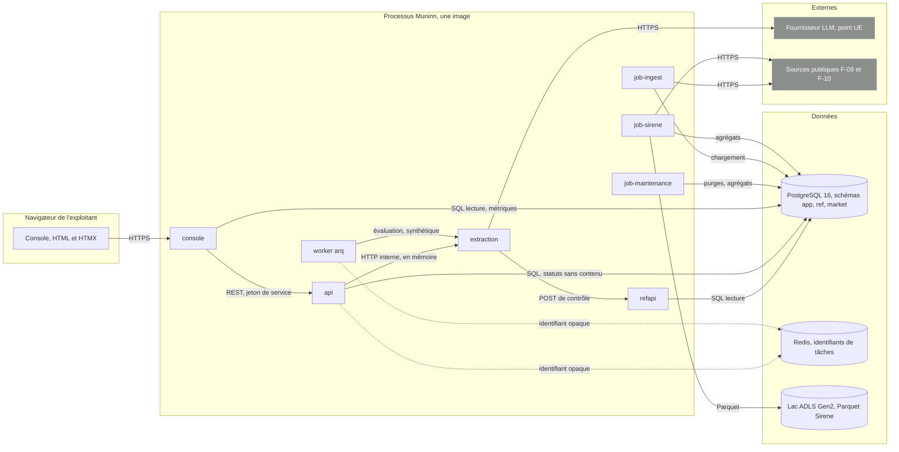
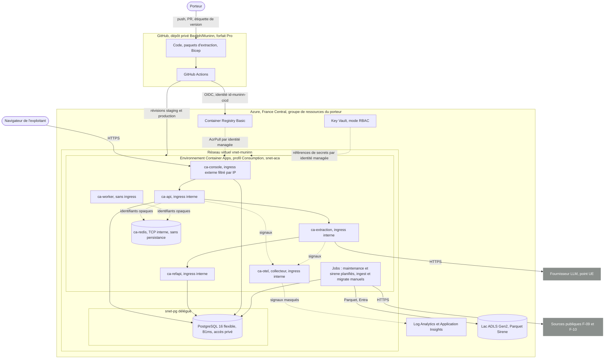

# Architecture technique et choix d'outils de Muninn

**Version :** 1.2
**Date :** 26 octobre 2026 (v1.2) ; 12 octobre 2026 (v1.1)
**Historique :** la v1.1 applique la relecture indépendante, s'aligne sur `05-chaine-llmops.md`
(staging, étiquette de version, évaluation par empreinte, minutes) et intègre D-27 à D-33 ainsi
que la lecture des fournisseurs de l'abonnement du 12 octobre 2026 (Redis en conteneur). La v1.2
(26 octobre 2026) aligne les sections 7.1 et 7.3 sur la chaîne livrée en V1 et liste ses écarts
avec la cible initiale. **Avertissement :** seules ces deux sections décrivent la V1 livrée ; les
sections 2 à 6, 7.2 et 8 à 11 décrivent la cible de la phase 2 et n'ont pas été révisées (la V1
n'a ni réseau virtuel, ni base en accès privé, ni Redis : applications en entrée externe, serveur
PostgreSQL ouvert aux services Azure, d'après `infra/azure/01-socle.sh` et `03-applications.sh`).
Pour l'infrastructure réelle, `infra/azure/README.md` fait foi.
**Phase :** 2 (industrialisation)
**Statut :** proposition, à valider par le porteur
**Compétence principale servie :** C15 (cadre technique : architecture, outils, méthodes) ;
préparation de C10 (interface accessible), C18 et C19 (intégration et livraison continues)
**Documents liés :** passation back-end (document interne au porteur, hors dépôt) ;
`docs/decisions.md` (D-01 à D-88) ; phase 0 : `01-user-stories.md`, `02-flux-de-donnees.md`,
`04-accessibilite-utilisabilite.md` ; phase 1 : `02-modele-de-donnees.md`,
`03-acces-et-exposition.md`, `04-verification-exactitude.md`, `06-big-data-externalise.md` ;
phase 2 : `01-besoin-de-production.md`, `02-plan-de-tests.md`, `03-observabilite.md`,
`04-contrat-api.md`, `05-chaine-llmops.md`, `07-methode-agile.md`

Ce document ne contient aucune ligne de code applicatif. Les extraits de configuration sont
illustratifs. Les hypothèses sont marquées **[H]**. Les prix sont publics, hors taxes, consultés le
12 octobre 2026. Les sigles « MD-0x (phase 1) » désignent les points ouverts du modèle de données
de la phase 1 ; les sigles « MD-x » sans suffixe désignent les modes dégradés du document 01.

## 1. Objet et contraintes

Ce document fixe l'architecture qui sert la démo du 29 octobre, l'oral du 12 novembre, puis le
produit. Il en tire les choix d'outils, chacun justifié, et propose les décisions d'architecture
(ADR) à faire valider.

Contraintes qui s'imposent :

| Source                                                      | Contrainte                                                                                                                                                                                                                                                                                                                                                                                                                                                               |
| ----------------------------------------------------------- | ------------------------------------------------------------------------------------------------------------------------------------------------------------------------------------------------------------------------------------------------------------------------------------------------------------------------------------------------------------------------------------------------------------------------------------------------------------------------ |
| R1 à R10                                                    | Rien ne sort en clair ; audio et transcription éphémères ; journaux sans DP ; UE ; aucune action payante sans accord                                                                                                                                                                                                                                                                                                                                                     |
| D-07                                                        | La console de démo reçoit le brouillon en clair (écart P-03, données synthétiques)                                                                                                                                                                                                                                                                                                                                                                                       |
| D-11                                                        | Extraction appelée en mémoire ; la file Redis ne porte que des identifiants opaques                                                                                                                                                                                                                                                                                                                                                                                      |
| D-18                                                        | Extraction sans accès aux bases ; brouillon via voice-gateway (ou via l'api en démo)                                                                                                                                                                                                                                                                                                                                                                                     |
| D-19                                                        | Droits Azure : Reader sur l'abonnement, Owner d'un seul groupe de ressources                                                                                                                                                                                                                                                                                                                                                                                             |
| Lecture des fournisseurs de l'abonnement le 12 octobre 2026 | Enregistrés : `Microsoft.App` (type `jobs` disponible en France Central), `Microsoft.DBforPostgreSQL`, `Microsoft.KeyVault`, `Microsoft.ContainerRegistry`, `Microsoft.OperationalInsights`, `microsoft.insights`, `Microsoft.Storage`, `Microsoft.Network`, `Microsoft.ManagedIdentity`, `Microsoft.Sql`, `Microsoft.CognitiveServices`. Non enregistrés : `Microsoft.Synapse`, `Microsoft.Databricks`, `Microsoft.MachineLearningServices`. Absent : `Microsoft.Cache` |
| D-27                                                        | Big data : lac ADLS Gen2 et job Container Apps planifié, moteur SQL en colonnes, agrégats dans PostgreSQL                                                                                                                                                                                                                                                                                                                                                                |
| D-29                                                        | Panne du LLM en fin d'appel : brouillon de secours `fallback_no_llm`                                                                                                                                                                                                                                                                                                                                                                                                     |
| D-31                                                        | Le porteur est en GitHub Pro : protection de branche et contrôle requis disponibles dès J0                                                                                                                                                                                                                                                                                                                                                                               |
| D-32, D-33                                                  | Modèle LLM non figé : comparaison documentée avant J2 ; clés fournies ensuite                                                                                                                                                                                                                                                                                                                                                                                            |
| Socle imposé                                                | Python 3.12, uv, FastAPI, Pydantic v2, PostgreSQL 16, SQLAlchemy 2, Alembic, Redis et arq, PyNaCl, ruff, mypy strict, pytest                                                                                                                                                                                                                                                                                                                                             |
| Socle imposé                                                | Docker et docker compose en local ; GitHub Actions sur `Bealph/Muninn` (privé) ; Azure Container Apps, ACR, PostgreSQL flexible, Key Vault, France Central                                                                                                                                                                                                                                                                                                               |
| Budget                                                      | Abonnement à 640 € par mois, partagé avec d'autres usages                                                                                                                                                                                                                                                                                                                                                                                                                |
| Besoin de production                                        | SLO, modes dégradés, RPO et RTO du document `01-besoin-de-production.md`                                                                                                                                                                                                                                                                                                                                                                                                 |

## 2. Composants

### 2.1 Découpage en processus

Le découpage reprend celui de la phase 1 (document 03, section 2.2), confirmé ici. Tous les
processus Muninn viennent **d'une seule image de conteneur**, lancée avec des commandes
différentes (ADR-10). Redis et le collecteur OpenTelemetry utilisent leur image publique,
importée dans le registre.

| Composant       | Rôle                                                                                                                | Entrée réseau                               | Accès aux données                                                                          | 29 octobre                                     | 12 novembre | Produit      |
| --------------- | ------------------------------------------------------------------------------------------------------------------- | ------------------------------------------- | ------------------------------------------------------------------------------------------ | ---------------------------------------------- | ----------- | ------------ |
| api             | Points publics, webhooks, appel de l'extraction, statuts, corrections                                               | Interne en démo ; Internet en produit       | `app` (rôle `muninn_api`), Redis                                                           | oui                                            | oui         | oui          |
| extraction      | Appel du LLM, validation du `DossierDraft`, normalisation, contrôle référentiel                                     | Interne                                     | Aucune base (D-18)                                                                         | oui                                            | oui         | oui          |
| refapi          | API REST des référentiels (US-50, C5), lecture seule                                                                | Interne                                     | `ref` (rôle `muninn_ref_reader`)                                                           | oui                                            | oui         | oui          |
| console         | Interface de démonstration et de test visuel (section 8)                                                            | Internet, filtré                            | `app` en lecture (`muninn_console`)                                                        | oui                                            | oui         | exploitation |
| worker          | Tâches arq à la demande (évaluation lancée depuis la console, puis SMS, relais)                                     | Aucune                                      | `app` (`muninn_worker` [H : rôle à ajouter à la phase 1, document 03, section 5.1]), Redis | oui                                            | oui         | oui          |
| redis           | File arq, sans persistance sur disque (D-11)                                                                        | TCP interne à l'environnement               | Identifiants opaques seulement                                                             | oui                                            | oui         | oui          |
| otel            | Collecteur OpenTelemetry : masquage, export des signaux (`03-observabilite.md`)                                     | Interne                                     | Aucune                                                                                     | oui                                            | oui         | oui          |
| job-maintenance | Purges et agrégats horaires, planifiés                                                                              | Aucune                                      | `app` (`muninn_worker_maint`)                                                              | oui                                            | oui         | oui          |
| job-ingest      | Collecte et chargement des référentiels (F-09)                                                                      | Aucune ; sortie vers les sources            | `ref` (`muninn_worker_ingest`)                                                             | oui                                            | oui         | oui          |
| job-migrate     | Migrations Alembic, au déploiement                                                                                  | Aucune                                      | Propriétaire (`muninn_migrator`)                                                           | oui                                            | oui         | oui          |
| job-sirene      | Traitement big data (D-27) : dépôt des Parquet dans le lac, requêtes SQL, secret statistique, écriture des agrégats | Aucune ; sortie vers data.gouv.fr et le lac | Lac (lecture et écriture) ; `market` (`muninn_market_loader`)                              | si le flux B le permet (`07-methode-agile.md`) | oui         | oui          |
| relay           | Chiffrement `SealedBox`, enveloppes, push                                                                           | Interne                                     | `app` (`muninn_relay`)                                                                     | non                                            | oui [H]     | oui          |
| voice-gateway   | Agent vocal temps réel                                                                                              | Internet, CPaaS seulement                   | `app` (`muninn_voice`)                                                                     | non                                            | non         | oui          |

En démo, l'api tient le rôle d'appelant de l'extraction que tient voice-gateway en production
(F-12, phase 0, document 02). Le simulateur d'appel et le CPaaS factice vivent dans l'api,
derrière l'interface du fournisseur de téléphonie, et n'existent que dans la configuration de démo.

### 2.2 Ce qui change entre le 29 octobre et le 12 novembre

| Élément                      | 29 octobre                                   | 12 novembre                                         |
| ---------------------------- | -------------------------------------------- | --------------------------------------------------- |
| Brouillon vers la console    | En clair, réponse HTTPS (D-07, P-03)         | Enveloppe chiffrée pour un appareil simulé (US-12)  |
| Jeu d'évaluation             | 20 de test, 35 de conformité                 | 100 de test, 40 de développement, 130 de conformité |
| Agrégats big data            | Selon l'avancement du flux B                 | Chargés dans `market` par job-sirene                |
| Staging                      | Révision étiquetée de l'environnement unique | Staging distinct (section 7.1)                      |
| Serveur MCP en lecture seule | Non                                          | Option (D-21)                                       |

## 3. Architecture applicative

### 3.1 Couches

Chaque processus Muninn suit la même organisation en couches, dans un seul paquet Python
`muninn` :

| Couche      | Contenu                                                                                           | Dépend de           |
| ----------- | ------------------------------------------------------------------------------------------------- | ------------------- |
| Entrées     | Routes FastAPI, commandes des jobs, tâches arq, gabarits de la console                            | Services            |
| Services    | Cas d'usage : extraire, contrôler, valider, purger, évaluer                                       | Domaine, interfaces |
| Domaine     | Modèles Pydantic (`DossierDraft` 1.1), normalisation, règles de clé humaine, sans entrée-sortie   | Rien                |
| Interfaces  | `Protocol` des fournisseurs : LLM, STT, TTS, CPaaS, SMS, push, stockage objet, référentiels       | Domaine             |
| Adaptateurs | Fournisseur LLM retenu (D-32), faux fournisseurs (`Fake…`), PostgreSQL (dépôts SQLAlchemy), Redis | Interfaces          |
| Transverse  | Configuration typée, journalisation à liste blanche, mesures, erreurs au format unique            | Rien                |

Règles :

- le domaine n'importe ni FastAPI, ni SQLAlchemy, ni un SDK de fournisseur : il se teste sans
  réseau ni base ;
- chaque fournisseur a une implémentation factice, utilisée par les tests et par le mode dégradé
  annoncé de la démo (passation back-end, section 5) ;
- l'interface LLM ne dépend d'aucun fournisseur : la comparaison de D-32 change un adaptateur, pas
  le domaine ;
- le composant extraction n'a aucune chaîne de connexion à une base dans sa configuration ; un
  test le vérifie (phase 1, document 03, TA-01) ;
- la transcription et le brouillon ne traversent que des appels en mémoire ou HTTP interne, jamais
  Redis ni un disque (D-11, R3).

### 3.2 Vue applicative



La console appelle l'api par son contrat REST (`04-contrat-api.md`), comme le fera l'application
mobile. Elle n'appelle jamais l'extraction directement. C'est ce qui fait d'elle une vraie
intégration de l'API d'IA (C10), et non un écran branché sur le code interne.

## 4. Déploiement local

`docker compose` lance la même image que l'environnement Azure, avec la configuration `local`.

| Service compose      | Image                                        | Rôle                                                         | Port publié sur le poste         |
| -------------------- | -------------------------------------------- | ------------------------------------------------------------ | -------------------------------- |
| `postgres`           | `postgres:16`                                | Base, trois schémas, rôles de la phase 1                     | 5432, sur 127.0.0.1              |
| `redis`              | `redis:7`, sans persistance                  | File arq                                                     | aucun                            |
| `migrate`            | image Muninn                                 | Alembic, puis fin                                            | aucun                            |
| `ingest`             | image Muninn                                 | Chargement des référentiels, à la demande                    | aucun                            |
| `sirene`             | image Muninn                                 | Traitement big data sur des Parquet copiés hors dépôt (P-18) | aucun                            |
| `api`                | image Muninn                                 | api, simulateur d'appel en configuration `demo`              | aucun                            |
| `extraction`         | image Muninn                                 | extraction                                                   | aucun                            |
| `refapi`             | image Muninn                                 | API des référentiels                                         | aucun                            |
| `worker`             | image Muninn                                 | worker arq                                                   | aucun                            |
| `console`            | image Muninn                                 | console                                                      | 8080, sur 127.0.0.1              |
| Pile d'observabilité | collecteur, Prometheus, Loki, Tempo, Grafana | Signaux locaux (`03-observabilite.md`)                       | Grafana sur 127.0.0.1 [H : port] |

Extrait illustratif, qui montre deux décisions : Redis sans persistance (D-11) et ports liés au
seul poste.

```yaml
# Illustratif : Redis ne garde rien sur disque, aucun port n'est ouvert hors du poste.
redis:
  image: redis:7
  command: ["redis-server", "--save", "", "--appendonly", "no"]
console:
  ports: ["127.0.0.1:8080:8080"]
```

Le stockage objet (MinIO) n'entre dans le compose qu'avec les stories de sauvegarde (US-33), après
le 12 novembre. Le développement hors conteneur utilise un environnement `uv` construit sur le
Python installé du système, car l'interpréteur téléchargé par `uv` ne charge pas les extensions
natives sur le poste du porteur [H : contrainte du poste, sans effet dans les conteneurs].

Trois configurations existent, choisies par une seule variable d'environnement :

| Configuration | Simulateur et vérité terrain | Faux fournisseurs      | Données      |
| ------------- | ---------------------------- | ---------------------- | ------------ |
| `local`       | activés                      | par défaut             | synthétiques |
| `demo`        | activés                      | sur bascule annoncée   | synthétiques |
| `prod`        | désactivés, test TA-24       | interdits au démarrage | réelles      |

## 5. Déploiement Azure

### 5.1 Ressources

Toutes les ressources sont dans l'unique groupe de ressources dont le porteur est Owner, en
France Central. Leur création est une action du porteur (R10), par un modèle Bicep relu avant
exécution (ADR-14). Chaque type de ressource ci-dessous relève d'un fournisseur enregistré
(lecture des fournisseurs de l'abonnement le 12 octobre 2026).

| Ressource                      | Nom proposé [H]                                                              | Niveau                                                                          | Rôle                                        |
| ------------------------------ | ---------------------------------------------------------------------------- | ------------------------------------------------------------------------------- | ------------------------------------------- |
| Réseau virtuel                 | `vnet-muninn`                                                                | 10.20.0.0/16                                                                    | Isolation de la base et des applications    |
| Sous-réseau de l'environnement | `snet-aca`                                                                   | /27 au minimum, /26 proposé                                                     | Environnement Container Apps                |
| Sous-réseau délégué de la base | `snet-pg`                                                                    | /28 [H : taille minimale à vérifier]                                            | PostgreSQL en accès privé                   |
| Zone DNS privée                | `privatelink…postgres`                                                       | une zone                                                                        | Résolution du nom privé de la base          |
| Environnement Container Apps   | `cae-muninn`                                                                 | Workload profiles, profil Consumption seul                                      | Applications et jobs                        |
| Applications Container Apps    | `ca-api`, `ca-extraction`, `ca-refapi`, `ca-console`, `ca-worker`, `ca-otel` | 0,25 vCPU, 0,5 Gio [H]                                                          | Section 2                                   |
| Application Redis              | `ca-redis`                                                                   | 0,25 vCPU, 0,5 Gio, une réplique, ingress TCP interne                           | File arq (ADR-13)                           |
| Jobs Container Apps            | `caj-maintenance`, `caj-ingest`, `caj-migrate`, `caj-sirene`                 | planifié, manuel, manuel, planifié et manuel                                    | Section 2                                   |
| Compte de stockage, lac        | `stmuninnlake…`                                                              | ADLS Gen2 (espace de noms hiérarchique), Hot LRS, accès par Entra seulement [H] | Parquet Sirene (D-27)                       |
| Container Registry             | `acrmuninn…`                                                                 | Basic                                                                           | Images                                      |
| PostgreSQL flexible server     | `psql-muninn`                                                                | Burstable B1ms, 32 Gio, PostgreSQL 16                                           | Base unique, trois schémas (ADR-15)         |
| Key Vault                      | `kv-muninn…`                                                                 | Standard, mode RBAC, purge protégée                                             | Secrets                                     |
| Identités managées affectées   | Section 6.1                                                                  | une par composant et par job, une pour la CI                                    | Accès sans secret                           |
| Espace Log Analytics           | `log-muninn`                                                                 | Paiement à l'usage, rétention 30 jours                                          | Journaux (voir `03-observabilite.md`)       |
| Application Insights           | `appi-muninn`                                                                | Basée sur l'espace `log-muninn`                                                 | Traces et métriques (`03-observabilite.md`) |
| Budget du groupe de ressources | `budget-muninn`                                                              | 60 € par mois, alertes à 50, 80 et 100 %                                        | SLO-16                                      |

`Microsoft.Cache` est absent de la liste des fournisseurs enregistrés : Azure Managed Redis n'est
pas disponible, et le porteur, Reader sur l'abonnement, ne peut pas l'enregistrer (D-19). Redis
tourne donc en conteneur (ADR-13).

### 5.2 Diagramme de déploiement



### 5.3 Réseau

- **Environnement dans un réseau virtuel.** Il permet l'accès privé à PostgreSQL : la base n'a
  aucune adresse publique. Le type « workload profiles » accepte un sous-réseau de /27, contre
  /23 pour un environnement « Consumption only » (Microsoft Learn, réseaux virtuels de Container
  Apps). Seul le profil Consumption est utilisé : aucun profil dédié, aucun point de terminaison
  privé, aucune maintenance planifiée, pour ne pas déclencher de frais de gestion de plan
  (section 10.3).
- **Entrées.** Seule la console est exposée à Internet, avec une liste d'adresses IP autorisées
  (poste du porteur, réseau de la salle d'examen [H : adresse à obtenir], plan B). L'api,
  l'extraction et la refapi ont un ingress interne : joignables depuis l'environnement seulement.
  En produit, l'api et voice-gateway passeront en ingress externe, derrière les contrôles de la
  phase 1 (document 03, sections 5.3 et 5.4).
- **Redis.** Ingress TCP interne : seul l'ingress TCP externe exige un réseau virtuel (Microsoft
  Learn, ingress de Container Apps). Mot de passe tiré de Key Vault. Le flux n'est pas chiffré par
  TLS, ce qui s'écarte de la phase 1 (document 03, section 5.7) : écart AT-08, accepté parce que
  Redis ne porte que des identifiants opaques (D-11) et ne sort pas de l'environnement [H :
  chiffrement du trafic interne à l'environnement, à vérifier comme option de Container Apps].
- **Flux entre applications.** HTTP interne, jeton de service par couple appelant-appelé, avec une
  portée (phase 1, document 03, section 5.3).
- **Sorties.** Vers le fournisseur LLM (HTTPS, point UE), vers les sources publiques (job-ingest
  et job-sirene seulement), vers le lac (HTTPS, authentification Entra). Aucune passerelle NAT :
  l'adresse de sortie n'a pas besoin d'être fixe [H : à revoir si un fournisseur exige une liste
  d'adresses autorisées].
- **Journaux d'accès.** La chaîne de requête n'est pas journalisée (P-05) ; les valeurs contrôlées
  passent dans le corps d'un `POST`.

## 6. Identités et secrets

### 6.1 Identités managées

Une identité managée affectée par l'utilisateur par application et par job. Chaque identité ne
reçoit que ce dont son composant a besoin (moindre privilège, phase 1, document 03, section 4.5).
Le rôle Key Vault Secrets User est attribué au niveau de **chaque secret**, pas du coffre : un
composant compromis ne lit que ses propres secrets.

| Identité                | Rôles Azure                                                                       | Secrets lus (Key Vault Secrets User, par secret)                                                                                           |
| ----------------------- | --------------------------------------------------------------------------------- | ------------------------------------------------------------------------------------------------------------------------------------------ |
| `id-muninn-api`         | AcrPull                                                                           | Mot de passe de `muninn_api` ; jetons de service vers extraction et refapi ; poivres HMAC ; mot de passe Redis                             |
| `id-muninn-extraction`  | AcrPull                                                                           | Clé du fournisseur LLM de production ; jeton de service vers refapi                                                                        |
| `id-muninn-refapi`      | AcrPull                                                                           | Mot de passe de `muninn_ref_reader`                                                                                                        |
| `id-muninn-console`     | AcrPull                                                                           | Mot de passe de `muninn_console` ; jeton de service vers l'api ; compte de la console (voie 2, section 6.3)                                |
| `id-muninn-worker`      | AcrPull                                                                           | Mot de passe de `muninn_worker` ; jeton de service vers extraction ; mot de passe Redis                                                    |
| `id-muninn-redis`       | AcrPull                                                                           | Mot de passe Redis                                                                                                                         |
| `id-muninn-otel`        | AcrPull                                                                           | Chaîne de connexion d'Application Insights                                                                                                 |
| `id-muninn-maintenance` | AcrPull                                                                           | Mot de passe de `muninn_worker_maint`                                                                                                      |
| `id-muninn-ingest`      | AcrPull                                                                           | Mot de passe de `muninn_worker_ingest`                                                                                                     |
| `id-muninn-migrate`     | AcrPull                                                                           | Mot de passe de `muninn_migrator`                                                                                                          |
| `id-muninn-sirene`      | AcrPull ; Storage Blob Data Contributor sur le seul conteneur `sirene` du lac     | Mot de passe de `muninn_market_loader`                                                                                                     |
| `id-muninn-voice`       | AcrPull                                                                           | Mot de passe de `muninn_voice` ; clés des fournisseurs STT, TTS et LLM de l'agent ; jeton de service vers extraction (après le 29 octobre) |
| `id-muninn-relay`       | AcrPull                                                                           | Mot de passe de `muninn_relay` ; identifiants des services de notification push (après le 29 octobre)                                      |
| `id-muninn-probe`       | AcrPull                                                                           | Jeton de service vers extraction ; aucun accès à la base (document 03 de la phase 1, section 4.6)                                          |
| `id-muninn-canary`      | AcrPull                                                                           | Jeton de service vers extraction ; aucun accès à la base (document 03 de la phase 1, section 4.6)                                          |
| `id-muninn-cicd`        | AcrPush sur le registre ; Container Apps Contributor sur les applications et jobs | Aucun : pas d'accès au coffre                                                                                                              |

Le rôle intégré Container Apps Contributor gère les applications sans droit d'attribution de
rôles (Microsoft Learn, rôles intégrés pour les conteneurs). Certains rôles intégrés de
Container Apps portent des permissions génériques qui incluent la lecture des valeurs de secrets
[H : à contrôler sur la définition du rôle avant attribution]. C'est la limite de `05-chaine-llmops.md`
(section 3.5) : contributeur sur les seules Container Apps, aucun accès aux secrets du coffre.

Le porteur est Owner du groupe de ressources : ces droits devraient suffire à créer les
identités, leurs informations d'identification fédérées et les attributions de rôles au niveau
du groupe [H : à vérifier au lot 0 par une création réelle, comme le dit le document 05].

### 6.2 Secrets

| Secret                                      | Stocké dans                                | Lu par                    | Remarque                                                                        |
| ------------------------------------------- | ------------------------------------------ | ------------------------- | ------------------------------------------------------------------------------- |
| Clé d'API du fournisseur LLM de production  | Key Vault                                  | extraction                | Fournie par le porteur après le choix de D-32 (D-33), jamais dans le dépôt (R8) |
| Clé d'API d'évaluation                      | Secret d'environnement GitHub `evaluation` | Job `eval` de la CI       | Distincte de la clé de production (`05-chaine-llmops.md`, section 3.5)          |
| Mots de passe des rôles PostgreSQL          | Key Vault                                  | Le composant du rôle      | Authentification Entra visée après le 12 novembre (ADR-17)                      |
| Mot de passe Redis                          | Key Vault                                  | api, worker, redis        | Rotation à 90 jours [H]                                                         |
| Jetons de service internes                  | Key Vault                                  | Le couple appelant-appelé | Rotation à 90 jours [H]                                                         |
| Poivres HMAC                                | Key Vault                                  | api                       | Pas utilisés en démo, prévus par le modèle                                      |
| Compte de la console (mot de passe et TOTP) | Key Vault                                  | console                   | Si l'authentification Entra intégrée n'est pas possible                         |
| Accès au lac                                | Aucun secret : identité managée            | job-sirene                | Clé partagée du compte désactivée [H]                                           |
| Accès de la CI à Azure                      | Aucun secret : fédération OIDC             | GitHub Actions            | Sujets exacts par branche et par étiquette (section 7.3)                        |

Les secrets entrent dans les applications comme **références Key Vault** résolues par l'identité
managée (Microsoft Learn, gestion des secrets de Container Apps). Le coffre a la suppression
réversible et la protection contre la purge.

### 6.3 Authentification de la console

La phase 1 exige un compte nominatif avec second facteur (document 03, section 5.3). Deux voies :

1. **Authentification intégrée de Container Apps avec Microsoft Entra ID**, si le locataire de
   l'organisme autorise le porteur à inscrire une application [H : non vérifié]. Le second facteur
   est alors celui du compte de l'organisme.
2. **Sinon**, connexion propre à la console : identifiant, mot de passe haché, code TOTP, session
   courte, en plus de la liste d'adresses IP de l'ingress.

La voie 1 est préférée : aucun mot de passe à gérer. La voie 2 est prête en repli.

## 7. Chaîne d'intégration et de livraison

### 7.1 Vue d'ensemble

Cette section décrit la chaîne **livrée en V1**, d'après la configuration versionnée, qui fait
foi (`.github/workflows/ci.yml`, `donnees.yml`, `retour-arriere.yml`, `infra/azure/deployer.sh`),
relue le 26 octobre 2026. Les schémas en boîtes de `infra/azure/README.md`, section « Schémas »
(images dans `infra/azure/schemas/`), en sont une lecture datée du même jour. Le contenu des tests est dans
`02-plan-de-tests.md`. La cible initiale, décrite par `05-chaine-llmops.md` (étapes E5 à E8),
n'est pas celle de la V1 ; les écarts sont listés plus bas.

| Déclencheur                                   | Travaux                                                                                                                                                                                                                                                                                                                                         | Environnement touché                                                                                                    |
| --------------------------------------------- | ----------------------------------------------------------------------------------------------------------------------------------------------------------------------------------------------------------------------------------------------------------------------------------------------------------------------------------------------- | ----------------------------------------------------------------------------------------------------------------------- |
| Pull request vers `main`                      | `lint` (ruff, format, mypy strict) ; `tests` (PostgreSQL 16 de test, axe-core dans Chromium) ; `build` (image et test de fumée : santé, SHA livré, migrations et commandes embarquées) ; `secrets` (gitleaks sur tout l'historique) ; `evaluation` si l'empreinte du paquet d'extraction diffère de celle de `main` ; contrôle requis `verdict` | Aucun environnement livré ; le modèle est appelé (environnement GitHub `evaluation`, 1 € au plus) si l'empreinte change |
| Fusion sur `main`                             | Mêmes contrôles (l'évaluation s'y déclare « non requise » : l'empreinte est celle de `main`), puis job `preproduction` : image `crmuninn.azurecr.io/muninn:<sha>` construite et poussée, `deployer.sh preproduction <sha>` ; si vert, job `production` : même image, `deployer.sh production <sha>`                                             | Préproduction, puis production                                                                                          |
| Workflow manuel `retour-arriere`              | Trafic de l'API et de la console rendu à une révision antérieure (la précédente, ou celle d'un commit donné), contrôle de l'adresse publique                                                                                                                                                                                                    | Celui choisi                                                                                                            |
| Workflow manuel `donnees`                     | Tâche `job-muninn-donnees-<env>` (migrations, rôles, ingestion), puis jeu de questions de démonstration contre l'API publique                                                                                                                                                                                                                   | Celui choisi                                                                                                            |
| Planification de la tâche (le 3 du mois, UTC) | Tâche des données seule, sans le jeu de questions : 3 h en préproduction, 4 h en production (`05-donnees.sh`)                                                                                                                                                                                                                                   | Les deux                                                                                                                |

`deployer.sh` livre l'API puis la console. Pour chacune : une image déjà en service est ignorée
sans erreur (INC-03) ; sinon, trafic figé sur la révision en service,
nouvelle révision sans trafic, contrôle à sa propre adresse (santé et SHA ; pour l'API, un appel
réel au modèle A), puis bascule de 100 % du trafic. Si un contrôle échoue, le trafic reste sur la
révision précédente et la livraison s'arrête : la production n'est jamais touchée quand la
préproduction échoue. La livraison ne migre pas la base : après une livraison qui change le
schéma, lancer le workflow `donnees` dans chaque environnement, sinon la nouvelle version tourne sur
l'ancien schéma jusqu'au 3 du mois. Les trois workflows d'un même environnement partagent un verrou
(`livraison-<env>`) : ils ne tournent jamais en même temps.

L'évaluation n'est pas déclenchée par les chemins modifiés, mais par l'empreinte : condensat de
tout ce qui peut changer une réponse évaluée, comparé à celui de `main`. Une PR de documentation ne
paie rien ; une PR qui touche le prompt paie tout, sous un plafond de 1 € (D-64).

**Préproduction.** Ce n'est pas une révision étiquetée de l'environnement de production : c'est un
environnement à part entière, avec ses propres applications (`ca-muninn-api-preprod`,
`ca-muninn-console-preprod`), sa base `muninn_preprod` sur le même serveur PostgreSQL et sa tâche
des données (`01-socle.sh`, `03-applications.sh`, `05-donnees.sh`). Le chiffrage de la section 10.3
n'a pas été revu pour cette forme ; le coût réel, préproduction comprise, est suivi par le budget
`budget-muninn` (60 € par mois, `04-budget.sh`).

**Écarts avec la cible initiale (`05-chaine-llmops.md`).**

| Cible initiale                                                       | V1 livrée                                                                                                                                                     |
| -------------------------------------------------------------------- | ------------------------------------------------------------------------------------------------------------------------------------------------------------- |
| Mise en production sur étiquette Git de version posée par le porteur | Mise en production automatique après la préproduction, sur toute fusion dans `main` dont le `verdict` est vert ; l'approbation humaine est la fusion de la PR |
| Révision à 0 % du trafic, test de fumée, canari, puis bascule        | Révision à 0 %, contrôle à son adresse, puis bascule de 100 % du trafic ; pas de canari                                                                       |
| Migration additive par un job à chaque livraison                     | Migrations faites par la tâche des données (`muninn-donnees`), lancée à la demande ou le 3 du mois ; la livraison ne migre pas                                |
| Évaluation si l'empreinte n'a pas d'attestation                      | Évaluation si l'empreinte diffère de celle de `main`, ou à la demande                                                                                         |
| Analyse des dépendances en PR                                        | Absente de la CI                                                                                                                                              |
| Extraction de contrôle synthétique en staging (E6)                   | Absente ; le contrôle de livraison est un appel réel au modèle A (`/llm/essai`)                                                                               |
| Release GitHub et rapport archivé (E8)                               | Absents                                                                                                                                                       |
| Workflow `nocturne` (dérives, stabilité, dépendances)                | Absent                                                                                                                                                        |
| Étiquette de PR `eval-complete`                                      | Absente ; l'évaluation complète se lance à la main (`workflow_dispatch` de `ci`)                                                                              |

### 7.2 Retour arrière

Les applications sont en mode « révisions multiples ». Une révision mise en production reste
précédée d'une révision active, sans trafic, jusqu'à la livraison suivante. Le retour arrière
bascule le trafic, sans reconstruire. Pendant les créneaux de démo, la révision précédente garde
une réplique minimale pour un retour arrière sans démarrage à froid ; hors créneaux, elle est à
zéro (proposition du document 05, section 11 ; coût en section 10.3). Les migrations Alembic sont
écrites pour rester compatibles avec la révision précédente (ajout de colonne, pas de suppression
dans la même livraison) : sans cette règle, un retour arrière de l'application casserait sur un
schéma déjà migré.

### 7.3 GitHub Pro sur un dépôt privé

Le porteur est en GitHub Pro (D-31). Conséquences vérifiées ou héritées du document 05
(section 3.4) :

- la protection de `main` est disponible dès J0 : fusion par PR seulement, contrôle requis
  `verdict`, branche à jour, historique linéaire. Une PR dégradée est donc bloquée par la
  plateforme, ce que la démo d'E3 peut montrer ;
- les environnements GitHub et leurs secrets sont disponibles en Pro ; les relecteurs obligatoires
  et les délais d'attente restent réservés aux dépôts publics, ou à Enterprise pour un dépôt privé
  (documentation de GitHub). En V1, l'approbation humaine d'une mise en production est la fusion
  de la PR dans `main` par le porteur (section 7.1) ; l'étiquette Git de version n'est pas utilisée ;
- la fédération OIDC utilise des sujets exacts, sans caractère générique : un par environnement
  GitHub (`preproduction`, `production`, `evaluation`), sur le sujet « immuable » du dépôt
  (`infra/azure/oidc-github.sh`, `06-evaluation.sh`).

**Minutes.** Le forfait Pro inclut 3 000 minutes d'Actions par mois pour les dépôts privés
(documentation de GitHub, facturation d'Actions). Le document 05 (section 3.7) estime la
consommation à 1 976 minutes par mois, au rythme de 80 pushes sur des PR et 25 fusions. La marge
est de 3 000 − 1 976 = 1 024 minutes, soit 34 % du quota. Au-delà, une minute d'exécuteur Linux à
2 cœurs coûte 0,006 $.

## 8. Interface de démonstration et de test visuel

### 8.1 Besoin

Le porteur exige de tester **chaque fonctionnalité** par une interface visuelle. La console doit
donc couvrir la démo du 29 octobre, puis s'étendre story après story. Elle doit satisfaire
WCAG 2.2 niveau AA (phase 0, document 04, section 2.3) et, au minimum pour la démo, EXA-01 à
EXA-05, EXA-07 à EXA-09, EXA-12, EXU-06, EXU-07 et EXU-12 (même document, section 5.3).

### 8.2 Options comparées

| Critère                   | FastAPI, Jinja2 et HTMX                                                                                       | SPA (React et Vite)                                                                              | Streamlit ou Gradio                                                                    |
| ------------------------- | ------------------------------------------------------------------------------------------------------------- | ------------------------------------------------------------------------------------------------ | -------------------------------------------------------------------------------------- |
| Accessibilité WCAG 2.2 AA | HTML sémantique rendu par le serveur ; points d'attention sur les mises à jour partielles (8.4)               | Atteignable, mais le routage côté client impose de gérer le focus et les annonces à chaque écran | Peu de maîtrise du balisage, du focus et des libellés : audit RGAA difficile à réussir |
| Délai jusqu'au 29 octobre | Squelette au jour J0, puis un écran par jour (`07-methode-agile.md`, section 6.1) ; même langage que le reste | Chaîne de build Node, typage dupliqué, client d'API à générer                                    | Très rapide pour un prototype                                                          |
| Crédibilité pour C10      | La console appelle l'API REST comme un client                                                                 | Idem, plus visible                                                                               | Le code de l'interface appelle souvent les fonctions Python directement                |
| Sécurité                  | Pas de jeton dans le navigateur ; session côté serveur ; CSP stricte possible                                 | Jeton ou session à exposer au navigateur                                                         | Modèle de session propre au cadriciel                                                  |
| Tests                     | pytest, Playwright, axe-core                                                                                  | Vitest ou Jest, Playwright, axe-core                                                             | Peu d'outils de test d'interface                                                       |
| Dépendances ajoutées      | Jinja2, une bibliothèque JavaScript (HTMX), servie localement                                                 | Node, npm, React, outillage de build                                                             | Le cadriciel entier                                                                    |

**Recommandation : FastAPI, Jinja2 et HTMX** (ADR-09). Le rendu serveur donne un HTML
sémantique par défaut, ce qui sert directement l'accessibilité. La console reste en Python, dans
le même dépôt, testée par les mêmes outils, ce qui tient le délai. La console consomme l'API
publique : la preuve de C10 est réelle. Streamlit et Gradio sont écartés pour l'accessibilité,
critère éliminatoire de C10. La SPA est écartée pour le délai, sans défaut de principe.

### 8.3 Écrans, fonctionnalité par fonctionnalité

Chaque écran a une adresse propre, un titre de page unique et un bandeau permanent « Démo,
données synthétiques » en configuration `demo`. Les points d'API sont ceux de `04-contrat-api.md`.

| Écran | Nom                        | Ce que l'on teste visuellement                                                                                                                                                                                             | Stories                    | Échéance |
| ----- | -------------------------- | -------------------------------------------------------------------------------------------------------------------------------------------------------------------------------------------------------------------------- | -------------------------- | -------- |
| E-01  | Accueil et état            | État de chaque dépendance (`/ready`), versions servies : paquet d'extraction, prompt, schéma, modèle, référentiels, image (SHA), configuration                                                                             | US-39, US-40, US-41        | 29/10    |
| E-02  | Scénarios                  | Liste filtrable du jeu synthétique par catégorie et partition ; lancement d'un scénario (le simulateur produit la fin d'appel)                                                                                             | US-36                      | 29/10    |
| E-03  | Brouillon d'extraction     | Champs, valeur, confiance, mention « à vérifier » en texte, résultat du contrôle par champ, version du référentiel, vérité terrain, écarts, `request_id` ; brouillon de secours `fallback_no_llm` affiché comme tel (D-29) | US-11, US-36, US-51        | 29/10    |
| E-04  | Preuve de destruction      | Horodatages de destruction de la transcription, rappel que l'audio est couvert par le test de conformité                                                                                                                   | US-31                      | 29/10    |
| E-05  | Validation et correction   | Correction d'un champ, validation en un geste, confirmation annoncée ; seuls les noms des champs corrigés partent au serveur                                                                                               | US-17                      | 29/10    |
| E-06  | Extraction depuis un texte | Saisie d'un texte libre synthétique, extraction, affichage comme E-03 ; avertissement « aucune donnée réelle » avant l'envoi                                                                                               | US-13 (voie écrite), US-11 | 29/10    |
| E-07  | Référentiels               | Versions, comptages, rejets motivés de chaque chargement ; formulaire de contrôle d'un code postal et d'une commune, d'un préfixe                                                                                          | US-46, US-47, US-50, US-51 | 29/10    |
| E-08  | Évaluation                 | Lancement sur la partition de développement ; liste des rapports ; exactitude par champ, intervalles, cas à tolérance nulle, coût, latence ; comparaison avec la référence                                                 | US-37, US-40               | 29/10    |
| E-09  | Qualité                    | Tableau de bord : `needs_review`, « non contrôlé », corrections par champ, latences p50 et p95, coût ; alertes actives (cellules de moins de 5 non affichées seules)                                                       | US-38                      | 29/10    |
| E-10  | Journal d'une requête      | Lignes de journal d'un `request_id`, filtrées par la liste blanche ; aucune DP visible                                                                                                                                     | US-39                      | 29/10    |
| E-11  | Livraisons                 | Révisions déployées en staging et en production, trafic, lien vers l'exécution de la CI et le rapport d'évaluation ; le retour arrière reste dans la CI (trace)                                                            | US-40                      | 29/10    |
| E-12  | Purges                     | Dernières exécutions de purge, éléments purgés par table, échecs                                                                                                                                                           | US-41                      | 12/11    |
| E-13  | Appareil simulé            | Enregistrement d'une clé publique, enveloppe telle que stockée (opaque), déchiffrement par l'appareil simulé, accusé et suppression                                                                                        | US-12, US-32               | 12/11    |
| E-14  | Marché                     | Agrégats Sirene et Urssaf du schéma `market`, version de l'exécution de job-sirene, secret statistique appliqué                                                                                                            | US-52, US-53               | 12/11    |
| E-15  | Ligne et disponibilités    | Réglage de la ligne, horaires sur les sept jours de la semaine (D-30), codes de renvoi, créneaux sans nom, test de renvoi simulé                                                                                           | US-02 à US-05, US-49       | après    |
| E-16  | Dépenses et tickets        | Dépense écrite ou dictée, ticket en image, brouillon `expense_voice` ou `receipt_scan`                                                                                                                                     | US-21, US-22               | après    |
| E-17  | SMS simulés                | Boîte d'envoi du faux fournisseur SMS, statut ; aucun envoi réel (R10)                                                                                                                                                     | US-27 à US-29              | après    |
| E-18  | Sauvegarde et archive      | Dépôt d'un blob opaque, durée de conservation, suppression                                                                                                                                                                 | US-33 à US-35              | après    |

L'écran E-06 accepte un texte libre : c'est un risque pour R9 (quelqu'un peut taper une donnée
réelle). Mesures : avertissement avant l'envoi, aucun stockage ni journal du texte, écran absent
de la configuration `prod`.

Le simulateur d'appel temps réel (agent vocal) n'a pas d'écran avant la décision ADR-01.

### 8.4 Règles d'accessibilité propres à HTMX

| Risque                                            | Règle                                                                                      | Exigence       |
| ------------------------------------------------- | ------------------------------------------------------------------------------------------ | -------------- |
| Une mise à jour partielle n'est pas annoncée      | Résultat placé dans une région `aria-live="polite"` ; erreurs en `role="alert"`            | EXA-08, EXA-12 |
| Le focus se perd après remplacement d'un fragment | Après une action, le focus va au titre du résultat ; jamais sur un élément retiré          | EXA-09         |
| L'interface ne marche plus sans JavaScript        | Chaque action est un formulaire ou un lien HTML valide ; HTMX l'améliore sans le remplacer | EXA-07, EXA-09 |
| L'état « à vérifier » est porté par la couleur    | Mention en texte et icône avec libellé ; la couleur double l'information                   | EXA-02         |
| Une action prend plusieurs secondes               | Indicateur d'attente annoncé ; bouton désactivé avec texte « extraction en cours »         | EXA-08         |
| Les tableaux de résultats deviennent illisibles   | Tableaux HTML avec en-têtes de ligne et de colonne, légende ; pas de grille de `div`       | EXA-07         |

Vérification : axe-core dans la chaîne sur chaque écran (zéro violation), parcours au clavier seul
et au lecteur d'écran (NVDA et Firefox) avant le 29 octobre, audit RGAA des écrans E-01 à E-11
(phase 0, document 04, section 5.2).

## 9. Big data (D-09, D-19, D-27)

### 9.1 Solution retenue

D-27 clôt D-09 : le traitement Sirene utilise un **lac ADLS Gen2** et un **job Container Apps
planifié** qui interroge les fichiers Parquet en SQL avec un moteur en colonnes, **DuckDB** [H :
version à figer au lot 0]. Les agrégats sont écrits dans le schéma `market` de PostgreSQL. Tout
est en France Central, dans le groupe de ressources du porteur, sur des fournisseurs enregistrés
(`Microsoft.Storage`, `Microsoft.App`).

| Étape                                     | Où                                                                                                                                                        | Sortie                                                                |
| ----------------------------------------- | --------------------------------------------------------------------------------------------------------------------------------------------------------- | --------------------------------------------------------------------- |
| Téléchargement des stocks Parquet du mois | job-sirene, depuis data.gouv.fr                                                                                                                           | Fichiers déposés dans le conteneur `sirene` du lac                    |
| Requêtes SQL d'extraction et d'agrégat    | job-sirene, DuckDB lisant le lac [H : lecture directe par l'extension Azure de DuckDB, à vérifier au lot 0 ; sinon copie locale dans le conteneur du job] | Comptages par NAF, tranche, catégorie juridique, département          |
| Secret statistique                        | job-sirene                                                                                                                                                | Cellules de moins de 5 regroupées (phase 1, document 02, section 4.2) |
| Chargement                                | Schéma `market` (rôle `muninn_market_loader`)                                                                                                             | `market.sirene_runs`, `market.sirene_counts`                          |
| Effacement des fichiers bruts             | Règle de cycle de vie du conteneur `sirene`                                                                                                               | Suppression après 35 jours [H] (P-18)                                 |
| Affichage                                 | Console, écran E-14                                                                                                                                       | Agrégats et version de l'exécution                                    |

Ce que voit le job : les fichiers Sirene complets, qui contiennent des données personnelles
d'entrepreneurs individuels. Les colonnes nominatives ne sont jamais lues (projection SQL) ; les
fichiers restent hors du dépôt (R9) et sont supprimés par la règle de cycle de vie.

Limite à dire au jury : DuckDB est un moteur mono-nœud. L'argument « big data » repose sur le
lac de données, le format en colonnes et la lecture sélective de 74 millions de lignes, pas sur
la distribution du calcul (phase 1, document 06, section 6.2).

### 9.2 Coût et dimensionnement

| Élément                  | Hypothèse ou calcul                                                                          | Coût mensuel         |
| ------------------------ | -------------------------------------------------------------------------------------------- | -------------------- |
| Stockage du lac          | 3 Go × 0,0169 € par Go, Hot LRS en France Central (phase 1, document 06, section 4.1)        | 0,05 €               |
| Calcul d'une exécution   | 2 vCPU et 4 Gio pendant 20 min [H] : 2 400 vCPU-s × 0,0000211 € + 4 800 Gio-s × 0,00000264 € | 0,06 € par exécution |
| Exécutions par mois      | 10 pendant la mise au point [H], 1 ensuite                                                   | 0,63 € puis 0,06 €   |
| Transactions de stockage | Négligeables à ce volume [H]                                                                 | 0,00 €               |

## 10. Coût Azure mensuel

### 10.1 Méthode

- Prix de l'API publique des prix de détail Azure (`prices.azure.com/api/retail/prices`), région
  `francecentral`, type « Consumption », lus le 12 octobre 2026, hors taxes, sans remise.
- L'API arrondit les prix en euros à quatre décimales. Les compteurs à la seconde de Container
  Apps y apparaissent à 0,0000 € : ils sont lus en dollars et convertis à 0,88 € pour 1 $ [H :
  rapport des prix euro et dollar du compteur « Standard Requests », 0,352 € pour 0,40 $, pas un
  taux de change officiel].
- Un mois compte 730 heures et 2 628 000 secondes. Le mois de référence est octobre, le plus
  chargé en créneaux de démo (88 heures, document 01, BP-07).
- La franchise gratuite de Container Apps (180 000 vCPU-secondes, 360 000 Gio-secondes, 2 millions
  de requêtes par mois) est **par abonnement**. L'abonnement est partagé : elle n'est pas déduite
  [H : consommation des autres usages inconnue].
- Les 5 Go gratuits de Log Analytics sont **par compte de facturation**, partagé aussi : non
  déduits dans le scénario haut.

### 10.2 Prix unitaires

| Compteur                                         | Prix unitaire                             | Source                                                           |
| ------------------------------------------------ | ----------------------------------------- | ---------------------------------------------------------------- |
| Container Apps, vCPU actif                       | 0,000024 $/s, soit 0,0000211 €/s          | API des prix, Azure Container Apps                               |
| Container Apps, vCPU inactif                     | 0,000003 $/s, soit 0,00000264 €/s         | Idem                                                             |
| Container Apps, mémoire active ou inactive       | 0,000003 $/Gio-s, soit 0,00000264 €/Gio-s | Idem                                                             |
| Container Apps, requêtes                         | 0,352 € par million                       | Idem                                                             |
| PostgreSQL flexible, B1ms                        | 0,0167 €/h                                | API des prix, Azure Database for PostgreSQL                      |
| PostgreSQL flexible, stockage                    | 0,117 €/Go/mois                           | Idem                                                             |
| PostgreSQL flexible, sauvegarde au-delà de 100 % | 0,088 €/Go/mois                           | Idem                                                             |
| Container Registry Basic                         | 0,1466 €/jour, 10 Gio inclus              | API des prix, Container Registry ; Microsoft Learn (niveaux ACR) |
| Stockage ADLS Gen2, Hot LRS                      | 0,0156 à 0,0169 €/Go/mois                 | Phase 1, document 06, section 4.1                                |
| Key Vault Standard, opérations                   | 0,0264 € pour 10 000                      | API des prix, Key Vault                                          |
| Log Analytics, ingestion au-delà de 5 Go         | 2,4287 €/Go                               | API des prix, Log Analytics                                      |
| DNS privé, zone                                  | 0,44 € par zone et par mois               | API des prix, Azure DNS                                          |

### 10.3 Estimation

Hypothèses de dimensionnement [H] :

- cinq applications de la chaîne (console, api, extraction, refapi, otel) à 0,25 vCPU et 0,5 Gio,
  soit 1,25 vCPU et 2,5 Gio ; le worker est mis à zéro hors tâche et compté dans la marge ;
- **40 heures actives par mois** dans le scénario bas : les évaluations tournent dans la CI, pas
  dans Azure (`05-chaine-llmops.md`). L'activité Azure vient du test visuel quotidien et des
  répétitions, environ 1 heure par jour sur 30 jours, plus 10 heures de contrôles de staging et
  de marge ;
- répliques minimales à 1 pendant les 88 heures de créneaux d'octobre, pour la révision active
  **et** pour la révision précédente (retour arrière sans démarrage à froid, section 7.2) ;
- Redis en conteneur, une réplique permanente (une application TCP ne descend pas à zéro [H]) ;
- PostgreSQL **jamais arrêté** : le job de maintenance tourne chaque heure et SLO-15 exige des
  purges sous 24 heures.

| Poste                                            | Calcul, scénario bas                                                                                                             | Bas (€)   | Calcul, scénario haut                                                               | Haut (€)   |
| ------------------------------------------------ | -------------------------------------------------------------------------------------------------------------------------------- | --------- | ----------------------------------------------------------------------------------- | ---------- |
| Applications, activité                           | 1,25 vCPU × 144 000 s = 180 000 vCPU-s × 0,0000211 + 2,5 Gio × 144 000 s = 360 000 Gio-s × 0,00000264                            | 4,75      | Actives en continu : 3 285 000 vCPU-s × 0,0000211 + 6 570 000 Gio-s × 0,00000264    | 86,65      |
| Applications, créneaux de démo (révision active) | Inactives 88 h : 396 000 vCPU-s × 0,00000264 + 792 000 Gio-s × 0,00000264                                                        | 3,14      | Incluses dans la ligne précédente                                                   | 0,00       |
| Révisions précédentes actives                    | Mêmes 88 h, même calcul                                                                                                          | 3,14      | Inactives en continu : 3 285 000 vCPU-s × 0,00000264 + 6 570 000 Gio-s × 0,00000264 | 26,01      |
| Redis en conteneur                               | Inactif en continu : 657 000 vCPU-s × 0,00000264 + 1 314 000 Gio-s × 0,00000264                                                  | 5,20      | Actif en continu : 657 000 vCPU-s × 0,0000211 + 1 314 000 Gio-s × 0,00000264        | 17,33      |
| Jobs                                             | Maintenance horaire (720 × 60 s × 0,25 vCPU, mémoire comprise) 0,29 ; job-sirene 0,63 (section 9.2) ; ingest et migrate 0,10 [H] | 1,02      | Idem                                                                                | 1,02       |
| Staging distinct (à partir du 12 novembre)       | Section 7.1                                                                                                                      | 0,40      | Idem                                                                                | 0,40       |
| PostgreSQL B1ms                                  | 730 h × 0,0167                                                                                                                   | 12,19     | Idem                                                                                | 12,19      |
| PostgreSQL stockage                              | 32 Go × 0,117                                                                                                                    | 3,74      | Idem                                                                                | 3,74       |
| PostgreSQL sauvegarde                            | Sous 100 % du stockage : gratuit                                                                                                 | 0,00      | Idem                                                                                | 0,00       |
| Lac ADLS Gen2                                    | Section 9.2                                                                                                                      | 0,05      | Idem                                                                                | 0,05       |
| Container Registry Basic                         | 30,42 jours × 0,1466                                                                                                             | 4,46      | Idem                                                                                | 4,46       |
| Key Vault                                        | 100 000 opérations × 0,0264 / 10 000                                                                                             | 0,26      | Idem                                                                                | 0,26       |
| Log Analytics                                    | Sous la franchise de 5 Go                                                                                                        | 0,00      | 1 Go facturé × 2,4287                                                               | 2,43       |
| DNS privé                                        | 1 zone                                                                                                                           | 0,44      | Idem                                                                                | 0,44       |
| **Total**                                        | sans objet                                                                                                                       | **38,79** | sans objet                                                                          | **154,98** |

Lecture :

- **SLO-16 (60 € par mois au plus) n'est tenu que dans le scénario bas.** Le scénario haut, qui
  suppose toutes les applications actives en continu, le dépasse : le budget du groupe de
  ressources (section 5.1) alerterait à 30, 48 puis 60 €, et l'action serait de remettre les
  répliques minimales à zéro hors créneaux.
- Les deux scénarios restent sous le budget de 640 € de l'abonnement, qui est partagé.
- En novembre, les créneaux font 57 heures au lieu de 88 : les deux lignes de créneaux baissent
  à 2,03 € chacune [H : 57 / 88 × 3,14].

**Risque de compteur non expliqué.** L'API des prix montre depuis le 1er septembre 2026 un
compteur « Environment Management Hour » à 0,11 €/h, soit 80,30 € par mois s'il s'appliquait à
tout environnement. La page de prix lue l'attache au plan Dedicated, aux points de terminaison
privés et à la maintenance planifiée, que cette architecture n'utilise pas. Ce point n'est pas
tranché par la documentation : à contrôler sur la facture du premier jour, puis à arrêter si le
compteur apparaît. Avec ce compteur, le scénario bas atteindrait 119,09 € et le haut 235,28 €.

**Hors Azure.**

| Poste                                 | Montant                                                                                                                               | Source                             |
| ------------------------------------- | ------------------------------------------------------------------------------------------------------------------------------------- | ---------------------------------- |
| Jetons LLM des campagnes d'évaluation | Environ 42 $ par mois avec Mistral Small 4, 260 $ avec Mistral Medium 3.5, juge compris ; à refaire pour les autres candidats de D-32 | `05-chaine-llmops.md`, section 5.5 |
| Minutes GitHub Actions                | 0 $ : 1 976 minutes pour 3 000 incluses en Pro                                                                                        | Section 7.3                        |
| Forfait GitHub Pro                    | Déjà payé par le porteur (D-31) : aucun coût ajouté par le projet                                                                     | D-31                               |

### 10.4 Leviers d'économie

| Levier                                                | Effet                                    | Contrepartie                               |
| ----------------------------------------------------- | ---------------------------------------- | ------------------------------------------ |
| Répliques minimales à 0 hors créneaux                 | L'essentiel de l'écart entre bas et haut | Démarrage à froid de quelques secondes [H] |
| Révision précédente à 0 réplique pendant les créneaux | 3,14 € en octobre                        | Retour arrière avec démarrage à froid      |
| Rétention de Log Analytics à 30 jours                 | Rétention gratuite jusqu'à 31 jours      | Aucune pour la démo                        |

L'arrêt de PostgreSQL hors travail n'est pas un levier : il casserait les purges horaires et
SLO-15.

## 11. Disponibilité, sauvegarde et reprise

### 11.1 Engagements publiés

| Service                         | Engagement lu                                                     | Source                                            |
| ------------------------------- | ----------------------------------------------------------------- | ------------------------------------------------- |
| PostgreSQL flexible sans HA     | 99,9 %                                                            | Microsoft Learn, fiabilité de PostgreSQL flexible |
| PostgreSQL flexible, HA de zone | 99,95 % (zonale) ; 99,99 % (zone-redondante)                      | Idem ; non disponible en Burstable                |
| Redis en conteneur              | Aucun engagement propre ; il suit l'application qui l'héberge     | Sans objet                                        |
| Container Apps                  | Lié aux règles de mise à l'échelle ; pourcentage non lu           | Microsoft Learn, fiabilité de Container Apps      |
| Key Vault, Container Registry   | Pourcentage non lu (document contractuel non lisible par l'outil) | Page des SLA des services en ligne de Microsoft   |

Le niveau Burstable n'est pas recommandé par Microsoft pour la production. Il convient à la démo.
Le produit passera à un niveau General Purpose avec haute disponibilité zone-redondante, ce qui
donne aussi un RPO nul en cas de panne de zone [H : coût non calculé, à faire avant le lancement].

### 11.2 Sauvegarde et reprise de la base

- **Restauration à un instant donné.** Microsoft Learn indique un RPO « jusqu'à cinq minutes » et
  un temps de restauration « de quelques minutes à quelques heures ». Le RPO de 5 minutes des
  enveloppes enregistrées (document 01, section 7.2) est donc tenu par le mécanisme natif ; le RTO
  de 1 heure ne l'est pas toujours : c'est un écart à dire.
- **Rétention.** 7 jours (valeur par défaut, minimum autorisé) proposés pour la démo, au lieu des
  30 jours supposés en phase 1 (document 02, section 9.3) : moins une sauvegarde vit, moins une
  donnée purgée survit (écart AT-01).
- **Après restauration.** Purges relancées avant réouverture (document 01, section 7.3).
- **Référentiels et agrégats.** Rechargeables par leurs jobs : ils n'exigent pas de sauvegarde
  propre.

### 11.3 Reprise de la démo

| Incident                         | Action                                                     | Durée visée |
| -------------------------------- | ---------------------------------------------------------- | ----------- |
| Révision défaillante             | Bascule du trafic sur la révision précédente (section 7.2) | 2 min       |
| Base corrompue                   | Restauration, rechargement des référentiels, purges        | 1 h         |
| Environnement Azure indisponible | Plan B : `docker compose` sur le poste, même image         | 5 min       |

## 12. Préconisation des outils et des méthodes

### 12.1 Outils

| Besoin                  | Outil retenu                                                                                   | Justification                                                                                                                                   | Alternatives écartées, et pourquoi                                                                  |
| ----------------------- | ---------------------------------------------------------------------------------------------- | ----------------------------------------------------------------------------------------------------------------------------------------------- | --------------------------------------------------------------------------------------------------- |
| Langage                 | Python 3.12                                                                                    | Socle imposé ; écosystème IA ; Pipecat demande Python 3.11 au moins, selon la passation back-end [H : non relu sur la documentation de Pipecat] | Go, TypeScript : écosystème IA moins direct, socle imposé                                           |
| Dépendances             | uv, fichier de verrouillage versionné                                                          | Reproductible, rapide, convention du poste                                                                                                      | pip et venv à la main : pas de verrou ; Poetry : plus lent, sans gain ici                           |
| API                     | FastAPI et Pydantic v2                                                                         | Validation stricte du `DossierDraft`, OpenAPI généré (C9)                                                                                       | Django REST : plus lourd ; Flask : validation et OpenAPI à ajouter                                  |
| Accès aux données       | SQLAlchemy 2 et psycopg 3                                                                      | Requêtes paramétrées, typage, RLS par variable de session                                                                                       | ORM asynchrone seul : moins de recul ; SQL brut : moins de sûreté de typage                         |
| Migrations              | Alembic                                                                                        | Migrations versionnées, revues en PR, compatibles avec le retour arrière                                                                        | Création au démarrage : pas d'historique                                                            |
| File de tâches          | arq sur Redis en conteneur                                                                     | Socle imposé ; asynchrone ; identifiants opaques seulement (D-11)                                                                               | Celery : plus lourd ; file PostgreSQL : charge ajoutée sur la base unique                           |
| Tâches planifiées       | Jobs Container Apps planifiés                                                                  | Payés à l'exécution ; sans processus permanent                                                                                                  | Planificateur d'arq : exige un worker toujours actif                                                |
| Big data                | DuckDB dans un job Container Apps, lac ADLS Gen2 (D-27)                                        | SQL sur Parquet, lecture en colonnes, fournisseurs enregistrés, coût quasi nul                                                                  | Synapse, Databricks : fournisseurs non enregistrés (lecture du 12 octobre 2026)                     |
| Chiffrement             | PyNaCl (libsodium)                                                                             | `SealedBox` X25519, retenu par la passation back-end                                                                                            | cryptography : primitives plus bas niveau, risque d'erreur d'assemblage                             |
| LLM                     | Adaptateur par fournisseur derrière une interface ; candidat retenu par la comparaison de D-32 | Changer de modèle ne touche qu'un adaptateur et un paquet versionné                                                                             | Appel direct d'un SDK depuis le domaine : verrouillage sur un fournisseur                           |
| Qualité du code         | ruff, mypy strict, pre-commit                                                                  | Un seul outil de lint et de format ; typage strict                                                                                              | black, isort et flake8 : trois outils pour un                                                       |
| Tests                   | pytest, pytest-asyncio, coverage                                                               | Socle imposé ; couverture de 85 % sur extraction, relay, crypto                                                                                 | unittest : plus verbeux                                                                             |
| Tests d'interface       | Playwright et axe-core                                                                         | Parcours réels dans un navigateur ; accessibilité automatisée (phase 0, doc 04)                                                                 | Selenium : plus lent à écrire ; tests sans navigateur : n'attrapent pas les défauts d'accessibilité |
| Console                 | FastAPI, Jinja2 et HTMX                                                                        | Section 8 (ADR-09)                                                                                                                              | SPA, Streamlit, Gradio : section 8.2                                                                |
| Conteneurs              | Docker, image unique, utilisateur non root                                                     | Une image testée, plusieurs processus (ADR-10)                                                                                                  | Une image par composant : plus de constructions sans gain d'isolation réel                          |
| Infrastructure          | Bicep                                                                                          | Natif Azure, sans fichier d'état à héberger, relu en PR                                                                                         | Terraform : état distant à sécuriser ; portail : non reproductible                                  |
| CI et CD                | GitHub Actions, fédération OIDC                                                                | Socle imposé ; aucun secret Azure stocké dans GitHub                                                                                            | Secret de principal de service : secret long à protéger                                             |
| Recherche de secrets    | gitleaks dans la chaîne et en pre-commit                                                       | R8 ; contrôle avant l'envoi                                                                                                                     | Analyse de secrets de GitHub sur dépôt privé : offre payante séparée [H : non vérifiée]             |
| Dépendances vulnérables | pip-audit dans la chaîne ; alertes Dependabot [H]                                              | Vulnérabilités connues des paquets Python                                                                                                       | Aucun outil : risque non suivi                                                                      |
| Image                   | Trivy sur l'image construite                                                                   | Vulnérabilités du système de l'image, dans la chaîne, sans service ajouté                                                                       | Analyse dans le registre : service Microsoft payant [H : offre et prix non lus]                     |
| Observabilité           | Voir `03-observabilite.md`                                                                     | Document dédié                                                                                                                                  | Voir ce document                                                                                    |

### 12.2 Méthodes

| Méthode                                            | Application à Muninn                                                                                        |
| -------------------------------------------------- | ----------------------------------------------------------------------------------------------------------- |
| Tests de conformité écrits avant le code           | Audio détruit, journaux propres, pas de clair en base, refus médical (passation back-end, section 13)       |
| Développement sur le tronc, branches courtes       | Une branche par story ou par tâche, fusion dans la journée si possible (`07-methode-agile.md`)              |
| Commits conventionnels                             | `feat:`, `fix:`, `test:`, `docs:`, `chore:` ; messages en français à l'impératif                            |
| Décisions tracées (ADR)                            | Section 13 ; un fichier par décision dans `docs/adr/` du dépôt à partir de la phase 3                       |
| Configuration par l'environnement                  | Aucune valeur propre à un environnement dans l'image ; secrets par références Key Vault                     |
| Paquets d'extraction versionnés                    | Prompt, schéma, lexique et modèle dans un paquet immuable, évaluation par empreinte (`05-chaine-llmops.md`) |
| Migrations compatibles avec la révision précédente | Section 7.2                                                                                                 |

## 13. Propositions d'ADR

Statuts : « proposé » (à valider), « différé » (hors du périmètre avant le 12 novembre), « fermé
par décision » (une décision du porteur y répond déjà), « en attente » (décision du porteur à
venir).

### ADR-01. Agent vocal : Pipecat ou orchestration maison

- **Contexte.** L'agent vocal est hors démo (phase 0, document 01, section 8.3).
- **Options.** Pipecat (<https://github.com/pipecat-ai/pipecat>, cité par la passation back-end ;
  licence BSD-2-Clause, sérialiseurs CPaaS et services Mistral selon cette passation [H : non
  relus sur le dépôt]) ; orchestration maison.
- **Recommandation.** Pipecat, sous réserve d'un prototype court mesurant la latence d'un tour de
  parole. Statut : différé après le 12 novembre.
- **Conséquences.** voice-gateway dépend d'un cadriciel externe, isolé derrière l'interface CPaaS.

### ADR-02. Fournisseur de téléphonie (CPaaS)

- **Contexte.** Téléphonie simulée jusqu'au 12 novembre. D-20 exige un fournisseur choisi dans
  l'UE.
- **Options.** Fournisseurs traitant dans l'UE. Twilio et Telnyx, cités par la passation back-end,
  ne restent candidats que si leur traitement dans l'UE est vérifié.
- **Recommandation.** Différé. Critères ajoutés par ce document : traitement dans l'UE (D-20),
  message de repli si le back-end ne répond pas (MD-2), enregistrement désactivable (P-13),
  signature des webhooks, coût à la minute pour SLO-14.
- **Conséquences.** Le faux CPaaS et le simulateur restent la seule implémentation jusqu'au choix.

### ADR-03. Modèle LLM de l'extraction : comparaison documentée (D-32)

- **Contexte.** Le modèle n'est pas figé (D-32). Les clés sont fournies une fois le choix fait
  (D-33). La comparaison sert aussi C7 (benchmark, livrable E2).
- **Critères.** Traitement dans l'UE (R5) ; zéro rétention, et ses conditions ; sortie structurée
  par JSON Schema ; coût par extraction face à SLO-13 ; exactitude sur le jeu synthétique, avec
  les seuils de blocage de la phase 1.

Candidats, sans classement :

| Candidat                                                         | Traitement dans l'UE                                             | Zéro rétention                                                          | Sortie structurée                                           | Coût par extraction (HP-03)                                                       | Exactitude |
| ---------------------------------------------------------------- | ---------------------------------------------------------------- | ----------------------------------------------------------------------- | ----------------------------------------------------------- | --------------------------------------------------------------------------------- | ---------- |
| Mistral Small 4                                                  | Hébergement dans l'UE par défaut (aide de Mistral)               | Sur demande, offre payante, appels sans état (documentation de Mistral) | Mode JSON et sorties structurées (documentation de Mistral) | 0,00086 €, 0,00094 € avec une majoration régionale [H]                            | À mesurer  |
| Mistral Medium 3.5                                               | Idem                                                             | Idem                                                                    | Idem                                                        | 0,0094 €, 0,0104 € avec une majoration régionale [H] : SLO-13 dépassé dans ce cas | À mesurer  |
| Modèles d'Azure AI Foundry, déployés dans une zone de données UE | [H : modèles disponibles, zones de données et région à vérifier] | [H : conditions à lire]                                                 | [H : prise en charge de JSON Schema à vérifier par modèle]  | [H : prix à lire]                                                                 | À mesurer  |

Le fournisseur `Microsoft.CognitiveServices` est enregistré (lecture des fournisseurs de
l'abonnement le 12 octobre 2026) et le porteur a le rôle « Foundry User » sur son groupe de
ressources (D-32).

- **Statut.** En attente du porteur, après la comparaison, à finir avant J2
  (`07-methode-agile.md`, section 6.1). Avant tout accord de zéro rétention, seules des données
  synthétiques sont envoyées (R9).
- **Conséquences.** Le modèle et sa version sont des paramètres du paquet d'extraction, tracés
  dans chaque rapport (VE-29).

### ADR-04. Synthèse vocale (TTS)

- **Contexte.** Hors démo. **Recommandation.** Différé ; critères : voix française, latence, point
  UE, zéro rétention. **Conséquences.** Aucune.

### ADR-05. Canal SMS

- **Contexte.** Hors démo ; aucun SMS réel (R10). **Recommandation.** Différé ; faux fournisseur
  et écran E-17. Critère ajouté : traitement dans l'UE (P-04). **Conséquences.** Aucune.

### ADR-06. Hébergeur et stockage objet

- **Contexte.** La passation back-end proposait Scaleway, OVHcloud ou Azure France Central. Le
  socle imposé retient Azure France Central pour la certification.
- **Options.** Azure France Central ; Scaleway ; OVHcloud.
- **Recommandation.** Azure France Central jusqu'au 12 novembre. Stockage objet : Azure Blob
  Storage, deux conteneurs `backups` et `archives`, versionnage désactivé (D-13), règle de cycle de
  vie en filet de sécurité. Le choix pour le produit est rouvert avant le lancement : R5 est tenue
  par la région, mais l'argument commercial de souveraineté est plus fort chez un hébergeur
  européen.
- **Conséquences.** Les adaptateurs de stockage restent derrière une interface ; aucune fonction
  propre à Azure dans le domaine.

### ADR-07. Lexique personnel pendant l'appel

- **Contexte.** P-02. **Statut.** Fermé par D-12 : aucun lexique personnel déchiffré par le
  serveur pendant l'appel. **Recommandation.** Lexique métier seul pendant l'appel ; correction et
  rapprochement sur l'appareil. **Conséquences.** Exactitude des noms propres plus basse pendant
  l'appel, mesurée par VE-30.

### ADR-08. Calibration des scores de confiance

- **Contexte.** Seuil initial de 0,7 ; pas d'entraînement de modèle (D-03).
- **Options.** Seuil unique ; seuil par champ choisi sur la partition de développement ;
  recalibration par une fonction apprise.
- **Recommandation.** Seuil par champ, choisi sur la partition de développement à partir du
  diagramme de fiabilité, publié avec l'erreur de calibration (VE-26). Pas de fonction apprise
  avant 40 scénarios de développement au moins.
- **Conséquences.** Le seuil devient un paramètre versionné, évalué comme le prompt.

### ADR-09. Technologie de la console

- **Contexte.** Section 8. **Options.** FastAPI, Jinja2 et HTMX ; SPA ; Streamlit ou Gradio.
- **Recommandation.** FastAPI, Jinja2 et HTMX, servi par un processus séparé qui appelle l'API.
- **Conséquences.** Règles d'accessibilité de la section 8.4 ; HTMX servi depuis l'image, sans
  appel à un CDN, pour une politique de sécurité de contenu stricte.

### ADR-10. Découpage en processus et image unique

- **Contexte.** Phase 1, document 03, section 2.2 ; D-18.
- **Options.** Monolithe à un processus ; une image par composant ; une image, plusieurs
  processus.
- **Recommandation.** Une image, plusieurs processus, chacun avec son identité, son rôle
  PostgreSQL et ses secrets.
- **Conséquences.** Une seule construction testée ; l'isolation vient des identités et du réseau,
  pas des images. L'extraction reste sans accès aux bases.

### ADR-11. Plateforme d'exécution

- **Contexte.** Socle imposé, fournisseur `Microsoft.App` enregistré, jobs disponibles en France
  Central (lecture des fournisseurs de l'abonnement le 12 octobre 2026).
- **Options.** Container Apps ; App Service ; AKS ; machine virtuelle.
- **Recommandation.** Container Apps, plan Consumption dans un environnement « workload
  profiles » : facturation à l'usage, mise à zéro, révisions, jobs planifiés, identités managées.
- **Conséquences.** Pas de profil dédié ni de point de terminaison privé (section 10.3).

### ADR-12. Réseau

- **Options.** Environnement sans réseau virtuel et base publique filtrée ; environnement dans un
  réseau virtuel et base en accès privé.
- **Recommandation.** Réseau virtuel et accès privé : la base n'a aucune adresse publique.
- **Conséquences.** Sous-réseau délégué et zone DNS privée (0,44 € par mois) ; la base n'est pas
  joignable depuis le poste du porteur sans rebond [H : accès d'administration à définir avec le
  rôle `muninn_breakglass`].

### ADR-13. Hébergement de Redis

- **Contexte.** Redis ne porte que des identifiants opaques (D-11). `Microsoft.Cache` est absent
  des fournisseurs enregistrés (lecture du 12 octobre 2026) : Azure Managed Redis n'est pas
  disponible.
- **Options.** Redis en conteneur avec ingress TCP interne ; pas de Redis en Azure (arq remplacé
  par les seuls jobs) ; demande d'enregistrement de `Microsoft.Cache` à l'organisme.
- **Recommandation.** Redis en conteneur (`ca-redis`), une réplique, **sans persistance sur
  disque** (D-11), mot de passe dans Key Vault, joignable seulement depuis l'environnement.
- **Conséquences.** Pas de TLS natif : écart AT-08 avec la phase 1 (document 03, section 5.7),
  borné par la nature des données. Une panne ou un redémarrage vide la file : les tâches sont
  rejouables par idempotence (document 01, section 7.2).

### ADR-14. Infrastructure et livraison

- **Options.** Portail ; Bicep ; Terraform.
- **Recommandation.** Bicep pour l'infrastructure, appliqué par le porteur (R10) ; GitHub Actions
  pour les images et les révisions, par fédération OIDC avec une identité managée affectée, limitée
  aux Container Apps et au registre.
- **Conséquences.** Protection de `main` et contrôle requis `verdict` dès J0 (D-31) ; approbation
  de la production par l'étiquette de version.

### ADR-15. Une ou deux bases (MD-08 (phase 1))

- **Recommandation.** Un serveur, une base, trois schémas (`app`, `ref`, `market`), un rôle par
  composant. **Conséquences.** Coût minimal ; l'isolation repose sur les droits par schéma et la
  RLS (phase 1, document 03, section 5).

### ADR-16. Service big data

- **Statut.** Fermé par D-27. Lac ADLS Gen2, job Container Apps planifié, DuckDB [H : version à
  figer au lot 0], agrégats dans `market`. Détail en section 9.
- **Conséquences.** Coût d'environ 0,68 € par mois pendant la mise au point (section 9.2) ;
  argument « big data » porté par le lac et le format en colonnes, pas par un calcul distribué.

### ADR-17. Authentification à PostgreSQL

- **Options.** Mots de passe par rôle dans Key Vault ; authentification Microsoft Entra par
  identité managée.
- **Recommandation.** Mots de passe dans Key Vault jusqu'au 29 octobre (moins de pièces
  mobiles) ; Entra visé pour le 12 novembre si le temps le permet.
- **Conséquences.** Rotation des mots de passe à 90 jours tant qu'ils existent.

## 14. Contradictions et écarts signalés

| ID    | Écart                                                                                              | Référence                              | Proposition                                                                                                   |
| ----- | -------------------------------------------------------------------------------------------------- | -------------------------------------- | ------------------------------------------------------------------------------------------------------------- |
| AT-01 | Rétention des sauvegardes de la base : 30 jours supposés en phase 1, 7 jours proposés ici          | Phase 1, doc 02, 9.3 ; MD-07 (phase 1) | 7 jours en démo ; durée produit à fixer au registre                                                           |
| AT-02 | La passation back-end préférait un hébergeur européen pour la souveraineté ; le socle impose Azure | ADR-06                                 | Azure pour la certification, choix rouvert avant le lancement                                                 |
| AT-03 | Le plan de démo (J1 à J9) ne compte ni le socle (lot 0) ni la création des ressources Azure        | Phase 0, doc 01, 8.2                   | Jour J0 le 15 octobre (`07-methode-agile.md`)                                                                 |
| AT-04 | La feuille de route place la console en phase 5 ; la démo l'exige dès l'itération 1                | Feuille de route                       | Squelette au jour J0, un écran de plus chaque jour (`07-methode-agile.md`, section 6.1)                       |
| AT-05 | Relecteurs obligatoires indisponibles sur un dépôt privé en Pro                                    | Section 7.3                            | Approbation par l'étiquette de version ; contrôle requis `verdict`                                            |
| AT-06 | Burstable non recommandé en production                                                             | Section 11.1                           | Burstable pour la démo seulement                                                                              |
| AT-07 | Pile mobile non choisie (MD-05 (phase 1))                                                          | Phase 1, doc 02                        | Hors périmètre avant le 12 novembre ; la console joue l'appareil                                              |
| AT-08 | Redis sans TLS, alors que la phase 1 l'exige                                                       | Phase 1, doc 03, 5.7 ; ADR-13          | Accepté pour des identifiants opaques dans l'environnement ; à revoir si `Microsoft.Cache` devient disponible |
| AT-09 | Rôle `muninn_worker` absent de la liste de la phase 1                                              | Phase 1, doc 03, 5.1                   | Ajouter le rôle à la phase 3, avec ses droits sur `app`                                                       |

## 15. Points incertains et décisions attendues

| ID     | Point                                                                             | Action                                        |
| ------ | --------------------------------------------------------------------------------- | --------------------------------------------- |
| ATQ-01 | Compteur « Environment Management Hour »                                          | Contrôle de la facture après un jour          |
| ATQ-02 | Inscription d'application Entra possible pour la console                          | Essai par le porteur                          |
| ATQ-03 | Taille minimale du sous-réseau délégué de PostgreSQL                              | Lecture de la documentation avant le Bicep    |
| ATQ-04 | Engagements de disponibilité de Container Apps, Key Vault et Container Registry   | Lecture du document contractuel de Microsoft  |
| ATQ-05 | Adresse IP de sortie de la salle d'examen pour la liste autorisée                 | À demander à l'organisme ; sinon plan B local |
| ATQ-06 | Version de DuckDB et lecture directe du lac                                       | Lot 0                                         |
| ATQ-07 | Permissions génériques du rôle Container Apps Contributor (lecture de secrets)    | Lecture de la définition avant attribution    |
| ATQ-08 | Attribution des rôles et des identités fédérées par le porteur                    | Création réelle au lot 0                      |
| ATQ-09 | Chiffrement du trafic interne à l'environnement (Redis)                           | Lecture de la documentation de Container Apps |
| ATQ-10 | Candidats d'Azure AI Foundry : modèles, zones de données UE, prix, zéro rétention | Comparaison de D-32, avant J2                 |

Décisions attendues du porteur : ADR-03 (après la comparaison, en attente) ; ADR-06 et ADR-08 ;
ADR-09 à ADR-15 et ADR-17 ; création des ressources Azure (R10) ; demande de zéro rétention au
fournisseur retenu.

## 16. Sources

Toutes consultées le 12 octobre 2026.

| Sujet                                                           | Source                                                                                                                         |
| --------------------------------------------------------------- | ------------------------------------------------------------------------------------------------------------------------------ |
| Prix Azure                                                      | <https://prices.azure.com/api/retail/prices>                                                                                   |
| Facturation de Container Apps, franchise                        | <https://learn.microsoft.com/en-us/azure/container-apps/billing>                                                               |
| Page de prix de Container Apps                                  | <https://azure.microsoft.com/en-us/pricing/details/container-apps/>                                                            |
| Ingress de Container Apps (TCP externe et VNet)                 | <https://learn.microsoft.com/en-us/azure/container-apps/ingress-overview>                                                      |
| Réseaux virtuels de Container Apps (/27, /23)                   | <https://learn.microsoft.com/en-us/azure/container-apps/custom-virtual-networks>                                               |
| Tirage d'image par identité managée                             | <https://learn.microsoft.com/en-us/azure/container-apps/managed-identity-image-pull>                                           |
| Secrets et références Key Vault                                 | <https://learn.microsoft.com/en-us/azure/container-apps/manage-secrets>                                                        |
| Jobs planifiés                                                  | <https://learn.microsoft.com/en-us/azure/container-apps/jobs>                                                                  |
| Destinations des journaux                                       | <https://learn.microsoft.com/en-us/azure/container-apps/log-options>                                                           |
| Fiabilité de Container Apps                                     | <https://learn.microsoft.com/en-us/azure/reliability/reliability-container-apps>                                               |
| Rôles intégrés pour les conteneurs (Container Apps Contributor) | <https://learn.microsoft.com/en-us/azure/role-based-access-control/built-in-roles/containers>                                  |
| Niveaux de calcul de PostgreSQL flexible                        | <https://learn.microsoft.com/en-us/azure/postgresql/compute-storage/concepts-compute>                                          |
| Versions de PostgreSQL prises en charge                         | <https://learn.microsoft.com/en-us/azure/postgresql/configure-maintain/concepts-version-policy>                                |
| Sauvegarde et restauration (RPO, rétention)                     | <https://learn.microsoft.com/en-us/azure/postgresql/backup-restore/concepts-backup-restore>                                    |
| SLA de PostgreSQL flexible                                      | <https://learn.microsoft.com/en-us/azure/reliability/reliability-database-postgresql>                                          |
| Niveaux de Container Registry                                   | <https://learn.microsoft.com/en-us/azure/container-registry/container-registry-skus>                                           |
| Log Analytics, franchise et rétention                           | <https://learn.microsoft.com/en-us/azure/azure-monitor/logs/cost-logs>                                                         |
| Fédération OIDC sur identité managée affectée                   | <https://learn.microsoft.com/en-us/entra/workload-id/workload-identity-federation-create-trust-user-assigned-managed-identity> |
| Minutes de GitHub Actions par forfait                           | <https://docs.github.com/en/billing/concepts/product-billing/github-actions>                                                   |
| Environnements GitHub                                           | <https://docs.github.com/en/actions/how-tos/deploy/configure-and-manage-deployments/manage-environments>                       |
| Forfaits GitHub (protection de branche en Pro)                  | <https://docs.github.com/en/get-started/learning-about-github/githubs-plans>                                                   |
| Prix de Mistral                                                 | <https://docs.mistral.ai/inference/pricing>                                                                                    |
| Hébergement des données Mistral                                 | <https://help.mistral.ai/en/articles/347629-where-do-you-store-my-data-or-my-organization-s-data>                              |
| Zéro rétention chez Mistral                                     | <https://docs.mistral.ai/admin/monitor-comply/zero-data-retention>                                                             |
| Sorties structurées de Mistral                                  | <https://docs.mistral.ai/capabilities/structured_output/overview/>                                                             |
| Fournisseurs enregistrés de l'abonnement                        | Lecture des fournisseurs de l'abonnement le 12 octobre 2026 (`az provider`, par l'orchestrateur)                               |
