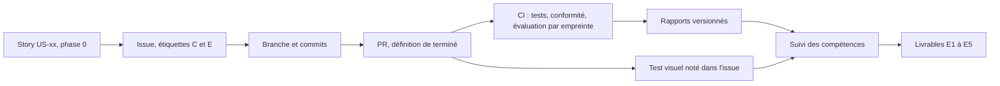

# Méthode agile appliquée à Muninn

**Version :** 1.2
**Date :** 12 octobre 2026
**Historique :** la v1.1 applique la relecture indépendante, s'aligne sur `05-chaine-llmops.md`
et intègre D-27 à D-33 (big data, GitHub Pro, week-ends, comparaison des modèles LLM, clés).
**Phase :** 2 (industrialisation)
**Statut :** proposition, à valider par le porteur
**Compétence principale servie :** C16 (coordination agile en contexte MLOps) ; préparation de
C7, C12, C13, C18 et C19
**Documents liés :** passation back-end (document interne au porteur, hors dépôt) ;
`docs/roadmap.md`, `docs/decisions.md` (D-01 à D-33) ; phase 0 : `01-user-stories.md`
(section 8) ; phase 1 : `04-verification-exactitude.md` (seuils de blocage) ; phase 2 :
`01-besoin-de-production.md`, `02-plan-de-tests.md`, `03-observabilite.md`, `04-contrat-api.md`,
`05-chaine-llmops.md`, `06-architecture-technique.md`

Ce document ne contient aucune ligne de code. Les hypothèses sont marquées **[H]**.

## 1. Objet

Ce document décrit comment le projet est réellement conduit : qui fait quoi, selon quel rythme,
avec quelles règles d'entrée et de sortie d'une story, et comment chaque livraison est reliée aux
compétences évaluées. Il couvre trois itérations : It0 (conception, jusqu'au 14 octobre), It1
(jusqu'au premier oral, 29 octobre 2026) et It2 (jusqu'à l'oral en situation d'examen,
12 novembre 2026).

## 2. Organisation réelle

### 2.1 Acteurs

Le projet compte **une seule personne**. Le reste du travail est fait par des agents d'IA
spécialisés, sous sa direction. Ce document le dit tel quel : il ne présente pas une équipe qui
n'existe pas.

| Acteur                  | Nature                        | Rôle                                                                                                                                                        |
| ----------------------- | ----------------------------- | ----------------------------------------------------------------------------------------------------------------------------------------------------------- |
| Porteur                 | Humain                        | Product owner : priorise, accepte ou refuse. Développeur : relit, corrige, exécute ce qui engage (R10). Exploitant : teste chaque fonction à l'écran        |
| Orchestrateur           | Agent d'IA                    | Découpe le travail, rédige les briefs, délègue aux spécialistes, intègre, relit chaque livrable avant de le rendre, tient le journal et les listes de suivi |
| Agents d'IA spécialisés | Agents d'IA, un par expertise | Données, sécurité, MLOps et évaluation, accessibilité, architecture, vérification de sources, relecture technique. Chacun produit dans son domaine          |
| Revue indépendante      | Agent d'IA distinct           | Relit un livrable qu'il n'a pas produit, avec un brief neutre, et rend une liste de défauts classés                                                         |

### 2.2 Responsabilités

R : réalise ; A : approuve, seul responsable ; C : consulté ; I : informé.

| Activité                                         | Porteur | Orchestrateur | Agents spécialisés | Revue indépendante |
| ------------------------------------------------ | ------- | ------------- | ------------------ | ------------------ |
| Priorisation du backlog                          | A, R    | C             | I                  | I                  |
| Découpage d'une story en tâches                  | A       | R             | C                  | I                  |
| Code, tests, documentation d'une tâche           | A       | R             | R                  | I                  |
| Revue d'une PR                                   | A       | R             | C                  | R                  |
| Test visuel d'une fonctionnalité                 | A, R    | I             | I                  | I                  |
| Action payante ou irréversible (R10)             | A, R    | C             | I                  | I                  |
| Décision d'architecture (ADR)                    | A       | R             | C                  | C                  |
| Choix du modèle LLM (D-32)                       | A       | R             | R                  | C                  |
| Mise en production d'une version (étiquette Git) | A, R    | C             | I                  | I                  |

### 2.3 Limites de cette organisation, et parades

| Limite                                                                                 | Parade                                                                                                   |
| -------------------------------------------------------------------------------------- | -------------------------------------------------------------------------------------------------------- |
| Les agents produisent vite ; le porteur relit à son rythme. Le goulot est la relecture | Limite de travail en cours (section 9.1) ; PR petites ; test visuel court et ciblé                       |
| Une revue par un agent de même nature peut partager les angles morts de l'auteur       | Revue fondée sur des preuves exécutées (tests, rapports), pas sur la lecture seule ; test visuel humain  |
| Une affirmation sur un service tiers peut être fausse                                  | Vérification contre la documentation officielle, source citée ; sinon marque [H]                         |
| Un agent peut proposer une action payante                                              | R10 : seul le porteur crée un compte, achète, déploie ou envoie un message réel                          |
| Séparation des tâches impossible entre exploitant et porteur                           | Séparation logique : identités, secrets et droits distincts (phase 1, document 03, section 2.1)          |
| Le porteur est seul administrateur du dépôt et peut lever une protection               | Traçabilité : journal d'audit du dépôt, contrôle nocturne de dérive (`05-chaine-llmops.md`, section 3.4) |

## 3. Cadre retenu : itérations à date fixe et flux tiré

Le cadre combine des itérations à date fixe, calées sur les oraux, et un tableau à flux tiré avec
limite de travail en cours.

| Option        | Pourquoi elle ne suffit pas seule                                                                              |
| ------------- | -------------------------------------------------------------------------------------------------------------- |
| Scrum strict  | Ses cérémonies supposent une équipe ; des sprints d'une semaine laisseraient peu de place à la revue des oraux |
| Kanban strict | Sans date de fin, rien n'oblige à livrer une démo complète au 28 octobre                                       |
| Cycle en V    | Les retours du jury du 29 octobre doivent modifier le plan du 12 novembre                                      |

Ce qui est gardé : un objectif par itération, un backlog priorisé, une revue avec démonstration,
une rétrospective, une limite de travail en cours, des définitions de « prêt » et de « terminé ».

## 4. Itérations

| Itération | Dates                     | Objectif                                                                                                                   | Revue                                         |
| --------- | ------------------------- | -------------------------------------------------------------------------------------------------------------------------- | --------------------------------------------- |
| It0       | 12 au 14 octobre          | Conception des phases 0 à 2 ; outillage (tableau, modèles d'issue et de PR) ; lecture des droits et des fournisseurs Azure | Validation de la phase 2 par le porteur       |
| It1       | 15 au 28 octobre          | Chaîne critique de la démo, de l'appel simulé au tableau de bord, déployée sur Azure et répétée ; E1 et E3 rédigés         | Premier oral blanc, 29 et 30 octobre          |
| It2       | 31 octobre au 11 novembre | Relais chiffré, jeu de 100 scénarios, purges, agrégats Sirene ; E2, E4, E5 rédigés                                         | Oral en situation d'examen, 12 et 13 novembre |

Le développement commence le mercredi 14 octobre (D-35, qui remplace D-16). It1 se divise en deux blocs : développement
du 14 au 23 octobre (tampon le 24), rédaction et répétition du 25 au 28 octobre (feuille de route). Les
week-ends sont des jours de travail possibles (D-30) : le planning les compte.

## 5. Backlog

### 5.1 Règles de priorisation

1. Ce qui sert la démo d'E3 et le livrable E1 passe avant tout (feuille de route : « E1 et E3
   d'abord »).
2. Dans la démo, la chaîne critique d'abord : un maillon manquant rend les suivants inutiles.
3. Ensuite, la priorité MoSCoW du document 01 de la phase 0.
4. À priorité égale, ou quand un élément porte une compétence évaluée le 29 octobre, ce qui réduit
   un risque (choix du modèle, droits Azure, capacité, preuve de compétence) passe devant.

Les éléments techniques sans story (socle, infrastructure, comparaison) portent l'identifiant
`T-xx`.

### 5.2 Backlog priorisé de It1

Estimations en jours de travail idéaux, reprises de la section 8.2 du document 01 de la phase 0,
sauf `T-xx` et le flux B [H]. Une story de plus d'un jour est découpée en tâches d'un jour au plus
(section 7.1).

| Rang | ID           | Élément                                                                                                                                                                                  | Priorité | Démo | Estimation (j) | Compétences   | Livrable |
| ---- | ------------ | ---------------------------------------------------------------------------------------------------------------------------------------------------------------------------------------- | -------- | ---- | -------------- | ------------- | -------- |
| 1    | T-01         | Socle : dépôt, `uv`, compose, configuration, journalisation à liste blanche, interfaces et faux fournisseurs, CI minimale, protection de `main`, `/health`                               | Must     | oui  | 1              | C15, C18, C20 | E3, E4   |
| 2    | T-06         | Comparaison documentée des modèles LLM (D-32) : Mistral Small et Medium, modèles d'Azure AI Foundry en zone de données UE ; critères d'ADR-03 ; mesure sur un extrait du jeu synthétique | Must     | oui  | 0,5            | C7, C8        | E2, E3   |
| 3    | T-02         | Ressources Azure par Bicep, dont le lac ADLS Gen2, créées par le porteur (R10)                                                                                                           | Must     | oui  | 0,5            | C15, C19      | E3, E4   |
| 4    | US-11        | Brouillon de dossier extrait, en deux tâches : (a) schéma 1.1, normalisation, faux fournisseurs ; (b) prompt, LLM réel, relance, refus médical, brouillon de secours (D-29)              | Must     | oui  | 2              | C8, C9, C12   | E3       |
| 5    | US-46, US-47 | Référentiels géographiques et de numérotation                                                                                                                                            | Must     | oui  | 1              | C1, C3, C4    | E1       |
| 6    | US-50, US-51 | API des référentiels, contrôle des champs, mode dégradé                                                                                                                                  | Must     | oui  | 1              | C5, C9, C12   | E1, E3   |
| 7    | US-36, US-37 | Simulateur, jeu de 20 scénarios et 35 de conformité, harnais, rapport                                                                                                                    | Must     | oui  | 1              | C12, C13      | E3       |
| 8    | US-17, US-31 | Validation en un geste, preuve de destruction, dans la console                                                                                                                           | Must     | oui  | 1              | C10, C17      | E3, E4   |
| 9    | US-38, US-39 | Métriques, tableau de bord, alerte, journal sans DP                                                                                                                                      | Must     | oui  | 1              | C11, C20      | E3, E5   |
| 10   | US-40        | CI et CD complètes : évaluation bloquante par empreinte, staging, étiquette de version, retour arrière, tests de conformité                                                              | Must     | oui  | 1              | C13, C18, C19 | E3, E4   |
| 11   | T-03         | Audit d'accessibilité de la console, première répétition                                                                                                                                 | Must     | oui  | 1              | C10, C14      | E3       |
| 12   | US-52        | Dimensionnement Sirene par job-sirene (D-27), flux B                                                                                                                                     | Should   | non  | 1              | C1, C2, C3    | E1       |
| 13   | US-48        | Lexique métier constitué et versionné, flux B                                                                                                                                            | Must     | non  | 1              | C1, C3, C8    | E1, E2   |
| 14   | US-53        | Croisement avec l'Urssaf, flux B                                                                                                                                                         | Should   | non  | 0,5            | C1, C3        | E1       |
| 15   | US-49        | Jours fériés, flux B                                                                                                                                                                     | Should   | non  | 0,5            | C1, C3        | E1       |
| 16   | SRC-05       | Chargement de la BAN, flux B                                                                                                                                                             | Should   | non  | 0,5            | C1, C4        | E1       |

US-52, classée Should, passe devant US-48, classée Must, par la règle 4 : elle porte seule le type
« big data » de C1, évalué le 29 octobre. US-48 n'est pas sur le chemin de la démo (phase 0,
document 01, section 8.3).

**Capacité.** Le flux A (rangs 1 à 11) totalise 11 jours pour 10 jours calendaires du 15 au
24 octobre. T-06 est produite par un agent spécialisé en parallèle de J0 et J1 ; elle ne pèse sur
le porteur que pour la relecture et la décision. **Il n'y a pas de marge dans ces 10 jours** :
le jour J9 est occupé par T-03. Le seul tampon est le dimanche 25 octobre (R1), prévu pour les
correctifs ; s'il est consommé, la rédaction d'E1 se resserre sur R2 à R4. Le flux B ajoute
3,5 jours et ne tient que si les agents le produisent en parallèle et que le porteur peut le
relire sans retarder le flux A : c'est le risque déjà signalé en phase 0 (document 01,
section 8.4).

### 5.3 Backlog de It2

| Rang | ID           | Élément                                                                                                                                            | Priorité | Estimation (j) | Compétences | Livrable |
| ---- | ------------ | -------------------------------------------------------------------------------------------------------------------------------------------------- | -------- | -------------- | ----------- | -------- |
| 1    | T-04         | Retours du jury intégrés au backlog                                                                                                                | Must     | 0,5            | C16         | tous     |
| 2    | US-12        | Relais chiffré vers un appareil simulé (fin de l'écart P-03), en deux tâches : chiffrement et enregistrement de la clé ; enveloppes, accusé, purge | Must     | 1,5            | C9, C17     | E3, E4   |
| 3    | US-37        | Jeu de 100 scénarios de test, 40 de développement, 130 de conformité                                                                               | Must     | 1              | C12         | E3       |
| 4    | T-05         | Alertes et fiches d'incident (`03-observabilite.md`)                                                                                               | Must     | 1              | C20, C21    | E5       |
| 5    | ADR-08       | Seuils de confiance par champ                                                                                                                      | Should   | 0,5            | C11, C12    | E3       |
| 6    | US-41        | Disponibilité et purges, écran E-12                                                                                                                | Should   | 0,5            | C20         | E5       |
| 7    | D-22, D-28   | Révocation d'un appareil, côté serveur ; recours par la phrase de récupération (D-28)                                                              | Should   | 0,5            | C17         | E4       |
| 8    | US-52, US-53 | Si non faits en It1                                                                                                                                | Should   | 1,5            | C1, C2      | E1       |
| 9    | D-21         | Serveur MCP en lecture seule pour l'exploitant                                                                                                     | Could    | 1              | C9, C13     | E3       |
| 10   | ADR-17       | Authentification Entra à PostgreSQL                                                                                                                | Could    | 0,5            | C15         | E4       |
| 11   | US-13        | Transcription réelle d'un débrief audio                                                                                                            | Could    | 1              | C8          | E2       |

## 6. Découpage jour par jour

### 6.1 Itération 1

Le jour J0 est ajouté au plan de la phase 0 (document 01, section 8.2), qui ne comptait ni le
socle ni la création des ressources Azure (écart AT-03 du document 06). Les jours J1 à J9 sont
ceux de ce plan, décalés d'un jour.

Le test visuel du porteur est quotidien. La console grandit chaque jour d'un écran (document 06,
section 8.3), à partir d'un squelette posé au jour J0 : sinon, rien ne serait testable à l'écran
avant le 21 octobre. Le jour J6 garde la consolidation du parcours de démo.

| Jour | Date            | Flux A (chaîne de la démo)                                                                                                                                                                                                                             | Écran ajouté ou complété            | Test visuel du porteur                                                                                                     | Flux B (données E1)         |
| ---- | --------------- | ------------------------------------------------------------------------------------------------------------------------------------------------------------------------------------------------------------------------------------------------------ | ----------------------------------- | -------------------------------------------------------------------------------------------------------------------------- | --------------------------- |
| J0   | mer. 14 octobre | T-01 socle et protection de `main` ; T-02 Bicep relu, ressources créées par le porteur ; tableau GitHub Projects ; début de T-06 par un agent                                                                                                          | E-01 état (squelette de la console) | La console locale affiche l'état des dépendances et les versions                                                           | Brief des agents de données |
| J1   | jeu. 15 octobre | US-11 (a) : schéma 1.1, normalisation, interfaces, faux fournisseurs, chemin « audio vers transcription factice » (R2 testable, TC-10), tests du week-end (D-30, TU-29 à TU-33) ; fin de T-06, **choix du modèle par le porteur (D-32) et clé (D-33)** | E-06 (faux LLM)                     | Un texte synthétique donne un brouillon valide, faux fournisseur nommé à l'écran ; lecture du rapport de T-06              | US-52 (job-sirene, D-27)    |
| J2   | ven. 16 octobre | US-11 (b) : paquet d'extraction versionné, LLM retenu, relance unique, `needs_review`, refus médical, brouillon de secours                                                                                                                             | E-06 (LLM réel), E-03               | Le même texte avec le modèle retenu ; un texte médical donne un refus ; panne simulée du LLM : brouillon `fallback_no_llm` | US-52                       |
| J3   | sam. 17 octobre | US-46, US-47 : codes postaux, COG, API Géo, MAJNUM ; rapport d'anomalies                                                                                                                                                                               | E-07 (versions, rejets)             | Versions chargées, comptages, rejets motivés                                                                               | US-48                       |
| J4   | dim. 18 octobre | US-50, US-51 : API des référentiels, contrôle depuis l'extraction, mode dégradé                                                                                                                                                                        | E-07 (contrôle), E-03               | « 93100 Bagnolet » marqué à vérifier ; refapi arrêtée : « non contrôlé »                                                   | US-48                       |
| J5   | lun. 19 octobre | US-36, US-37 : 20 scénarios, 35 de conformité, harnais, rapport                                                                                                                                                                                        | E-02, E-08                          | Lancement d'un scénario ; lecture d'un rapport et de ses intervalles                                                       | US-53                       |
| J6   | mar. 20 octobre | US-17, US-31 : validation en un geste, preuve de destruction ; parcours complet de la démo                                                                                                                                                             | E-04, E-05                          | Parcours de la démo de bout en bout, au clavier seul                                                                       | US-49                       |
| J7   | mer. 21 octobre | US-38, US-39 : métriques, tableau de bord, alerte, journal sans DP                                                                                                                                                                                     | E-09, E-10                          | Une correction fait bouger la métrique ; une ligne de journal sans DP                                                      | SRC-05                      |
| J8   | jeu. 22 octobre | US-40 : CI et CD complètes, évaluation bloquante, staging, étiquette de version, retour arrière ; tests de conformité de la chaîne                                                                                                                     | E-11                                | Une PR dégradée est bloquée par le contrôle `verdict` ; un retour arrière rend la révision précédente                      | Relecture du flux B         |
| J9   | ven. 23 octobre | T-03 : audit RGAA et WCAG 2.2 des écrans E-01 à E-11, répétition 1                                                                                                                                                                                     | Corrections                         | Répétition chronométrée sur Azure                                                                                          | Clôture du flux B           |
| T    | sam. 24 octobre | Tampon d'un jour gagné par D-35 (développement avancé au mercredi 14) ; absorbe un glissement de J1 à J9                                                                                                                                               | sans objet                          | sans objet                                                                                                                 | sans objet                  |
| R1   | dim. 25 octobre | Gel fonctionnel ; tampon d'un jour pour le flux A ; seuls les correctifs entrent                                                                                                                                                                       | aucun                               | Selon les correctifs                                                                                                       | Rédaction d'E1              |
| R2   | lun. 26 octobre | Rédaction d'E3, captures de la console                                                                                                                                                                                                                 | aucun                               | Relecture des captures                                                                                                     | Rédaction d'E1              |
| R3   | mar. 27 octobre | Répétition 2 ; répliques minimales à 1 à partir de 14 h ; **répétition du plan B**                                                                                                                                                                     | aucun                               | Répétition sur Azure, puis bascule sur le plan B local (`docker compose`)                                                  | Relecture d'E1              |
| R4   | mer. 28 octobre | Répétition 3 ; vidéo du plan C ; gel à 18 h                                                                                                                                                                                                            | aucun                               | Trois répétitions consécutives réussies ; sinon repli du document 01, section 5.2                                          | E1 et E3 finalisés          |

Règle des répétitions (document 01, section 5.2) : trois répétitions complètes consécutives
doivent réussir avant le 28 octobre à 18 h. Si la condition n'est pas atteinte, la démo du 29 se
fait sur la dernière configuration qui a réussi une répétition complète : Azure, ou le plan B
local si l'échec vient d'Azure, ou le plan C (vidéo) si rien n'a réussi. L'écart est dit au jury.

Dépendances qui peuvent décaler ce plan :

| Dépendance                                                 | Date limite                          | Si elle manque                                                                   |
| ---------------------------------------------------------- | ------------------------------------ | -------------------------------------------------------------------------------- |
| Choix du modèle (D-32) et clé du fournisseur retenu (D-33) | Avant J2, soit le 16 octobre au soir | J2 avance sur le faux fournisseur ; l'extraction réelle consomme le tampon de R1 |
| Ressources Azure créées (T-02)                             | 14 octobre                           | Déploiement local seulement jusqu'à résolution ; plan B promu en plan A          |
| Lecture directe du lac par DuckDB (ATQ-06 du document 06)  | 16 octobre                           | Copie locale des Parquet dans le conteneur du job ; US-52 tient                  |

### 6.2 Itération 2

Les week-ends restent des jours de travail possibles (D-30).

| Date                       | Développement                                                                | Rédaction (feuille de route)                              |
| -------------------------- | ---------------------------------------------------------------------------- | --------------------------------------------------------- |
| sam. 31 octobre            | Rétrospective de It1 ; retours du jury triés en issues (T-04)                | Synthèse des retours                                      |
| dim. 1er novembre          | US-12, tâche 1 : enregistrement d'une clé, chiffrement `SealedBox`           | Phase 0b : dispositif de veille (C6)                      |
| lun. 2 novembre            | US-12, tâche 2 : enveloppes, accusé, purge ; écran E-13                      | Phase 0b : benchmark (C7), à partir du rapport de T-06    |
| mar. 3 novembre            | US-37 : génération et relecture du jeu de 100 scénarios                      | E2                                                        |
| mer. 4 novembre            | Évaluation complète ; ADR-08 seuils par champ                                | E2                                                        |
| jeu. 5 novembre            | T-05 alertes et fiches d'incident ; US-41 et écran E-12                      | E5                                                        |
| ven. 6 novembre            | Révocation et recours (D-22, D-28) ; US-52 et US-53 si reportés ; écran E-14 | E4                                                        |
| sam. 7 novembre            | Could : D-21 (MCP) ou ADR-17, selon le temps restant                         | E4                                                        |
| dim. 8 novembre            | Gel fonctionnel                                                              | E4, E5                                                    |
| lun. 9 au mer. 11 novembre | Correctifs seulement ; répliques minimales à 1 à partir du 11 à 9 h          | Relecture des cinq livrables ; répétitions des 90 minutes |

## 7. Définitions de « prêt » et de « terminé »

### 7.1 Définition de « prêt »

Une story, une tâche d'une story découpée, ou un élément `T-xx` n'entre dans « En cours » que si
tous les points sont vrais :

| Point                                                                                                                                                              | Vérifié dans     |
| ------------------------------------------------------------------------------------------------------------------------------------------------------------------ | ---------------- |
| Critères d'acceptation au format « Étant donné… / Quand… / Alors… », repris du document 01 de la phase 0 ; pour une tâche, les critères de la story qu'elle couvre | Issue            |
| Flux de données rattaché (phase 0, document 02) et règles R1 à R10 touchées listées                                                                                | Issue            |
| Points d'API décrits dans `04-contrat-api.md`, ou ajout prévu dans la story                                                                                        | Issue            |
| Tests prévus nommés dans `02-plan-de-tests.md` ; cas de vérification VD ou VE identifiés                                                                           | Issue            |
| Écran de la console identifié (document 06, section 8.3)                                                                                                           | Issue            |
| Données synthétiques disponibles, ou leur création incluse dans la story (R9)                                                                                      | Issue            |
| Estimation de 1 jour au plus par issue. Une story plus grosse (US-11, US-12) est découpée en tâches, chacune avec sa propre issue                                  | Champ du tableau |
| Dépendances levées (choix du modèle, clé, ressource Azure, décision du porteur) ou contournement écrit                                                             | Issue            |

### 7.2 Définition de « terminé »

Une story est terminée quand **tous** les points s'appliquant à elle sont vrais. « Sans objet »
doit être écrit et justifié dans la PR, jamais laissé vide.

| Famille        | Point                                                                                                                                                                                                                    |
| -------------- | ------------------------------------------------------------------------------------------------------------------------------------------------------------------------------------------------------------------------ |
| Code           | ruff et mypy strict sans erreur ; aucune dette marquée sans issue                                                                                                                                                        |
| Tests          | Unitaires, d'intégration et de conformité verts dans la CI ; couverture de 85 % au moins sur extraction, relay, crypto                                                                                                   |
| Conformité     | Tests R1 à R4 et R7 concernés verts ; aucune DP dans les journaux de l'exécution de la CI ; recherche de secrets propre (R8) ; données synthétiques seulement (R9)                                                       |
| Évaluation LLM | Section 7.3, si l'empreinte d'évaluation change                                                                                                                                                                          |
| Contrat        | OpenAPI à jour et conforme à `04-contrat-api.md` ; erreurs au format unique                                                                                                                                              |
| Observabilité  | Points de mesure et lignes de journal de `03-observabilite.md` émis et visibles                                                                                                                                          |
| Interface      | Fonction testable dans la console ; axe-core sans violation sur l'écran ; parcours au clavier fait                                                                                                                       |
| Revue          | PR relue par la revue indépendante ; défauts bloquants corrigés ; contrôle requis `verdict` vert ; approbation du porteur écrite dans la PR                                                                              |
| Test visuel    | Le porteur a exécuté le scénario d'acceptation à l'écran ; date, configuration et résultat notés dans l'issue                                                                                                            |
| Livraison      | Fusion sur `main` ; image construite ; révision candidate saine en staging, extraction de contrôle conforme ; mise en production par l'étiquette de version du porteur quand la story le demande (`05-chaine-llmops.md`) |
| Documentation  | ADR écrit si une décision structurante a été prise ; journal de la journée mis à jour ; suivi des compétences à jour                                                                                                     |

### 7.3 Évaluation du LLM dans la définition de « terminé »

Contexte MLOps : un changement de prompt peut casser le produit sans casser un seul test
unitaire. L'évaluation est donc une condition de « terminé », au même titre que les tests. Elle
est déclenchée par l'**empreinte d'évaluation**, condensat de tout ce qui peut changer une réponse
évaluée (`05-chaine-llmops.md`, section 5.2), et non par une déclaration ou par les chemins
modifiés.

| Type de changement                    | Preuve exigée avant fusion                                                                                                                                                                                                             |
| ------------------------------------- | -------------------------------------------------------------------------------------------------------------------------------------------------------------------------------------------------------------------------------------- |
| Changement sans effet sur l'empreinte | Tests ; pas d'évaluation                                                                                                                                                                                                               |
| Prompt, schéma, lexique, seuil        | Rapport d'évaluation sur la partition de test et le jeu de conformité ; tous les seuils de blocage de la phase 1 (document 04, section 6) respectés ; comparaison appariée avec la référence ; nouvelle version du paquet d'extraction |
| Modèle ou version du modèle           | Idem, plus latence p50 et p95 et coût par extraction comparés aux SLO-05 et SLO-13 du document 01                                                                                                                                      |
| Jeu d'évaluation                      | Nouvelle version du jeu, justification écrite ; les deux versions rapportées (phase 1, document 04, section 3.3)                                                                                                                       |
| Juge LLM                              | Étalonnage refait (kappa) avant usage (phase 1, document 04, section 5.3)                                                                                                                                                              |

La partition de test n'est jamais lue pour mettre au point un prompt. Le rapport est versionné
avec la PR ; il ne contient que des données synthétiques (R9). Le détail de la chaîne est dans
`05-chaine-llmops.md`.

## 8. Rituels

| Rituel                    | Quand                                | Durée [H] | Participants                           | Entrée                                            | Sortie et trace                                              |
| ------------------------- | ------------------------------------ | --------- | -------------------------------------- | ------------------------------------------------- | ------------------------------------------------------------ |
| Planification d'itération | 15 et 31 octobre                     | 1 h       | Porteur, orchestrateur                 | Backlog, retours, capacité                        | Objectif d'itération, colonne « Prêt » remplie               |
| Point du jour             | Chaque matin                         | 15 min    | Porteur, orchestrateur                 | Tableau, résultats de la CI, journal de la veille | Plan du jour, blocages, briefs des agents ; ligne de journal |
| Affinage                  | Tous les deux jours                  | 30 min    | Porteur, orchestrateur, agent concerné | Stories des 3 jours suivants                      | Stories conformes à la définition de « prêt »                |
| Revue de PR               | À chaque PR                          | 15 min    | Revue indépendante, porteur            | Diff, rapports de la CI                           | Commentaires, approbation écrite                             |
| Test visuel               | Chaque soir                          | 20 min    | Porteur                                | Écrans du jour                                    | Résultat dans l'issue ; story « terminée » ou renvoyée       |
| Revue d'itération         | 29 et 30 octobre ; 12 et 13 novembre | Oral      | Porteur, jury                          | Démo, livrables                                   | Retours du jury, consignés en issues                         |
| Rétrospective             | 31 octobre ; 14 novembre             | 45 min    | Porteur, orchestrateur                 | Mesures de la section 10, journal                 | Trois actions au plus, chacune en issue                      |
| Revue de fin de phase     | Fin de chaque phase                  | 30 min    | Porteur                                | Livrables de la phase                             | Commit et push (D-17), décisions consignées                  |

## 9. Outillage et traçabilité

### 9.1 Tableau GitHub Projects

| Colonne     | Entrée                            | Limite de travail en cours |
| ----------- | --------------------------------- | -------------------------- |
| Backlog     | Toute issue triée                 | aucune                     |
| Prêt        | Définition de « prêt » remplie    | 6                          |
| En cours    | Branche ouverte                   | 3 [H]                      |
| En revue    | PR ouverte, CI verte              | 3                          |
| Test visuel | PR approuvée, déployée en staging | 3                          |
| Terminé     | Définition de « terminé » remplie | aucune                     |

La limite de 3 en cours tient compte du parallélisme des agents ; la limite en revue et en test
visuel protège la capacité de relecture du porteur, qui est le goulot (section 2.3).

Champs personnalisés : `Story` (US-xx ou T-xx), `Épopée`, `Compétences` (C1 à C21),
`Livrable` (E1 à E5), `Itération`, `Estimation`, `Priorité` (MoSCoW), `Démo` (oui ou non).
Vues : tableau par colonne ; tableau par compétence ; vue « démo du 29 octobre » filtrée.

### 9.2 Issues, branches, PR

| Élément            | Règle                                                                                                                                                                                     |
| ------------------ | ----------------------------------------------------------------------------------------------------------------------------------------------------------------------------------------- |
| Issue              | Une par story, par tâche d'une story découpée, ou par élément `T-xx` ; modèle avec critères d'acceptation, règles, flux, écran, définition de « prêt »                                    |
| Étiquettes         | `US-xx`, `C1` à `C21`, `E1` à `E5`, `regle-R1` à `regle-R10`, `chaine`, `bloquant`                                                                                                        |
| Branche            | Courte, depuis `main` : `feat/us-11-schema-dossier`, `fix/…`, `docs/…`                                                                                                                    |
| Commit             | Commits conventionnels ; message en français, à l'impératif ; référence de l'issue                                                                                                        |
| PR                 | Modèle avec la définition de « terminé » en cases à cocher ; lien vers le rapport d'évaluation si l'empreinte change                                                                      |
| Fusion             | Après le contrôle requis `verdict`, la revue indépendante et l'approbation écrite du porteur ; historique linéaire                                                                        |
| Protection         | `main` protégée dès J0 (GitHub Pro, D-31) : fusion par PR seulement, contrôle requis `verdict`, branche à jour, suppression et réécriture interdites (`05-chaine-llmops.md`, section 3.4) |
| Mise en production | Étiquette Git de version posée par le porteur ; canari puis bascule                                                                                                                       |

Aucun message publié sur GitHub (commit, PR, issue) ne mentionne d'outil d'assistance. C'est une
consigne du porteur, tenue dans les instructions locales du projet et non dans
`docs/decisions.md` ; des contrôles locaux avant commit l'appliquent.

### 9.3 Chaîne de traçabilité vers les compétences

| Compétence | Preuve produite par la méthode                                                                            |
| ---------- | --------------------------------------------------------------------------------------------------------- |
| C7         | Rapport de la comparaison des modèles LLM (T-06), repris dans E2                                          |
| C9, C10    | PR des stories US-11, US-17, US-50 ; captures des écrans E-03 à E-06 ; audit d'accessibilité              |
| C11        | Écrans E-08 et E-09 ; alertes ; rapports d'évaluation successifs                                          |
| C12        | Rapports d'évaluation, cas à tolérance nulle, tests de validation des formats                             |
| C13        | Historique des versions du paquet d'extraction ; une PR bloquée par `verdict` ; un retour arrière exécuté |
| C15        | Document 06 et ADR                                                                                        |
| C16        | Ce document ; tableau ; comptes rendus des rituels ; rétrospectives et leurs actions                      |
| C18, C19   | Exécutions de la CI, du staging et des mises en production, avec leurs durées et leurs échecs             |
| C20, C21   | Journal sans DP, alertes, fiches d'incident ouvertes pendant les itérations                               |

Le fichier `docs/suivi/competences.md` est mis à jour à chaque story terminée ; le journal de
session est tenu chaque jour.

## 10. Mesures de pilotage

| Mesure                                           | Définition                                        | Usage                                                                             |
| ------------------------------------------------ | ------------------------------------------------- | --------------------------------------------------------------------------------- |
| Avancement vers la démo                          | Jours estimés terminés sur jours du flux A        | Arbitrage du flux B, chaque matin                                                 |
| Délai de traversée                               | De « En cours » à « Terminé », par story          | Rétrospective                                                                     |
| Taux de réussite du test visuel au premier essai | Stories acceptées sans renvoi sur stories testées | Qualité de la définition de « prêt »                                              |
| Exactitude par version du paquet d'extraction    | Rapport d'évaluation, avec intervalle             | Tendance, pas objectif de vitesse                                                 |
| Livraisons bloquées par l'évaluation             | Nombre et motif                                   | Preuve de C13                                                                     |
| Minutes de CI consommées                         | Cumul du mois                                     | Quota de 3 000 minutes du forfait Pro ; 1 976 estimées (document 06, section 7.3) |
| Coût Azure cumulé                                | Coût du groupe de ressources                      | SLO-16                                                                            |

Aucune vélocité en points n'est suivie : avec un seul relecteur humain et deux itérations de
développement, elle ne prédirait rien. L'estimation en jours reste une hypothèse, recalée chaque
matin.

## 11. Risques et points incertains

| ID    | Risque ou point                                                                                                          | Réponse                                                                                                        |
| ----- | ------------------------------------------------------------------------------------------------------------------------ | -------------------------------------------------------------------------------------------------------------- |
| MA-01 | Flux A à 11 jours pour 10 jours calendaires, sans marge ; flux B à 3,5 jours en plus                                     | Tampon unique le 25 octobre (R1) ; T-06 en parallèle ; flux B parallélisé et arbitré chaque matin              |
| MA-02 | Travail le week-end                                                                                                      | Levé par D-30 : les week-ends d'It1 et d'It2 sont des jours de travail possibles                               |
| MA-03 | Choix du modèle (D-32) et clé (D-33) non obtenus avant J2 ; ressources Azure non créées le 15 octobre                    | Section 6.1, dépendances                                                                                       |
| MA-04 | Relecture du porteur saturée                                                                                             | Limites de travail en cours ; PR de moins d'une journée                                                        |
| MA-05 | Le porteur, seul administrateur, peut lever la protection de `main`                                                      | Journal d'audit du dépôt ; contrôle nocturne de dérive (`05-chaine-llmops.md`)                                 |
| MA-06 | It2 cumule développement et rédaction de trois livrables                                                                 | Gel fonctionnel le 8 novembre ; les « Could » sortent en premier                                               |
| MA-07 | La comparaison T-06 couvre des candidats d'Azure AI Foundry dont les modèles, les zones et les prix ne sont pas vérifiés | Comparaison bornée à une demi-journée ; un candidat non vérifié est noté « non mesuré », pas écarté en silence |

Décisions attendues du porteur : la méthode (section 3), le jour J0, l'ordre du flux B (section
5.2), les limites de travail en cours ; le choix du modèle LLM à l'issue de T-06 (ADR-03 du
document 06, en attente).
