# Flux de données de Muninn

**Version :** 1.1
**Date :** 12 octobre 2026
**Historique :** la v1.1 suit la phase 2 et les décisions D-24 à D-30 : F-04 transcrit par le
composant extraction (contrat d'API, CA-04) ; F-10 passe par un lac ADLS Gen2 et une tâche Azure
Container Apps (D-27) ; F-02 décrit le brouillon de secours (D-29) et le rappel au prochain jour
d'ouverture (D-30) ; P-10 et P-12 sont décidés (D-24, D-26).
**Phase :** 0a (besoin, flux et sources de données)
**Statut :** proposition, à valider par le porteur
**Compétences servies :** C14 (modélisation du besoin) ; préparation de C1 à C5 (E1) et de C9 à
C13 (E3)
**Documents liés :** `01-user-stories.md` (US-01 à US-54), `03-sources-de-donnees.md` (SRC-01 à
SRC-14), `04-accessibilite-utilisabilite.md`

## 1. Objet et choix de présentation

Ce document décrit comment les données circulent dans Muninn : qui les émet, qui les reçoit,
dans quel ordre, sous quelle forme, où elles sont transformées et quand elles sont détruites.

**Choix de regroupement.** Le porteur a demandé un schéma de flux par user story. Le document
regroupe les 54 stories en 12 flux (F-01 à F-12), puis rattache chaque story à au moins un flux
dans une table de traçabilité (section 18). C'est un choix, pour trois raisons :

- plusieurs stories partagent exactement la même chaîne d'échanges. US-06 à US-12 décrivent les
  étapes d'un seul appel : 7 schémas répéteraient 7 fois le même diagramme ;
- un schéma par story masquerait l'ordre réel des échanges entre stories (l'extraction de US-11
  précède le chiffrement de US-12 et le contrôle de US-51 s'insère entre les deux) ;
- un flux vérifiable de bout en bout est la bonne unité pour contrôler les règles R1 à R10 : la
  question « le serveur voit-il un dossier en clair ? » se pose sur une chaîne, pas sur une étape.

Le regroupement garde la granularité utile : chaque échange porte un numéro, et la table de
traçabilité dit quel flux, et le plus souvent quels messages, couvrent quelle story. Quelques
stories ne correspondent pas à des messages mais à une transformation (US-20, US-32), à une
branche non détaillée (US-09, US-10 : arrêt anticipé de la boucle de F-02) ou à une frontière
(US-42, US-44). Pour elles, un schéma propre serait à dessiner si le jury l'exige.

Les hypothèses sont marquées **[H]**.

## 2. Conventions

**Diagrammes.** Chaque flux a un diagramme de séquence Mermaid numéroté automatiquement. Le
numéro d'un message est celui de la colonne « N° » de la table des échanges. Les notes
`T1`, `T2`… repèrent les points de transformation.

**Participants.**

| Catégorie    | Participants                                                                                                        |
| ------------ | ------------------------------------------------------------------------------------------------------------------- |
| Humains      | Artisan, client final, exploitant, porteur du projet                                                                |
| Applicatifs  | App mobile, base locale chiffrée, console web, api, voice-gateway, extraction, relay, API des référentiels, workers |
| Stockage     | PostgreSQL (métadonnées et base des référentiels), Redis (files de tâches), stockage objet UE                       |
| Fournisseurs | CPaaS (factice en développement et en démo), STT, LLM, TTS, push (FCM, APNs), SMS, e-mail                           |
| Externes     | Opérateur de l'artisan, outil de facturation, plateforme agréée (V2), sources SRC-01 à SRC-14                       |

L'**API des référentiels** est un composant nouveau, introduit par US-50. Elle n'existe pas dans
l'architecture de la passation back-end. Elle peut être un module de l'api ou un service à part
[H : choix en phase 2, C15]. Elle n'est pas exposée sur Internet [H].

**Colonne « Sens ».**

| Valeur  | Signification                                                                                |
| ------- | -------------------------------------------------------------------------------------------- |
| entrant | Vers le back-end Muninn, depuis l'appareil, un fournisseur ou une source                     |
| sortant | Depuis le back-end vers l'appareil, un fournisseur ou une source                             |
| interne | Entre deux composants du back-end                                                            |
| local   | Sur le téléphone, entre l'artisan, l'application et la base locale                           |
| externe | Entre deux parties hors du back-end (appareil et outil tiers, notification push et appareil) |

**Colonne « Sensibilité ».**

| Valeur      | Signification                                                                                        |
| ----------- | ---------------------------------------------------------------------------------------------------- |
| aucune      | Aucune donnée relative à une personne physique                                                       |
| DP          | Donnée personnelle lisible par le destinataire. Le transport est chiffré (TLS), mais pas le contenu  |
| DP chiffrée | Donnée personnelle chiffrée par une clé que le serveur ne détient pas (enveloppe, blob, base locale) |

Tous les échanges IP passent en TLS. Le SMS et la téléphonie (réseau de l'opérateur) ne sont pas
chiffrés de bout en bout. TLS protège le transport, pas le contenu vis-à-vis du destinataire : un
échange sous TLS reste « DP » si le destinataire lit la donnée.

**Données synthétiques.** Elles sont marquées « aucune » dans F-11 (évaluation). Dans F-12, la
démo, les mêmes données sont marquées « DP » : la démo montre le chemin de production, et le code
qui les traite est celui qui traitera des données réelles.

Les données de l'artisan lui-même (identifiant de connexion, nom d'entreprise, prénom, jeton push,
créneaux de son agenda) sont des DP. Elles sont marquées comme telles, même si la règle R1 vise
les dossiers des clients. Les métadonnées purement techniques (statut, taille, compteur, clé
publique, identifiant opaque) sont marquées « aucune » : elles ne disent rien d'une personne
au-delà de l'existence d'un compte [H : classement à confirmer dans le registre des traitements].

## 3. Vue d'ensemble

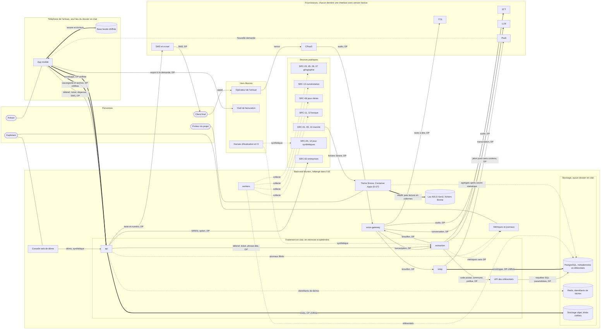

Lecture des traits :

| Trait             | Signification                                                                     |
| ----------------- | --------------------------------------------------------------------------------- |
| Flèche épaisse    | DP chiffrée : le serveur transporte ou stocke sans pouvoir lire                   |
| Flèche pleine     | DP lisible par le destinataire, sous TLS sauf SMS et téléphonie                   |
| Flèche pointillée | Aucune DP (données publiques, synthétiques, métriques, notification sans contenu) |
| Trait sans flèche | Interaction humaine avec un outil                                                 |

**Frontière « en clair / chiffré ».** Sous le contrôle de Muninn, un dossier n'existe en clair
qu'à deux endroits :

1. sur le téléphone de l'artisan, où la base locale est chiffrée au repos (US-32) ;
2. dans la mémoire des composants de la zone « traitement en clair » du back-end, pendant le
   traitement d'une requête ou d'un appel (voice-gateway, extraction, relay, api, API des
   référentiels). Rien de cette zone n'est écrit en clair sur un disque, une base, une file ou un
   journal (R1 à R4).

Hors du contrôle de Muninn, des DP existent aussi en clair :

- chez les fournisseurs STT, LLM, TTS, CPaaS et SMS, le temps de leur traitement. Lecture retenue
  de R5 : tout hébergement et tout traitement se font dans l'UE ; la zéro rétention est exigée des
  fournisseurs d'IA (STT, LLM, TTS). Le CPaaS et le fournisseur SMS relèvent de leurs propres
  conditions (section 19, P-04 et P-13) ;
- chez les destinataires choisis par l'artisan : outil de facturation et fichier d'export (F-08) ;
- dans la réponse HTTPS des points d'extraction appelés par l'appareil (F-03, F-05) et, pour la
  démo, dans le navigateur de la console (F-12).

« En mémoire » suit la formule de R2 : en mémoire, ou en fichier temporaire chiffré supprimé dans
un bloc `finally`. Une bibliothèque qui reçoit un envoi multipart peut écrire le fichier sur
disque au-delà d'un seuil [H : comportement et seuil à vérifier dans la documentation de la pile
retenue]. Ce cas exige un répertoire temporaire chiffré et un test de conformité sur `/debrief`,
`/receipts/scan` et `/expenses/voice`.

## 4. Ce que chaque composant voit en clair

| Composant                            | Voit en clair                                                                                                                                                                                                                            | Combien de temps                                                      | Ne voit jamais                                          |
| ------------------------------------ | ---------------------------------------------------------------------------------------------------------------------------------------------------------------------------------------------------------------------------------------- | --------------------------------------------------------------------- | ------------------------------------------------------- |
| App mobile et base locale            | Tous les dossiers de l'artisan, son agenda, son lexique personnel                                                                                                                                                                        | Tant que l'artisan les garde ; base chiffrée au repos                 | Les données d'un autre artisan                          |
| Console web (démo)                   | Brouillons synthétiques, vérité terrain, métriques                                                                                                                                                                                       | Session du navigateur                                                 | Toute donnée réelle (R9)                                |
| api                                  | Identifiant de connexion, SIREN et bloc `dirigeants`, configuration de ligne, numéro appelant, audio et texte du débrief, image du ticket, dépense dite, `DossierDraft` rendu à l'appareil, phrase de recherche, texte et numéro des SMS | Durée de la requête ; seules la configuration et les créneaux restent | Contenu des enveloppes, des sauvegardes et des archives |
| voice-gateway                        | Audio et transcription de l'appel, numéro appelant, règles de la ligne, créneaux sans nom, brouillon de l'appel, brouillon de secours (D-29)                                                                                             | Durée de l'appel                                                      | Les dossiers existants de l'artisan                     |
| extraction                           | Transcription, audio du débrief, image du ticket, audio et texte d'une phrase dite (F-04), lexique personnel, brouillon                                                                                                                  | Durée de l'extraction                                                 | Les dossiers existants de l'artisan                     |
| relay                                | Brouillon en clair, clés publiques des appareils                                                                                                                                                                                         | Jusqu'au chiffrement                                                  | Les clés privées                                        |
| API des référentiels                 | Code postal, commune, préfixe de numéro, métier                                                                                                                                                                                          | Durée de la requête                                                   | Nom, rue, numéro complet, contenu de la demande         |
| workers                              | Données publiques, identifiants de tâches, métadonnées de purge                                                                                                                                                                          | Durée de la tâche                                                     | Contenu d'un dossier                                    |
| PostgreSQL                           | Comptes, empreinte du code de connexion, appareils, clés publiques, jetons push, lignes, fenêtre de test, créneaux sans nom, `caller_hash`, statuts, `sms_jobs`, `audit_events`, compteurs de correction, référentiels, lexiques         | Durées de conservation (sessions d'appel : 90 jours [H])              | Dossier en clair, audio, transcription, texte de SMS    |
| Redis                                | Identifiants de tâches [H : charge utile sans DP, voir section 19]                                                                                                                                                                       | Durée de la tâche                                                     | Transcription, brouillon                                |
| Stockage objet                       | Rien : blobs opaques                                                                                                                                                                                                                     | Jusqu'au remplacement (sauvegarde) ; 10 ans (archive)                 | Les clés de déchiffrement                               |
| Métriques et journaux                | Compteurs, latences, coûts, versions, noms de champs corrigés, `request_id`                                                                                                                                                              | Rétention des journaux [H : à fixer en phase 1]                       | Nom, numéro, adresse, contenu                           |
| CPaaS                                | Audio de l'appel, numéro appelant, numéro Muninn                                                                                                                                                                                         | Durée de l'appel, plus ses propres journaux d'appel [H : ADR-02]      | Le brouillon et les dossiers                            |
| STT                                  | Audio, termes des lexiques                                                                                                                                                                                                               | Durée de la requête ; zéro rétention [H : à vérifier, ADR-03]         | Le brouillon et les dossiers                            |
| LLM                                  | Conversation, transcription, image du ticket, lexiques                                                                                                                                                                                   | Durée de la requête ; zéro rétention [H : à vérifier, ADR-03]         | Les dossiers existants                                  |
| TTS                                  | Phrases prononcées par l'agent, dont la reformulation de la demande (nom, adresse)                                                                                                                                                       | Durée de la requête ; point UE et zéro rétention exigés [H : ADR-04]  | Le reste de l'appel                                     |
| Push                                 | Jeton de l'appareil et texte fixe « Nouvelle demande »                                                                                                                                                                                   | Durée de l'envoi                                                      | Tout contenu de demande                                 |
| SMS et e-mail                        | Texte et numéro du destinataire ; code de connexion et identifiant de l'artisan                                                                                                                                                          | Selon ses conditions [H : ADR-05]                                     | Les dossiers                                            |
| Outil de facturation                 | Le dossier exporté                                                                                                                                                                                                                       | Choisi par l'artisan                                                  | Les autres dossiers                                     |
| Tâche Sirene et lac ADLS Gen2 (D-27) | Fichiers Sirene complets dans le lac ; colonnes nominatives jamais lues                                                                                                                                                                  | Durée du traitement, puis suppression sous 24 h [H]                   | Toute donnée de client                                  |
| Harnais d'évaluation et CI           | Données synthétiques                                                                                                                                                                                                                     | Versionnées dans le dépôt                                             | Toute donnée réelle (R9)                                |

**Contrôle demandé par l'autocritique : le serveur voit-il un dossier en clair au-delà du
traitement éphémère ?** Non, dans les flux décrits. Quatre fuites possibles restent à fermer par
la conception technique : la file Redis, les journaux de requêtes de la base, les journaux du
proxy et les outils de suivi d'erreurs qui capturent les variables locales. Elles sont décrites
en section 19 (points P-01, P-05 et P-06).

## 5. Liste des flux

| Flux | Objet                                                | Stories couvertes                                              | Dans la démo du 29 octobre    |
| ---- | ---------------------------------------------------- | -------------------------------------------------------------- | ----------------------------- |
| F-01 | Mise en service                                      | US-01 à US-04, US-54                                           | non                           |
| F-02 | Appel manqué jusqu'au dossier chiffré sur l'appareil | US-06 à US-12, US-15, US-17, US-20, US-31, US-42, US-51        | en partie, sous la forme F-12 |
| F-03 | Débrief vocal ou écrit                               | US-13 à US-17, US-44, US-51                                    | non                           |
| F-04 | Recherche et désambiguïsation sur l'appareil         | US-18, US-19, US-30, US-32                                     | non                           |
| F-05 | Dépense (ticket, dictée) et rentabilité              | US-21 à US-23, US-25                                           | non                           |
| F-06 | Rendez-vous, rappels et imprévus avec SMS            | US-05, US-08, US-26 à US-29, US-49                             | non                           |
| F-07 | Sauvegarde, archive et effacement                    | US-32 à US-35                                                  | non                           |
| F-08 | Export vers la facturation                           | US-24, US-30, US-45                                            | non                           |
| F-09 | Alimentation des référentiels (pipeline E1)          | US-15, US-43, US-46 à US-50                                    | en partie, sous la forme F-12 |
| F-10 | Dimensionnement Sirene (big data)                    | US-52, US-53                                                   | non                           |
| F-11 | Évaluation, monitoring et livraison                  | US-15, US-36 à US-41, US-43                                    | en partie, sous la forme F-12 |
| F-12 | Démo du 29 octobre, version simulée                  | US-11, US-17, US-31, US-36 à US-40, US-46, US-47, US-50, US-51 | oui                           |

## 6. F-01. Mise en service

**Objet.** Créer le compte, enregistrer l'appareil et sa clé publique, régler la ligne, activer
le renvoi et le vérifier ; révoquer un appareil perdu ou volé.
**Stories couvertes.** US-01, US-02, US-03, US-04, US-54.
**Déclencheur.** L'artisan installe l'application et demande un code.

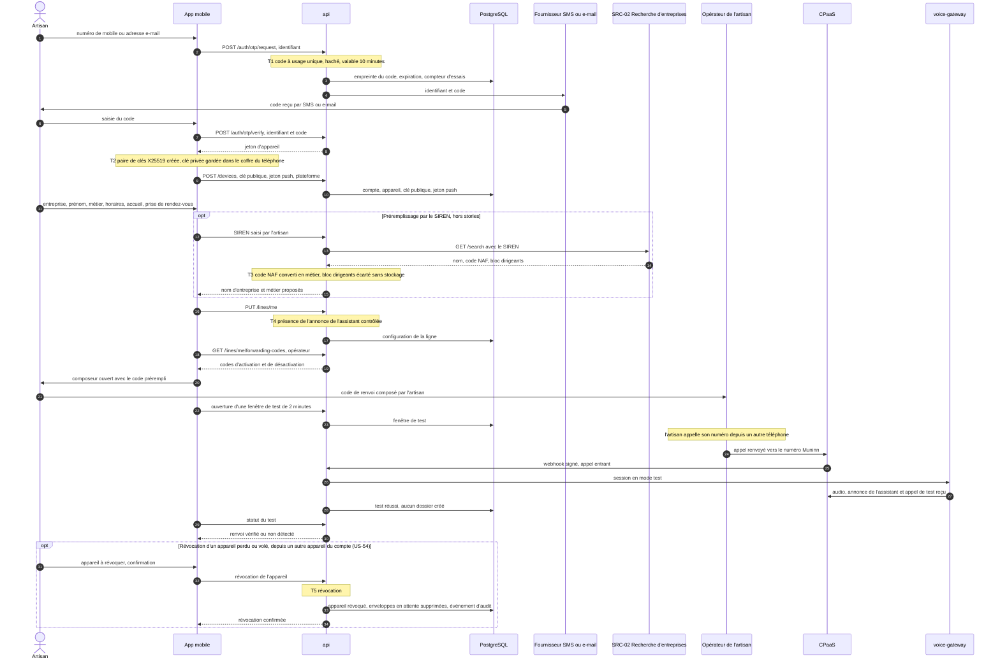

| N°  | Émetteur                  | Récepteur                 | Données                                                                                                                     | Format                        | Sens    | Transformation                 | Sensibilité | Règle      |
| --- | ------------------------- | ------------------------- | --------------------------------------------------------------------------------------------------------------------------- | ----------------------------- | ------- | ------------------------------ | ----------- | ---------- |
| 1   | Artisan                   | App mobile                | Numéro de mobile ou adresse e-mail                                                                                          | Saisie                        | local   | sans objet                     | DP          | sans objet |
| 2   | App mobile                | api                       | Identifiant de connexion                                                                                                    | HTTPS, JSON                   | entrant | sans objet                     | DP          | R4         |
| 3   | api                       | PostgreSQL                | Empreinte du code, expiration, essais, identifiant haché [H]                                                                | SQL                           | interne | T1                             | DP          | R4         |
| 4   | api                       | Fournisseur SMS ou e-mail | Identifiant et code                                                                                                         | API du fournisseur            | sortant | sans objet                     | DP          | R10        |
| 5   | Fournisseur SMS ou e-mail | Artisan                   | Code                                                                                                                        | SMS ou e-mail                 | externe | sans objet                     | DP          | R10        |
| 6   | Artisan                   | App mobile                | Code                                                                                                                        | Saisie                        | local   | sans objet                     | DP          | sans objet |
| 7   | App mobile                | api                       | Identifiant et code                                                                                                         | HTTPS, JSON                   | entrant | T1 (comparaison à l'empreinte) | DP          | R4         |
| 8   | api                       | App mobile                | Jeton d'appareil                                                                                                            | HTTPS, JSON                   | sortant | sans objet                     | aucune      | sans objet |
| 9   | App mobile                | api                       | Clé publique, jeton push, plateforme                                                                                        | HTTPS, JSON                   | entrant | T2                             | DP          | R1         |
| 10  | api                       | PostgreSQL                | Compte, appareil, clé publique, jeton push                                                                                  | SQL                           | interne | sans objet                     | DP          | R1         |
| 11  | Artisan                   | App mobile                | Entreprise, prénom, métier, horaires, accueil, rendez-vous                                                                  | Saisie                        | local   | sans objet                     | DP          | R6         |
| 12  | App mobile                | api                       | SIREN de l'artisan [H : point d'API absent]                                                                                 | HTTPS, JSON                   | entrant | sans objet                     | DP          | R4         |
| 13  | api                       | SRC-02                    | SIREN [H : recherche par SIREN non testée, document 03]                                                                     | HTTPS, GET                    | sortant | sans objet                     | DP          | R4         |
| 14  | SRC-02                    | api                       | Nom, code NAF, bloc `dirigeants`                                                                                            | JSON                          | entrant | T3                             | DP          | R4         |
| 15  | api                       | App mobile                | Nom d'entreprise et métier proposés                                                                                         | HTTPS, JSON                   | sortant | T3                             | DP          | sans objet |
| 16  | App mobile                | api                       | Configuration de la ligne                                                                                                   | HTTPS, JSON (`PUT /lines/me`) | entrant | T4                             | DP          | R6         |
| 17  | api                       | PostgreSQL                | Table `lines`                                                                                                               | SQL                           | interne | sans objet                     | DP          | R6         |
| 18  | App mobile                | api                       | Opérateur choisi                                                                                                            | HTTPS, GET                    | entrant | sans objet                     | aucune      | sans objet |
| 19  | api                       | App mobile                | Codes de renvoi et instructions                                                                                             | HTTPS, JSON                   | sortant | sans objet                     | aucune      | sans objet |
| 20  | App mobile                | Artisan                   | Composeur prérempli                                                                                                         | Intention du système          | local   | sans objet                     | aucune      | sans objet |
| 21  | Artisan                   | Opérateur de l'artisan    | Code de renvoi                                                                                                              | Signalisation téléphonique    | externe | sans objet                     | aucune      | sans objet |
| 22  | App mobile                | api                       | Ouverture de la fenêtre de test [H : point d'API absent]                                                                    | HTTPS, JSON                   | entrant | sans objet                     | aucune      | sans objet |
| 23  | api                       | PostgreSQL                | Fenêtre de test                                                                                                             | SQL                           | interne | sans objet                     | aucune      | sans objet |
| 24  | Opérateur de l'artisan    | CPaaS                     | Appel renvoyé, numéro appelant                                                                                              | Téléphonie                    | externe | sans objet                     | DP          | R10        |
| 25  | CPaaS                     | api                       | Événement d'appel entrant, numéro appelant                                                                                  | HTTPS, JSON signé             | entrant | Numéro haché (F-02, T1)        | DP          | R4         |
| 26  | api                       | voice-gateway             | Session en mode test                                                                                                        | Appel interne                 | interne | sans objet                     | aucune      | R6         |
| 27  | voice-gateway             | CPaaS                     | Audio de l'annonce (entreprise, prénom) et du message de test                                                               | WebSocket, audio              | sortant | sans objet                     | DP          | R2, R6     |
| 28  | api                       | PostgreSQL                | Statut du test, aucun dossier                                                                                               | SQL                           | interne | sans objet                     | aucune      | R2         |
| 29  | App mobile                | api                       | Demande du statut [H : point d'API absent]                                                                                  | HTTPS, GET                    | entrant | sans objet                     | aucune      | sans objet |
| 30  | api                       | App mobile                | Renvoi vérifié ou non détecté                                                                                               | HTTPS, JSON                   | sortant | sans objet                     | aucune      | sans objet |
| 31  | Artisan                   | App mobile                | Appareil à révoquer, confirmation                                                                                           | Saisie                        | local   | sans objet                     | aucune      | sans objet |
| 32  | App mobile                | api                       | Identifiant opaque de l'appareil à révoquer [H : point d'API absent]                                                        | HTTPS, JSON                   | entrant | sans objet                     | aucune      | R4         |
| 33  | api                       | PostgreSQL                | `revoked_at` posé ; empreinte du jeton et jeton push effacés ; enveloppes en attente supprimées ; événement d'audit sans DP | SQL                           | interne | T5                             | aucune      | R1, R4     |
| 34  | api                       | App mobile                | Révocation confirmée                                                                                                        | HTTPS, JSON                   | sortant | sans objet                     | aucune      | sans objet |

**Points de transformation.**

- **T1.** Génération d'un code à usage unique. Seule son empreinte est stockée, avec une
  expiration de 10 minutes et un compteur de 5 essais [H]. Comparaison à l'empreinte au
  message 7.
- **T2.** Génération de la paire de clés X25519 sur l'appareil. La clé privée ne quitte jamais
  le coffre du téléphone (US-01, critère 2).
- **T3.** Correspondance code NAF vers métier (SRC-09). Le bloc `dirigeants` est écarté sans
  stockage (fiche SRC-02).
- **T4.** Contrôle que le message d'accueil contient l'annonce de l'assistant (R6, US-02).
- **T5.** Révocation d'un appareil (US-54). L'appareil qui révoque est un autre appareil du
  compte. Le serveur pose `revoked_at`, efface l'empreinte du jeton et le jeton push, supprime
  les enveloppes en attente ; le relay ne chiffre plus pour cet appareil. L'appareil révoqué
  reçoit HTTP 401 à sa requête suivante.

**Destructions.**

| Élément                                                | Où il existe             | Détruit quand                             | Règle  |
| ------------------------------------------------------ | ------------------------ | ----------------------------------------- | ------ |
| Code à usage unique (empreinte)                        | PostgreSQL               | À la vérification ou après 10 minutes [H] | R4     |
| Bloc `dirigeants` de SRC-02                            | Mémoire de l'api         | À la fin de la requête                    | R1, R4 |
| Audio de l'appel de test                               | Mémoire du voice-gateway | À la fin de l'appel, bloc `finally`       | R2     |
| Empreinte du jeton et jeton push de l'appareil révoqué | PostgreSQL               | À la révocation (message 33)              | R4     |
| Enveloppes en attente de l'appareil révoqué            | PostgreSQL               | À la révocation (message 33)              | R1     |
| Ligne de l'appareil révoqué                            | PostgreSQL               | 30 jours après la révocation [H]          | R4     |

## 7. F-02. Appel manqué jusqu'au dossier chiffré sur l'appareil (flux principal)

**Objet.** Prendre l'appel renvoyé, recueillir la demande, extraire un brouillon validé,
contrôler ses champs par les référentiels, le chiffrer pour l'appareil, le livrer et le faire
valider.
**Modifié le 12 octobre 2026 (phase 1, X-05).** L'extraction rend le brouillon à voice-gateway,
qui le confie au relay et écrit le statut d'extraction ; l'extraction n'a plus aucun accès à la
base ni au relay (document 03 de la phase 1, sections 2.2 et 4.2).
**Stories couvertes.** US-06 à US-12, US-15, US-17, US-20, US-31, US-51. US-42 (V2) est la
frontière de ce flux : enregistrer l'appel contredirait R2.
**Déclencheur.** Un client appelle l'artisan, qui ne répond pas, est occupé ou injoignable.

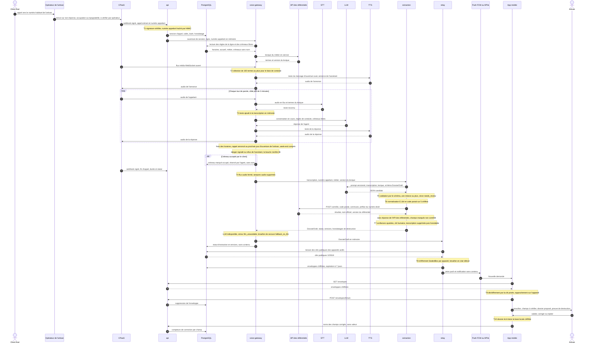

| N°  | Émetteur               | Récepteur              | Données                                                                                                                                  | Format                                 | Sens    | Transformation | Sensibilité | Règle      |
| --- | ---------------------- | ---------------------- | ---------------------------------------------------------------------------------------------------------------------------------------- | -------------------------------------- | ------- | -------------- | ----------- | ---------- |
| 1   | Client final           | Opérateur de l'artisan | Appel, numéro appelant, voix                                                                                                             | Téléphonie                             | externe | sans objet     | DP          | sans objet |
| 2   | Opérateur de l'artisan | CPaaS                  | Appel renvoyé, numéro appelant                                                                                                           | Téléphonie                             | externe | sans objet     | DP          | sans objet |
| 3   | CPaaS                  | api                    | Événement d'appel entrant, numéro appelant, numéro Muninn                                                                                | HTTPS, JSON signé                      | entrant | T1             | DP          | R4         |
| 4   | api                    | PostgreSQL             | Session d'appel, `caller_hash` (pseudonyme), horodatage                                                                                  | SQL                                    | interne | T1             | DP          | R1, R4     |
| 5   | api                    | voice-gateway          | Identifiants de session et de ligne, numéro appelant                                                                                     | Appel interne                          | interne | sans objet     | DP          | R4         |
| 6   | voice-gateway          | PostgreSQL             | Lecture des règles et des créneaux                                                                                                       | SQL                                    | interne | sans objet     | aucune      | sans objet |
| 7   | PostgreSQL             | voice-gateway          | Horaires, accueil, nom d'entreprise, prénom de l'artisan, créneaux sans nom                                                              | SQL                                    | interne | sans objet     | DP          | R1, R6     |
| 8   | voice-gateway          | API des référentiels   | Métier                                                                                                                                   | HTTPS, GET                             | interne | sans objet     | aucune      | sans objet |
| 9   | API des référentiels   | voice-gateway          | Termes et version du lexique                                                                                                             | HTTPS, JSON                            | interne | T2             | aucune      | sans objet |
| 10  | CPaaS                  | voice-gateway          | Ouverture du flux média                                                                                                                  | WebSocket, audio                       | entrant | sans objet     | DP          | R2         |
| 11  | voice-gateway          | TTS                    | Texte d'ouverture (entreprise, prénom de l'artisan)                                                                                      | API du fournisseur                     | sortant | sans objet     | DP          | R5, R6     |
| 12  | TTS                    | voice-gateway          | Audio de l'annonce                                                                                                                       | Audio                                  | entrant | sans objet     | DP          | R2         |
| 13  | voice-gateway          | CPaaS                  | Audio de l'annonce                                                                                                                       | WebSocket, audio                       | sortant | sans objet     | DP          | R6         |
| 14  | CPaaS                  | voice-gateway          | Audio de l'appelant                                                                                                                      | WebSocket, audio                       | entrant | sans objet     | DP          | R2         |
| 15  | voice-gateway          | STT                    | Audio en flux, termes du lexique                                                                                                         | API du fournisseur, flux               | sortant | T2             | DP          | R2, R5     |
| 16  | STT                    | voice-gateway          | Texte reconnu                                                                                                                            | API du fournisseur                     | entrant | T3             | DP          | R3, R5     |
| 17  | voice-gateway          | LLM                    | Conversation en cours, règles de conduite, créneaux libres                                                                               | API du fournisseur                     | sortant | sans objet     | DP          | R5, R6, R7 |
| 18  | LLM                    | voice-gateway          | Réponse de l'agent                                                                                                                       | API du fournisseur                     | entrant | sans objet     | DP          | R5, R6     |
| 19  | voice-gateway          | TTS                    | Texte de la réponse (reformulation de la demande)                                                                                        | API du fournisseur                     | sortant | sans objet     | DP          | R5         |
| 20  | TTS                    | voice-gateway          | Audio de la réponse                                                                                                                      | Audio                                  | entrant | sans objet     | DP          | R2         |
| 21  | voice-gateway          | CPaaS                  | Audio de la réponse                                                                                                                      | WebSocket, audio                       | sortant | sans objet     | DP          | R2         |
| 22  | voice-gateway          | PostgreSQL             | Créneau occupé, réservé par l'agent                                                                                                      | SQL                                    | interne | sans objet     | DP          | R1         |
| 23  | CPaaS                  | api                    | Fin d'appel, durée, statut ; le webhook porte aussi les numéros [H]                                                                      | HTTPS, JSON signé                      | entrant | sans objet     | DP          | R4         |
| 24  | voice-gateway          | extraction             | Transcription, numéro appelant, métier, version du lexique                                                                               | Appel interne en mémoire [H]           | interne | T4             | DP          | R2, R3     |
| 25  | extraction             | LLM                    | Prompt versionné, transcription, lexique, schéma                                                                                         | API du fournisseur                     | sortant | sans objet     | DP          | R3, R5, R7 |
| 26  | LLM                    | extraction             | JSON candidat                                                                                                                            | JSON                                   | entrant | T5, T6         | DP          | R5, R7     |
| 27  | extraction             | API des référentiels   | Code postal, commune ; préfixe de 7 chiffres du numéro, seulement s'il est dicté (1 000 numéros possibles : la donnée reste personnelle) | HTTPS, JSON (`POST`)                   | interne | sans objet     | DP          | R4         |
| 28  | API des référentiels   | extraction             | Résultat du contrôle, nom officiel, version                                                                                              | HTTPS, JSON                            | interne | T7             | aucune      | R4         |
| 29  | extraction             | voice-gateway          | `DossierDraft` en clair, statut, versions, horodatages de destruction ; ou erreur 503 `llm_unavailable`, sans contenu (D-29)             | Réponse de l'appel interne, en mémoire | interne | sans objet     | DP          | R1, R3     |
| 30  | voice-gateway          | relay                  | `DossierDraft` en clair, ou brouillon de secours `fallback_no_llm` (D-29)                                                                | Appel interne en mémoire               | interne | sans objet     | DP          | R1, R3     |
| 31  | voice-gateway          | PostgreSQL             | `extraction_status`, versions du prompt, du schéma et du modèle                                                                          | SQL                                    | interne | sans objet     | aucune      | R1, R4     |
| 32  | relay                  | PostgreSQL             | Lecture des clés publiques                                                                                                               | SQL                                    | interne | sans objet     | aucune      | sans objet |
| 33  | PostgreSQL             | relay                  | Clés publiques X25519                                                                                                                    | SQL                                    | interne | sans objet     | aucune      | sans objet |
| 34  | relay                  | PostgreSQL             | Enveloppes, `expires_at`                                                                                                                 | SQL (`bytea`)                          | interne | T8             | DP chiffrée | R1         |
| 35  | relay                  | Push                   | Jeton push, notification sans contenu                                                                                                    | API FCM ou APNs                        | sortant | sans objet     | DP          | R1, R4     |
| 36  | Push                   | App mobile             | « Nouvelle demande »                                                                                                                     | Notification push                      | externe | sans objet     | aucune      | R1, R4     |
| 37  | App mobile             | api                    | `GET /envelopes`, jeton d'appareil                                                                                                       | HTTPS                                  | entrant | sans objet     | aucune      | sans objet |
| 38  | api                    | App mobile             | Enveloppes                                                                                                                               | HTTPS, JSON                            | sortant | T9             | DP chiffrée | R1         |
| 39  | App mobile             | api                    | Accusé de réception (`POST /envelopes/{id}/ack`)                                                                                         | HTTPS                                  | entrant | sans objet     | aucune      | R1         |
| 40  | api                    | PostgreSQL             | Suppression de l'enveloppe                                                                                                               | SQL                                    | interne | sans objet     | aucune      | R1         |
| 41  | App mobile             | Artisan                | Brouillon, champs à vérifier, dossier proposé, preuve de destruction                                                                     | Écran                                  | local   | sans objet     | DP          | sans objet |
| 42  | Artisan                | App mobile             | Décision et corrections                                                                                                                  | Toucher ou clavier                     | local   | T10            | DP          | sans objet |
| 43  | App mobile             | api                    | Noms des champs corrigés, sans valeur [H : point d'API absent]                                                                           | HTTPS, JSON                            | entrant | sans objet     | aucune      | R4         |
| 44  | api                    | PostgreSQL             | Compteurs de correction par champ [H : lieu unique, base ou outil de métriques, à fixer en phase 1]                                      | SQL                                    | interne | sans objet     | aucune      | R4         |

**Points de transformation.**

- **T1.** Vérification de la signature du webhook. Le numéro appelant est haché par HMAC-SHA256
  avec un poivre du serveur (`caller_hash`). Le numéro en clair ne reste qu'en mémoire, puis dans
  le brouillon chiffré.
- **T2.** Sélection des termes du lexique métier injectés dans le STT : 100 au plus, fonction
  annoncée comme expérimentale hors anglais (passation, ADR-03) [H].
- **T3.** Accumulation du texte reconnu en une transcription, en mémoire seulement.
- **T4.** Fermeture du flux audio. Les tampons audio sont libérés dans un bloc `finally` (R2).
- **T5.** Validation du JSON par le schéma `DossierDraft`. Une relance avec l'erreur, puis
  brouillon partiel `needs_review`. Les informations médicales sont refusées (R7).
- **T6.** Normalisation : téléphone en E.164, code postal sur 5 chiffres, casse et accents.
- **T7.** Ajustement des confiances selon le contrôle par les référentiels (US-51) ; nom officiel
  de la commune ; construction de la clé humaine. Sans réponse de l'API des référentiels, les
  champs sont marqués « non contrôlé » et l'événement est compté (US-51, critère 4). La
  transcription est supprimée dans un bloc `finally`, même en cas d'erreur ; l'horodatage de
  suppression (US-31) n'est ajouté qu'**après** cette suppression, dans le bloc `destruction` du
  contrat 1.1 (décidé : D-24). Cet horodatage est une assertion du serveur, adossée aux tests de conformité (document
  01, section 9) ; il ne prouve pas l'effacement physique de la mémoire.
- **Brouillon de secours (D-29).** Si le LLM est indisponible en fin d'appel, l'extraction
  répond `llm_unavailable` au message 29, sans brouillon. Voice-gateway construit alors un
  brouillon de secours `fallback_no_llm` : numéro et heure de l'appel, action « rappeler »,
  `needs_review` vrai, clé humaine nulle. Il le confie au relay par le message 30, comme un
  brouillon ordinaire. La transcription est détruite comme dans le cas nominal (T4, T7) : elle
  ne peut être ni gardée ni remise en file pour un nouvel essai (R3). L'artisan reçoit
  « rappeler » ; aucune demande n'est perdue en silence (document 01, US-11, critère 5).
- **Hors des horaires (D-30).** L'agent ne propose pas de créneau et annonce un rappel au
  prochain jour d'ouverture de l'artisan, calculé sur ses horaires, week-end compris, et en
  sautant les jours fériés non travaillés (US-02, critères 2 et 5 ; US-49, critère 3).
- **T8.** Le relay reçoit le brouillon de voice-gateway (messages 29 et 30), jamais de
  l'extraction. Chiffrement `SealedBox` (X25519) pour chaque appareil actif. Le brouillon en clair est
  libéré aussitôt. Si le relay échoue avant le chiffrement, ou si aucun appareil actif n'existe,
  le brouillon n'est écrit nulle part en clair : il est perdu. L'échec est compté
  (`extraction_status`) et alerté (US-38) ; l'artisan garde la trace de l'appel manqué dans le
  journal d'appels de son téléphone [H : comportement à valider ; la passation ne le fixe pas]. Un échec du push ne perd rien :
  l'enveloppe reste en base 7 jours et l'appareil la récupère à sa prochaine ouverture.
- **T9.** Déchiffrement sur l'appareil. Rapprochement avec un dossier existant par le numéro et la
  clé humaine (US-20). Le rendez-vous éventuel rejoint l'agenda (F-06).
- **T10.** Écriture dans la base locale chiffrée. Le comptage des corrections ne garde que le nom
  du champ (US-17, critère 3).

**Destructions.**

| Élément                       | Où il existe                                          | Détruit quand                                               | Règle  |
| ----------------------------- | ----------------------------------------------------- | ----------------------------------------------------------- | ------ |
| Audio de l'appel              | Mémoire du voice-gateway                              | À la fin de l'appel, dans un bloc `finally` (T4)            | R2     |
| Audio chez le STT et le TTS   | Fournisseurs                                          | Fin de la requête, zéro rétention [H : à vérifier, ADR-03]  | R2, R5 |
| Transcription                 | Mémoire du voice-gateway                              | À la remise à l'extraction (message 24), bloc `finally`     | R3     |
| Transcription                 | Mémoire de l'extraction                               | À la fin de l'extraction, même en cas d'erreur (T7)         | R3     |
| Numéro appelant en clair      | Mémoire de l'api et du voice-gateway                  | À la fin de la session d'appel (webhook de fin, message 23) | R1, R4 |
| Numéro appelant en clair      | Mémoire de l'extraction et du relay                   | Au chiffrement ; seul `caller_hash` reste (90 jours [H])    | R1, R4 |
| Fragments envoyés au contrôle | Mémoire de l'API des référentiels                     | À la réponse ; jamais journalisés                           | R4     |
| Brouillon en clair            | Mémoire de l'extraction, du voice-gateway et du relay | Juste après le chiffrement (T8)                             | R1     |
| Brouillon de secours          | Mémoire du voice-gateway et du relay                  | Juste après le chiffrement (T8)                             | R1     |
| Enveloppe chiffrée            | PostgreSQL                                            | À l'accusé de réception, ou après 7 jours                   | R1     |
| Brouillon rejeté              | Appareil                                              | À la confirmation du rejet (US-17)                          | R1     |

## 8. F-03. Débrief vocal ou écrit

**Objet.** Transformer un débrief dicté ou écrit en brouillon rattaché au bon dossier.
**Stories couvertes.** US-13 à US-17, US-51. US-44 (hors périmètre) est la frontière : l'appli
détecte la fin d'un appel décroché, sans jamais accéder à son audio.
**Déclencheur.** Fin d'un appel décroché (invitation, Android), ou décision de l'artisan après une
visite.

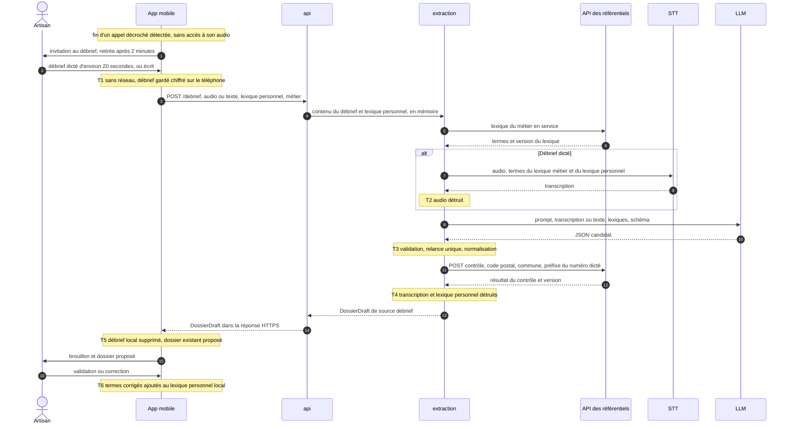

| N°  | Émetteur             | Récepteur            | Données                                          | Format                   | Sens    | Transformation | Sensibilité | Règle      |
| --- | -------------------- | -------------------- | ------------------------------------------------ | ------------------------ | ------- | -------------- | ----------- | ---------- |
| 1   | App mobile           | Artisan              | Invitation au débrief                            | Notification locale      | local   | sans objet     | aucune      | R2         |
| 2   | Artisan              | App mobile           | Débrief dicté ou écrit                           | Audio ou texte           | local   | T1             | DP          | R7         |
| 3   | App mobile           | api                  | Audio ou texte, lexique personnel, métier        | HTTPS, multipart         | entrant | sans objet     | DP          | R1, R2, R3 |
| 4   | api                  | extraction           | Contenu du débrief, lexique personnel            | Appel interne en mémoire | interne | sans objet     | DP          | R2, R3, R4 |
| 5   | extraction           | API des référentiels | Métier                                           | HTTPS, GET               | interne | sans objet     | aucune      | sans objet |
| 6   | API des référentiels | extraction           | Termes et version du lexique                     | HTTPS, JSON              | interne | sans objet     | aucune      | sans objet |
| 7   | extraction           | STT                  | Audio, lexique métier et lexique personnel       | API du fournisseur       | sortant | sans objet     | DP          | R2, R5     |
| 8   | STT                  | extraction           | Transcription                                    | API du fournisseur       | entrant | T2             | DP          | R3, R5     |
| 9   | extraction           | LLM                  | Prompt, transcription ou texte, lexiques, schéma | API du fournisseur       | sortant | sans objet     | DP          | R3, R5, R7 |
| 10  | LLM                  | extraction           | JSON candidat                                    | JSON                     | entrant | T3             | DP          | R5, R7     |
| 11  | extraction           | API des référentiels | Code postal, commune, préfixe du numéro          | HTTPS, JSON (`POST`)     | interne | sans objet     | DP          | R4         |
| 12  | API des référentiels | extraction           | Résultat du contrôle et version                  | HTTPS, JSON              | interne | sans objet     | aucune      | R4         |
| 13  | extraction           | api                  | `DossierDraft` de source `debrief`               | Appel interne en mémoire | interne | T4             | DP          | R3         |
| 14  | api                  | App mobile           | `DossierDraft`                                   | HTTPS, JSON              | sortant | T5             | DP          | R1         |
| 15  | App mobile           | Artisan              | Brouillon et dossier proposé                     | Écran                    | local   | sans objet     | DP          | sans objet |
| 16  | Artisan              | App mobile           | Validation ou corrections                        | Toucher ou clavier       | local   | T6             | DP          | sans objet |

**Points de transformation.**

- **T1.** Sans réseau, le débrief est gardé chiffré sur le téléphone, envoyé au retour du réseau,
  puis supprimé après l'envoi réussi (US-13, critère 4).
- **T2.** Transcription par le STT ; l'audio est libéré dans un bloc `finally`.
- **T3.** Validation par le schéma, une relance, normalisation (comme F-02, T5 et T6).
- **T4.** Ajustement des confiances par le contrôle (US-51), si le débrief contient une adresse
  ou un numéro. Destruction de la transcription et du lexique personnel.
- **T5.** Le débrief local est supprimé une fois la réponse reçue. Le rapprochement avec un
  dossier existant se fait sur l'appareil.
- **T6.** Les termes corrigés (noms, rues) rejoignent le lexique personnel stocké sur
  l'appareil (US-16).

**Destructions.**

| Élément                      | Où il existe                        | Détruit quand                              | Règle  |
| ---------------------------- | ----------------------------------- | ------------------------------------------ | ------ |
| Débrief en attente de réseau | Téléphone, chiffré                  | Après l'envoi réussi                       | R2     |
| Audio du débrief             | Mémoire de l'api et de l'extraction | Après la transcription (T2)                | R2     |
| Transcription                | Mémoire de l'extraction             | À la fin de l'extraction (T4)              | R3     |
| Lexique personnel            | Mémoire de l'api et de l'extraction | À la fin de la requête ; jamais journalisé | R1, R4 |
| `DossierDraft` en clair      | Mémoire de l'api                    | À l'envoi de la réponse                    | R1     |

Le brouillon revient en clair dans la réponse HTTPS, sans enveloppe. C'est le contrat de
`POST /debrief` de la passation : l'appareil qui l'a demandé est connecté. Rien n'est stocké.

## 9. F-04. Recherche et désambiguïsation sur l'appareil

**Objet.** Retrouver un dossier par sa clé humaine, lever une ambiguïté par une seule question,
suivre les actions à faire.
**Modifié le 12 octobre 2026 (phase 2, contrat d'API, CA-04).** La transcription d'une phrase
dite passe par le point interne `POST /v1/transcribe` du composant extraction, seul détenteur de
la clé du fournisseur de transcription (document 03 de la phase 1, section 5.6). L'api ne joint
plus le STT : elle reçoit l'audio par `POST /v1/transcriptions` et le relaie en mémoire.
**Stories couvertes.** US-18, US-19, US-30, US-32. Le rattachement automatique (US-20) est dans
F-02, T9.
**Déclencheur.** L'artisan cherche un dossier, à la voix ou au clavier.

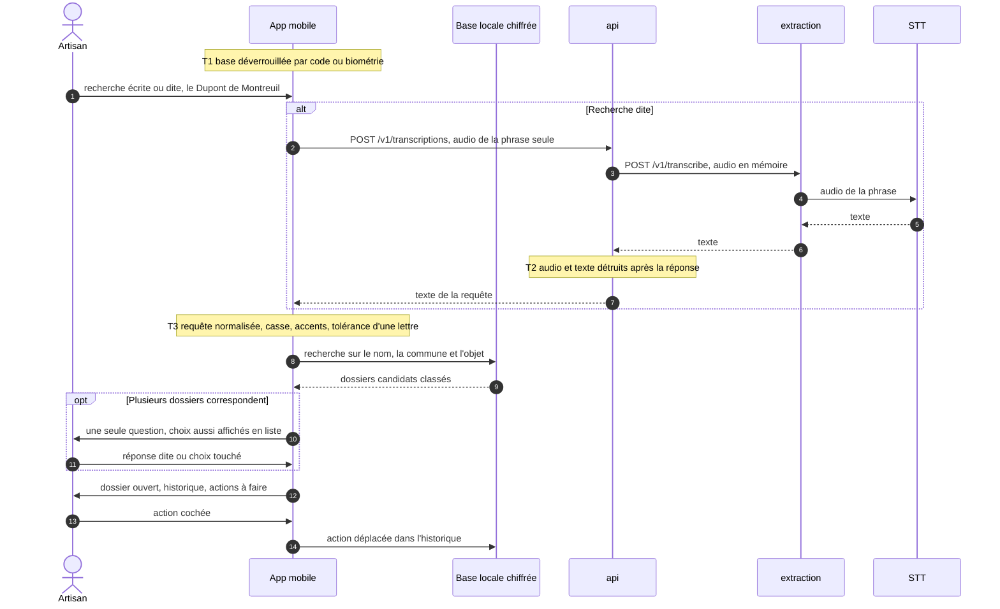

| N°  | Émetteur             | Récepteur            | Données                                        | Format                                 | Sens    | Transformation | Sensibilité | Règle      |
| --- | -------------------- | -------------------- | ---------------------------------------------- | -------------------------------------- | ------- | -------------- | ----------- | ---------- |
| 1   | Artisan              | App mobile           | Requête (nom, commune, objet)                  | Voix ou clavier                        | local   | sans objet     | DP          | sans objet |
| 2   | App mobile           | api                  | Audio de la phrase (`POST /v1/transcriptions`) | HTTPS, multipart                       | entrant | sans objet     | DP          | R2, R3     |
| 3   | api                  | extraction           | Audio de la phrase (`POST /v1/transcribe`)     | Appel interne en mémoire               | interne | sans objet     | DP          | R2, R3, R4 |
| 4   | extraction           | STT                  | Audio de la phrase                             | API du fournisseur                     | sortant | sans objet     | DP          | R2, R5     |
| 5   | STT                  | extraction           | Texte                                          | API du fournisseur                     | entrant | sans objet     | DP          | R3, R5     |
| 6   | extraction           | api                  | Texte                                          | Réponse de l'appel interne, en mémoire | interne | sans objet     | DP          | R3, R4     |
| 7   | api                  | App mobile           | Texte de la requête                            | HTTPS, JSON                            | sortant | T2             | DP          | R3, R4     |
| 8   | App mobile           | Base locale chiffrée | Requête normalisée                             | Appel local                            | local   | T3             | DP          | R1         |
| 9   | Base locale chiffrée | App mobile           | Dossiers candidats                             | Appel local                            | local   | sans objet     | DP          | R1         |
| 10  | App mobile           | Artisan              | Question et liste des choix                    | Voix et écran                          | local   | sans objet     | DP          | sans objet |
| 11  | Artisan              | App mobile           | Réponse                                        | Voix ou toucher                        | local   | sans objet     | DP          | sans objet |
| 12  | App mobile           | Artisan              | Dossier, historique, actions                   | Écran                                  | local   | sans objet     | DP          | sans objet |
| 13  | Artisan              | App mobile           | Action cochée                                  | Toucher                                | local   | sans objet     | DP          | sans objet |
| 14  | App mobile           | Base locale chiffrée | Mise à jour de l'action                        | Appel local                            | local   | T1             | DP chiffrée | R1         |

**Points de transformation.**

- **T1.** Chiffrement au repos de la base locale ; ouverture après déverrouillage par code ou
  biométrie (US-32) [H].
- **T2.** Transcription de la seule phrase dite, par le composant extraction ; audio et texte
  libérés à la réponse, dans l'api comme dans l'extraction. Une réponse dite à la question de
  désambiguïsation (message 11) suit le même chemin.
- **T3.** Normalisation de la requête (casse, accents) et recherche approchée tolérant une lettre
  d'écart (US-18, critère 2) ; classement des candidats.

**Destructions.**

| Élément                         | Où il existe                        | Détruit quand           | Règle  |
| ------------------------------- | ----------------------------------- | ----------------------- | ------ |
| Audio de la phrase de recherche | Mémoire de l'api et de l'extraction | Après la transcription  | R2     |
| Texte de la requête             | Mémoire de l'api et de l'extraction | À l'envoi de la réponse | R3, R4 |

Sans réseau, la recherche écrite fonctionne : les messages 2 à 7 n'ont pas lieu.

## 10. F-05. Dépense (ticket, dictée) et rentabilité

**Objet.** Transformer un ticket photographié ou une dépense dite en dépense rattachée, et
calculer la marge du chantier.
**Stories couvertes.** US-21, US-22, US-23, US-25 (V2).
**Déclencheur.** L'artisan photographie un ticket, dicte une dépense ou saisit un encaissement.

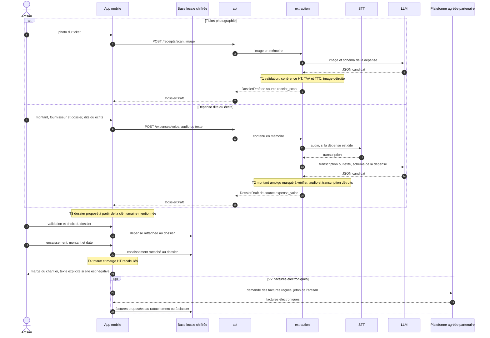

| N°  | Émetteur                     | Récepteur                    | Données                                                                       | Format                             | Sens    | Transformation | Sensibilité | Règle      |
| --- | ---------------------------- | ---------------------------- | ----------------------------------------------------------------------------- | ---------------------------------- | ------- | -------------- | ----------- | ---------- |
| 1   | Artisan                      | App mobile                   | Photo du ticket                                                               | Image                              | local   | sans objet     | DP          | sans objet |
| 2   | App mobile                   | api                          | Image du ticket                                                               | HTTPS, multipart                   | entrant | sans objet     | DP          | R1         |
| 3   | api                          | extraction                   | Image en mémoire                                                              | Appel interne en mémoire           | interne | sans objet     | DP          | R1, R4     |
| 4   | extraction                   | LLM                          | Image et schéma de la dépense [H : OCR par un modèle de vision, ADR à ouvrir] | API du fournisseur                 | sortant | sans objet     | DP          | R5         |
| 5   | LLM                          | extraction                   | JSON candidat                                                                 | JSON                               | entrant | T1             | DP          | R5         |
| 6   | extraction                   | api                          | `DossierDraft` de source `receipt_scan`                                       | Appel interne en mémoire           | interne | T1             | DP          | R1         |
| 7   | api                          | App mobile                   | `DossierDraft`                                                                | HTTPS, JSON                        | sortant | sans objet     | DP          | R1         |
| 8   | Artisan                      | App mobile                   | Dépense dite ou écrite                                                        | Audio ou texte                     | local   | sans objet     | DP          | sans objet |
| 9   | App mobile                   | api                          | Audio ou texte                                                                | HTTPS, multipart                   | entrant | sans objet     | DP          | R2, R3     |
| 10  | api                          | extraction                   | Contenu en mémoire                                                            | Appel interne en mémoire           | interne | sans objet     | DP          | R2, R3     |
| 11  | extraction                   | STT                          | Audio                                                                         | API du fournisseur                 | sortant | sans objet     | DP          | R2, R5     |
| 12  | STT                          | extraction                   | Transcription                                                                 | API du fournisseur                 | entrant | sans objet     | DP          | R3, R5     |
| 13  | extraction                   | LLM                          | Transcription ou texte, schéma                                                | API du fournisseur                 | sortant | sans objet     | DP          | R3, R5     |
| 14  | LLM                          | extraction                   | JSON candidat                                                                 | JSON                               | entrant | T2             | DP          | R5         |
| 15  | extraction                   | api                          | `DossierDraft` de source `expense_voice`                                      | Appel interne en mémoire           | interne | T2             | DP          | R2, R3     |
| 16  | api                          | App mobile                   | `DossierDraft`                                                                | HTTPS, JSON                        | sortant | sans objet     | DP          | R1         |
| 17  | Artisan                      | App mobile                   | Validation et dossier choisi                                                  | Toucher                            | local   | T3             | DP          | sans objet |
| 18  | App mobile                   | Base locale chiffrée         | Dépense rattachée                                                             | Appel local                        | local   | sans objet     | DP chiffrée | R1         |
| 19  | Artisan                      | App mobile                   | Encaissement, montant et date                                                 | Saisie                             | local   | sans objet     | DP          | sans objet |
| 20  | App mobile                   | Base locale chiffrée         | Encaissement                                                                  | Appel local                        | local   | T4             | DP chiffrée | R1         |
| 21  | App mobile                   | Artisan                      | Encaissements, dépenses, marge                                                | Écran                              | local   | T4             | DP          | sans objet |
| 22  | App mobile                   | Plateforme agréée partenaire | Demande des factures, jeton de l'artisan                                      | HTTPS [H : API du partenaire]      | externe | sans objet     | DP          | R1         |
| 23  | Plateforme agréée partenaire | App mobile                   | Factures électroniques                                                        | Format de facture électronique [H] | externe | sans objet     | DP          | R1         |
| 24  | App mobile                   | Base locale chiffrée         | Factures à rattacher ou à classer                                             | Appel local                        | local   | sans objet     | DP chiffrée | R1         |

**Points de transformation.**

- **T1.** Validation par le schéma ; contrôle de cohérence HT, TVA, TTC ; montant illisible mis à
  `null` et marqué « à vérifier ». L'image est libérée à la fin du traitement (US-21, critère 3).
- **T2.** Un montant sans précision HT ou TTC est marqué « à vérifier » ; aucun taux de TVA n'est
  supposé (US-22, critère 3). Audio et transcription détruits.
- **T3.** Proposition du dossier à partir de `dossier_cle_humaine_mentionnee`, sur l'appareil.
- **T4.** Recalcul des totaux et de la marge HT, sans action de l'artisan (US-23).

**Destructions.**

| Élément                               | Où il existe                        | Détruit quand                 | Règle |
| ------------------------------------- | ----------------------------------- | ----------------------------- | ----- |
| Image du ticket envoyée au traitement | Mémoire de l'api et de l'extraction | À la fin du traitement (T1)   | R1    |
| Audio de la dépense dite              | Mémoire de l'api et de l'extraction | Après la transcription        | R2    |
| Transcription                         | Mémoire de l'extraction             | À la fin de l'extraction (T2) | R3    |
| `DossierDraft` en clair               | Mémoire de l'api                    | À l'envoi de la réponse       | R1    |

La copie du ticket gardée pour la comptabilité est chiffrée par l'appareil et archivée par F-07.

## 11. F-06. Rendez-vous, rappels et imprévus avec SMS

**Objet.** Partager les disponibilités sans détail, réserver un créneau par l'agent en excluant
les jours fériés, envoyer les rappels et les messages d'imprévu.
**Stories couvertes.** US-05, US-08, US-26, US-27, US-28, US-29, US-49.
**Déclencheur.** Synchronisation de l'agenda, appel avec prise de rendez-vous (F-02), heure d'un
rappel, ou imprévu déclaré par l'artisan.

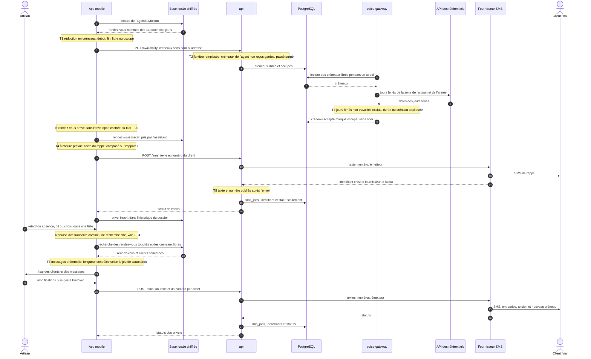

| N°  | Émetteur             | Récepteur            | Données                                  | Format                            | Sens    | Transformation | Sensibilité | Règle       |
| --- | -------------------- | -------------------- | ---------------------------------------- | --------------------------------- | ------- | -------------- | ----------- | ----------- |
| 1   | App mobile           | Base locale chiffrée | Lecture de l'agenda                      | Appel local                       | local   | sans objet     | aucune      | sans objet  |
| 2   | Base locale chiffrée | App mobile           | Rendez-vous nommés                       | Appel local                       | local   | sans objet     | DP          | R1          |
| 3   | App mobile           | api                  | Créneaux : début, fin, libre ou occupé   | HTTPS, JSON (`PUT /availability`) | entrant | T1             | DP          | R1, R4      |
| 4   | api                  | PostgreSQL           | `availability_slots`                     | SQL                               | interne | T2             | DP          | R1          |
| 5   | voice-gateway        | PostgreSQL           | Lecture des créneaux libres              | SQL                               | interne | sans objet     | aucune      | sans objet  |
| 6   | PostgreSQL           | voice-gateway        | Créneaux                                 | SQL                               | interne | sans objet     | DP          | sans objet  |
| 7   | voice-gateway        | API des référentiels | Zone et année                            | HTTPS, GET                        | interne | sans objet     | aucune      | sans objet  |
| 8   | API des référentiels | voice-gateway        | Dates des jours fériés                   | HTTPS, JSON                       | interne | T3             | aucune      | sans objet  |
| 9   | voice-gateway        | PostgreSQL           | Créneau occupé, réservé par l'agent      | SQL                               | interne | T3             | DP          | R1          |
| 10  | App mobile           | Base locale chiffrée | Rendez-vous « pris par l'assistant »     | Appel local                       | local   | sans objet     | DP chiffrée | R1          |
| 11  | App mobile           | api                  | Texte du rappel, numéro du client        | HTTPS, JSON (`POST /sms`)         | entrant | T4             | DP          | R1, R4, R10 |
| 12  | api                  | Fournisseur SMS      | Texte, numéro, émetteur                  | API du fournisseur                | sortant | sans objet     | DP          | R4, R10     |
| 13  | Fournisseur SMS      | Client final         | SMS de rappel                            | SMS                               | externe | sans objet     | DP          | R10         |
| 14  | Fournisseur SMS      | api                  | Identifiant chez le fournisseur, statut  | HTTPS, JSON                       | entrant | T5             | aucune      | R4          |
| 15  | api                  | PostgreSQL           | `sms_jobs` : identifiant et statut       | SQL                               | interne | T5             | aucune      | R1, R4      |
| 16  | api                  | App mobile           | Statut de l'envoi                        | HTTPS, JSON                       | sortant | sans objet     | aucune      | sans objet  |
| 17  | App mobile           | Base locale chiffrée | Envoi inscrit dans l'historique          | Appel local                       | local   | sans objet     | DP chiffrée | R1          |
| 18  | Artisan              | App mobile           | Retard ou absence, durée                 | Voix ou toucher                   | local   | T6             | DP          | sans objet  |
| 19  | App mobile           | Base locale chiffrée | Recherche des rendez-vous touchés        | Appel local                       | local   | sans objet     | aucune      | sans objet  |
| 20  | Base locale chiffrée | App mobile           | Rendez-vous et clients concernés         | Appel local                       | local   | sans objet     | DP          | R1          |
| 21  | App mobile           | Artisan              | Liste des clients et messages préremplis | Écran                             | local   | T7             | DP          | sans objet  |
| 22  | Artisan              | App mobile           | Modifications, geste « Envoyer »         | Toucher ou clavier                | local   | sans objet     | DP          | sans objet  |
| 23  | App mobile           | api                  | Un texte et un numéro par client         | HTTPS, JSON (`POST /sms`)         | entrant | sans objet     | DP          | R1, R4, R10 |
| 24  | api                  | Fournisseur SMS      | Textes, numéros, émetteur                | API du fournisseur                | sortant | sans objet     | DP          | R4, R10     |
| 25  | Fournisseur SMS      | Client final         | SMS d'imprévu                            | SMS                               | externe | sans objet     | DP          | R10         |
| 26  | Fournisseur SMS      | api                  | Statuts                                  | HTTPS, JSON                       | entrant | T5             | aucune      | R4          |
| 27  | api                  | PostgreSQL           | `sms_jobs` : identifiants et statuts     | SQL                               | interne | T5             | aucune      | R1, R4      |
| 28  | api                  | App mobile           | Statuts des envois                       | HTTPS, JSON                       | sortant | sans objet     | aucune      | sans objet  |

**Points de transformation.**

- **T1.** Réduction de l'agenda nommé en créneaux anonymes (début, fin, type), sur l'appareil
  (US-05, critère 1).
- **T2.** Remplacement de la fenêtre de 14 jours ; les créneaux réservés par l'agent et pas encore
  reçus restent occupés ; purge des créneaux passés (US-05, critère 2).
- **T3.** Exclusion des jours fériés non travaillés de la zone de l'artisan (US-49) ; application
  de la durée de créneau (US-05, critère 3). Le créneau accepté devient occupé sans nom (US-08,
  US-26).
- **T4.** Composition du texte du rappel sur l'appareil, au nom de l'entreprise (US-27,
  critère 4).
- **T5.** Le serveur ne garde que l'identifiant chez le fournisseur et le statut (US-27,
  critère 3).
- **T6.** Une phrase dite (« j'ai deux heures de retard ») est transcrite par le même chemin que
  la recherche dite de F-04, sans conservation, puis interprétée sur l'appareil [H : le traitement
  de cette phrase n'est fixé ni par le concept ni par la passation].
- **T7.** Préremplissage d'un message par client, avec un ou deux créneaux libres ; 160
  caractères au plus en alphabet GSM 7 bits (US-29) [H : limite à confirmer auprès du fournisseur
  SMS]. Le calcul porte sur le jeu de caractères réel : un caractère hors alphabet GSM fait passer
  le message en UCS-2, limité à 70 caractères.

**Destructions.**

| Élément                  | Où il existe     | Détruit quand                                            | Règle  |
| ------------------------ | ---------------- | -------------------------------------------------------- | ------ |
| Texte et numéro d'un SMS | Mémoire de l'api | Après la réponse du fournisseur                          | R1, R4 |
| Créneaux passés          | PostgreSQL       | À la synchronisation suivante, ou par la purge planifiée | R1     |

## 12. F-07. Sauvegarde, archive et effacement

**Objet.** Sauvegarder les dossiers avec la seule clé de l'artisan, archiver les pièces
comptables pendant 10 ans, restaurer, effacer un dossier à la demande d'un client.
**Stories couvertes.** US-32, US-33, US-34, US-35.
**Déclencheur.** Sauvegarde planifiée ou manuelle [H], pièce comptable validée, changement de
téléphone, demande d'effacement, ou date de fin de conservation atteinte.

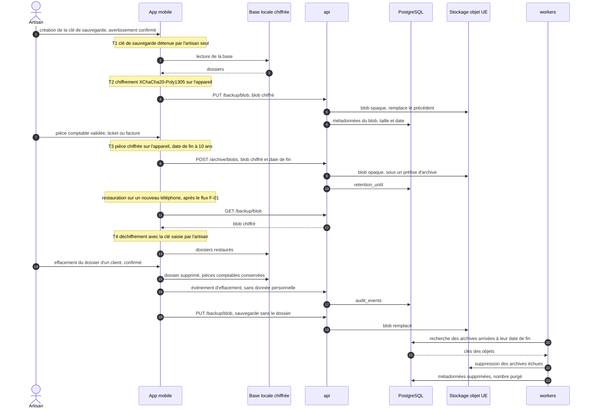

| N°  | Émetteur             | Récepteur            | Données                                         | Format                        | Sens    | Transformation | Sensibilité | Règle      |
| --- | -------------------- | -------------------- | ----------------------------------------------- | ----------------------------- | ------- | -------------- | ----------- | ---------- |
| 1   | Artisan              | App mobile           | Création de la clé, confirmation                | Toucher                       | local   | T1             | aucune      | sans objet |
| 2   | App mobile           | Base locale chiffrée | Lecture de la base                              | Appel local                   | local   | sans objet     | aucune      | sans objet |
| 3   | Base locale chiffrée | App mobile           | Dossiers                                        | Appel local                   | local   | T2             | DP          | R1         |
| 4   | App mobile           | api                  | Blob de sauvegarde                              | HTTPS (`PUT /backup/blob`)    | entrant | T2             | DP chiffrée | R1         |
| 5   | api                  | Stockage objet UE    | Blob opaque                                     | API S3                        | interne | sans objet     | DP chiffrée | R1, R5     |
| 6   | api                  | PostgreSQL           | Table `blobs` : taille, date                    | SQL                           | interne | sans objet     | aucune      | R1         |
| 7   | Artisan              | App mobile           | Pièce comptable validée                         | Toucher                       | local   | T3             | DP          | sans objet |
| 8   | App mobile           | api                  | Blob d'archive, date de fin de conservation     | HTTPS (`POST /archive/blobs`) | entrant | T3             | DP chiffrée | R1         |
| 9   | api                  | Stockage objet UE    | Blob opaque, préfixe d'archive                  | API S3                        | interne | sans objet     | DP chiffrée | R1, R5     |
| 10  | api                  | PostgreSQL           | `retention_until`                               | SQL                           | interne | sans objet     | aucune      | R1         |
| 11  | App mobile           | api                  | Demande de la sauvegarde                        | HTTPS (`GET /backup/blob`)    | entrant | sans objet     | aucune      | sans objet |
| 12  | api                  | App mobile           | Blob de sauvegarde                              | HTTPS                         | sortant | T4             | DP chiffrée | R1         |
| 13  | App mobile           | Base locale chiffrée | Dossiers restaurés                              | Appel local                   | local   | sans objet     | DP chiffrée | R1         |
| 14  | Artisan              | App mobile           | Effacement d'un dossier, confirmation           | Toucher                       | local   | sans objet     | DP          | sans objet |
| 15  | App mobile           | Base locale chiffrée | Suppression du dossier                          | Appel local                   | local   | sans objet     | aucune      | R1         |
| 16  | App mobile           | api                  | Événement d'effacement [H : point d'API absent] | HTTPS, JSON                   | entrant | sans objet     | aucune      | R4         |
| 17  | api                  | PostgreSQL           | `audit_events`, sans donnée personnelle         | SQL                           | interne | sans objet     | aucune      | R4         |
| 18  | App mobile           | api                  | Nouvelle sauvegarde                             | HTTPS (`PUT /backup/blob`)    | entrant | T2             | DP chiffrée | R1         |
| 19  | api                  | Stockage objet UE    | Blob remplacé                                   | API S3                        | interne | sans objet     | DP chiffrée | R1         |
| 20  | workers              | PostgreSQL           | Recherche des archives échues                   | SQL                           | interne | sans objet     | aucune      | sans objet |
| 21  | PostgreSQL           | workers              | Clés des objets                                 | SQL                           | interne | sans objet     | aucune      | sans objet |
| 22  | workers              | Stockage objet UE    | Ordre de suppression                            | API S3                        | interne | sans objet     | aucune      | R1         |
| 23  | workers              | PostgreSQL           | Suppression des métadonnées, comptage           | SQL                           | interne | sans objet     | aucune      | R4         |

**Points de transformation.**

- **T1.** Création de la clé de sauvegarde, détenue par l'artisan seul ; avertissement sur sa
  perte (US-33, critère 3).
- **T2.** Chiffrement de la base en blob XChaCha20-Poly1305 sur l'appareil.
- **T3.** Chiffrement de la pièce sur l'appareil ; date de fin de conservation à 10 ans (Code de
  commerce, article L123-22, cité par US-34).
- **T4.** Déchiffrement sur le nouveau téléphone avec la clé saisie par l'artisan.

La suppression à échéance est faite par le worker (messages 20 à 23), qui lit
`retention_until` objet par objet. Une règle de cycle de vie du stockage objet porte en général sur
un préfixe et un âge, pas sur une date propre à chaque objet [H : à vérifier dans la
documentation du fournisseur retenu, ADR-06] ; elle peut servir de filet de sécurité, par préfixe
d'année de fin.

**Destructions.**

| Élément                       | Où il existe         | Détruit quand                                              | Règle |
| ----------------------------- | -------------------- | ---------------------------------------------------------- | ----- |
| Sauvegarde précédente         | Stockage objet       | À son remplacement [H : sans versionnage de l'objet, P-07] | R1    |
| Archive d'une pièce comptable | Stockage objet       | À sa date de fin de conservation                           | R1    |
| Dossier effacé                | Appareil, sauvegarde | Tout de suite sur l'appareil ; à la sauvegarde suivante    | R1    |

## 13. F-08. Export vers la facturation

**Objet.** Envoyer un dossier validé vers l'outil de facturation de l'artisan, sans passer par le
serveur Muninn. La préparation de devis (US-55), elle, passe par le serveur, en mémoire et sans
donnée nominative (`../architecture-agentique/01-architecture-agentique.md`, section 8.1).
**Stories couvertes.** US-24, US-30 (relance de paiement). US-45 (facturation électronique,
horizon V3 ou V4, D-55) en est la suite : d'ici là, Muninn n'émet aucune facture. Depuis D-53, Muninn prépare des devis (US-55, conception
dans `../architecture-agentique/01-architecture-agentique.md`) ; les factures restent dans
l'outil de l'artisan.
**Déclencheur.** L'artisan touche « Exporter ».

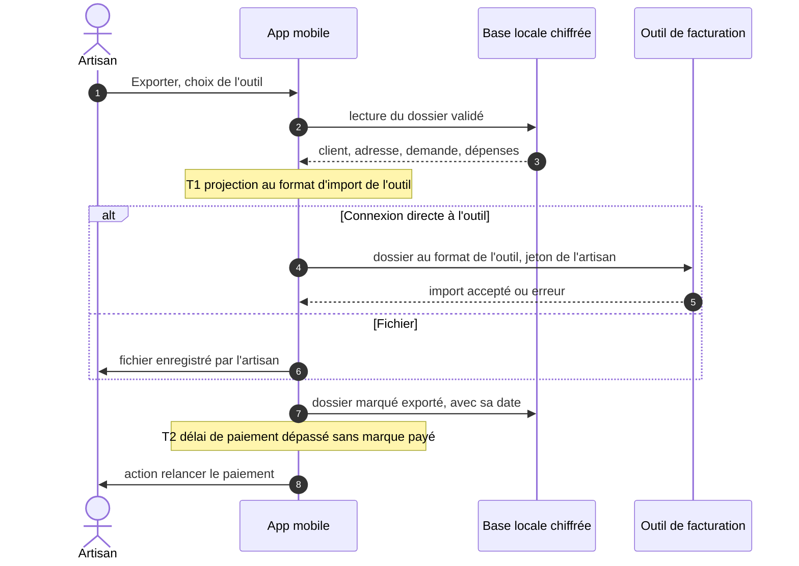

| N°  | Émetteur             | Récepteur            | Données                            | Format                                  | Sens    | Transformation | Sensibilité | Règle      |
| --- | -------------------- | -------------------- | ---------------------------------- | --------------------------------------- | ------- | -------------- | ----------- | ---------- |
| 1   | Artisan              | App mobile           | Choix de l'outil                   | Toucher                                 | local   | sans objet     | aucune      | sans objet |
| 2   | App mobile           | Base locale chiffrée | Lecture du dossier                 | Appel local                             | local   | sans objet     | aucune      | sans objet |
| 3   | Base locale chiffrée | App mobile           | Client, adresse, demande, dépenses | Appel local                             | local   | T1             | DP          | R1         |
| 4   | App mobile           | Outil de facturation | Dossier au format de l'outil       | HTTPS, API de l'outil [H : à confirmer] | externe | T1             | DP          | R1         |
| 5   | Outil de facturation | App mobile           | Accusé ou erreur d'import          | HTTPS, JSON                             | externe | sans objet     | aucune      | sans objet |
| 6   | App mobile           | Artisan              | Fichier d'export                   | Fichier [H : format à confirmer]        | local   | T1             | DP          | R1         |
| 7   | App mobile           | Base locale chiffrée | Marque « exporté », date           | Appel local                             | local   | sans objet     | aucune      | sans objet |
| 8   | App mobile           | Artisan              | Action « relancer le paiement »    | Écran                                   | local   | T2             | DP          | sans objet |

**Points de transformation.**

- **T1.** Projection du dossier au format d'import de l'outil choisi : client, adresse, demande,
  dépenses au minimum (US-24, critère 2).
- **T2.** Ajout d'une action « relancer le paiement » quand le délai fixé par l'artisan est
  dépassé sans marque « payé » (US-30, critère 3).

**Destructions.** Le serveur Muninn ne voit pas l'export, il n'a donc rien à détruire. Le
fichier enregistré par l'artisan relève de son choix.

## 14. F-09. Alimentation des référentiels (pipeline E1)

**Objet.** Collecter les sources publiques, les nettoyer, les rapprocher, les charger dans la
base des référentiels avec une version, et les servir par l'API des référentiels.
**Stories couvertes.** US-46, US-47, US-48, US-49, US-50 ; US-15 (lexique servi à l'extraction) ;
US-43 (lexiques d'autres métiers, V2, même chaîne).
**Déclencheur.** Planification selon la fréquence de chaque source : BAN quotidienne, MAJNUM
après chaque collège de l'ARCEP, codes postaux semestriels, COG et jours fériés annuels, lexique
à la demande de l'exploitant [H : fréquences de rafraîchissement à fixer en phase 1].

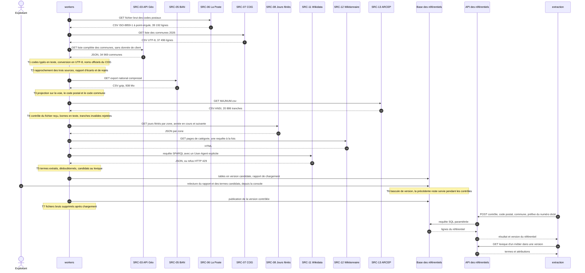

| N°  | Émetteur              | Récepteur             | Données                                            | Format               | Sens    | Transformation | Sensibilité | Règle      |
| --- | --------------------- | --------------------- | -------------------------------------------------- | -------------------- | ------- | -------------- | ----------- | ---------- |
| 1   | workers               | SRC-06                | Requête du fichier brut                            | HTTPS, GET           | sortant | sans objet     | aucune      | sans objet |
| 2   | SRC-06                | workers               | Codes postaux, 39 192 lignes, 5 colonnes           | CSV, ISO-8859-1, `;` | entrant | T1, T2         | aucune      | sans objet |
| 3   | workers               | SRC-07                | Requête de `v_commune_2026.csv`                    | HTTPS, GET           | sortant | sans objet     | aucune      | sans objet |
| 4   | SRC-07                | workers               | COG, 37 496 lignes                                 | CSV, UTF-8, `,`      | entrant | T1, T2         | aucune      | sans objet |
| 5   | workers               | SRC-03                | `GET /communes`, sans paramètre issu d'un appel    | HTTPS, GET           | sortant | sans objet     | aucune      | sans objet |
| 6   | SRC-03                | workers               | 34 969 communes                                    | JSON                 | entrant | T2             | aucune      | sans objet |
| 7   | workers               | SRC-05                | Requête de l'export national                       | HTTPS, GET           | sortant | sans objet     | aucune      | sans objet |
| 8   | SRC-05                | workers               | 26 118 629 adresses, 938 Mo compressé              | CSV, gzip            | entrant | T3             | aucune      | sans objet |
| 9   | workers               | SRC-13                | Requête de `MAJNUM.csv`                            | HTTPS, GET           | sortant | sans objet     | aucune      | sans objet |
| 10  | SRC-13                | workers               | 20 886 tranches                                    | CSV, ANSI, `;`       | entrant | T4             | aucune      | sans objet |
| 11  | workers               | SRC-08                | Zone et année                                      | HTTPS, GET           | sortant | sans objet     | aucune      | sans objet |
| 12  | SRC-08                | workers               | Jours fériés par zone                              | JSON                 | entrant | sans objet     | aucune      | sans objet |
| 13  | workers               | SRC-12                | Pages de catégorie `/wiki/`, une requête à la fois | HTTPS, GET           | sortant | sans objet     | aucune      | sans objet |
| 14  | SRC-12                | workers               | Pages de catégorie                                 | HTML                 | entrant | T5             | aucune      | sans objet |
| 15  | workers               | SRC-11                | Requête SPARQL                                     | HTTPS                | sortant | sans objet     | aucune      | sans objet |
| 16  | SRC-11                | workers               | Marques et alias, ou refus HTTP 429                | JSON                 | entrant | T5             | aucune      | sans objet |
| 17  | workers               | Base des référentiels | Tables candidates, rapport de chargement           | SQL                  | interne | T1 à T5        | aucune      | sans objet |
| 18  | Exploitant            | Base des référentiels | Acceptation des termes et du rapport               | HTTPS, console       | entrant | T5             | aucune      | sans objet |
| 19  | workers               | Base des référentiels | Publication de la version                          | SQL                  | interne | T6             | aucune      | sans objet |
| 20  | extraction            | API des référentiels  | Code postal, commune, préfixe du numéro            | HTTPS, JSON (`POST`) | interne | sans objet     | DP          | R4         |
| 21  | API des référentiels  | Base des référentiels | Requête paramétrée avec ces valeurs                | SQL                  | interne | sans objet     | DP          | R4         |
| 22  | Base des référentiels | API des référentiels  | Lignes du référentiel                              | SQL                  | interne | sans objet     | aucune      | sans objet |
| 23  | API des référentiels  | extraction            | Résultat et version                                | HTTPS, JSON          | interne | sans objet     | aucune      | R4         |
| 24  | extraction            | API des référentiels  | Métier et version                                  | HTTPS, GET           | interne | sans objet     | aucune      | sans objet |
| 25  | API des référentiels  | extraction            | Termes, sources et licences                        | HTTPS, JSON          | interne | sans objet     | aucune      | sans objet |

**Points de transformation.**

- **T1.** Nettoyage : codes postaux et codes communes lus comme texte (« 01400 » garde son zéro) ;
  conversion de l'ISO-8859-1 en UTF-8 ; noms en majuscules sans accents de La Poste remplacés par
  le nom officiel du COG.
- **T2.** Agrégation : rapprochement des trois sources sur le code commune ; rattachement des
  communes déléguées (`COMPARENT`) ; rapport des écarts (34 969 contre 34 875 communes) et des
  lignes rejetées avec leur motif.
- **T3.** Projection de la BAN sur la voie, le code postal et le code commune ; sous-ensemble de
  départements au MVP [H].
- **T4.** Contrôle du fichier reçu (taille, en-tête), et non de la fiche data.gouv.fr dont la
  taille est périmée ; bornes lues comme texte ; rejet des tranches dont la fin précède le début ;
  classement mobile ou fixe [H : règle à confirmer].
- **T5.** Lexique : extraction des titres de pages, dédoublonnage, retrait des termes hors
  dépannage, ajout des termes saisis à la main (dont le chauffage), relecture humaine (message 18),
  attribution par licence.
- **T6.** Versionnage : chaque chargement crée une version candidate ; la bascule est atomique ; la
  version précédente reste servie pendant les contrôles et reste disponible pour un retour arrière
  [H].
- **T7.** Suppression des fichiers bruts téléchargés une fois la version publiée [H].

**Destructions.**

| Élément                          | Où il existe                      | Détruit quand                                                | Règle      |
| -------------------------------- | --------------------------------- | ------------------------------------------------------------ | ---------- |
| Fichiers bruts téléchargés       | Zone de travail des workers       | Après publication de la version (T7) [H]                     | sans objet |
| Valeurs envoyées au contrôle     | Mémoire de l'API des référentiels | À la réponse ; jamais journalisées (P-05)                    | R4         |
| Version de référentiel remplacée | Base des référentiels             | Après la version suivante, gardée pour le retour arrière [H] | sans objet |

Les données de ce flux sont publiques et ne contiennent aucune DP, sauf les valeurs à contrôler
envoyées par l'extraction (messages 20 et 21).

## 15. F-10. Dimensionnement Sirene (big data)

**Objet.** Compter les artisans solo de la tête de pont dans les fichiers stock de Sirene, croiser
avec l'Urssaf, produire un rapport daté.
**Modifié le 12 octobre 2026 (D-27).** Le traitement ne tourne plus sur un poste de calcul : une
tâche planifiée Azure Container Apps dépose les fichiers dans un lac de données ADLS Gen2, les
interroge en SQL avec un moteur en colonnes et écrit les agrégats dans PostgreSQL (schéma
`market`). France Central, groupe de ressources du porteur (document 06 de la phase 1).
**Stories couvertes.** US-52, US-53.
**Déclencheur.** Le porteur lance la tâche sur un nouveau stock mensuel, ou la planification la
lance [H : rythme mensuel, aligné sur la publication des stocks].

Ce flux s'exécute hors du chemin des appels et des dossiers. Le moteur SQL exact relève de
l'architecture technique de la phase 2 (ADR-16).

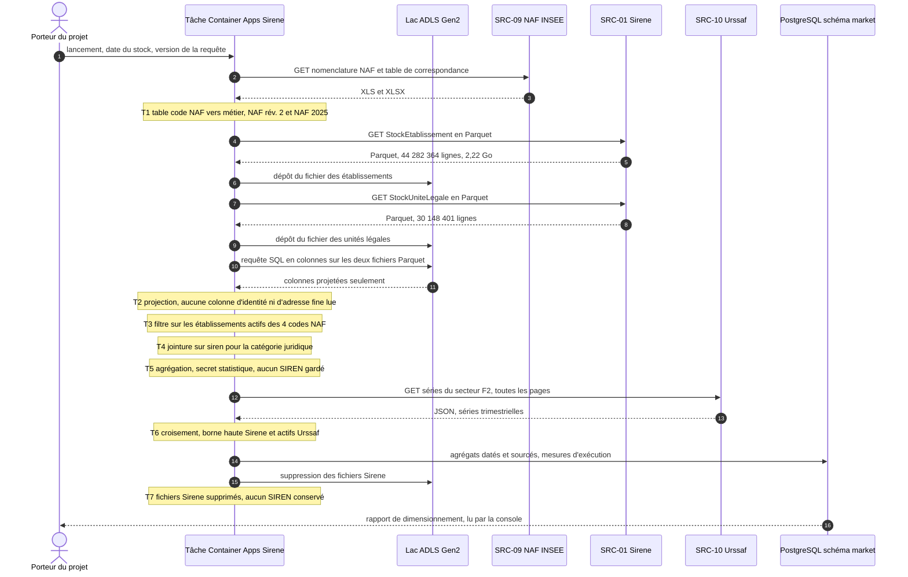

| N°  | Émetteur                    | Récepteur                   | Données                                                                       | Format                          | Sens    | Transformation | Sensibilité | Règle      |
| --- | --------------------------- | --------------------------- | ----------------------------------------------------------------------------- | ------------------------------- | ------- | -------------- | ----------- | ---------- |
| 1   | Porteur du projet           | Tâche Container Apps Sirene | Date du stock, version de la requête                                          | Commande Azure ou planification | entrant | sans objet     | aucune      | R10        |
| 2   | Tâche Container Apps Sirene | SRC-09                      | Requête des fichiers NAF                                                      | HTTPS, GET                      | sortant | sans objet     | aucune      | sans objet |
| 3   | SRC-09                      | Tâche Container Apps Sirene | Nomenclature NAF rév. 2, correspondance NAF 2025                              | XLS, XLSX                       | entrant | T1             | aucune      | sans objet |
| 4   | Tâche Container Apps Sirene | SRC-01                      | Requête du stock des établissements                                           | HTTPS, GET                      | sortant | sans objet     | aucune      | sans objet |
| 5   | SRC-01                      | Tâche Container Apps Sirene | 44 282 364 établissements, 54 colonnes                                        | Parquet                         | entrant | sans objet     | DP          | R4, R9     |
| 6   | Tâche Container Apps Sirene | Lac ADLS Gen2               | Fichier des établissements                                                    | Parquet                         | interne | sans objet     | DP          | R4, R9     |
| 7   | Tâche Container Apps Sirene | SRC-01                      | Requête du stock des unités légales                                           | HTTPS, GET                      | sortant | sans objet     | aucune      | sans objet |
| 8   | SRC-01                      | Tâche Container Apps Sirene | 30 148 401 unités légales, 35 colonnes                                        | Parquet                         | entrant | sans objet     | DP          | R4, R9     |
| 9   | Tâche Container Apps Sirene | Lac ADLS Gen2               | Fichier des unités légales                                                    | Parquet                         | interne | sans objet     | DP          | R4, R9     |
| 10  | Tâche Container Apps Sirene | Lac ADLS Gen2               | Requête SQL : colonnes, filtre, jointure                                      | SQL sur Parquet                 | interne | sans objet     | aucune      | sans objet |
| 11  | Lac ADLS Gen2               | Tâche Container Apps Sirene | Colonnes projetées : activité, tranche, catégorie, lieu, `siren`              | Parquet, lecture en colonnes    | interne | T2 à T5        | DP          | R4, R9     |
| 12  | Tâche Container Apps Sirene | SRC-10                      | Requête des séries du secteur F2                                              | HTTPS, API Explore              | sortant | sans objet     | aucune      | sans objet |
| 13  | SRC-10                      | Tâche Container Apps Sirene | Effectifs administrativement et économiquement actifs                         | JSON                            | entrant | T6             | aucune      | sans objet |
| 14  | Tâche Container Apps Sirene | PostgreSQL                  | Comptages après secret statistique, sources, dates, durée, mémoire, volume lu | SQL (schéma `market`)           | interne | T5, T6         | aucune      | R9         |
| 15  | Tâche Container Apps Sirene | Lac ADLS Gen2               | Suppression des deux fichiers                                                 | API du stockage                 | interne | T7             | aucune      | R9         |
| 16  | PostgreSQL                  | Porteur du projet           | Rapport de dimensionnement                                                    | Console, document               | sortant | sans objet     | aucune      | sans objet |

**Points de transformation.**

- **T1.** Table de référence code NAF vers métier Muninn, en NAF rév. 2 et en NAF 2025 par la
  table de correspondance.
- **T2.** Projection de colonnes : la requête ne lit que les colonnes listées par la fiche
  SRC-01. Le format en colonnes de Parquet permet de ne jamais charger en mémoire les colonnes
  d'identité et d'adresse fine.
- **T3.** Filtre : établissement actif, code NAF de la tête de pont.
- **T4.** Jointure avec les unités légales sur `siren`, pour la catégorie juridique.
- **T5.** Agrégation par code NAF, tranche d'effectif (`NN` distinct de `00`, vides à part),
  catégorie juridique et département ; aucun SIREN n'est gardé. Un croisement fin peut produire
  des cellules de 1 ou 2 entreprises, qui désignent alors une personne : les cellules sous le
  seuil de 5 [H] sont regroupées ou masquées avant l'écriture (document 02 de la phase 1,
  section 4.2).
- **T6.** Croisement avec la série Urssaf F2 : borne haute (Sirene) et estimation des entreprises
  économiquement actives (Urssaf), avec l'écart de périmètre dit.
- **T7.** Suppression des fichiers Sirene du lac à la fin du traitement.

**Destructions.**

| Élément                      | Où il existe                             | Détruit quand                                       | Règle |
| ---------------------------- | ---------------------------------------- | --------------------------------------------------- | ----- |
| Fichiers stock Sirene        | Lac ADLS Gen2                            | Après l'agrégation (T7), au plus tard sous 24 h [H] | R9    |
| Fichiers en transit          | Mémoire ou disque temporaire de la tâche | À la fin du dépôt dans le lac                       | R9    |
| Lignes filtrées non agrégées | Mémoire du moteur                        | À la fin de la requête                              | R4    |

Les messages 5, 6, 8, 9 et 11 transportent des DP : les fichiers Sirene contiennent les noms et
adresses des entrepreneurs individuels. La projection T2 évite de les lire, pas de les déposer.
Une lecture distante par requêtes partielles (en-tête `Range`), déjà utilisée pour mesurer les
fichiers dans le document 03, éviterait aussi le dépôt de ces colonnes [H : performance à mesurer].

## 16. F-11. Évaluation, monitoring et livraison (exploitant)

**Objet.** Construire le jeu synthétique, évaluer une version candidate, bloquer ou livrer, suivre
la qualité en production, purger, revenir en arrière.
**Stories couvertes.** US-36 à US-41 ; US-15 (évaluation avec et sans lexique) ; US-43
(évaluation d'un nouveau lexique avant service).
**Déclencheur.** Modification du prompt, du schéma, du lexique ou du modèle ; trafic de
production ; planification des purges ; régression constatée.

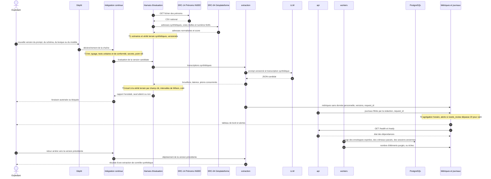

| N°  | Émetteur              | Récepteur             | Données                                                                    | Format             | Sens    | Transformation | Sensibilité | Règle       |
| --- | --------------------- | --------------------- | -------------------------------------------------------------------------- | ------------------ | ------- | -------------- | ----------- | ----------- |
| 1   | Harnais d'évaluation  | SRC-14                | Requête du fichier des prénoms                                             | HTTPS, GET         | externe | sans objet     | aucune      | sans objet  |
| 2   | SRC-14                | Harnais d'évaluation  | Prénoms et effectifs arrondis                                              | CSV                | externe | T1             | aucune      | R9          |
| 3   | Harnais d'évaluation  | SRC-04                | Adresses synthétiques (voie réelle, numéro inexistant)                     | HTTPS, GET         | externe | sans objet     | aucune      | R9          |
| 4   | SRC-04                | Harnais d'évaluation  | Adresses normalisées, score                                                | JSON               | externe | T1             | aucune      | R9          |
| 5   | Exploitant            | Dépôt                 | Nouvelle version (prompt, schéma, lexique, modèle)                         | Git                | externe | sans objet     | aucune      | R8, R9      |
| 6   | Dépôt                 | Intégration continue  | Déclenchement                                                              | Webhook            | externe | sans objet     | aucune      | sans objet  |
| 7   | Intégration continue  | Harnais d'évaluation  | Lancement de l'évaluation                                                  | Commande           | externe | T2             | aucune      | R8          |
| 8   | Harnais d'évaluation  | extraction            | Transcriptions synthétiques                                                | Appel interne      | externe | sans objet     | aucune      | R9          |
| 9   | extraction            | LLM                   | Prompt versionné, transcription synthétique                                | API du fournisseur | sortant | sans objet     | aucune      | R5, R9, R10 |
| 10  | LLM                   | extraction            | JSON candidat                                                              | JSON               | entrant | sans objet     | aucune      | R5          |
| 11  | extraction            | Harnais d'évaluation  | Brouillons, latence, jetons                                                | JSON               | externe | T3             | aucune      | R9          |
| 12  | Harnais d'évaluation  | Intégration continue  | Rapport horodaté, versions, seuil                                          | Markdown           | externe | T3             | aucune      | R9          |
| 13  | Intégration continue  | Exploitant            | Livraison autorisée ou bloquée                                             | Interface de la CI | externe | sans objet     | aucune      | sans objet  |
| 14  | extraction            | Métriques et journaux | Statuts, `needs_review`, latences, coûts, versions, `request_id`           | Métriques          | interne | T4             | aucune      | R4          |
| 15  | api                   | Métriques et journaux | Journaux après filtre de redaction, `request_id`                           | Lignes JSON        | interne | T4             | aucune      | R4          |
| 16  | Métriques et journaux | Exploitant            | Tableau de bord et alertes                                                 | HTTPS              | sortant | sans objet     | aucune      | R4          |
| 17  | Métriques et journaux | api                   | `GET /health`, `GET /ready`                                                | HTTPS              | interne | sans objet     | aucune      | sans objet  |
| 18  | api                   | Métriques et journaux | État des dépendances                                                       | HTTPS, JSON        | interne | sans objet     | aucune      | sans objet  |
| 19  | workers               | PostgreSQL            | Purge des enveloppes, des créneaux et des sessions de plus de 90 jours [H] | SQL                | interne | sans objet     | aucune      | R1, R4      |
| 20  | workers               | Métriques et journaux | Nombre d'éléments purgés, échec éventuel                                   | Métriques          | interne | sans objet     | aucune      | R4          |
| 21  | Exploitant            | Intégration continue  | Retour arrière                                                             | Interface de la CI | externe | sans objet     | aucune      | sans objet  |
| 22  | Intégration continue  | extraction            | Version précédente                                                         | Image de conteneur | entrant | sans objet     | aucune      | R8          |
| 23  | extraction            | Exploitant            | Résultat d'une extraction de contrôle                                      | Rapport            | sortant | sans objet     | aucune      | R9          |

**Points de transformation.**

- **T1.** Génération des scénarios : prénoms tirés selon leur fréquence (SRC-14), noms fictifs,
  voies réelles avec des numéros de rue supérieurs au plus grand numéro de la voie dans la BAN,
  pour qu'aucune adresse réelle ne soit désignée [H]. La Géoplateforme ne reçoit que ces adresses.
  Les numéros de téléphone sont pris dans une plage fictive, absente des tranches attribuées
  [H : plage à identifier]. Conséquence pour US-51 : un numéro hors tranches est marqué « à
  vérifier ». La version de test du référentiel de numérotation déclare donc cette plage fictive
  comme valide, faute de quoi le champ `telephone` serait toujours « à vérifier » dans la démo et
  dans l'évaluation. Cette version de test n'est jamais servie en production.
- **T2.** Contrôles de la chaîne : lint, typage, tests unitaires, tests de conformité (audio
  détruit, journaux propres, pas de clair en base, ouverture de l'agent, refus médical),
  recherche de secrets, fournisseur d'IA sur un point UE (US-40, critère 4).
- **T3.** Comparaison à la vérité terrain après normalisation ; exactitude par champ clé et
  globale ; intervalle de Wilson à 95 % ; latence p50 et p95 ; coût par appel (US-37).
- **T4.** Filtre de redaction des journaux (R4) ; agrégation horaire ; seuil d'alerte sur
  `needs_review` [H : 20 % sur une heure, 20 extractions au moins] (US-38).

**Destructions.**

| Élément               | Où il existe          | Détruit quand                                | Règle |
| --------------------- | --------------------- | -------------------------------------------- | ----- |
| Enveloppes expirées   | PostgreSQL            | Purge planifiée, après 7 jours               | R1    |
| Sessions d'appel      | PostgreSQL            | Après 90 jours [H : à valider dans l'AIPD]   | R4    |
| Journaux et métriques | Métriques et journaux | Fin de la rétention [H : à fixer en phase 1] | R4    |

Les rapports d'évaluation sont versionnés : ils ne contiennent que des données synthétiques
(R9). Les métriques de production viennent du trafic réel, mais ne portent aucun contenu.

## 17. F-12. Démo du 29 octobre, version simulée

**Modifié le 12 octobre 2026 (phase 1, X-05).** L'api tient le rôle d'appelant de l'extraction
que tient voice-gateway dans F-02 : elle reçoit le brouillon et écrit le statut d'extraction
(`app.extraction_runs`) ; les corrections vont dans `app.field_corrections`, lieu fixé en phase 1.
**Objet.** Montrer en une chaîne : un appel simulé, l'extraction réelle, le contrôle par les
référentiels chargés par le pipeline E1, l'affichage, la validation et le monitoring.
**Stories couvertes.** US-11, US-17, US-31, US-36, US-37, US-38, US-39, US-40, US-46, US-47,
US-50, US-51 (périmètre de démo de la section 8 du document 01).
**Déclencheur.** L'exploitant lance un scénario depuis la console.

Différences avec F-02 : pas d'agent vocal, pas d'audio, pas de téléphonie réelle. Le simulateur
fournit une transcription écrite. La console joue le rôle de l'appareil : pas d'enveloppe
chiffrée, le relais étant prévu pour l'oral du 12 novembre. Les données sont synthétiques. Les
échanges sont pourtant marqués « DP » comme en production : le code qui les traite est le même.

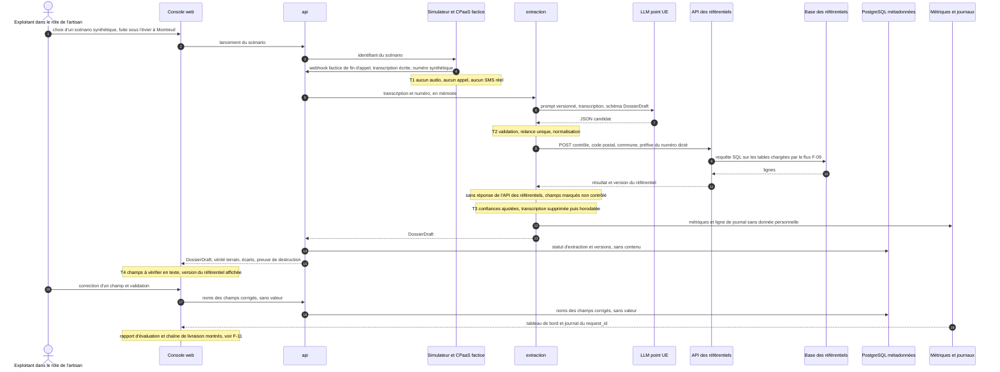

| N°  | Émetteur                    | Récepteur                   | Données                                                               | Format                   | Sens    | Transformation | Sensibilité | Règle           |
| --- | --------------------------- | --------------------------- | --------------------------------------------------------------------- | ------------------------ | ------- | -------------- | ----------- | --------------- |
| 1   | Exploitant                  | Console web                 | Choix du scénario                                                     | Clic                     | local   | sans objet     | aucune      | R9              |
| 2   | Console web                 | api                         | Lancement du scénario                                                 | HTTPS, JSON              | entrant | sans objet     | aucune      | sans objet      |
| 3   | api                         | Simulateur et CPaaS factice | Identifiant du scénario                                               | Appel interne            | interne | sans objet     | aucune      | R10             |
| 4   | Simulateur et CPaaS factice | api                         | Fin d'appel factice, transcription écrite, numéro synthétique         | HTTPS, JSON              | interne | T1             | DP          | R2, R3, R9, R10 |
| 5   | api                         | extraction                  | Transcription et numéro                                               | Appel interne en mémoire | interne | sans objet     | DP          | R3              |
| 6   | extraction                  | LLM point UE                | Prompt versionné, transcription, schéma                               | API du fournisseur       | sortant | sans objet     | DP          | R5, R7, R10     |
| 7   | LLM point UE                | extraction                  | JSON candidat                                                         | JSON                     | entrant | T2             | DP          | R5, R7          |
| 8   | extraction                  | API des référentiels        | Code postal, commune, préfixe du numéro                               | HTTPS, JSON (`POST`)     | interne | sans objet     | DP          | R4              |
| 9   | API des référentiels        | Base des référentiels       | Requête paramétrée                                                    | SQL                      | interne | sans objet     | DP          | R4              |
| 10  | Base des référentiels       | API des référentiels        | Lignes                                                                | SQL                      | interne | sans objet     | aucune      | sans objet      |
| 11  | API des référentiels        | extraction                  | Résultat et version                                                   | HTTPS, JSON              | interne | T3             | aucune      | R4              |
| 12  | extraction                  | Métriques et journaux       | Métriques et journal sans DP                                          | Métriques, lignes JSON   | interne | sans objet     | aucune      | R4              |
| 13  | extraction                  | api                         | `DossierDraft`                                                        | Appel interne en mémoire | interne | T3             | DP          | R3              |
| 14  | api                         | PostgreSQL métadonnées      | Statut d'extraction et versions, sans contenu (`app.extraction_runs`) | SQL                      | interne | sans objet     | aucune      | R1, R4          |
| 15  | api                         | Console web                 | Brouillon, vérité terrain, écarts, preuve de destruction              | HTTPS, JSON              | sortant | T4             | DP          | R1 (écart P-03) |
| 16  | Exploitant                  | Console web                 | Correction et validation                                              | Clavier                  | local   | sans objet     | DP          | sans objet      |
| 17  | Console web                 | api                         | Noms des champs corrigés                                              | HTTPS, JSON              | entrant | sans objet     | aucune      | R4              |
| 18  | api                         | PostgreSQL métadonnées      | Noms des champs corrigés (`app.field_corrections`)                    | SQL                      | interne | sans objet     | aucune      | R4              |
| 19  | Métriques et journaux       | Console web                 | Tableau de bord, journal du `request_id`                              | HTTPS                    | sortant | sans objet     | aucune      | R4              |

**Points de transformation.**

- **T1.** Le simulateur remplace l'appel : il produit la fin d'appel et une transcription écrite
  du scénario (US-36). Aucun numéro acheté, aucun appel ni SMS réel (R10).
- **T2.** Validation par le schéma, une relance, normalisation (comme F-02, T5 et T6).
- **T3.** Contrôle par les référentiels (US-51) ; destruction de la transcription ; horodatage de
  destruction (US-31).
- **T4.** Affichage des champs « à vérifier » en texte (document 04, EXA-02) et de la version du
  référentiel ; calcul des écarts à la vérité terrain.

**Destructions.**

| Élément                 | Où il existe                        | Détruit quand                                          | Règle |
| ----------------------- | ----------------------------------- | ------------------------------------------------------ | ----- |
| Audio                   | N'existe pas dans la démo           | sans objet                                             | R2    |
| Transcription           | Mémoire de l'api et de l'extraction | À la fin de l'extraction                               | R3    |
| `DossierDraft` en clair | Mémoire de l'api ; navigateur       | À l'envoi de la réponse ; à la fermeture de la console | R1    |

La destruction de l'audio n'est pas montrée : elle repose sur le test de conformité (document 01,
section 8.4).

## 18. Traçabilité des stories

Chaque story est rattachée à au moins un flux. Une story de frontière (hors MVP) est rattachée au
flux dont elle trace la limite.

| Story | Titre court                              | Flux                           | Remarque                                      |
| ----- | ---------------------------------------- | ------------------------------ | --------------------------------------------- |
| US-01 | Compte et téléphone liés par code        | F-01                           | Messages 1 à 10                               |
| US-02 | Réglage de la ligne Muninn               | F-01                           | Messages 11 à 17                              |
| US-03 | Codes de renvoi par opérateur            | F-01                           | Messages 18 à 21                              |
| US-04 | Appel de test du renvoi                  | F-01                           | Messages 22 à 30                              |
| US-05 | Disponibilités partagées sans détail     | F-06                           | Messages 1 à 4                                |
| US-06 | Annonce de l'assistant automatique       | F-02                           | Messages 11 à 13                              |
| US-07 | Demande exposée et reformulée            | F-02                           | Boucle, messages 14 à 21                      |
| US-08 | Créneau proposé ou rappel annoncé        | F-02, F-06                     | F-02 message 22 ; F-06 messages 5 à 9         |
| US-09 | Consigne de sécurité en cas de danger    | F-02                           | Arrêt anticipé de la boucle                   |
| US-10 | Refus de l'assistant                     | F-02                           | Arrêt anticipé de la boucle                   |
| US-11 | Brouillon de dossier extrait de l'appel  | F-02, F-12                     | F-02 messages 24 à 30                         |
| US-12 | Notification et dossier chiffré          | F-02                           | Messages 32 à 40                              |
| US-13 | Débrief vocal                            | F-03                           | Messages 2 à 14                               |
| US-14 | Invitation au débrief                    | F-03                           | Message 1                                     |
| US-15 | Lexique métier                           | F-02, F-03, F-09, F-11         | Servi par F-09, évalué par F-11               |
| US-16 | Lexique personnel                        | F-03                           | Messages 3, 7 ; T6                            |
| US-17 | Validation en un geste                   | F-02, F-03, F-12               | F-02 messages 41 à 44                         |
| US-18 | Recherche par clé humaine                | F-04                           | Messages 1 à 9                                |
| US-19 | Désambiguïsation par une question        | F-04                           | Messages 10 et 11                             |
| US-20 | Rattachement d'un client connu           | F-02                           | T9, sur l'appareil                            |
| US-21 | Ticket photographié en dépense           | F-05                           | Messages 1 à 7                                |
| US-22 | Dépense dictée                           | F-05                           | Messages 8 à 16                               |
| US-23 | Marge par chantier                       | F-05                           | Messages 17 à 21                              |
| US-24 | Export vers l'outil de facturation       | F-08                           | Messages 1 à 7                                |
| US-25 | Import des factures électroniques        | F-05                           | V2, messages 22 à 24                          |
| US-26 | Rendez-vous de l'assistant dans l'agenda | F-06                           | Messages 9 et 10                              |
| US-27 | Rappels de rendez-vous par SMS           | F-06                           | Messages 11 à 17                              |
| US-28 | Imprévu géré en un geste                 | F-06                           | Messages 18 à 28                              |
| US-29 | SMS clair au client                      | F-06                           | Message 25 ; T7                               |
| US-30 | Liste des actions à faire                | F-04, F-08                     | F-04 messages 12 à 14 ; F-08 message 8        |
| US-31 | Preuve de destruction                    | F-02, F-12                     | F-02 T7 et message 41                         |
| US-32 | Dossiers chiffrés sur le téléphone       | F-04, F-07                     | Base locale chiffrée                          |
| US-33 | Sauvegarde avec sa propre clé            | F-07                           | Messages 1 à 6 et 11 à 13                     |
| US-34 | Archive légale de 10 ans                 | F-07                           | Messages 7 à 10 et 20 à 23                    |
| US-35 | Suppression à la demande du client       | F-07                           | Messages 14 à 19                              |
| US-36 | Simulateur d'appel de bout en bout       | F-11, F-12                     | F-12 messages 1 à 4                           |
| US-37 | Évaluation de l'extraction               | F-11, F-12                     | F-11 messages 1 à 13                          |
| US-38 | Tableau de bord et alertes de qualité    | F-11, F-12                     | F-11 messages 14 à 16                         |
| US-39 | Journaux sans donnée personnelle         | F-11, F-12                     | F-11 message 15                               |
| US-40 | Livraison contrôlée et retour arrière    | F-11, F-12                     | F-11 messages 5 à 13 et 21 à 23               |
| US-41 | Disponibilité et purges                  | F-11                           | Messages 17 à 20                              |
| US-42 | Numéro professionnel complet             | F-02                           | Frontière V2 : enregistrement contraire à R2  |
| US-43 | Lexiques d'autres métiers                | F-09, F-11                     | V2, même chaîne que US-48                     |
| US-44 | Écoute des appels natifs                 | F-03                           | Frontière : seule la fin d'appel est détectée |
| US-45 | Factures électroniques (D-55)            | F-08                           | Suite de l'export, horizon V3 ou V4           |
| US-55 | Préparation d'un devis (D-53)            | non disponible (flux à écrire) | `architecture-agentique/01`, section 8        |
| US-46 | Référentiels géographiques               | F-09, F-12                     | F-09 messages 1 à 8                           |
| US-47 | Référentiel de numérotation              | F-09, F-12                     | F-09 messages 9 et 10                         |
| US-48 | Lexique métier constitué et versionné    | F-09                           | Messages 13 à 19                              |
| US-49 | Jours fériés exclus des créneaux         | F-06, F-09                     | F-09 messages 11 et 12 ; F-06 messages 7 à 9  |
| US-50 | API REST des référentiels                | F-09, F-12                     | F-09 messages 20 à 25                         |
| US-51 | Contrôle des champs par les référentiels | F-02, F-03, F-12               | F-02 messages 27 et 28                        |
| US-52 | Dimensionnement Sirene                   | F-10                           | Messages 1 à 11, 14 à 16                      |
| US-53 | Croisement avec l'Urssaf                 | F-10                           | Messages 2, 3, 12 à 14 et 16                  |
| US-54 | Révocation d'un appareil                 | F-01                           | Messages 31 à 34                              |

Contrôle : 54 stories, 54 lignes, aucune sans flux.

## 19. Conflits, écarts et points à trancher

Ces points ont été relevés en construisant les flux. Aucun n'a été contourné : chacun appelle une
décision ou une précision en phase 1 ou 2.

| ID   | Point                                                                                                                                                                                                                                                                                                                                                                                                      | Règle      | Proposition                                                                                                                                                     |
| ---- | ---------------------------------------------------------------------------------------------------------------------------------------------------------------------------------------------------------------------------------------------------------------------------------------------------------------------------------------------------------------------------------------------------------- | ---------- | --------------------------------------------------------------------------------------------------------------------------------------------------------------- |
| P-01 | La passation prévoit Redis et des tâches arq pour l'extraction. Si la transcription, le brouillon ou le texte et le numéro d'un SMS (envoi en tâche arq, passation section 14) transitent par une file Redis, ils peuvent être écrits sur disque (persistance de Redis)                                                                                                                                    | R1, R3     | Décidé : D-11. Passer la transcription par appel direct en mémoire ; la file ne porte que des identifiants opaques. Sinon, désactiver la persistance et le dire |
| P-02 | ADR-07 : le lexique personnel téléversé chiffré, « que seul le processus d'extraction déchiffre », suppose une clé détenue par le serveur. Le lexique personnel contient des noms de clients                                                                                                                                                                                                               | R1         | Décidé : D-12. Ne pas retenir cette option sans décision explicite du porteur. Les flux ci-dessus n'utilisent pas de lexique personnel pendant l'appel          |
| P-03 | Démo : la console reçoit le brouillon en clair dans la réponse HTTPS, sans enveloppe chiffrée                                                                                                                                                                                                                                                                                                              | R1         | Écart assumé pour le 29 octobre (données synthétiques, rien de stocké). Le relais chiffré (US-12) est prévu pour le 12 novembre. À dire au jury                 |
| P-04 | `POST /sms` : le serveur et le fournisseur SMS lisent le texte et le numéro du client. R1 n'est pas enfreinte (rien n'est stocké), mais la donnée sort en clair vers un tiers. Lecture retenue de R5 : hébergement et traitement dans l'UE pour tous, zéro rétention pour les fournisseurs d'IA                                                                                                            | R1, R5     | Inscrire le fournisseur SMS dans le registre et l'AIPD ; exiger un fournisseur qui traite dans l'UE (ADR-05)                                                    |
| P-05 | Les valeurs contrôlées par l'API des référentiels (code postal, commune, préfixe) peuvent fuir par les journaux d'accès, du proxy ou des requêtes SQL de la base                                                                                                                                                                                                                                           | R4         | Valeurs dans le corps d'un `POST`, jamais dans l'URL ; journal des requêtes SQL désactivé sur ces tables ; test de conformité (US-50, critère 3)                |
| P-06 | Un outil de suivi d'erreurs qui capture les variables locales ou les corps de requête copierait une transcription ou un brouillon hors de la zone éphémère                                                                                                                                                                                                                                                 | R1, R3, R4 | Interdire la capture des variables locales et des corps ; test de conformité avec une exception provoquée pendant l'extraction (US-31, critère 2)               |
| P-07 | Sauvegarde : si le stockage objet garde les versions précédentes d'un objet, un dossier effacé (US-35) survit dans l'ancienne sauvegarde                                                                                                                                                                                                                                                                   | R1         | Décidé : D-13. Désactiver le versionnage du compartiment des sauvegardes, ou fixer une expiration courte des versions ; à décider avec ADR-06                   |
| P-08 | Archive : elle est chiffrée par une clé de l'artisan. Si la clé est perdue, les pièces deviennent illisibles avant 10 ans, alors que la conservation est une obligation légale                                                                                                                                                                                                                             | R1         | Décidé : D-14. Dire ce risque à l'artisan à la création de la clé (US-33). Toute clé de secours tenue par Muninn contredirait R1 : décision du porteur          |
| P-09 | Points d'API absents de la passation, utilisés ici : extraction à partir de texte, transcription d'une recherche dite, compteurs de correction, fenêtre de test du renvoi et son statut, recherche par SIREN, paramètre `métier` de `POST /debrief`, événement d'effacement, API des référentiels. Tables absentes du modèle de la passation : code de connexion, fenêtre de test, compteurs de correction | aucune     | Les ajouter au contrat OpenAPI en phase 2                                                                                                                       |
| P-10 | Contrat `DossierDraft` 1.0 : pas de champ pour les horodatages de destruction (US-31) ni pour le résultat du contrôle par champ (US-51)                                                                                                                                                                                                                                                                    | aucune     | Décidé (D-24) : contrat 1.1, spécifié par le contrat d'API de la phase 2 (section 3) : `draft_id`, `destruction`, `checks` par champ                            |
| P-11 | Jours fériés : la zone dépend du département de l'artisan, et l'artisan peut déclarer travailler un jour férié (US-49, critère 4). Aucun de ces deux réglages n'est dans la configuration de ligne de la passation                                                                                                                                                                                         | aucune     | Ajouter à `PUT /lines/me` un champ « zone » et la liste des jours fériés travaillés                                                                             |
| P-12 | Identifiant de connexion de l'artisan (numéro ou e-mail) : la table `accounts` de la passation n'a pas de colonne pour le garder                                                                                                                                                                                                                                                                           | R4         | Décidé (D-26) : empreinte seulement, aucune copie lisible ; l'artisan est joint par notification ou par le prestataire de paiement                              |
| P-13 | CPaaS : le fournisseur garde ses propres journaux d'appel (numéros, durées) et peut enregistrer l'audio si l'option est active                                                                                                                                                                                                                                                                             | R2, R4     | Vérifier que l'enregistrement est désactivé et lire la durée de conservation de ses journaux (ADR-02)                                                           |
| P-14 | Import des factures électroniques (US-25, V2) : si la plateforme agréée pousse les factures vers le serveur, celui-ci les voit en clair                                                                                                                                                                                                                                                                    | R1         | Récupération directe par l'appareil (F-05, messages 22 et 23), à confirmer avec le partenaire                                                                   |
| P-15 | Export par API vers l'outil de facturation : certains éditeurs exigent un secret client côté serveur pour l'autorisation                                                                                                                                                                                                                                                                                   | R1         | Si un relais serveur devient nécessaire, il ne doit porter que l'autorisation, jamais le dossier [H : API des éditeurs non lues]                                |
| P-16 | Préremplissage par SIREN (SRC-02) : prévu par le document 03, porté par aucune story                                                                                                                                                                                                                                                                                                                       | aucune     | Le garder en option dans F-01 ou écrire une story avant le lot 3                                                                                                |
| P-17 | Imprévu dit (US-28) : la passation ne dit pas où la phrase est transcrite et interprétée                                                                                                                                                                                                                                                                                                                   | R3         | Transcription par le chemin de la recherche dite, interprétation sur l'appareil (F-06, T6)                                                                      |
| P-18 | Sirene : le téléchargement des fichiers stock amène sur le poste des colonnes nominatives, même si elles ne sont jamais lues                                                                                                                                                                                                                                                                               | R9         | Fichiers hors dépôt et supprimés après traitement ; tester la lecture distante par requêtes partielles                                                          |

## 20. Décisions attendues du porteur

1. **Regroupement en flux.** Valider le choix de 12 flux et de la table de traçabilité, au lieu
   d'un schéma par story.
2. **API des référentiels.** Valider son ajout à l'architecture, interne, et le contrôle du
   numéro par son seul préfixe.
3. **Démo du 29 octobre.** Valider l'ajout du contrôle par les référentiels (document 01,
   section 8 : 2 jours de plus, dont 1,5 jour déjà dû à E1) et l'écart P-03.
4. **P-01, P-02, P-07, P-08.** Ces quatre points touchent R1 ou R3 et engagent un choix de
   conception (file, clé, stockage) : ils demandent une décision avant la phase 2. Les autres
   points qui touchent une règle (P-03 à P-06, P-13 à P-15) se règlent par un test, une mention
   dans l'AIPD ou une vérification chez un fournisseur, sans changer l'architecture.
