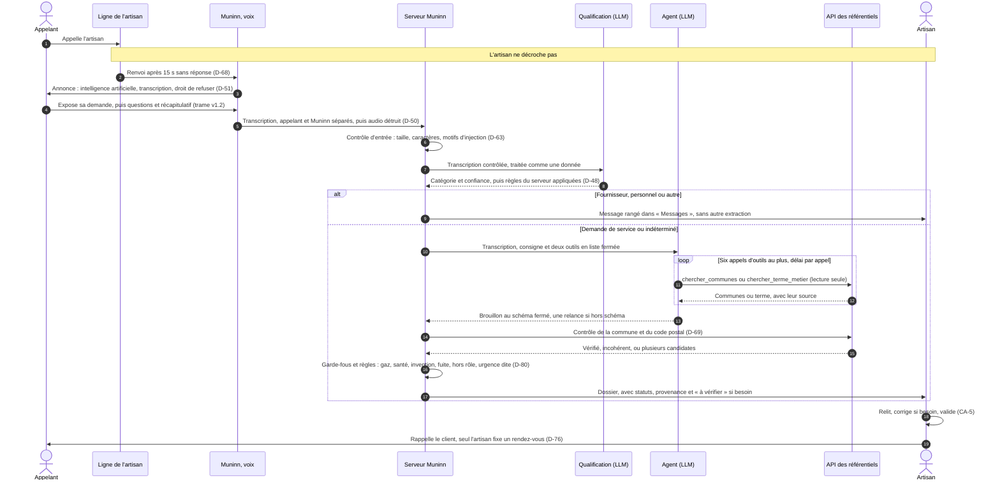
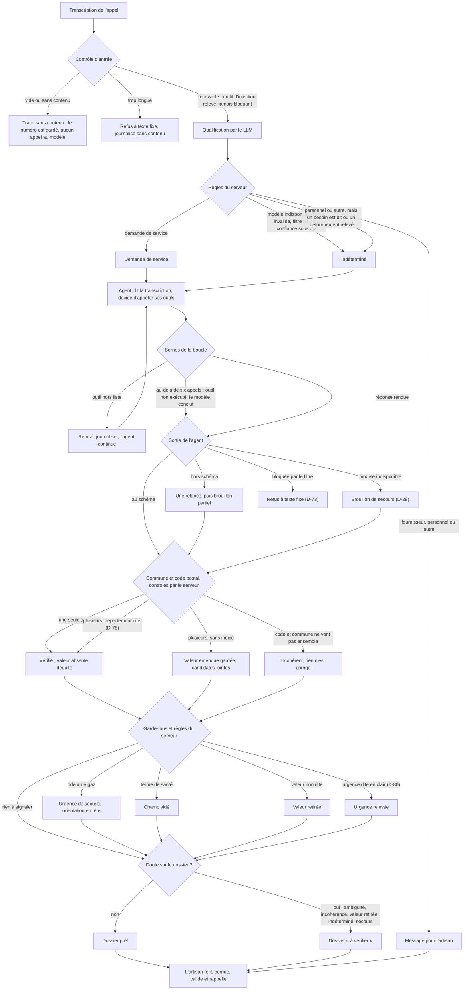

# Muninn V1 : le workflow d'un appel

**Statut :** complément au dossier de conception V1, établi le 22 octobre 2026, après coup. Le
sprint 1 a produit le schéma d'architecture (§ 5.1) et le schéma de pilotage (§ 5.2) ; il n'a pas
schématisé le déroulé d'un appel. Ce document le fait, sans modifier le dossier gelé. Il montre le
workflow tel qu'il est conçu et livré au 22 octobre 2026, décisions postérieures au sprint 1
comprises (D-69, D-73, D-77, D-78, D-80).

Code de référence : `src/muninn/qualification/qualificateur.py` (`traiter_appel`),
`src/muninn/extraction/agent.py` (boucle), `src/muninn/extraction/evaluateur.py` (contrôles et
garde-fous).

**Ce que couvre la V1.**

| Partie                                                         | État au 22 octobre 2026                   |
| -------------------------------------------------------------- | ----------------------------------------- |
| Renvoi d'appel après 15 s sans réponse (D-68)                  | Hors V1 : simulé dans la console (R10)    |
| Conversation à deux voix, puis transcription (D-50)            | Sprint 5 (V-12) ; dialogue écrit d'ici là |
| Contrôle d'entrée, qualification, agent, contrôles, garde-fous | Livré au sprint 4, en production          |
| Dossier ou message affiché dans la console                     | Livré au sprint 4 (écran « Agent »)       |
| Correction et validation par l'artisan (CA-5)                  | Sprint 5 (V-09)                           |

## 1. Le déroulé d'un appel

Qui fait quoi, dans l'ordre. Les traits pleins sont des appels, les traits pointillés des réponses.
Rendus : `diagrammes/conception-workflow/svg/1-le-deroule-d-un-appel.svg` et `png/`.

## 2. Les décisions en route

Chaque losange est une décision prise par une règle écrite dans le code, sauf la boucle de
l'agent, où le modèle décide lui-même d'appeler un outil, dans les bornes fixées par le serveur.
Rendus : `diagrammes/conception-workflow/svg/2-les-decisions-en-route.svg` et `png/`.

## 3. Ce que les schémas ne montrent pas

- **Ce qui est journalisé.** À chaque étape, un événement sans contenu : le code du garde-fou, le
  `request_id`, la durée, le coût. La transcription est détruite après l'extraction
  (`production.md`, § 5).
- **Les seuils.** Le seuil de confiance de 0,7 est une hypothèse [H], non calibrée ; les autres
  bornes (six appels d'outils, délai par appel, une relance) viennent du paquet d'extraction
  versionné.
- **Le « à vérifier ».** Un dossier est « à vérifier » dès qu'un motif est levé ou qu'un champ clé
  présent reste incertain ; la liste exacte des motifs est dans `evaluateur.py` (`Motif`).
