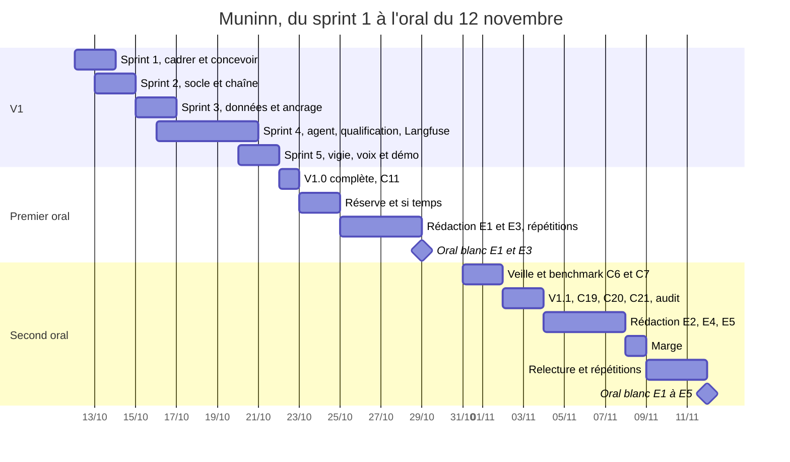

# Feuille de route V1

**Version :** 1.2
**Date :** 14 octobre 2026 (v1.5 du dossier V1 : D-48 à D-51 ; nouvelles dates selon D-52, validée par le porteur)
**Objet :** le chemin du sprint 1 jusqu'à l'oral du 12 novembre, taillé sur la V1 (six jours de
développement, 7,75 depuis la v1.5 du dossier) et sur la couverture des 21 compétences (`couverture-competences.md`).

À sa validation, elle remplace le calendrier de `docs/roadmap.md` (v2.2) pour la période du 12
octobre au 13 novembre ; celui-ci reste comme historique (D-36).

**Après le 13 novembre**, cette feuille de route s'arrête : le projet reprend la feuille de route
du produit (`docs/roadmap.md`) et la conception des phases 0 à 2, sans les découpes de la V1
(D-42).

## 1. Jalons et portes

Une porte est un contrôle qui conditionne la suite : tant qu'elle n'est pas franchie, l'étape
suivante ne démarre pas.

| Porte | Date                    | Condition pour la franchir                                                                                                                                                      | Qui décide         |
| ----- | ----------------------- | ------------------------------------------------------------------------------------------------------------------------------------------------------------------------------- | ------------------ |
| P0    | mar. 13 octobre         | Dossier de conception V1 validé par le porteur, puis par le formateur ; aucune ligne de code avant                                                                              | Formateur, porteur |
| P1    | mer. 14 octobre au soir | Sprint 2 tenu ; sinon, périmètre revu par décision écrite avant le sprint 3. Franchie : sprint 2 livré les 13 et 14 octobre, avec le déploiement automatisé et la préproduction | Porteur            |
| P2    | ven. 16 octobre         | Modèle LLM choisi et clés fournies. Franchie : modèles choisis le 13 octobre (D-44 à D-46), appel sans clé par identité managée                                                 | Porteur            |
| P3    | mer. 21 octobre au soir | V1 terminée : CA-1 à CA-8 vérifiés sur Azure, 3 exécutions sur 3                                                                                                                | Porteur            |
| P4    | jeu. 22 octobre au soir | V1.0 complète : outillage de monitoring (C11) ; le déploiement automatisé (C13) est livré depuis le sprint 2                                                                    | Porteur            |
| P5    | mer. 28 octobre, 18 h   | Gel : E1 et E3 rédigés en Word, démo répétée trois fois, plan B prêt                                                                                                            | Porteur            |
| P6    | mer. 11 novembre, 18 h  | Gel : E1 à E5 rédigés, retours du premier oral intégrés, répétition des 90 minutes faite                                                                                        | Porteur            |

## 2. Calendrier

| Période                              | Étape                                                | Contenu                                                                                                                                                                                | Compétences prouvées ou renforcées | Livrables  |
| ------------------------------------ | ---------------------------------------------------- | -------------------------------------------------------------------------------------------------------------------------------------------------------------------------------------- | ---------------------------------- | ---------- |
| lun. 12 et mar. 13 octobre           | Sprint 1 : cadrer, choisir, concevoir                | Dossier de conception V1, couverture des compétences, feuille de route ; validation (P0)                                                                                               | C14, C15, C16                      | E4         |
| mar. 13 et mer. 14 octobre           | Sprint 2 : le socle et la chaîne                     | V-01 à V-03, plus le déploiement automatisé, la préproduction et le retour arrière (D-43) ; compte rendu dans `sprints/sprint-2/`                                                      | C13, C15, C17, C18, C19, C21       | E3, E4     |
| jeu. 15 et ven. 16 octobre           | Sprint 3 : les données et l'ancrage                  | V-04 à V-06 : collecte de quatre types de sources (V-04) et de Sirene (V-06), nettoyage, base, API des référentiels, Sirene. En parallèle, comparaison des modèles LLM (T-06), puis P2 | C1 à C5, C7 (en partie)            | E1, E2     |
| ven. 16 au mar. 20 octobre           | Sprint 4 : la composante agentique et les garde-fous | V-07, V-08, V-11, V-13 : agent outillé, politique, garde-fous, qualification des appels, Langfuse, évaluation bloquante                                                                | C8, C9, C11, C12, C13              | E2, E3     |
| mar. 20 et mer. 21 octobre           | Sprint 5 : la vigie, la voix et la démo              | V-09, V-10, V-12 : console, écran Qualité, alerte, voix simulée ; P3                                                                                                                   | C8, C9, C10, C11, C17, C20         | E3, E4     |
| jeu. 22 octobre                      | V1.0 complète                                        | OpenTelemetry vers Application Insights, alerte Azure Monitor ; P4                                                                                                                     | C11, C20                           | E3, E5     |
| ven. 23 et sam. 24 octobre           | Réserve                                              | Rattrapage d'un glissement, puis « si temps » dans l'ordre du dossier V1 (contrôle du numéro, 30 cas de conformité, lac de données, écran Marché)                                      | selon l'élément                    | E1, E3     |
| dim. 25 au mer. 28 octobre           | Rédaction et répétitions du premier oral             | E1 (2 à 5 pages, avec le contexte du projet) et E3 (15 à 20 pages) en Word, captures, script de démo ; répétitions le 26, le 27 et le 28 ; plan B (local) et plan C (vidéo) ; P5       | sans objet                         | E1, E3     |
| jeu. 29 et ven. 30 octobre           | **Premier oral blanc**                               | E1 (15 min), E3 (20 min, démo comprise), retours (10 min)                                                                                                                              | C1 à C5, C9 à C13                  | E1, E3     |
| sam. 31 octobre et dim. 1er novembre | Veille et benchmark                                  | Dispositif de veille, synthèses, recommandations ; benchmark complet des services d'IA (transcription, synthèse vocale, téléphonie, LLM)                                               | C6, C7                             | E2         |
| lun. 2 et mar. 3 novembre            | V1.1                                                 | Révision de préproduction (environnement de test) ; ouverture automatique d'une fiche d'incident ; incident provoqué, résolu et documenté ; audit RGAA manuel                          | C10, C19, C20, C21                 | E4, E5     |
| mer. 4 au sam. 7 novembre            | Rédaction du second oral                             | E2 (15 à 20 pages), E4 (15 à 20 pages), E5 (2 à 5 pages) en Word ; E1 et E3 mis à jour avec les retours du jury                                                                        | sans objet                         | E1 à E5    |
| dim. 8 novembre                      | Marge                                                | Absorbe un retard de rédaction                                                                                                                                                         | sans objet                         | sans objet |
| lun. 9 au mer. 11 novembre           | Relecture et répétitions                             | Relecture des cinq livrables ; répétition des 90 minutes, au moins deux fois ; P6                                                                                                      | sans objet                         | E1 à E5    |
| jeu. 12 et ven. 13 novembre          | **Oral blanc en situation réelle**                   | E1 à E5, 90 minutes                                                                                                                                                                    | C1 à C21                           | E1 à E5    |

**Tout au long des sprints**, deux traces s'accumulent sans charge propre :

- une fiche par incident réel (cause, correctif, PR, test de non-régression), pour C21 ;
- le tableau GitHub Projects, les PR revues et un compte rendu court à la fin de chaque sprint,
  pour C16.

## 3. Vue d'ensemble

Les sprints 3 et 4 se chevauchent le vendredi 16 et les sprints 4 et 5 le mardi 20, comme le prévoit
le dossier V1 (demi-journées). Le diagramme les montre à la journée.

## 4. Charge

| Bloc                                   | Jours de travail | Source de l'estimation                                   |
| -------------------------------------- | ---------------- | -------------------------------------------------------- |
| V1 (sprints 2 à 5)                     | 7,75             | Dossier V1, §2.2 (v1.5)                                  |
| V1.0 complète                          | 0,5              | OpenTelemetry seul : le déploiement automatisé est livré |
| Réserve                                | 2                | Hors plan ; réduite de 3 à 2 jours par la v1.5           |
| Rédaction et répétitions, premier oral | 4                | [H : deux livrables, trois répétitions]                  |
| Veille et benchmark                    | 2                | Couverture des compétences, §3                           |
| V1.1                                   | 1,5              | Couverture des compétences, §3                           |
| Rédaction, second oral                 | 4                | [H : trois livrables et mise à jour de deux]             |
| Marge, relecture, répétitions          | 4                | Hors plan, pour la marge                                 |

Le calendrier compte tous les jours, week-ends compris (D-30). [H] Les durées de rédaction ne
sont pas mesurées ; la première rédaction (E1 et E3) servira d'étalon pour la seconde.

## 5. Risques propres à la feuille de route

| Risque                                                        | Effet                                      | Parade                                                                                     |
| ------------------------------------------------------------- | ------------------------------------------ | ------------------------------------------------------------------------------------------ |
| Glissement de la V1 au-delà du 21 octobre                     | Les compléments obligatoires sont menacés  | Réserve des 23 et 24 ; Langfuse est retiré en premier, puis les « si temps »               |
| OpenTelemetry non livré avant le 29 octobre                   | C11 sans outillage standard devant le jury | Montrer les métriques de la base et les traces Langfuse ; dire ce qui manque               |
| Retours du jury qui demandent des changements de fond         | La rédaction du second oral déborde        | Marge du 8 novembre ; les compléments du 2 et du 3 novembre peuvent être réduits           |
| Fatigue : travail tous les jours du 12 octobre au 13 novembre | Erreurs, qualité en baisse                 | Prévoir au moins une demi-journée sans travail par semaine dans la réserve ou la marge [H] |
