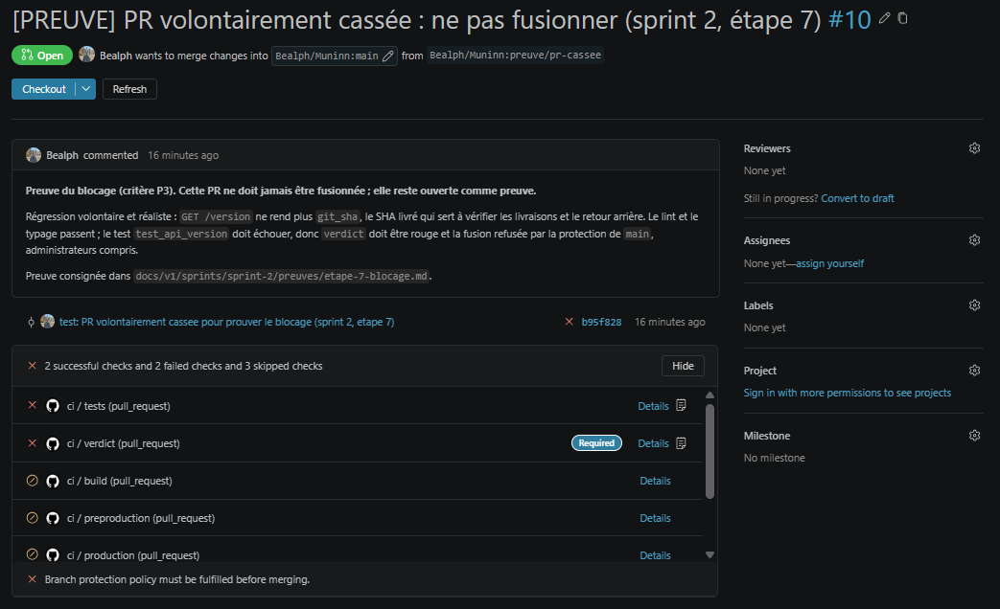
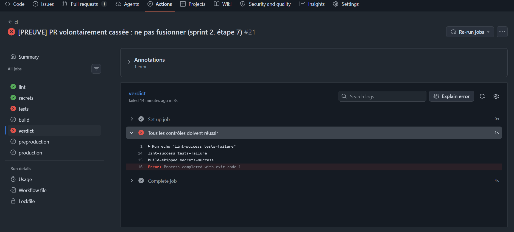
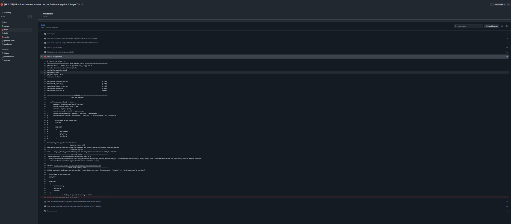

# Preuve du blocage d'un commit cassé (sprint 2, étape 7, critère P3)

**Date :** 14 octobre 2026
**Résultat :** la PR cassée est arrêtée par `verdict` ; GitHub refuse la fusion, y compris avec
les droits d'administrateur. `main` n'a pas changé.

## Protocole, fixé avant l'essai

1. Introduire une régression réaliste qui passe le lint et le typage : `GET /version` ne rend
   plus `git_sha`, le SHA livré qui sert à contrôler les livraisons et le retour arrière.
2. Vérifier en local qu'un seul test échoue et que ruff et mypy passent.
3. Ouvrir une PR vers `main` et laisser la CI s'exécuter.
4. Tenter la fusion, d'abord normalement, puis avec les droits d'administrateur.
5. Constater que `main` n'a pas bougé. La PR reste ouverte comme preuve.

## Éléments

| Élément               | Valeur                                                                   |
| --------------------- | ------------------------------------------------------------------------ |
| PR                    | n° 10, <https://github.com/Bealph/Muninn/pull/10>, laissée ouverte       |
| Branche               | `preuve/pr-cassee`                                                       |
| Exécution de la CI    | 38538872846, <https://github.com/Bealph/Muninn/actions/runs/38538872846> |
| Protection de `main`  | `verdict` requis, administrateurs inclus, ni force-push ni suppression   |
| `main` avant et après | `8cee14d`, inchangé                                                      |

## Résultat des jobs

| Job             | Résultat | Commentaire                                        |
| --------------- | -------- | -------------------------------------------------- |
| `lint`          | réussi   | La régression passe ruff, le format et mypy strict |
| `secrets`       | réussi   | Aucun secret                                       |
| `tests`         | échoué   | `test_api_version` détecte la disparition du SHA   |
| `build`         | ignoré   | Dépend de `tests`                                  |
| `verdict`       | échoué   | Seul contrôle requis par la protection de `main`   |
| `preproduction` | ignoré   | Ne tourne que sur `main`, après un `verdict` vert  |
| `production`    | ignoré   | Idem                                               |

## Extrait du journal de la CI

```text
tests | >       assert set(donnees) == {"version", "git_sha", "environment"}
tests | E       AssertionError: assert {'environment', 'version'} == {'environment...a', 'version'}
tests | tests/test_socle.py:21: AssertionError
tests | FAILED tests/test_socle.py::test_api_version - AssertionError: ...
tests | =================== 1 failed, 21 passed, 1 warning in 2.83s ====================
tests | ##[error]Process completed with exit code 1.
verdict | lint=success tests=failure
verdict | build=skipped secrets=success
```

## Tentatives de fusion

```text
$ gh pr merge 10 --squash
X Pull request Bealph/Muninn#10 is not mergeable: the base branch policy prohibits the merge.

$ gh pr merge 10 --squash --admin
GraphQL: Required status check "verdict" is failing. (mergePullRequest)

$ gh pr view 10 --json state,mergeStateStatus
OPEN BLOCKED
```

## Captures

Captures d'écran prises par le porteur le 14 octobre 2026.

- Page de la PR n° 10 : `verdict` rouge marqué « Required », fusion bloquée (« Branch protection
  policy must be fulfilled before merging »).

  

- Job `verdict` de l'exécution : `lint=success tests=failure`, sortie en erreur.

  

- Journal du job `tests` : `test_api_version` en échec, 1 échec sur 22 tests.

  

## Pour la démonstration en direct

Ouvrir la PR n° 10 : le contrôle `verdict` est rouge et le bouton de fusion est désactivé. Pour
rejouer l'essai devant l'évaluateur, pousser un nouveau commit cassé sur une branche et ouvrir une
PR : environ 1 min 30 jusqu'au `verdict` rouge.
